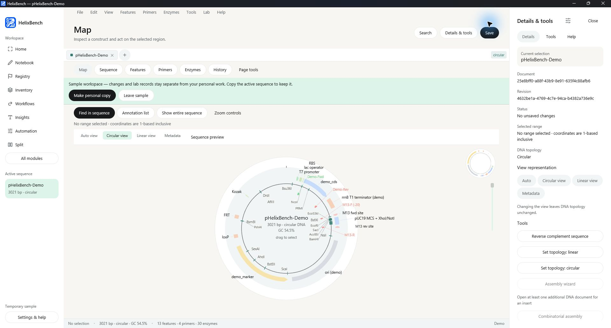

<p align="center">
  
</p>

<h1 align="center">HelixBench</h1>

<p align="center">
  A local-first DNA &amp; plasmid workbench for Windows, written in pure Rust.<br />
  Restriction mapping, features, primers, ORFs, 6-frame translation, cloning &amp; analysis tools —
  native, offline, no account.
</p>

<p align="center">
  <a href="https://github.com/ShaikMoosa/helixbench/releases/latest"></a>
  
  
  
</p>

---

HelixBench is a desktop sequence editor in the spirit of classic plasmid tools: open a sequence,
see it annotated on a circular map and as a double-stranded sequence view, cut it with restriction
enzymes, design primers, translate open reading frames, and search DNA or protein — all without
leaving your machine. On top of the editor it ships a full molecular-biology toolset (PCR, cloning,
CRISPR, codon optimization, alignment, BLAST) and a local lab workspace (notebook, registry,
inventory, workflows, insights dashboards and automation pipelines). Documents are plain files on
disk; saves are atomic and versioned. There is no cloud, no telemetry, and no sign-in.

## Preview



*The light editor: circular plasmid map with pastel features and enzyme cut-site labels (left),
annotated double-stranded sequence panel (right), and feature description / properties / legend
cards below. A labeled navigation sidebar switches workspace and sequence views; Plasmid / Linear /
Metadata tabs, document tabs and a zoom slider + minimap sit above the map.*

The shell is built on **GPUI** (Zed's UI framework) over a framework-agnostic core:

| Shell | Crate | Role |
| --- | --- | --- |
| **GPUI** (Zed's UI framework) | `apps/desktop_gpui` | Single native shell — light laboratory editor |

All logic lives in `appcore` over `domain` + `storage`, so the UI is a thin rendering layer and the
science is testable headlessly. (The earlier egui fallback was removed in v0.8; GPUI is the single shell.)

## Install

Download the latest installer or portable build from
[**Releases**](https://github.com/ShaikMoosa/helixbench/releases/latest):

- `HelixBench-Setup-<version>.exe` — per-user Windows installer (Start Menu + optional desktop
  shortcut, Add/Remove Programs entry + uninstaller). No admin required.
- `helixbench_gpui.exe` — portable standalone build; run directly, no install.

Or build from source (below).

## Features

### Editor
- **Circular map** — features, enzyme cut sites, primers and ORFs on a plasmid map with ruler,
  zoom window, minimap and topology (linear / circular).
- **Sequence view** — annotated double-stranded rows with complement strand, per-base colors,
  selection, zoom + minimap, and inline translations.
- **Restriction analysis** — curated enzyme database, enzyme sets, cut-site filters (cutters,
  methylation-sensitive, unique / double / non-cutters), per-enzyme cut positions, and
  **find by cuts/region** (anywhere / in selection / custom range, combinable with cut-count).
- **Features** — create / edit / delete annotations, translated CDS products, segments, and
  one-click **Detect Common Features** (promoters, terminators, origins, markers, …).
- **Primers** — list primers with length, GC%, melting temperature (Tm), direction, phosphorylation.
- **Translation & ORFs** — 6-frame translation, ORF detection with a minimum-length threshold, and
  **7 genetic codes** (Standard, Vertebrate / Yeast / Mold / Invertebrate Mitochondrial,
  Ciliate, Bacterial / Plastid).
- **Search** — DNA, protein or feature-name search with IUPAC ambiguity codes, match navigation and
  on-sequence highlighting.
- **Sequence colors** — None, History (edit provenance) or Custom DNA color regions.
- **History & versions** — full undo / redo with an audit list, plus persistent named version
  snapshots you can restore.
- **Multi-document** — open several documents (and PCR/assembly products) as tabs.
- **View tabs** — inspect any construct as **Plasmid**, **Linear** or **Metadata** without changing
  its topology.
- **Split Workspace** — compare the active document against another open document side-by-side.
- **Saved alignments** — name and save alignment runs; reload or delete them later.

### Molecular tools (Tools menu)
- **In-silico PCR** — amplify between a primer pair; preview amplicon (bp, coords, Tm); create the
  product as a new document with optional feature copy.
- **Primer design** — parameter-driven forward/reverse candidates scored by Tm, GC% and 3′ GC-clamp,
  with optional 5′ overhangs and **hairpin / self-dimer secondary-structure badges**; add the chosen
  pair. The primer editor shows a live secondary-structure preview.
- **Virtual digest & gel** — fragment sizes for the selected enzymes plus an agarose-gel simulation
  (ladder + digest lanes, log-scale migration).
- **Sequence alignment** — progressive multiple alignment (Feng–Doolittle: UPGMA guide tree +
  profile–profile NW) with consensus and identity %, circular auto-reindex, and bulk alignment of
  all open documents; results can be saved to a reloadable **saved-alignments list**.
- **Assembly wizard** — Digest & Ligate, Gibson and Golden Gate; join inserts into a linearized
  vector with junction reporting, **Gibson junction primer design** and **Golden Gate overhang
  validation** (unique / non-palindromic fusion sites).
- **Combinatorial assembly** — generate constructs for every ordering of the open inserts (capped).
- **CRISPR guides** — NGG PAM scan on both strands; **Doench Rule-Set-2 on-target scoring** and
  **CFD off-target scoring** with a per-site off-target list; add guides as features.
- **Codon optimization** — host-aware (E. coli / Human) protein-preserving re-encode with CAI,
  **GC-window smoothing, restriction-site avoidance and codon harmonization**.
- **Local BLAST** — seed-and-extend similarity search against a **loaded FASTA database** or the
  open documents.
- **Protein analysis** — BLOSUM62 protein alignment plus MW, pI, GRAVY/hydropathy, charge at pH 7,
  extinction coefficient and amino-acid composition.
- **Feature library** — reusable motif library with **bulk auto-annotation** across all open
  documents (both strands).
- **Workspace / bulk** — multi-document selection with bulk tag / FASTA export / close; per-document
  tags for organization.

### Local registry
- Offline catalog of **plasmids, strains and primers** (strain fields follow the the reference platform strain
  template: organism, host/parent strain, resistance, plasmids, medium, genotype, status, …).
- Add / edit / delete entries, **link** an entry to the active document and **open** the linked doc.
- Persisted to a versioned, atomic `registry.json` in the config dir. No multi-user / sync.

### Workspace & lab records
- **Home** — resume-work hub: workspace stats, My Work (open documents), recent files, open-task
  worklist and recent notebook entries, with one-click resume.
- **Notebook** — experimental entries with sections, structured result tables, templates, and a
  draft → submitted → approved review flow.
- **Inventory** — physical storage tree (locations / boxes / plates / containers), plate well grid
  with fill-wells and immutable plate snapshots into entries.
- **Workflows** — assigned tasks, request intake (draft → sent), and a local flowchart executor with
  data passing between steps.
- **Insights** — local dashboards over registry / inventory / tasks / entries with group-by bar
  charts and CSV export.
- **Automation** — CSV file-ingestion → transform (filter / count) → writeback pipelines with
  draft → published lifecycle, run history and error states, and an audit trail.

## File formats

| Direction | Formats |
| --- | --- |
| Open / import | `.hbx` (native), GenBank (`.gb` `.gbk` `.genbank` `.gp`), FASTA (`.fa` `.fasta` `.fna` `.faa`), raw sequence text |
| Save | `.hbx` — versioned JSON, written atomically (temp file + rename); includes version snapshots |
| Export | FASTA, GenBank, plain text |
| Registry | `registry.json` — versioned, atomic, in the config dir |
| Workspace | `records.json`, `inventory.json`, `workflows.json`, `analytics.json`, `alignments.json` — versioned, atomic, in the config dir |

## Getting started (build from source)

Requirements: **Windows 10/11 (x64)** and a **Rust stable toolchain (MSVC)** with the Visual Studio
C++ build tools. No Node.js, no webview, no runtime downloads.

```bash
# GPUI shell
cargo run -p desktop_gpui

# optimized release binary
cargo build --release -p desktop_gpui
# -> target/release/helixbench_gpui.exe
```

On first launch HelixBench opens a seeded demo plasmid (`pHelixBench-Demo`, 3021 bp) so every view
is populated and explorable immediately.

### Keyboard shortcuts

| Keys | Action |
| --- | --- |
| `Ctrl+1` … `Ctrl+6` | Switch view (Map, Sequence, Features, Primers, Enzymes, History) |
| `Ctrl+N` / `Ctrl+O` | New / Open |
| `Ctrl+S` / `Ctrl+Shift+S` | Save / Save As |
| `Ctrl+Z` / `Ctrl+Y` | Undo / Redo |
| `Ctrl+F` | Find (DNA / protein / name) |
| `Ctrl+A` / `Ctrl+C` / `Ctrl+X` / `Ctrl+V` | Select all / copy / cut / paste |

Zoom is enabled via **View → Zoom controls**, then driven by the zoom bar (`+`, `−`, Fit,
center-on-selection) and the draggable minimap in the Sequence view.

## Architecture

```
helixbench/
├── crates/
│   ├── domain/      # pure entities & algorithms: sequence, codes, translation, ORFs, enzymes,
│   │                # features, primers, search, pcr, primer_design, digest, align, assembly,
│   │                # crispr, codon, blast, registry. No UI / OS / network deps.
│   ├── storage/     # versioned .hbx persistence, FASTA / GenBank IO, atomic writes, config,
│   │                # registry persistence
│   └── appcore/     # framework-agnostic AppState + typed commands (actions), undo/redo, versions
└── apps/
    └── desktop_gpui/  # GPUI shell: views, dialogs, theme, icons (single shell)
```

Dependency rule: shells depend inward on `appcore` → `domain` / `storage`. The core crates never
import UI, OS, or network code, which keeps the logic testable headlessly and identical across
shells.

## Design

The GPUI shell follows a light, modern laboratory editor: a white canvas and chrome with a
single dark top application bar, ink text, one teal accent for selection, and pastel feature fills
so annotations read softly on light. The editor splits into a circular map (left) and an annotated
double-stranded sequence panel (right), with description / properties / legend cards below. A
labeled navigation sidebar (Workspace + Sequence groups) switches views; monochrome stroke icons,
nested radii (8/6/4) and a 4px grid keep the chrome quiet so the sequence stays the focus.

The matching Figma design system (tokens, components, screens, dialogs) is authored by
`design/figma-plugin/` (a Figma Plugin API script).

## Development

```bash
cargo fmt --all -- --check
cargo test --workspace --all-features
cargo clippy --workspace --all-targets --all-features -- -D warnings
cargo build --workspace --all-targets --all-features
```

The domain, storage and appcore crates are covered by ~150 unit tests (translation, ORFs, enzyme
cutting, search, PCR, primer design + secondary structure, digest, alignment, assembly, CRISPR,
codon/CAI, BLAST, registry, insights/automation, `.hbx`/registry/alignment round-trips, atomic-write
behavior). CI (GitHub Actions, windows-latest) runs fmt / clippy `-D warnings` / tests / build on
every push.

The improvement roadmap derived from the reference training resources lives in
[`docs/PRODUCT_IMPROVEMENTS.md`](docs/PRODUCT_IMPROVEMENTS.md).

## License

MIT — see the workspace `Cargo.toml`.