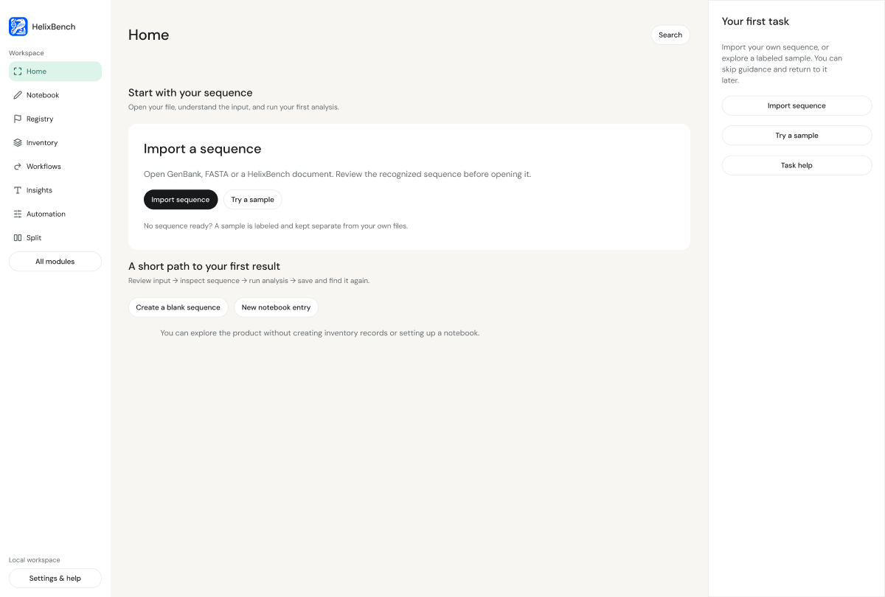
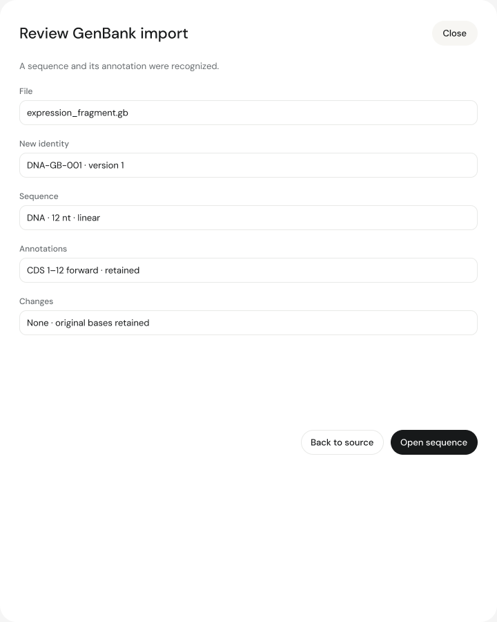
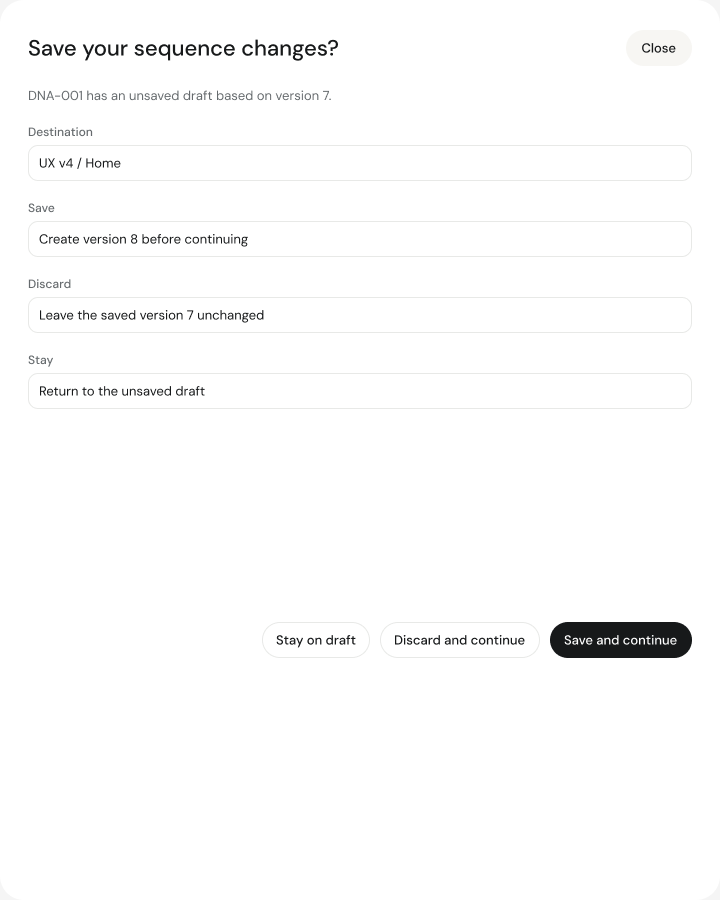
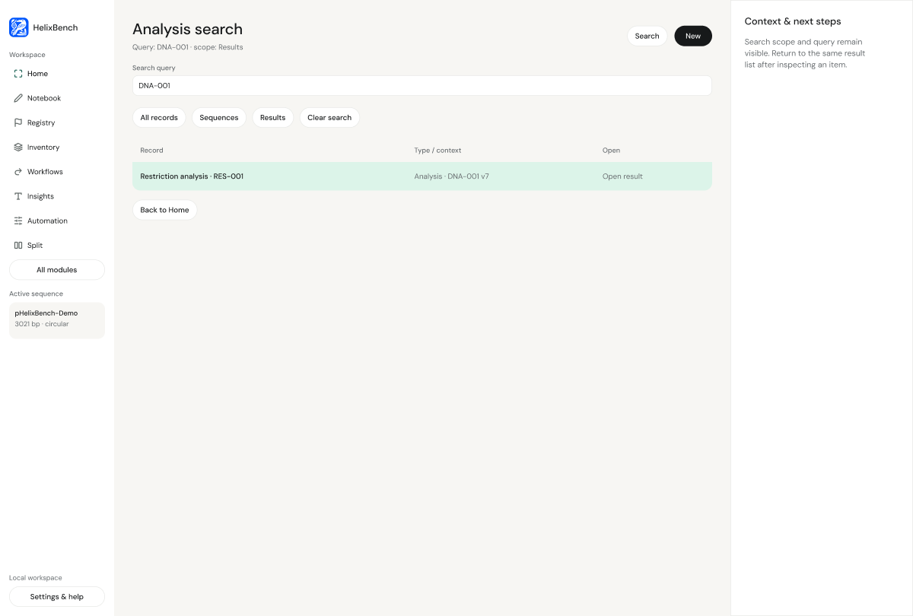
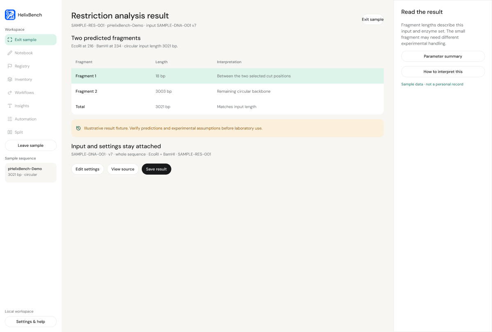
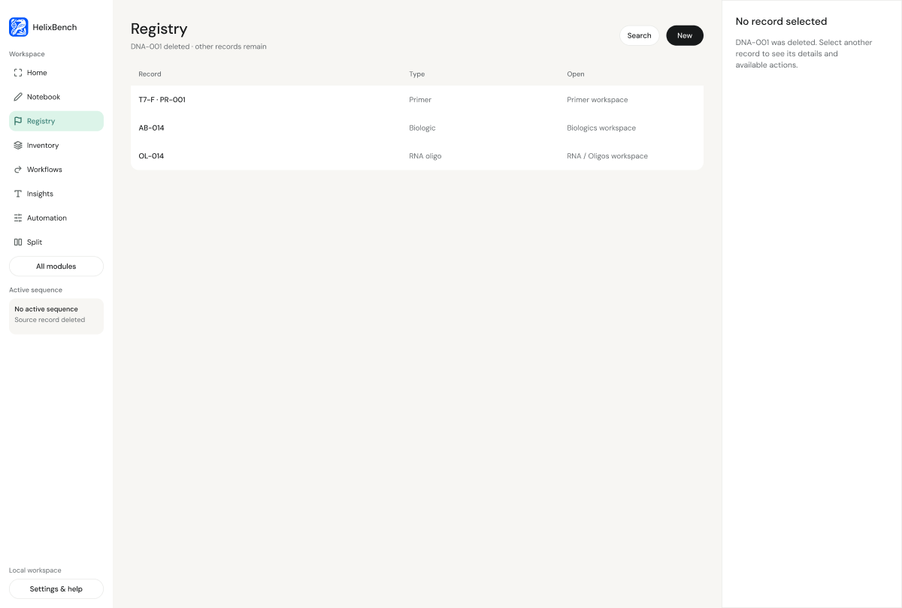
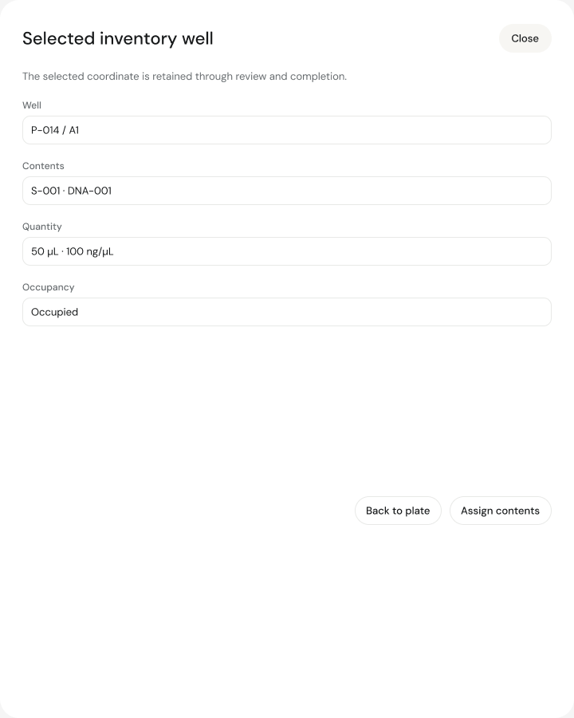
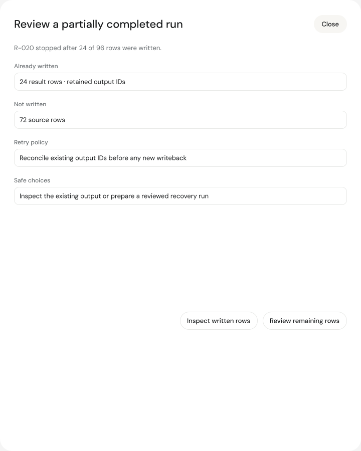

# Shared state visual references

These representative Figma captures illustrate the shared contracts. Use the state machines and screen requirements for implementation behavior; example text and data are not production defaults. The full state catalog retains frame links and authored actions.

## First use

Offer an explicit sample route and an import route. Sample records must never be silently mixed into real work.

## Import review

Review molecule type, records, transformations and validation before committing. Retain original input and actionable row errors.

## Unsaved work guard

Save, discard or stay must act on the exact invoking draft and preserve the intended destination. Failed save keeps the guard open.

## Search and recovery

Show typed results with their source context; retain the query and distinguish no matches from a load failure.

## Analysis result

Show method, actual input revision, parameters, result content and explicit next actions. Saving must be truthful and refindable.

## After deletion

Clear deleted selections, offer a safe next action and preserve dependency history. Undo is shown only when it can actually restore the operation.

## Contextual inspection

Keep the selected well and container identity visible while showing relevant properties and actions in the right panel.

## Partial operation

Distinguish committed outputs from failed or pending work. Retry only failed work without duplicating committed outputs.

