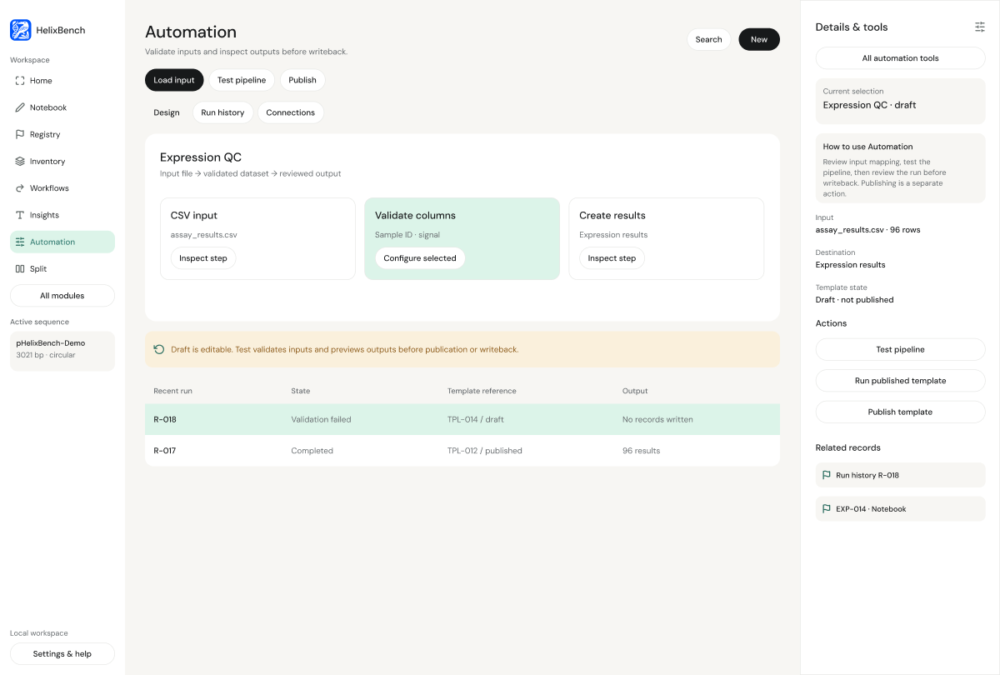

# SCR-13 · Automation

[Current Figma screen](https://www.figma.com/design/U1kWw1K5NZBgEYkuxMz3Qb/helixbench?node-id=107-31876) · Implementation phase P16.

## Purpose and layout

Run an explicit pipeline against an explicit file, with traceable output.

Draft/published pipeline configuration; input review and mapping; run history by ID; running/cancel/recovery states; output and writeback audit.

## Target requirements

- **SCR-13-R1:** Published configurations have an immutable revision reference. Editing a draft does not mutate an in-flight run or an earlier completed run.
- **SCR-13-R2:** CSV ingestion handles quoting, newlines, encoding and row shape. Validate required identifiers and mapping before any writeback.
- **SCR-13-R3:** Running, cancel-requested, canceled, completed, failed and partial-write outcomes are distinct. Do not present a Cancel action when the actual stage cannot safely support it.
- **SCR-13-R4:** Persist run IDs, source fingerprint, parameters, staged outputs and per-row writeback identities. A retry cannot repeat successful output writes.
- **SCR-13-R5:** Recovery of a validation-only failure starts a reviewed new run. Recovery of a partial write first reconciles retained output IDs and the remaining row set.
- **SCR-13-R6:** An output table and linked notebook keep submitted automation rows separate from existing manual draft rows.

## User flow

1. Select pipeline
2. Load CSV and validate columns
3. Review transform and writeback destination
4. Publish if required
5. Run selected pipeline
6. Inspect outcome and records written

Use the shared typed context, validation/review, persistence and return-location contracts at every relevant transition. Prototype fixture IDs and figures are never production defaults.

## States and recovery

- Loading: retain prior context and identify the active request/operation.
- Populated: show stable object identity, meaningful status and available actions.
- No data: offer the relevant creation/import action.
- No matches: retain query/scope and expose Reset or Change settings.
- Invalid prerequisite: explain the missing input and provide its remedy.
- Validation/write failure: retain draft values and show a constructive correction/retry.
- Dirty/partial/stale/unavailable states use the shared state machines when applicable.

## Screen-specific edge cases

- **SCR-13-EC1:** Empty/malformed CSV, duplicate headers, missing row IDs, quoted commas/newlines, UTF-8 BOM and repeated source input.
- **SCR-13-EC2:** Template deleted/unpublished after review; unknown pipeline step; changed destination schema.
- **SCR-13-EC3:** Cancel during parsing, before commit or after some writes; application closes during a run.
- **SCR-13-EC4:** Persistence succeeds for outputs but not run history/audit; restart must reconcile the journal.
- **SCR-13-EC5:** Double-click Start, retry an already completed run or resume an uncertain partial outcome.
- **SCR-13-EC6:** R-017 and R-018 remain distinct run details; no history row opens another run just because it shares a pipeline.

## Current code ownership

- [crates/appcore/src/actions.rs:2899](C:/Users/Admin/Documents/Qoder/2026-11-13/87e5a6b2/helixbench/crates/appcore/src/actions.rs:2899) — `pub fn automation_add_pipeline(app: &mut AppState, name: &str)`
- [crates/appcore/src/actions.rs:2909](C:/Users/Admin/Documents/Qoder/2026-11-13/87e5a6b2/helixbench/crates/appcore/src/actions.rs:2909) — `pub fn automation_publish(app: &mut AppState, id: u64)`
- [crates/appcore/src/actions.rs:2917](C:/Users/Admin/Documents/Qoder/2026-11-13/87e5a6b2/helixbench/crates/appcore/src/actions.rs:2917) — `pub fn automation_load_csv(app: &mut AppState)`
- [crates/appcore/src/actions.rs:2935](C:/Users/Admin/Documents/Qoder/2026-11-13/87e5a6b2/helixbench/crates/appcore/src/actions.rs:2935) — `pub fn automation_run(app: &mut AppState, id: u64, csv: &str)`

Domain modules: `crates/domain/src/automation.rs`, `crates/domain/src/insights.rs`.

Native presentation entry points:

- [apps/desktop_gpui/src/lab.rs:933](C:/Users/Admin/Documents/Qoder/2026-11-13/87e5a6b2/helixbench/apps/desktop_gpui/src/lab.rs:933) — `render_automation`
- [apps/desktop_gpui/src/dialogs.rs:5022](C:/Users/Admin/Documents/Qoder/2026-11-13/87e5a6b2/helixbench/apps/desktop_gpui/src/dialogs.rs:5022) — `audit`

## Field/draft contracts

Use the typed domain/store models in the data reference and the proposed request/operation models. No nonexistent UI draft is assumed.

## Feature-level implementation contracts

### F-150 · Create pipeline

**Status:** Specified; not verified implemented.

**Entry:** New pipeline (1 navigation click(s)).

**Prerequisite:** None.

**Outcome:** Named creation and explicit input/transform/output preview.

**Current evidence note:** Creates a generic Pipeline in source.

**Relevant code/action family:** [crates/appcore/src/actions.rs:2935](C:/Users/Admin/Documents/Qoder/2026-11-13/87e5a6b2/helixbench/crates/appcore/src/actions.rs:2935), [crates/appcore/src/actions.rs:2917](C:/Users/Admin/Documents/Qoder/2026-11-13/87e5a6b2/helixbench/crates/appcore/src/actions.rs:2917).

**Acceptance:**

- F-150-AC1: Given The owning page and the stated prerequisite are available. When The user follows New pipeline. Then Named creation and explicit input/transform/output preview; feature entry requires at most two navigation clicks.
- F-150-AC2: Given The context contains two similar names or a changed table order. When This feature is activated. Then The command payload retains the exact selected typed identity, source revision and scope.
- F-150-AC3: Given A draft contains an invalid or missing required value. When The user submits the form. Then Show a field-local error, retain the draft and perform no mutation.

**Recovery and edge conditions:**

- Invalid required fields are identified beside the input with original draft values retained.
- Cancel does not alter the source object or create an unrelated example record.
- A stale/deleted target is resolved explicitly instead of mutating a row index.
- Successful persistence updates the selected record, related views and audit consistently.
- Template deleted/unpublished after review; unknown pipeline step; changed destination schema.
- Cancel during parsing, before commit or after some writes; application closes during a run.

### F-151 · Select pipeline

**Status:** Specified; not verified implemented.

**Entry:** Pipeline row (1 navigation click(s)).

**Prerequisite:** Existing pipeline.

**Outcome:** Keep selected target visible.

**Current evidence note:** No page selection; run uses last pipeline.

**Relevant code/action family:** [crates/appcore/src/actions.rs:2935](C:/Users/Admin/Documents/Qoder/2026-11-13/87e5a6b2/helixbench/crates/appcore/src/actions.rs:2935), [crates/appcore/src/actions.rs:2917](C:/Users/Admin/Documents/Qoder/2026-11-13/87e5a6b2/helixbench/crates/appcore/src/actions.rs:2917).

**Acceptance:**

- F-151-AC1: Given The owning page and the stated prerequisite are available. When The user follows Pipeline row. Then Keep selected target visible; feature entry requires at most two navigation clicks.
- F-151-AC2: Given The context contains two similar names or a changed table order. When This feature is activated. Then The command payload retains the exact selected typed identity, source revision and scope.
- F-151-AC3: Given The intended target was deleted or became inaccessible after rendering. When The user activates its row or link. Then Show a relevant recovery path without opening an unrelated record; retain a safe return location.

**Recovery and edge conditions:**

- Two same-name records and two stores with the same numeric ID resolve correctly.
- A missing/deleted/inaccessible target offers a relevant remedy rather than another record.
- Back restores the invoking task and selection; dirty work is preserved where necessary.
- Keyboard activation and labeled controls expose the same action as pointer input.
- Cancel during parsing, before commit or after some writes; application closes during a run.
- Persistence succeeds for outputs but not run history/audit; restart must reconcile the journal.

### F-152 · Load CSV

**Status:** Specified; not verified implemented.

**Entry:** Load CSV (1 navigation click(s)).

**Prerequisite:** CSV file.

**Outcome:** Show filename, headers and row count.

**Current evidence note:** Visible native file action.

**Relevant code/action family:** [crates/appcore/src/actions.rs:2899](C:/Users/Admin/Documents/Qoder/2026-11-13/87e5a6b2/helixbench/crates/appcore/src/actions.rs:2899), [crates/appcore/src/actions.rs:2909](C:/Users/Admin/Documents/Qoder/2026-11-13/87e5a6b2/helixbench/crates/appcore/src/actions.rs:2909), [crates/appcore/src/actions.rs:2917](C:/Users/Admin/Documents/Qoder/2026-11-13/87e5a6b2/helixbench/crates/appcore/src/actions.rs:2917), [crates/appcore/src/actions.rs:2935](C:/Users/Admin/Documents/Qoder/2026-11-13/87e5a6b2/helixbench/crates/appcore/src/actions.rs:2935).

**Acceptance:**

- F-152-AC1: Given The owning page and the stated prerequisite are available. When The user follows Load CSV. Then Show filename, headers and row count; feature entry requires at most two navigation clicks.
- F-152-AC2: Given The context contains two similar names or a changed table order. When This feature is activated. Then The command payload retains the exact selected typed identity, source revision and scope.
- F-152-AC3: Given A file or store write is awaiting completion. When The OS dialog is canceled or the atomic write fails. Then Do not report success, change saved/dirty truth or continue a pending destructive intent; preserve original data.

**Recovery and edge conditions:**

- OS-dialog cancellation leaves drafts, source data and pending navigation intact.
- Permission denied, disk full, locked destination and rename failure never show success.
- Reopening/retrying the same operation preserves identity and does not duplicate successful output.
- Export/import preserves scope, encoding, units and declared lossy transformations.
- Persistence succeeds for outputs but not run history/audit; restart must reconcile the journal.
- Double-click Start, retry an already completed run or resume an uncertain partial outcome.

### F-153 · Configure transforms and destination

**Status:** Specified; not verified implemented.

**Entry:** Pipeline row → Configure (2 navigation click(s)).

**Prerequisite:** Existing pipeline.

**Outcome:** Explicit filter/count/writeback settings.

**Current evidence note:** Limited configuration UI not verified.

**Relevant code/action family:** [crates/appcore/src/actions.rs:2899](C:/Users/Admin/Documents/Qoder/2026-11-13/87e5a6b2/helixbench/crates/appcore/src/actions.rs:2899), [crates/appcore/src/actions.rs:2909](C:/Users/Admin/Documents/Qoder/2026-11-13/87e5a6b2/helixbench/crates/appcore/src/actions.rs:2909), [crates/appcore/src/actions.rs:2917](C:/Users/Admin/Documents/Qoder/2026-11-13/87e5a6b2/helixbench/crates/appcore/src/actions.rs:2917), [crates/appcore/src/actions.rs:2935](C:/Users/Admin/Documents/Qoder/2026-11-13/87e5a6b2/helixbench/crates/appcore/src/actions.rs:2935).

**Acceptance:**

- F-153-AC1: Given The owning page and the stated prerequisite are available. When The user follows Pipeline row → Configure. Then Explicit filter/count/writeback settings; feature entry requires at most two navigation clicks.
- F-153-AC2: Given The context contains two similar names or a changed table order. When This feature is activated. Then The command payload retains the exact selected typed identity, source revision and scope.
- F-153-AC3: Given The intended target was deleted or became inaccessible after rendering. When The user activates its row or link. Then Show a relevant recovery path without opening an unrelated record; retain a safe return location.

**Recovery and edge conditions:**

- Two same-name records and two stores with the same numeric ID resolve correctly.
- A missing/deleted/inaccessible target offers a relevant remedy rather than another record.
- Back restores the invoking task and selection; dirty work is preserved where necessary.
- Keyboard activation and labeled controls expose the same action as pointer input.
- Double-click Start, retry an already completed run or resume an uncertain partial outcome.
- R-017 and R-018 remain distinct run details; no history row opens another run just because it shares a pipeline.

### F-154 · Publish draft

**Status:** Specified; not verified implemented.

**Entry:** Pipeline row → Publish (2 navigation click(s)).

**Prerequisite:** Valid draft.

**Outcome:** Confirm publish state and retain selected pipeline.

**Current evidence note:** Existing per-pipeline action.

**Relevant code/action family:** [crates/appcore/src/actions.rs:2909](C:/Users/Admin/Documents/Qoder/2026-11-13/87e5a6b2/helixbench/crates/appcore/src/actions.rs:2909).

**Acceptance:**

- F-154-AC1: Given The owning page and the stated prerequisite are available. When The user follows Pipeline row → Publish. Then Confirm publish state and retain selected pipeline; feature entry requires at most two navigation clicks.
- F-154-AC2: Given The context contains two similar names or a changed table order. When This feature is activated. Then The command payload retains the exact selected typed identity, source revision and scope.
- F-154-AC3: Given A file or store write is awaiting completion. When The OS dialog is canceled or the atomic write fails. Then Do not report success, change saved/dirty truth or continue a pending destructive intent; preserve original data.

**Recovery and edge conditions:**

- OS-dialog cancellation leaves drafts, source data and pending navigation intact.
- Permission denied, disk full, locked destination and rename failure never show success.
- Reopening/retrying the same operation preserves identity and does not duplicate successful output.
- Export/import preserves scope, encoding, units and declared lossy transformations.
- R-017 and R-018 remain distinct run details; no history row opens another run just because it shares a pipeline.
- Empty/malformed CSV, duplicate headers, missing row IDs, quoted commas/newlines, UTF-8 BOM and repeated source input.

### F-155 · Run selected pipeline

**Status:** Specified; not verified implemented.

**Entry:** Pipeline row → Run (2 navigation click(s)).

**Prerequisite:** Loaded CSV and eligible pipeline.

**Outcome:** Run the row's ID; show writeback destination.

**Current evidence note:** Current code runs last pipeline.

**Relevant code/action family:** [crates/appcore/src/actions.rs:2935](C:/Users/Admin/Documents/Qoder/2026-11-13/87e5a6b2/helixbench/crates/appcore/src/actions.rs:2935), [crates/appcore/src/actions.rs:2917](C:/Users/Admin/Documents/Qoder/2026-11-13/87e5a6b2/helixbench/crates/appcore/src/actions.rs:2917).

**Acceptance:**

- F-155-AC1: Given The owning page and the stated prerequisite are available. When The user follows Pipeline row → Run. Then Run the row's ID; show writeback destination; feature entry requires at most two navigation clicks.
- F-155-AC2: Given The context contains two similar names or a changed table order. When This feature is activated. Then The command payload retains the exact selected typed identity, source revision and scope.
- F-155-AC3: Given The intended target was deleted or became inaccessible after rendering. When The user activates its row or link. Then Show a relevant recovery path without opening an unrelated record; retain a safe return location.

**Recovery and edge conditions:**

- Two same-name records and two stores with the same numeric ID resolve correctly.
- A missing/deleted/inaccessible target offers a relevant remedy rather than another record.
- Back restores the invoking task and selection; dirty work is preserved where necessary.
- Keyboard activation and labeled controls expose the same action as pointer input.
- Empty/malformed CSV, duplicate headers, missing row IDs, quoted commas/newlines, UTF-8 BOM and repeated source input.
- Template deleted/unpublished after review; unknown pipeline step; changed destination schema.

### F-156 · Inspect recent run

**Status:** Specified; not verified implemented.

**Entry:** Run row (1 navigation click(s)).

**Prerequisite:** Existing run.

**Outcome:** Inputs, status, output row count and log detail.

**Current evidence note:** Logs currently shown inline, capped.

**Relevant code/action family:** [crates/appcore/src/actions.rs:2899](C:/Users/Admin/Documents/Qoder/2026-11-13/87e5a6b2/helixbench/crates/appcore/src/actions.rs:2899), [crates/appcore/src/actions.rs:2909](C:/Users/Admin/Documents/Qoder/2026-11-13/87e5a6b2/helixbench/crates/appcore/src/actions.rs:2909), [crates/appcore/src/actions.rs:2917](C:/Users/Admin/Documents/Qoder/2026-11-13/87e5a6b2/helixbench/crates/appcore/src/actions.rs:2917), [crates/appcore/src/actions.rs:2935](C:/Users/Admin/Documents/Qoder/2026-11-13/87e5a6b2/helixbench/crates/appcore/src/actions.rs:2935).

**Acceptance:**

- F-156-AC1: Given The owning page and the stated prerequisite are available. When The user follows Run row. Then Inputs, status, output row count and log detail; feature entry requires at most two navigation clicks.
- F-156-AC2: Given The context contains two similar names or a changed table order. When This feature is activated. Then The command payload retains the exact selected typed identity, source revision and scope.
- F-156-AC3: Given The intended target was deleted or became inaccessible after rendering. When The user activates its row or link. Then Show a relevant recovery path without opening an unrelated record; retain a safe return location.

**Recovery and edge conditions:**

- Two same-name records and two stores with the same numeric ID resolve correctly.
- A missing/deleted/inaccessible target offers a relevant remedy rather than another record.
- Back restores the invoking task and selection; dirty work is preserved where necessary.
- Keyboard activation and labeled controls expose the same action as pointer input.
- Template deleted/unpublished after review; unknown pipeline step; changed destination schema.
- Cancel during parsing, before commit or after some writes; application closes during a run.

### F-157 · Inspect error / correct input

**Status:** Specified; not verified implemented.

**Entry:** Failed run → View error (2 navigation click(s)).

**Prerequisite:** Failed run.

**Outcome:** Explain column/format problem and retain inputs.

**Current evidence note:** Short log list; weak recovery affordance.

**Relevant code/action family:** [crates/appcore/src/actions.rs:2899](C:/Users/Admin/Documents/Qoder/2026-11-13/87e5a6b2/helixbench/crates/appcore/src/actions.rs:2899), [crates/appcore/src/actions.rs:2909](C:/Users/Admin/Documents/Qoder/2026-11-13/87e5a6b2/helixbench/crates/appcore/src/actions.rs:2909), [crates/appcore/src/actions.rs:2917](C:/Users/Admin/Documents/Qoder/2026-11-13/87e5a6b2/helixbench/crates/appcore/src/actions.rs:2917), [crates/appcore/src/actions.rs:2935](C:/Users/Admin/Documents/Qoder/2026-11-13/87e5a6b2/helixbench/crates/appcore/src/actions.rs:2935).

**Acceptance:**

- F-157-AC1: Given The owning page and the stated prerequisite are available. When The user follows Failed run → View error. Then Explain column/format problem and retain inputs; feature entry requires at most two navigation clicks.
- F-157-AC2: Given The context contains two similar names or a changed table order. When This feature is activated. Then The command payload retains the exact selected typed identity, source revision and scope.
- F-157-AC3: Given The intended target was deleted or became inaccessible after rendering. When The user activates its row or link. Then Show a relevant recovery path without opening an unrelated record; retain a safe return location.

**Recovery and edge conditions:**

- Two same-name records and two stores with the same numeric ID resolve correctly.
- A missing/deleted/inaccessible target offers a relevant remedy rather than another record.
- Back restores the invoking task and selection; dirty work is preserved where necessary.
- Keyboard activation and labeled controls expose the same action as pointer input.
- Cancel during parsing, before commit or after some writes; application closes during a run.
- Persistence succeeds for outputs but not run history/audit; restart must reconcile the journal.

### F-158 · Audit pipeline operations

**Status:** Specified; not verified implemented.

**Entry:** Audit trail (1 navigation click(s)).

**Prerequisite:** Existing events.

**Outcome:** Inspect creation, publication and writeback events.

**Current evidence note:** Separate app audit dialog.

**Relevant code/action family:** [crates/appcore/src/actions.rs:1797](C:/Users/Admin/Documents/Qoder/2026-11-13/87e5a6b2/helixbench/crates/appcore/src/actions.rs:1797), [crates/appcore/src/actions.rs:1801](C:/Users/Admin/Documents/Qoder/2026-11-13/87e5a6b2/helixbench/crates/appcore/src/actions.rs:1801), [crates/appcore/src/actions.rs:2935](C:/Users/Admin/Documents/Qoder/2026-11-13/87e5a6b2/helixbench/crates/appcore/src/actions.rs:2935), [crates/appcore/src/actions.rs:2917](C:/Users/Admin/Documents/Qoder/2026-11-13/87e5a6b2/helixbench/crates/appcore/src/actions.rs:2917).

**Acceptance:**

- F-158-AC1: Given The owning page and the stated prerequisite are available. When The user follows Audit trail. Then Inspect creation, publication and writeback events; feature entry requires at most two navigation clicks.
- F-158-AC2: Given The context contains two similar names or a changed table order. When This feature is activated. Then The command payload retains the exact selected typed identity, source revision and scope.
- F-158-AC3: Given The intended target was deleted or became inaccessible after rendering. When The user activates its row or link. Then Show a relevant recovery path without opening an unrelated record; retain a safe return location.

**Recovery and edge conditions:**

- Two same-name records and two stores with the same numeric ID resolve correctly.
- A missing/deleted/inaccessible target offers a relevant remedy rather than another record.
- Back restores the invoking task and selection; dirty work is preserved where necessary.
- Keyboard activation and labeled controls expose the same action as pointer input.
- Persistence succeeds for outputs but not run history/audit; restart must reconcile the journal.
- Double-click Start, retry an already completed run or resume an uncertain partial outcome.

### F-159 · Unpublish / edit published pipeline

**Status:** Specified; not verified implemented.

**Entry:** Pipeline row → Lifecycle actions (2 navigation click(s)).

**Prerequisite:** Published pipeline.

**Outcome:** Explicitly design/version lifecycle before exposing action.

**Current evidence note:** Figma depicts Unpublish/Edit; source page only Publish.

**Relevant code/action family:** [crates/appcore/src/actions.rs:2909](C:/Users/Admin/Documents/Qoder/2026-11-13/87e5a6b2/helixbench/crates/appcore/src/actions.rs:2909), [crates/appcore/src/actions.rs:2935](C:/Users/Admin/Documents/Qoder/2026-11-13/87e5a6b2/helixbench/crates/appcore/src/actions.rs:2935), [crates/appcore/src/actions.rs:2917](C:/Users/Admin/Documents/Qoder/2026-11-13/87e5a6b2/helixbench/crates/appcore/src/actions.rs:2917).

**Acceptance:**

- F-159-AC1: Given The owning page and the stated prerequisite are available. When The user follows Pipeline row → Lifecycle actions. Then Explicitly design/version lifecycle before exposing action; feature entry requires at most two navigation clicks.
- F-159-AC2: Given The context contains two similar names or a changed table order. When This feature is activated. Then The command payload retains the exact selected typed identity, source revision and scope.
- F-159-AC3: Given A file or store write is awaiting completion. When The OS dialog is canceled or the atomic write fails. Then Do not report success, change saved/dirty truth or continue a pending destructive intent; preserve original data.

**Recovery and edge conditions:**

- OS-dialog cancellation leaves drafts, source data and pending navigation intact.
- Permission denied, disk full, locked destination and rename failure never show success.
- Reopening/retrying the same operation preserves identity and does not duplicate successful output.
- Export/import preserves scope, encoding, units and declared lossy transformations.
- Double-click Start, retry an already completed run or resume an uncertain partial outcome.
- R-017 and R-018 remain distinct run details; no history row opens another run just because it shares a pipeline.

