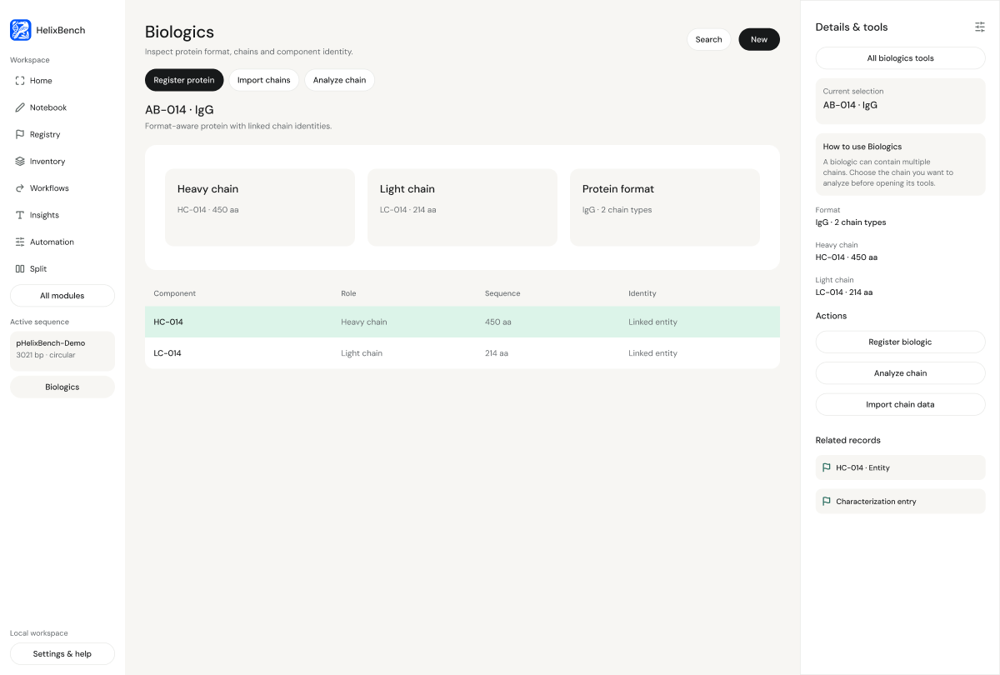

# SCR-15 · Biologics

[Current Figma screen](https://www.figma.com/design/U1kWw1K5NZBgEYkuxMz3Qb/helixbench?node-id=107-32270) · Implementation phase P17.

## Purpose and layout

Register a protein entity and inspect its chains, domains and numbering.

Biologic identity/format with chain selection, components and numbering; explicit protein-input analysis; related record/sample links.

## Target requirements

- **SCR-15-R1:** Fields preserve name, format, numbering and all chains. Chain identity, sequence type and length remain explicit across tools.
- **SCR-15-R2:** Protein analysis consumes the selected protein or an explicitly reviewed translation product. A DNA document cannot silently become HC-014.
- **SCR-15-R3:** Display molecular properties and alignment with method/units/assumptions; save a result linked to the actual protein chain revision.
- **SCR-15-R4:** A numbering/annotation scheme is labeled by the implementation actually present; unsupported regions or formats remain visible as limitations.
- **SCR-15-R5:** Deleting or editing a chain reviews dependent biologic/result links and preserves immutable historical input.

## User flow

1. Register entity and format
2. Validate chains and numbering
3. Select entity
4. Inspect domains/numbered residues
5. Continue to protein analysis

Use the shared typed context, validation/review, persistence and return-location contracts at every relevant transition. Prototype fixture IDs and figures are never production defaults.

## States and recovery

- Loading: retain prior context and identify the active request/operation.
- Populated: show stable object identity, meaningful status and available actions.
- No data: offer the relevant creation/import action.
- No matches: retain query/scope and expose Reset or Change settings.
- Invalid prerequisite: explain the missing input and provide its remedy.
- Validation/write failure: retain draft values and show a constructive correction/retry.
- Dirty/partial/stale/unavailable states use the shared state machines when applicable.

## Screen-specific edge cases

- **SCR-15-EC1:** Missing chain, unsupported amino acid, stop/gap symbols, unusual chain length and duplicate names.
- **SCR-15-EC2:** Selected light chain differs from the default heavy chain; never substitute another chain.
- **SCR-15-EC3:** Biologic format expects a chain that is missing or cannot be classified.
- **SCR-15-EC4:** Protein comparison is blank, invalid or the wrong molecular type.
- **SCR-15-EC5:** Numbering scheme cannot assign a residue; do not invent coverage.
- **SCR-15-EC6:** A chain changes after analysis setup; historical property results retain their captured source.

## Current code ownership

- [crates/appcore/src/actions.rs:2045](C:/Users/Admin/Documents/Qoder/2026-11-13/87e5a6b2/helixbench/crates/appcore/src/actions.rs:2045) — `pub fn open_biologics_register(app: &mut AppState)`
- [crates/appcore/src/actions.rs:2059](C:/Users/Admin/Documents/Qoder/2026-11-13/87e5a6b2/helixbench/crates/appcore/src/actions.rs:2059) — `pub fn biologics_save(app: &mut AppState, draft: &BiologicsDraft) -> Result<u64, String>`
- [crates/appcore/src/actions.rs:2098](C:/Users/Admin/Documents/Qoder/2026-11-13/87e5a6b2/helixbench/crates/appcore/src/actions.rs:2098) — `pub fn biologics_delete(app: &mut AppState, id: u64)`
- [crates/appcore/src/actions.rs:1442](C:/Users/Admin/Documents/Qoder/2026-11-13/87e5a6b2/helixbench/crates/appcore/src/actions.rs:1442) — `pub fn open_protein(app: &mut AppState)`
- [crates/appcore/src/actions.rs:1446](C:/Users/Admin/Documents/Qoder/2026-11-13/87e5a6b2/helixbench/crates/appcore/src/actions.rs:1446) — `pub fn run_protein(app: &mut AppState, draft: &mut ProteinDraft)`

Domain modules: `crates/domain/src/biologics.rs`, `crates/domain/src/protein.rs`.

Native presentation entry points:

- [apps/desktop_gpui/src/lab.rs:1258](C:/Users/Admin/Documents/Qoder/2026-11-13/87e5a6b2/helixbench/apps/desktop_gpui/src/lab.rs:1258) — `render_biologics`
- [apps/desktop_gpui/src/dialogs.rs:5972](C:/Users/Admin/Documents/Qoder/2026-11-13/87e5a6b2/helixbench/apps/desktop_gpui/src/dialogs.rs:5972) — `biologics`
- [apps/desktop_gpui/src/dialogs.rs:4281](C:/Users/Admin/Documents/Qoder/2026-11-13/87e5a6b2/helixbench/apps/desktop_gpui/src/dialogs.rs:4281) — `protein`

## Field/draft contracts

### BiologicsDraft

[crates/appcore/src/state.rs:458](C:/Users/Admin/Documents/Qoder/2026-11-13/87e5a6b2/helixbench/crates/appcore/src/state.rs:458)

- `name: String` — Trim for validation; require a nonempty meaningful label where the owning operation creates an object. Preserve original editable draft on error.
- `format: usize` — Use a labeled finite choice with a visible selected value. Validate enum/mode availability; preserve unknown legacy values for review.
- `numbering: usize` — Use a labeled finite choice with a visible selected value. Validate enum/mode availability; preserve unknown legacy values for review.
- `seqs: Vec<String>` — Use the owning feature/module requirements and the current typed source definition. Optional values remain distinguishable from empty/default values; validate before commit.
- `error: Option<String>` — System-owned validation/error state; never an editable user field.

### ProteinDraft

[crates/appcore/src/state.rs:399](C:/Users/Admin/Documents/Qoder/2026-11-13/87e5a6b2/helixbench/crates/appcore/src/state.rs:399)

- `stats: Option<domain::protein::ProteinStats>` — Computed preview/output state. Clear or mark stale when relevant input changes; never commit an unrelated result.
- `align: Option<(Vec<u8>, Vec<u8>, i32)>` — Computed preview/output state. Clear or mark stale when relevant input changes; never commit an unrelated result.
- `error: Option<String>` — System-owned validation/error state; never an editable user field.

## Feature-level implementation contracts

### F-166 · Register IgG / bispecific / nanobody / TCR / Fab

**Status:** Specified; not verified implemented.

**Entry:** Register biologic (1 navigation click(s)).

**Prerequisite:** Valid chain input.

**Outcome:** Explicit format and numbering selection.

**Current evidence note:** Existing dialog.

**Relevant code/action family:** [crates/appcore/src/actions.rs:2045](C:/Users/Admin/Documents/Qoder/2026-11-13/87e5a6b2/helixbench/crates/appcore/src/actions.rs:2045), [crates/appcore/src/actions.rs:2059](C:/Users/Admin/Documents/Qoder/2026-11-13/87e5a6b2/helixbench/crates/appcore/src/actions.rs:2059), [crates/appcore/src/actions.rs:2098](C:/Users/Admin/Documents/Qoder/2026-11-13/87e5a6b2/helixbench/crates/appcore/src/actions.rs:2098), [crates/appcore/src/actions.rs:1442](C:/Users/Admin/Documents/Qoder/2026-11-13/87e5a6b2/helixbench/crates/appcore/src/actions.rs:1442), [crates/appcore/src/actions.rs:1446](C:/Users/Admin/Documents/Qoder/2026-11-13/87e5a6b2/helixbench/crates/appcore/src/actions.rs:1446).

**Acceptance:**

- F-166-AC1: Given The owning page and the stated prerequisite are available. When The user follows Register biologic. Then Explicit format and numbering selection; feature entry requires at most two navigation clicks.
- F-166-AC2: Given The context contains two similar names or a changed table order. When This feature is activated. Then The command payload retains the exact selected typed identity, source revision and scope.
- F-166-AC3: Given A draft contains an invalid or missing required value. When The user submits the form. Then Show a field-local error, retain the draft and perform no mutation.

**Recovery and edge conditions:**

- Invalid required fields are identified beside the input with original draft values retained.
- Cancel does not alter the source object or create an unrelated example record.
- A stale/deleted target is resolved explicitly instead of mutating a row index.
- Successful persistence updates the selected record, related views and audit consistently.
- Selected light chain differs from the default heavy chain; never substitute another chain.
- Biologic format expects a chain that is missing or cannot be classified.

### F-167 · Inspect entity overview

**Status:** Specified; not verified implemented.

**Entry:** Entity row (1 navigation click(s)).

**Prerequisite:** Existing entity.

**Outcome:** Format, chain count and residues.

**Current evidence note:** Select button.

**Relevant code/action family:** [crates/appcore/src/actions.rs:2045](C:/Users/Admin/Documents/Qoder/2026-11-13/87e5a6b2/helixbench/crates/appcore/src/actions.rs:2045), [crates/appcore/src/actions.rs:2059](C:/Users/Admin/Documents/Qoder/2026-11-13/87e5a6b2/helixbench/crates/appcore/src/actions.rs:2059), [crates/appcore/src/actions.rs:2098](C:/Users/Admin/Documents/Qoder/2026-11-13/87e5a6b2/helixbench/crates/appcore/src/actions.rs:2098), [crates/appcore/src/actions.rs:1442](C:/Users/Admin/Documents/Qoder/2026-11-13/87e5a6b2/helixbench/crates/appcore/src/actions.rs:1442), [crates/appcore/src/actions.rs:1446](C:/Users/Admin/Documents/Qoder/2026-11-13/87e5a6b2/helixbench/crates/appcore/src/actions.rs:1446).

**Acceptance:**

- F-167-AC1: Given The owning page and the stated prerequisite are available. When The user follows Entity row. Then Format, chain count and residues; feature entry requires at most two navigation clicks.
- F-167-AC2: Given The context contains two similar names or a changed table order. When This feature is activated. Then The command payload retains the exact selected typed identity, source revision and scope.
- F-167-AC3: Given Underlying records exist and a query or filter is active. When The query/filter matches no records. Then Show no matches with the active scope and reset remedy; do not claim that the dataset is empty or failed.

**Recovery and edge conditions:**

- Empty source, filtered-out records and failed load have different status/remedies.
- Sorting/filtering or a same-name record cannot change the selected stable identity.
- Returning restores the same query/filter/scope and scroll anchor where supported.
- Inspection-only changes do not mark scientific content dirty.
- Biologic format expects a chain that is missing or cannot be classified.
- Protein comparison is blank, invalid or the wrong molecular type.

### F-168 · View chains and sequence

**Status:** Specified; not verified implemented.

**Entry:** Entity row → Chains tab (2 navigation click(s)).

**Prerequisite:** Existing entity.

**Outcome:** Labeled chain kind and sequence.

**Current evidence note:** Selected details rendered below list.

**Relevant code/action family:** [crates/appcore/src/actions.rs:2045](C:/Users/Admin/Documents/Qoder/2026-11-13/87e5a6b2/helixbench/crates/appcore/src/actions.rs:2045), [crates/appcore/src/actions.rs:2059](C:/Users/Admin/Documents/Qoder/2026-11-13/87e5a6b2/helixbench/crates/appcore/src/actions.rs:2059), [crates/appcore/src/actions.rs:2098](C:/Users/Admin/Documents/Qoder/2026-11-13/87e5a6b2/helixbench/crates/appcore/src/actions.rs:2098), [crates/appcore/src/actions.rs:1442](C:/Users/Admin/Documents/Qoder/2026-11-13/87e5a6b2/helixbench/crates/appcore/src/actions.rs:1442), [crates/appcore/src/actions.rs:1446](C:/Users/Admin/Documents/Qoder/2026-11-13/87e5a6b2/helixbench/crates/appcore/src/actions.rs:1446).

**Acceptance:**

- F-168-AC1: Given The owning page and the stated prerequisite are available. When The user follows Entity row → Chains tab. Then Labeled chain kind and sequence; feature entry requires at most two navigation clicks.
- F-168-AC2: Given The context contains two similar names or a changed table order. When This feature is activated. Then The command payload retains the exact selected typed identity, source revision and scope.
- F-168-AC3: Given Underlying records exist and a query or filter is active. When The query/filter matches no records. Then Show no matches with the active scope and reset remedy; do not claim that the dataset is empty or failed.

**Recovery and edge conditions:**

- Empty source, filtered-out records and failed load have different status/remedies.
- Sorting/filtering or a same-name record cannot change the selected stable identity.
- Returning restores the same query/filter/scope and scroll anchor where supported.
- Inspection-only changes do not mark scientific content dirty.
- Protein comparison is blank, invalid or the wrong molecular type.
- Numbering scheme cannot assign a residue; do not invent coverage.

### F-169 · Inspect domains

**Status:** Specified; not verified implemented.

**Entry:** Entity row → Domains tab (2 navigation click(s)).

**Prerequisite:** Domain annotations available.

**Outcome:** Domain kind, chain and range.

**Current evidence note:** Selected details below list.

**Relevant code/action family:** [crates/appcore/src/actions.rs:2045](C:/Users/Admin/Documents/Qoder/2026-11-13/87e5a6b2/helixbench/crates/appcore/src/actions.rs:2045), [crates/appcore/src/actions.rs:2059](C:/Users/Admin/Documents/Qoder/2026-11-13/87e5a6b2/helixbench/crates/appcore/src/actions.rs:2059), [crates/appcore/src/actions.rs:2098](C:/Users/Admin/Documents/Qoder/2026-11-13/87e5a6b2/helixbench/crates/appcore/src/actions.rs:2098), [crates/appcore/src/actions.rs:1442](C:/Users/Admin/Documents/Qoder/2026-11-13/87e5a6b2/helixbench/crates/appcore/src/actions.rs:1442), [crates/appcore/src/actions.rs:1446](C:/Users/Admin/Documents/Qoder/2026-11-13/87e5a6b2/helixbench/crates/appcore/src/actions.rs:1446).

**Acceptance:**

- F-169-AC1: Given The owning page and the stated prerequisite are available. When The user follows Entity row → Domains tab. Then Domain kind, chain and range; feature entry requires at most two navigation clicks.
- F-169-AC2: Given The context contains two similar names or a changed table order. When This feature is activated. Then The command payload retains the exact selected typed identity, source revision and scope.
- F-169-AC3: Given The intended target was deleted or became inaccessible after rendering. When The user activates its row or link. Then Show a relevant recovery path without opening an unrelated record; retain a safe return location.

**Recovery and edge conditions:**

- Two same-name records and two stores with the same numeric ID resolve correctly.
- A missing/deleted/inaccessible target offers a relevant remedy rather than another record.
- Back restores the invoking task and selection; dirty work is preserved where necessary.
- Keyboard activation and labeled controls expose the same action as pointer input.
- Numbering scheme cannot assign a residue; do not invent coverage.
- A chain changes after analysis setup; historical property results retain their captured source.

### F-170 · Inspect numbering

**Status:** Specified; not verified implemented.

**Entry:** Entity row → Numbering tab (2 navigation click(s)).

**Prerequisite:** Numbered chain exists.

**Outcome:** Scheme and residue labels remain visible.

**Current evidence note:** Selected numbering text.

**Relevant code/action family:** [crates/appcore/src/actions.rs:2045](C:/Users/Admin/Documents/Qoder/2026-11-13/87e5a6b2/helixbench/crates/appcore/src/actions.rs:2045), [crates/appcore/src/actions.rs:2059](C:/Users/Admin/Documents/Qoder/2026-11-13/87e5a6b2/helixbench/crates/appcore/src/actions.rs:2059), [crates/appcore/src/actions.rs:2098](C:/Users/Admin/Documents/Qoder/2026-11-13/87e5a6b2/helixbench/crates/appcore/src/actions.rs:2098), [crates/appcore/src/actions.rs:1442](C:/Users/Admin/Documents/Qoder/2026-11-13/87e5a6b2/helixbench/crates/appcore/src/actions.rs:1442), [crates/appcore/src/actions.rs:1446](C:/Users/Admin/Documents/Qoder/2026-11-13/87e5a6b2/helixbench/crates/appcore/src/actions.rs:1446).

**Acceptance:**

- F-170-AC1: Given The owning page and the stated prerequisite are available. When The user follows Entity row → Numbering tab. Then Scheme and residue labels remain visible; feature entry requires at most two navigation clicks.
- F-170-AC2: Given The context contains two similar names or a changed table order. When This feature is activated. Then The command payload retains the exact selected typed identity, source revision and scope.
- F-170-AC3: Given The intended target was deleted or became inaccessible after rendering. When The user activates its row or link. Then Show a relevant recovery path without opening an unrelated record; retain a safe return location.

**Recovery and edge conditions:**

- Two same-name records and two stores with the same numeric ID resolve correctly.
- A missing/deleted/inaccessible target offers a relevant remedy rather than another record.
- Back restores the invoking task and selection; dirty work is preserved where necessary.
- Keyboard activation and labeled controls expose the same action as pointer input.
- A chain changes after analysis setup; historical property results retain their captured source.
- Missing chain, unsupported amino acid, stop/gap symbols, unusual chain length and duplicate names.

### F-171 · Delete biologic

**Status:** Specified; not verified implemented.

**Entry:** Entity row → Delete (2 navigation click(s)).

**Prerequisite:** Existing entity.

**Outcome:** Confirmation and dependency context.

**Current evidence note:** Existing direct delete.

**Relevant code/action family:** [crates/appcore/src/actions.rs:2045](C:/Users/Admin/Documents/Qoder/2026-11-13/87e5a6b2/helixbench/crates/appcore/src/actions.rs:2045), [crates/appcore/src/actions.rs:2059](C:/Users/Admin/Documents/Qoder/2026-11-13/87e5a6b2/helixbench/crates/appcore/src/actions.rs:2059), [crates/appcore/src/actions.rs:2098](C:/Users/Admin/Documents/Qoder/2026-11-13/87e5a6b2/helixbench/crates/appcore/src/actions.rs:2098), [crates/appcore/src/actions.rs:1442](C:/Users/Admin/Documents/Qoder/2026-11-13/87e5a6b2/helixbench/crates/appcore/src/actions.rs:1442), [crates/appcore/src/actions.rs:1446](C:/Users/Admin/Documents/Qoder/2026-11-13/87e5a6b2/helixbench/crates/appcore/src/actions.rs:1446).

**Acceptance:**

- F-171-AC1: Given The owning page and the stated prerequisite are available. When The user follows Entity row → Delete. Then Confirmation and dependency context; feature entry requires at most two navigation clicks.
- F-171-AC2: Given The context contains two similar names or a changed table order. When This feature is activated. Then The command payload retains the exact selected typed identity, source revision and scope.
- F-171-AC3: Given A consequence review identifies the selected record. When The user cancels or the commit fails. Then Keep the reviewed object unchanged, preserve useful draft context and show a recoverable outcome.

**Recovery and edge conditions:**

- Cancel before commit leaves the reviewed object and selection unchanged.
- Changing the selected object while the review is open cannot retarget the action.
- Blocked dependencies and persistence failure leave a constructive recovery path; no false success.
- Successful mutation clears or updates the exact selected context and retained references.
- Missing chain, unsupported amino acid, stop/gap symbols, unusual chain length and duplicate names.
- Selected light chain differs from the default heavy chain; never substitute another chain.

### F-172 · Analyze selected chain

**Status:** Specified; not verified implemented.

**Entry:** Chain row → Analyze protein (2 navigation click(s)).

**Prerequisite:** Chain selected.

**Outcome:** Prefill protein analysis with exact chain.

**Current evidence note:** Protein analysis is separate Tools dialog.

**Relevant code/action family:** [crates/appcore/src/actions.rs:2045](C:/Users/Admin/Documents/Qoder/2026-11-13/87e5a6b2/helixbench/crates/appcore/src/actions.rs:2045), [crates/appcore/src/actions.rs:2059](C:/Users/Admin/Documents/Qoder/2026-11-13/87e5a6b2/helixbench/crates/appcore/src/actions.rs:2059), [crates/appcore/src/actions.rs:2098](C:/Users/Admin/Documents/Qoder/2026-11-13/87e5a6b2/helixbench/crates/appcore/src/actions.rs:2098), [crates/appcore/src/actions.rs:1442](C:/Users/Admin/Documents/Qoder/2026-11-13/87e5a6b2/helixbench/crates/appcore/src/actions.rs:1442), [crates/appcore/src/actions.rs:1446](C:/Users/Admin/Documents/Qoder/2026-11-13/87e5a6b2/helixbench/crates/appcore/src/actions.rs:1446).

**Acceptance:**

- F-172-AC1: Given The owning page and the stated prerequisite are available. When The user follows Chain row → Analyze protein. Then Prefill protein analysis with exact chain; feature entry requires at most two navigation clicks.
- F-172-AC2: Given The context contains two similar names or a changed table order. When This feature is activated. Then The command payload retains the exact selected typed identity, source revision and scope.
- F-172-AC3: Given The intended target was deleted or became inaccessible after rendering. When The user activates its row or link. Then Show a relevant recovery path without opening an unrelated record; retain a safe return location.

**Recovery and edge conditions:**

- Two same-name records and two stores with the same numeric ID resolve correctly.
- A missing/deleted/inaccessible target offers a relevant remedy rather than another record.
- Back restores the invoking task and selection; dirty work is preserved where necessary.
- Keyboard activation and labeled controls expose the same action as pointer input.
- Selected light chain differs from the default heavy chain; never substitute another chain.
- Biologic format expects a chain that is missing or cannot be classified.

