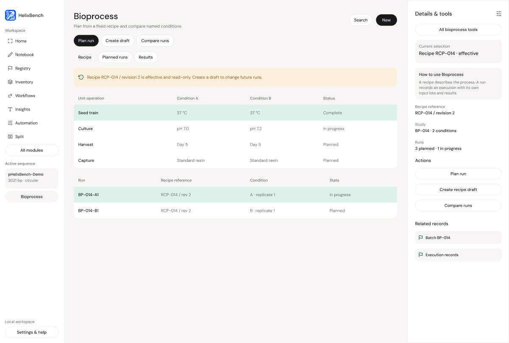

# SCR-19 · Bioprocess

[Current Figma screen](https://www.figma.com/design/U1kWw1K5NZBgEYkuxMz3Qb/helixbench?node-id=107-33033) · Implementation phase P18.

## Purpose and layout

Plan the correct recipe run, follow operations and compare replicates.

Recipe/unit-operation definition; draft/executing/completed/aborted runs; operator steps; replicate conditions/titer and cross-run comparison.

## Target requirements

- **SCR-19-R1:** Recipe identity and an execution run are different objects. Capture the recipe revision and input lots when a run starts.
- **SCR-19-R2:** Start, complete, abort and step-completion actions obey the domain state machine; a completed/aborted run cannot silently restart.
- **SCR-19-R3:** Durations, conditions, titer and quantities have visible units and finite values. Preserve the selected run/replicate during editing.
- **SCR-19-R4:** Comparison identifies every run, recipe, replicate and condition rather than displaying unlabeled aggregate values.
- **SCR-19-R5:** Deleting a run or recipe reviews dependent records; physical lot consumption and result recording use recoverable operation boundaries when implemented.

## User flow

1. Choose recipe
2. Plan a named run
3. Start run
4. Complete operations and enter replicates
5. Review results
6. Complete or abort with a clear audit trail

Use the shared typed context, validation/review, persistence and return-location contracts at every relevant transition. Prototype fixture IDs and figures are never production defaults.

## States and recovery

- Loading: retain prior context and identify the active request/operation.
- Populated: show stable object identity, meaningful status and available actions.
- No data: offer the relevant creation/import action.
- No matches: retain query/scope and expose Reset or Change settings.
- Invalid prerequisite: explain the missing input and provide its remedy.
- Validation/write failure: retain draft values and show a constructive correction/retry.
- Dirty/partial/stale/unavailable states use the shared state machines when applicable.

## Screen-specific edge cases

- **SCR-19-EC1:** No recipe selected, no unit operations, empty name/product and a recipe changed after run planning.
- **SCR-19-EC2:** Start twice, complete with incomplete required steps, abort at a boundary or toggle a step in a locked run.
- **SCR-19-EC3:** Negative/nonfinite duration or titer and mixed condition units.
- **SCR-19-EC4:** Duplicate replicate labels and comparison of incompatible process/measurement units.
- **SCR-19-EC5:** Run deletion while a computation or comparison is open.
- **SCR-19-EC6:** Restart after a partially persisted operation retains run identity and does not silently consume lots twice.

## Current code ownership

- [crates/appcore/src/actions.rs:2464](C:/Users/Admin/Documents/Qoder/2026-11-13/87e5a6b2/helixbench/crates/appcore/src/actions.rs:2464) — `pub fn open_bp_recipe(app: &mut AppState)`
- [crates/appcore/src/actions.rs:2468](C:/Users/Admin/Documents/Qoder/2026-11-13/87e5a6b2/helixbench/crates/appcore/src/actions.rs:2468) — `pub fn bp_recipe_save(app: &mut AppState, draft: &BpRecipeDraft) -> Result<u64, String>`
- [crates/appcore/src/actions.rs:2481](C:/Users/Admin/Documents/Qoder/2026-11-13/87e5a6b2/helixbench/crates/appcore/src/actions.rs:2481) — `pub fn bp_run_create(app: &mut AppState, recipe: u64, name: &str) -> Result<u64, String>`
- [crates/appcore/src/actions.rs:2499](C:/Users/Admin/Documents/Qoder/2026-11-13/87e5a6b2/helixbench/crates/appcore/src/actions.rs:2499) — `pub fn bp_run_action(app: &mut AppState, id: u64, action: &str)`
- [crates/appcore/src/actions.rs:2517](C:/Users/Admin/Documents/Qoder/2026-11-13/87e5a6b2/helixbench/crates/appcore/src/actions.rs:2517) — `pub fn bp_step_toggle(app: &mut AppState, run: u64, step: usize)`
- [crates/appcore/src/actions.rs:2527](C:/Users/Admin/Documents/Qoder/2026-11-13/87e5a6b2/helixbench/crates/appcore/src/actions.rs:2527) — `pub fn open_bp_replicate(app: &mut AppState)`
- [crates/appcore/src/actions.rs:2535](C:/Users/Admin/Documents/Qoder/2026-11-13/87e5a6b2/helixbench/crates/appcore/src/actions.rs:2535) — `pub fn bp_replicate_save(app: &mut AppState, draft: &BpReplicateDraft) -> Result<u64, String>`
- [crates/appcore/src/actions.rs:2572](C:/Users/Admin/Documents/Qoder/2026-11-13/87e5a6b2/helixbench/crates/appcore/src/actions.rs:2572) — `pub fn bp_delete_run(app: &mut AppState, id: u64)`

Domain modules: `crates/domain/src/bioprocess.rs`.

Native presentation entry points:

- [apps/desktop_gpui/src/lab.rs:2163](C:/Users/Admin/Documents/Qoder/2026-11-13/87e5a6b2/helixbench/apps/desktop_gpui/src/lab.rs:2163) — `render_bioprocess`
- [apps/desktop_gpui/src/dialogs.rs:6714](C:/Users/Admin/Documents/Qoder/2026-11-13/87e5a6b2/helixbench/apps/desktop_gpui/src/dialogs.rs:6714) — `bp_recipe`
- [apps/desktop_gpui/src/dialogs.rs:6776](C:/Users/Admin/Documents/Qoder/2026-11-13/87e5a6b2/helixbench/apps/desktop_gpui/src/dialogs.rs:6776) — `bp_replicate`

## Field/draft contracts

### BpRecipeDraft

[crates/appcore/src/state.rs:536](C:/Users/Admin/Documents/Qoder/2026-11-13/87e5a6b2/helixbench/crates/appcore/src/state.rs:536)

- `name: String` — Trim for validation; require a nonempty meaningful label where the owning operation creates an object. Preserve original editable draft on error.
- `product: String` — Use the owning feature/module requirements and the current typed source definition. Optional values remain distinguishable from empty/default values; validate before commit.
- `error: Option<String>` — System-owned validation/error state; never an editable user field.

### BpReplicateDraft

[crates/appcore/src/state.rs:544](C:/Users/Admin/Documents/Qoder/2026-11-13/87e5a6b2/helixbench/crates/appcore/src/state.rs:544)

- `label: String` — Use the owning feature/module requirements and the current typed source definition. Optional values remain distinguishable from empty/default values; validate before commit.
- `titer: String` — Parse finite numeric input, display units/range where relevant and apply domain-specific bounds. Do not silently substitute a default after invalid input.
- `temp: String` — Parse finite numeric input, display units/range where relevant and apply domain-specific bounds. Do not silently substitute a default after invalid input.
- `ph: String` — Use the owning feature/module requirements and the current typed source definition. Optional values remain distinguishable from empty/default values; validate before commit.
- `error: Option<String>` — System-owned validation/error state; never an editable user field.

## Feature-level implementation contracts

### F-201 · Create recipe

**Status:** Specified; not verified implemented.

**Entry:** New recipe (1 navigation click(s)).

**Prerequisite:** Recipe/product input.

**Outcome:** Explicit recipe and operation template.

**Current evidence note:** Existing recipe dialog.

**Relevant code/action family:** [crates/appcore/src/actions.rs:2464](C:/Users/Admin/Documents/Qoder/2026-11-13/87e5a6b2/helixbench/crates/appcore/src/actions.rs:2464), [crates/appcore/src/actions.rs:2468](C:/Users/Admin/Documents/Qoder/2026-11-13/87e5a6b2/helixbench/crates/appcore/src/actions.rs:2468), [crates/appcore/src/actions.rs:2481](C:/Users/Admin/Documents/Qoder/2026-11-13/87e5a6b2/helixbench/crates/appcore/src/actions.rs:2481), [crates/appcore/src/actions.rs:2499](C:/Users/Admin/Documents/Qoder/2026-11-13/87e5a6b2/helixbench/crates/appcore/src/actions.rs:2499), [crates/appcore/src/actions.rs:2517](C:/Users/Admin/Documents/Qoder/2026-11-13/87e5a6b2/helixbench/crates/appcore/src/actions.rs:2517), [crates/appcore/src/actions.rs:2527](C:/Users/Admin/Documents/Qoder/2026-11-13/87e5a6b2/helixbench/crates/appcore/src/actions.rs:2527), [crates/appcore/src/actions.rs:2535](C:/Users/Admin/Documents/Qoder/2026-11-13/87e5a6b2/helixbench/crates/appcore/src/actions.rs:2535), [crates/appcore/src/actions.rs:2572](C:/Users/Admin/Documents/Qoder/2026-11-13/87e5a6b2/helixbench/crates/appcore/src/actions.rs:2572).

**Acceptance:**

- F-201-AC1: Given The owning page and the stated prerequisite are available. When The user follows New recipe. Then Explicit recipe and operation template; feature entry requires at most two navigation clicks.
- F-201-AC2: Given The context contains two similar names or a changed table order. When This feature is activated. Then The command payload retains the exact selected typed identity, source revision and scope.
- F-201-AC3: Given A draft contains an invalid or missing required value. When The user submits the form. Then Show a field-local error, retain the draft and perform no mutation.

**Recovery and edge conditions:**

- Invalid required fields are identified beside the input with original draft values retained.
- Cancel does not alter the source object or create an unrelated example record.
- A stale/deleted target is resolved explicitly instead of mutating a row index.
- Successful persistence updates the selected record, related views and audit consistently.
- Start twice, complete with incomplete required steps, abort at a boundary or toggle a step in a locked run.
- Negative/nonfinite duration or titer and mixed condition units.

### F-202 · Inspect recipe operations/duration

**Status:** Specified; not verified implemented.

**Entry:** Recipe row (1 navigation click(s)).

**Prerequisite:** Existing recipe.

**Outcome:** Operations and expected duration.

**Current evidence note:** Recipe summary only on page.

**Relevant code/action family:** [crates/appcore/src/actions.rs:2464](C:/Users/Admin/Documents/Qoder/2026-11-13/87e5a6b2/helixbench/crates/appcore/src/actions.rs:2464), [crates/appcore/src/actions.rs:2468](C:/Users/Admin/Documents/Qoder/2026-11-13/87e5a6b2/helixbench/crates/appcore/src/actions.rs:2468), [crates/appcore/src/actions.rs:2481](C:/Users/Admin/Documents/Qoder/2026-11-13/87e5a6b2/helixbench/crates/appcore/src/actions.rs:2481), [crates/appcore/src/actions.rs:2499](C:/Users/Admin/Documents/Qoder/2026-11-13/87e5a6b2/helixbench/crates/appcore/src/actions.rs:2499), [crates/appcore/src/actions.rs:2517](C:/Users/Admin/Documents/Qoder/2026-11-13/87e5a6b2/helixbench/crates/appcore/src/actions.rs:2517), [crates/appcore/src/actions.rs:2527](C:/Users/Admin/Documents/Qoder/2026-11-13/87e5a6b2/helixbench/crates/appcore/src/actions.rs:2527), [crates/appcore/src/actions.rs:2535](C:/Users/Admin/Documents/Qoder/2026-11-13/87e5a6b2/helixbench/crates/appcore/src/actions.rs:2535), [crates/appcore/src/actions.rs:2572](C:/Users/Admin/Documents/Qoder/2026-11-13/87e5a6b2/helixbench/crates/appcore/src/actions.rs:2572).

**Acceptance:**

- F-202-AC1: Given The owning page and the stated prerequisite are available. When The user follows Recipe row. Then Operations and expected duration; feature entry requires at most two navigation clicks.
- F-202-AC2: Given The context contains two similar names or a changed table order. When This feature is activated. Then The command payload retains the exact selected typed identity, source revision and scope.
- F-202-AC3: Given The intended target was deleted or became inaccessible after rendering. When The user activates its row or link. Then Show a relevant recovery path without opening an unrelated record; retain a safe return location.

**Recovery and edge conditions:**

- Two same-name records and two stores with the same numeric ID resolve correctly.
- A missing/deleted/inaccessible target offers a relevant remedy rather than another record.
- Back restores the invoking task and selection; dirty work is preserved where necessary.
- Keyboard activation and labeled controls expose the same action as pointer input.
- Negative/nonfinite duration or titer and mixed condition units.
- Duplicate replicate labels and comparison of incompatible process/measurement units.

### F-203 · Plan run from chosen recipe

**Status:** Specified; not verified implemented.

**Entry:** Recipe row → Plan run (2 navigation click(s)).

**Prerequisite:** Existing valid recipe.

**Outcome:** Explicit recipe ID and run name; validate selection.

**Current evidence note:** Current page hardcodes recipe 0.

**Relevant code/action family:** [crates/appcore/src/actions.rs:2464](C:/Users/Admin/Documents/Qoder/2026-11-13/87e5a6b2/helixbench/crates/appcore/src/actions.rs:2464), [crates/appcore/src/actions.rs:2468](C:/Users/Admin/Documents/Qoder/2026-11-13/87e5a6b2/helixbench/crates/appcore/src/actions.rs:2468), [crates/appcore/src/actions.rs:2481](C:/Users/Admin/Documents/Qoder/2026-11-13/87e5a6b2/helixbench/crates/appcore/src/actions.rs:2481), [crates/appcore/src/actions.rs:2499](C:/Users/Admin/Documents/Qoder/2026-11-13/87e5a6b2/helixbench/crates/appcore/src/actions.rs:2499), [crates/appcore/src/actions.rs:2517](C:/Users/Admin/Documents/Qoder/2026-11-13/87e5a6b2/helixbench/crates/appcore/src/actions.rs:2517), [crates/appcore/src/actions.rs:2527](C:/Users/Admin/Documents/Qoder/2026-11-13/87e5a6b2/helixbench/crates/appcore/src/actions.rs:2527), [crates/appcore/src/actions.rs:2535](C:/Users/Admin/Documents/Qoder/2026-11-13/87e5a6b2/helixbench/crates/appcore/src/actions.rs:2535), [crates/appcore/src/actions.rs:2572](C:/Users/Admin/Documents/Qoder/2026-11-13/87e5a6b2/helixbench/crates/appcore/src/actions.rs:2572).

**Acceptance:**

- F-203-AC1: Given The owning page and the stated prerequisite are available. When The user follows Recipe row → Plan run. Then Explicit recipe ID and run name; validate selection; feature entry requires at most two navigation clicks.
- F-203-AC2: Given The context contains two similar names or a changed table order. When This feature is activated. Then The command payload retains the exact selected typed identity, source revision and scope.
- F-203-AC3: Given The intended target was deleted or became inaccessible after rendering. When The user activates its row or link. Then Show a relevant recovery path without opening an unrelated record; retain a safe return location.

**Recovery and edge conditions:**

- Two same-name records and two stores with the same numeric ID resolve correctly.
- A missing/deleted/inaccessible target offers a relevant remedy rather than another record.
- Back restores the invoking task and selection; dirty work is preserved where necessary.
- Keyboard activation and labeled controls expose the same action as pointer input.
- Duplicate replicate labels and comparison of incompatible process/measurement units.
- Run deletion while a computation or comparison is open.

### F-204 · Select run

**Status:** Specified; not verified implemented.

**Entry:** Run row (1 navigation click(s)).

**Prerequisite:** Existing run.

**Outcome:** Show run identity and allowed actions.

**Current evidence note:** Select button.

**Relevant code/action family:** [crates/appcore/src/actions.rs:2464](C:/Users/Admin/Documents/Qoder/2026-11-13/87e5a6b2/helixbench/crates/appcore/src/actions.rs:2464), [crates/appcore/src/actions.rs:2468](C:/Users/Admin/Documents/Qoder/2026-11-13/87e5a6b2/helixbench/crates/appcore/src/actions.rs:2468), [crates/appcore/src/actions.rs:2481](C:/Users/Admin/Documents/Qoder/2026-11-13/87e5a6b2/helixbench/crates/appcore/src/actions.rs:2481), [crates/appcore/src/actions.rs:2499](C:/Users/Admin/Documents/Qoder/2026-11-13/87e5a6b2/helixbench/crates/appcore/src/actions.rs:2499), [crates/appcore/src/actions.rs:2517](C:/Users/Admin/Documents/Qoder/2026-11-13/87e5a6b2/helixbench/crates/appcore/src/actions.rs:2517), [crates/appcore/src/actions.rs:2527](C:/Users/Admin/Documents/Qoder/2026-11-13/87e5a6b2/helixbench/crates/appcore/src/actions.rs:2527), [crates/appcore/src/actions.rs:2535](C:/Users/Admin/Documents/Qoder/2026-11-13/87e5a6b2/helixbench/crates/appcore/src/actions.rs:2535), [crates/appcore/src/actions.rs:2572](C:/Users/Admin/Documents/Qoder/2026-11-13/87e5a6b2/helixbench/crates/appcore/src/actions.rs:2572).

**Acceptance:**

- F-204-AC1: Given The owning page and the stated prerequisite are available. When The user follows Run row. Then Show run identity and allowed actions; feature entry requires at most two navigation clicks.
- F-204-AC2: Given The context contains two similar names or a changed table order. When This feature is activated. Then The command payload retains the exact selected typed identity, source revision and scope.
- F-204-AC3: Given The intended target was deleted or became inaccessible after rendering. When The user activates its row or link. Then Show a relevant recovery path without opening an unrelated record; retain a safe return location.

**Recovery and edge conditions:**

- Two same-name records and two stores with the same numeric ID resolve correctly.
- A missing/deleted/inaccessible target offers a relevant remedy rather than another record.
- Back restores the invoking task and selection; dirty work is preserved where necessary.
- Keyboard activation and labeled controls expose the same action as pointer input.
- Run deletion while a computation or comparison is open.
- Restart after a partially persisted operation retains run identity and does not silently consume lots twice.

### F-205 · Start planned run

**Status:** Specified; not verified implemented.

**Entry:** Run row → Start (2 navigation click(s)).

**Prerequisite:** Planned run.

**Outcome:** Status and start event recorded.

**Current evidence note:** Existing state-dependent action.

**Relevant code/action family:** [crates/appcore/src/actions.rs:2464](C:/Users/Admin/Documents/Qoder/2026-11-13/87e5a6b2/helixbench/crates/appcore/src/actions.rs:2464), [crates/appcore/src/actions.rs:2468](C:/Users/Admin/Documents/Qoder/2026-11-13/87e5a6b2/helixbench/crates/appcore/src/actions.rs:2468), [crates/appcore/src/actions.rs:2481](C:/Users/Admin/Documents/Qoder/2026-11-13/87e5a6b2/helixbench/crates/appcore/src/actions.rs:2481), [crates/appcore/src/actions.rs:2499](C:/Users/Admin/Documents/Qoder/2026-11-13/87e5a6b2/helixbench/crates/appcore/src/actions.rs:2499), [crates/appcore/src/actions.rs:2517](C:/Users/Admin/Documents/Qoder/2026-11-13/87e5a6b2/helixbench/crates/appcore/src/actions.rs:2517), [crates/appcore/src/actions.rs:2527](C:/Users/Admin/Documents/Qoder/2026-11-13/87e5a6b2/helixbench/crates/appcore/src/actions.rs:2527), [crates/appcore/src/actions.rs:2535](C:/Users/Admin/Documents/Qoder/2026-11-13/87e5a6b2/helixbench/crates/appcore/src/actions.rs:2535), [crates/appcore/src/actions.rs:2572](C:/Users/Admin/Documents/Qoder/2026-11-13/87e5a6b2/helixbench/crates/appcore/src/actions.rs:2572).

**Acceptance:**

- F-205-AC1: Given The owning page and the stated prerequisite are available. When The user follows Run row → Start. Then Status and start event recorded; feature entry requires at most two navigation clicks.
- F-205-AC2: Given The context contains two similar names or a changed table order. When This feature is activated. Then The command payload retains the exact selected typed identity, source revision and scope.
- F-205-AC3: Given The intended target was deleted or became inaccessible after rendering. When The user activates its row or link. Then Show a relevant recovery path without opening an unrelated record; retain a safe return location.

**Recovery and edge conditions:**

- Two same-name records and two stores with the same numeric ID resolve correctly.
- A missing/deleted/inaccessible target offers a relevant remedy rather than another record.
- Back restores the invoking task and selection; dirty work is preserved where necessary.
- Keyboard activation and labeled controls expose the same action as pointer input.
- Restart after a partially persisted operation retains run identity and does not silently consume lots twice.
- No recipe selected, no unit operations, empty name/product and a recipe changed after run planning.

### F-206 · View / complete worksheet operation

**Status:** Specified; not verified implemented.

**Entry:** Run row → Worksheet tab (2 navigation click(s)).

**Prerequisite:** Run selected.

**Outcome:** Named operation with duration and Mark done toggle.

**Current evidence note:** Selected worksheet below list.

**Relevant code/action family:** [crates/appcore/src/actions.rs:2464](C:/Users/Admin/Documents/Qoder/2026-11-13/87e5a6b2/helixbench/crates/appcore/src/actions.rs:2464), [crates/appcore/src/actions.rs:2468](C:/Users/Admin/Documents/Qoder/2026-11-13/87e5a6b2/helixbench/crates/appcore/src/actions.rs:2468), [crates/appcore/src/actions.rs:2481](C:/Users/Admin/Documents/Qoder/2026-11-13/87e5a6b2/helixbench/crates/appcore/src/actions.rs:2481), [crates/appcore/src/actions.rs:2499](C:/Users/Admin/Documents/Qoder/2026-11-13/87e5a6b2/helixbench/crates/appcore/src/actions.rs:2499), [crates/appcore/src/actions.rs:2517](C:/Users/Admin/Documents/Qoder/2026-11-13/87e5a6b2/helixbench/crates/appcore/src/actions.rs:2517), [crates/appcore/src/actions.rs:2527](C:/Users/Admin/Documents/Qoder/2026-11-13/87e5a6b2/helixbench/crates/appcore/src/actions.rs:2527), [crates/appcore/src/actions.rs:2535](C:/Users/Admin/Documents/Qoder/2026-11-13/87e5a6b2/helixbench/crates/appcore/src/actions.rs:2535), [crates/appcore/src/actions.rs:2572](C:/Users/Admin/Documents/Qoder/2026-11-13/87e5a6b2/helixbench/crates/appcore/src/actions.rs:2572).

**Acceptance:**

- F-206-AC1: Given The owning page and the stated prerequisite are available. When The user follows Run row → Worksheet tab. Then Named operation with duration and Mark done toggle; feature entry requires at most two navigation clicks.
- F-206-AC2: Given The context contains two similar names or a changed table order. When This feature is activated. Then The command payload retains the exact selected typed identity, source revision and scope.
- F-206-AC3: Given Underlying records exist and a query or filter is active. When The query/filter matches no records. Then Show no matches with the active scope and reset remedy; do not claim that the dataset is empty or failed.

**Recovery and edge conditions:**

- Empty source, filtered-out records and failed load have different status/remedies.
- Sorting/filtering or a same-name record cannot change the selected stable identity.
- Returning restores the same query/filter/scope and scroll anchor where supported.
- Inspection-only changes do not mark scientific content dirty.
- No recipe selected, no unit operations, empty name/product and a recipe changed after run planning.
- Start twice, complete with incomplete required steps, abort at a boundary or toggle a step in a locked run.

### F-207 · Add replicate

**Status:** Specified; not verified implemented.

**Entry:** Run row → Add replicate (2 navigation click(s)).

**Prerequisite:** Run selected.

**Outcome:** Conditions and titer with units.

**Current evidence note:** Below worksheet.

**Relevant code/action family:** [crates/appcore/src/actions.rs:2535](C:/Users/Admin/Documents/Qoder/2026-11-13/87e5a6b2/helixbench/crates/appcore/src/actions.rs:2535).

**Acceptance:**

- F-207-AC1: Given The owning page and the stated prerequisite are available. When The user follows Run row → Add replicate. Then Conditions and titer with units; feature entry requires at most two navigation clicks.
- F-207-AC2: Given The context contains two similar names or a changed table order. When This feature is activated. Then The command payload retains the exact selected typed identity, source revision and scope.
- F-207-AC3: Given A draft contains an invalid or missing required value. When The user submits the form. Then Show a field-local error, retain the draft and perform no mutation.

**Recovery and edge conditions:**

- Invalid required fields are identified beside the input with original draft values retained.
- Cancel does not alter the source object or create an unrelated example record.
- A stale/deleted target is resolved explicitly instead of mutating a row index.
- Successful persistence updates the selected record, related views and audit consistently.
- Start twice, complete with incomplete required steps, abort at a boundary or toggle a step in a locked run.
- Negative/nonfinite duration or titer and mixed condition units.

### F-208 · Inspect replicate conditions/results

**Status:** Specified; not verified implemented.

**Entry:** Run row → Replicates tab (2 navigation click(s)).

**Prerequisite:** Replicates exist.

**Outcome:** Temperature, pH, titer and individual identity.

**Current evidence note:** Selected inline summaries.

**Relevant code/action family:** [crates/appcore/src/actions.rs:2535](C:/Users/Admin/Documents/Qoder/2026-11-13/87e5a6b2/helixbench/crates/appcore/src/actions.rs:2535).

**Acceptance:**

- F-208-AC1: Given The owning page and the stated prerequisite are available. When The user follows Run row → Replicates tab. Then Temperature, pH, titer and individual identity; feature entry requires at most two navigation clicks.
- F-208-AC2: Given The context contains two similar names or a changed table order. When This feature is activated. Then The command payload retains the exact selected typed identity, source revision and scope.
- F-208-AC3: Given The intended target was deleted or became inaccessible after rendering. When The user activates its row or link. Then Show a relevant recovery path without opening an unrelated record; retain a safe return location.

**Recovery and edge conditions:**

- Two same-name records and two stores with the same numeric ID resolve correctly.
- A missing/deleted/inaccessible target offers a relevant remedy rather than another record.
- Back restores the invoking task and selection; dirty work is preserved where necessary.
- Keyboard activation and labeled controls expose the same action as pointer input.
- Negative/nonfinite duration or titer and mixed condition units.
- Duplicate replicate labels and comparison of incompatible process/measurement units.

### F-209 · Inspect mean titer

**Status:** Specified; not verified implemented.

**Entry:** Run row → Results tab (2 navigation click(s)).

**Prerequisite:** Replicates exist.

**Outcome:** Mean with count and units.

**Current evidence note:** Inline mean-titer label.

**Relevant code/action family:** [crates/appcore/src/actions.rs:2464](C:/Users/Admin/Documents/Qoder/2026-11-13/87e5a6b2/helixbench/crates/appcore/src/actions.rs:2464), [crates/appcore/src/actions.rs:2468](C:/Users/Admin/Documents/Qoder/2026-11-13/87e5a6b2/helixbench/crates/appcore/src/actions.rs:2468), [crates/appcore/src/actions.rs:2481](C:/Users/Admin/Documents/Qoder/2026-11-13/87e5a6b2/helixbench/crates/appcore/src/actions.rs:2481), [crates/appcore/src/actions.rs:2499](C:/Users/Admin/Documents/Qoder/2026-11-13/87e5a6b2/helixbench/crates/appcore/src/actions.rs:2499), [crates/appcore/src/actions.rs:2517](C:/Users/Admin/Documents/Qoder/2026-11-13/87e5a6b2/helixbench/crates/appcore/src/actions.rs:2517), [crates/appcore/src/actions.rs:2527](C:/Users/Admin/Documents/Qoder/2026-11-13/87e5a6b2/helixbench/crates/appcore/src/actions.rs:2527), [crates/appcore/src/actions.rs:2535](C:/Users/Admin/Documents/Qoder/2026-11-13/87e5a6b2/helixbench/crates/appcore/src/actions.rs:2535), [crates/appcore/src/actions.rs:2572](C:/Users/Admin/Documents/Qoder/2026-11-13/87e5a6b2/helixbench/crates/appcore/src/actions.rs:2572).

**Acceptance:**

- F-209-AC1: Given The owning page and the stated prerequisite are available. When The user follows Run row → Results tab. Then Mean with count and units; feature entry requires at most two navigation clicks.
- F-209-AC2: Given The context contains two similar names or a changed table order. When This feature is activated. Then The command payload retains the exact selected typed identity, source revision and scope.
- F-209-AC3: Given The intended target was deleted or became inaccessible after rendering. When The user activates its row or link. Then Show a relevant recovery path without opening an unrelated record; retain a safe return location.

**Recovery and edge conditions:**

- Two same-name records and two stores with the same numeric ID resolve correctly.
- A missing/deleted/inaccessible target offers a relevant remedy rather than another record.
- Back restores the invoking task and selection; dirty work is preserved where necessary.
- Keyboard activation and labeled controls expose the same action as pointer input.
- Duplicate replicate labels and comparison of incompatible process/measurement units.
- Run deletion while a computation or comparison is open.

### F-210 · Cross-run titer comparison

**Status:** Specified; not verified implemented.

**Entry:** Compare tab (1 navigation click(s)).

**Prerequisite:** Comparable runs with replicates.

**Outcome:** Explicit run names and mg/L values.

**Current evidence note:** Bottom chart.

**Relevant code/action family:** [crates/appcore/src/actions.rs:2464](C:/Users/Admin/Documents/Qoder/2026-11-13/87e5a6b2/helixbench/crates/appcore/src/actions.rs:2464), [crates/appcore/src/actions.rs:2468](C:/Users/Admin/Documents/Qoder/2026-11-13/87e5a6b2/helixbench/crates/appcore/src/actions.rs:2468), [crates/appcore/src/actions.rs:2481](C:/Users/Admin/Documents/Qoder/2026-11-13/87e5a6b2/helixbench/crates/appcore/src/actions.rs:2481), [crates/appcore/src/actions.rs:2499](C:/Users/Admin/Documents/Qoder/2026-11-13/87e5a6b2/helixbench/crates/appcore/src/actions.rs:2499), [crates/appcore/src/actions.rs:2517](C:/Users/Admin/Documents/Qoder/2026-11-13/87e5a6b2/helixbench/crates/appcore/src/actions.rs:2517), [crates/appcore/src/actions.rs:2527](C:/Users/Admin/Documents/Qoder/2026-11-13/87e5a6b2/helixbench/crates/appcore/src/actions.rs:2527), [crates/appcore/src/actions.rs:2535](C:/Users/Admin/Documents/Qoder/2026-11-13/87e5a6b2/helixbench/crates/appcore/src/actions.rs:2535), [crates/appcore/src/actions.rs:2572](C:/Users/Admin/Documents/Qoder/2026-11-13/87e5a6b2/helixbench/crates/appcore/src/actions.rs:2572).

**Acceptance:**

- F-210-AC1: Given The owning page and the stated prerequisite are available. When The user follows Compare tab. Then Explicit run names and mg/L values; feature entry requires at most two navigation clicks.
- F-210-AC2: Given The context contains two similar names or a changed table order. When This feature is activated. Then The command payload retains the exact selected typed identity, source revision and scope.
- F-210-AC3: Given The intended target was deleted or became inaccessible after rendering. When The user activates its row or link. Then Show a relevant recovery path without opening an unrelated record; retain a safe return location.

**Recovery and edge conditions:**

- Two same-name records and two stores with the same numeric ID resolve correctly.
- A missing/deleted/inaccessible target offers a relevant remedy rather than another record.
- Back restores the invoking task and selection; dirty work is preserved where necessary.
- Keyboard activation and labeled controls expose the same action as pointer input.
- Run deletion while a computation or comparison is open.
- Restart after a partially persisted operation retains run identity and does not silently consume lots twice.

### F-211 · Complete / abort run

**Status:** Specified; not verified implemented.

**Entry:** Run row → Complete or Abort (2 navigation click(s)).

**Prerequisite:** Running run.

**Outcome:** Review incomplete operations before finalizing.

**Current evidence note:** Existing state-dependent actions.

**Relevant code/action family:** [crates/appcore/src/actions.rs:2464](C:/Users/Admin/Documents/Qoder/2026-11-13/87e5a6b2/helixbench/crates/appcore/src/actions.rs:2464), [crates/appcore/src/actions.rs:2468](C:/Users/Admin/Documents/Qoder/2026-11-13/87e5a6b2/helixbench/crates/appcore/src/actions.rs:2468), [crates/appcore/src/actions.rs:2481](C:/Users/Admin/Documents/Qoder/2026-11-13/87e5a6b2/helixbench/crates/appcore/src/actions.rs:2481), [crates/appcore/src/actions.rs:2499](C:/Users/Admin/Documents/Qoder/2026-11-13/87e5a6b2/helixbench/crates/appcore/src/actions.rs:2499), [crates/appcore/src/actions.rs:2517](C:/Users/Admin/Documents/Qoder/2026-11-13/87e5a6b2/helixbench/crates/appcore/src/actions.rs:2517), [crates/appcore/src/actions.rs:2527](C:/Users/Admin/Documents/Qoder/2026-11-13/87e5a6b2/helixbench/crates/appcore/src/actions.rs:2527), [crates/appcore/src/actions.rs:2535](C:/Users/Admin/Documents/Qoder/2026-11-13/87e5a6b2/helixbench/crates/appcore/src/actions.rs:2535), [crates/appcore/src/actions.rs:2572](C:/Users/Admin/Documents/Qoder/2026-11-13/87e5a6b2/helixbench/crates/appcore/src/actions.rs:2572).

**Acceptance:**

- F-211-AC1: Given The owning page and the stated prerequisite are available. When The user follows Run row → Complete or Abort. Then Review incomplete operations before finalizing; feature entry requires at most two navigation clicks.
- F-211-AC2: Given The context contains two similar names or a changed table order. When This feature is activated. Then The command payload retains the exact selected typed identity, source revision and scope.
- F-211-AC3: Given The intended target was deleted or became inaccessible after rendering. When The user activates its row or link. Then Show a relevant recovery path without opening an unrelated record; retain a safe return location.

**Recovery and edge conditions:**

- Two same-name records and two stores with the same numeric ID resolve correctly.
- A missing/deleted/inaccessible target offers a relevant remedy rather than another record.
- Back restores the invoking task and selection; dirty work is preserved where necessary.
- Keyboard activation and labeled controls expose the same action as pointer input.
- Restart after a partially persisted operation retains run identity and does not silently consume lots twice.
- No recipe selected, no unit operations, empty name/product and a recipe changed after run planning.

### F-212 · Delete run

**Status:** Specified; not verified implemented.

**Entry:** Run row → Delete (2 navigation click(s)).

**Prerequisite:** Existing run.

**Outcome:** Named confirmation; clarify records affected.

**Current evidence note:** Existing direct action.

**Relevant code/action family:** [crates/appcore/src/actions.rs:2464](C:/Users/Admin/Documents/Qoder/2026-11-13/87e5a6b2/helixbench/crates/appcore/src/actions.rs:2464), [crates/appcore/src/actions.rs:2468](C:/Users/Admin/Documents/Qoder/2026-11-13/87e5a6b2/helixbench/crates/appcore/src/actions.rs:2468), [crates/appcore/src/actions.rs:2481](C:/Users/Admin/Documents/Qoder/2026-11-13/87e5a6b2/helixbench/crates/appcore/src/actions.rs:2481), [crates/appcore/src/actions.rs:2499](C:/Users/Admin/Documents/Qoder/2026-11-13/87e5a6b2/helixbench/crates/appcore/src/actions.rs:2499), [crates/appcore/src/actions.rs:2517](C:/Users/Admin/Documents/Qoder/2026-11-13/87e5a6b2/helixbench/crates/appcore/src/actions.rs:2517), [crates/appcore/src/actions.rs:2527](C:/Users/Admin/Documents/Qoder/2026-11-13/87e5a6b2/helixbench/crates/appcore/src/actions.rs:2527), [crates/appcore/src/actions.rs:2535](C:/Users/Admin/Documents/Qoder/2026-11-13/87e5a6b2/helixbench/crates/appcore/src/actions.rs:2535), [crates/appcore/src/actions.rs:2572](C:/Users/Admin/Documents/Qoder/2026-11-13/87e5a6b2/helixbench/crates/appcore/src/actions.rs:2572).

**Acceptance:**

- F-212-AC1: Given The owning page and the stated prerequisite are available. When The user follows Run row → Delete. Then Named confirmation; clarify records affected; feature entry requires at most two navigation clicks.
- F-212-AC2: Given The context contains two similar names or a changed table order. When This feature is activated. Then The command payload retains the exact selected typed identity, source revision and scope.
- F-212-AC3: Given A consequence review identifies the selected record. When The user cancels or the commit fails. Then Keep the reviewed object unchanged, preserve useful draft context and show a recoverable outcome.

**Recovery and edge conditions:**

- Cancel before commit leaves the reviewed object and selection unchanged.
- Changing the selected object while the review is open cannot retarget the action.
- Blocked dependencies and persistence failure leave a constructive recovery path; no false success.
- Successful mutation clears or updates the exact selected context and retained references.
- No recipe selected, no unit operations, empty name/product and a recipe changed after run planning.
- Start twice, complete with incomplete required steps, abort at a boundary or toggle a step in a locked run.

