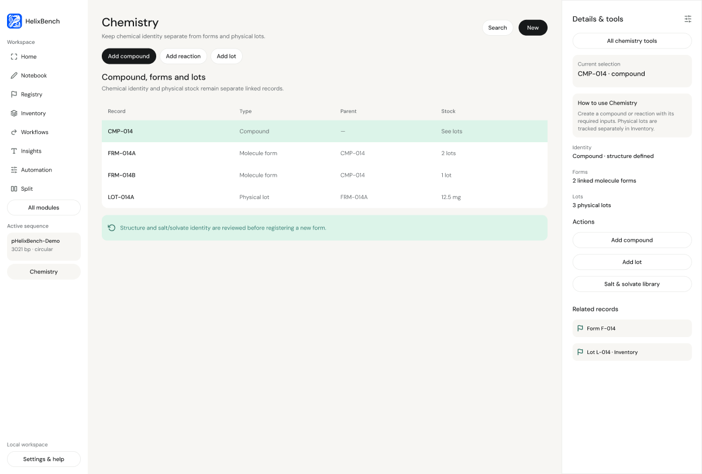

# SCR-16 · Chemistry

[Current Figma screen](https://www.figma.com/design/U1kWw1K5NZBgEYkuxMz3Qb/helixbench?node-id=107-32457) · Implementation phase P17.

## Purpose and layout

Register a compound, inspect its structure and manage reactions or material lots.

Compound list and supported-SMILES inspection; substructure search; reaction identities/equivalents; salt/solvate forms and physical material lots.

## Target requirements

- **SCR-16-R1:** Validate the supported SMILES subset before deriving formula/mass. Unsupported stereochemistry or syntax is not silently interpreted as a fully supported structure.
- **SCR-16-R2:** Separate compound identity, reaction identity and material-lot quantity/location. Use stable IDs for reaction participants and form references.
- **SCR-16-R3:** Reaction input identifies reactant/product and positive finite equivalents; calculated changes show the assumptions of the local model.
- **SCR-16-R4:** Substructure search uses the implemented matching semantics and shows no-match independently from parse failure.
- **SCR-16-R5:** Compound/reaction deletion checks references. Repeated display names and a changed selected row cannot redirect a save/delete to another compound.

## User flow

1. Add compound by SMILES
2. Validate structure/properties
3. Select compound
4. Add lot or define reaction
5. Save and inspect linked result

Use the shared typed context, validation/review, persistence and return-location contracts at every relevant transition. Prototype fixture IDs and figures are never production defaults.

## States and recovery

- Loading: retain prior context and identify the active request/operation.
- Populated: show stable object identity, meaningful status and available actions.
- No data: offer the relevant creation/import action.
- No matches: retain query/scope and expose Reset or Change settings.
- Invalid prerequisite: explain the missing input and provide its remedy.
- Validation/write failure: retain draft values and show a constructive correction/retry.
- Dirty/partial/stale/unavailable states use the shared state machines when applicable.

## Screen-specific edge cases

- **SCR-16-EC1:** Unbalanced ring/branch/bracket syntax, unsupported element/bond/stereochemistry and malformed charge.
- **SCR-16-EC2:** Zero/negative/nonfinite equivalents or missing participant.
- **SCR-16-EC3:** Compound is referenced by a reaction, lot, registry relation or result.
- **SCR-16-EC4:** A salt/solvate form changes molecular mass while a lot retains its own quantity unit.
- **SCR-16-EC5:** Substructure query fails to parse or matches no compounds.
- **SCR-16-EC6:** Formula/mass computation is unavailable for an unsupported structure; never display a fabricated number.

## Current code ownership

- [crates/appcore/src/actions.rs:2110](C:/Users/Admin/Documents/Qoder/2026-11-13/87e5a6b2/helixbench/crates/appcore/src/actions.rs:2110) — `pub fn open_chem_add(app: &mut AppState)`
- [crates/appcore/src/actions.rs:2114](C:/Users/Admin/Documents/Qoder/2026-11-13/87e5a6b2/helixbench/crates/appcore/src/actions.rs:2114) — `pub fn chem_add_save(app: &mut AppState, draft: &ChemAddDraft) -> Result<u64, String>`
- [crates/appcore/src/actions.rs:2128](C:/Users/Admin/Documents/Qoder/2026-11-13/87e5a6b2/helixbench/crates/appcore/src/actions.rs:2128) — `pub fn open_chem_reaction(app: &mut AppState)`
- [crates/appcore/src/actions.rs:2136](C:/Users/Admin/Documents/Qoder/2026-11-13/87e5a6b2/helixbench/crates/appcore/src/actions.rs:2136) — `pub fn chem_reaction_save(app: &mut AppState, draft: &ChemReactionDraft) -> Result<u64, String>`
- [crates/appcore/src/actions.rs:2171](C:/Users/Admin/Documents/Qoder/2026-11-13/87e5a6b2/helixbench/crates/appcore/src/actions.rs:2171) — `pub fn open_chem_lot(app: &mut AppState)`
- [crates/appcore/src/actions.rs:2179](C:/Users/Admin/Documents/Qoder/2026-11-13/87e5a6b2/helixbench/crates/appcore/src/actions.rs:2179) — `pub fn chem_lot_save(app: &mut AppState, draft: &ChemLotDraft) -> Result<u64, String>`
- [crates/appcore/src/actions.rs:2200](C:/Users/Admin/Documents/Qoder/2026-11-13/87e5a6b2/helixbench/crates/appcore/src/actions.rs:2200) — `pub fn chem_delete_compound(app: &mut AppState, id: u64)`
- [crates/appcore/src/actions.rs:2211](C:/Users/Admin/Documents/Qoder/2026-11-13/87e5a6b2/helixbench/crates/appcore/src/actions.rs:2211) — `pub fn chem_delete_reaction(app: &mut AppState, id: u64)`

Domain modules: `crates/domain/src/chemistry.rs`.

Native presentation entry points:

- [apps/desktop_gpui/src/lab.rs:1898](C:/Users/Admin/Documents/Qoder/2026-11-13/87e5a6b2/helixbench/apps/desktop_gpui/src/lab.rs:1898) — `render_chemistry`
- [apps/desktop_gpui/src/dialogs.rs:6103](C:/Users/Admin/Documents/Qoder/2026-11-13/87e5a6b2/helixbench/apps/desktop_gpui/src/dialogs.rs:6103) — `chem_add`
- [apps/desktop_gpui/src/dialogs.rs:6173](C:/Users/Admin/Documents/Qoder/2026-11-13/87e5a6b2/helixbench/apps/desktop_gpui/src/dialogs.rs:6173) — `chem_reaction`
- [apps/desktop_gpui/src/dialogs.rs:6285](C:/Users/Admin/Documents/Qoder/2026-11-13/87e5a6b2/helixbench/apps/desktop_gpui/src/dialogs.rs:6285) — `chem_lot`

## Field/draft contracts

### ChemAddDraft

[crates/appcore/src/state.rs:468](C:/Users/Admin/Documents/Qoder/2026-11-13/87e5a6b2/helixbench/crates/appcore/src/state.rs:468)

- `name: String` — Trim for validation; require a nonempty meaningful label where the owning operation creates an object. Preserve original editable draft on error.
- `smiles: String` — Validate the declared molecule/grammar before commit. Preserve original text and report meaningful normalization or unsupported syntax.
- `error: Option<String>` — System-owned validation/error state; never an editable user field.

### ChemReactionDraft

[crates/appcore/src/state.rs:476](C:/Users/Admin/Documents/Qoder/2026-11-13/87e5a6b2/helixbench/crates/appcore/src/state.rs:476)

- `name: String` — Trim for validation; require a nonempty meaningful label where the owning operation creates an object. Preserve original editable draft on error.
- `reactant: usize` — Resolve a stable typed identity from a labeled picker. Validate existence/kind at submit; do not persist a row index as a foreign key.
- `product: usize` — Resolve a stable typed identity from a labeled picker. Validate existence/kind at submit; do not persist a row index as a foreign key.
- `req: String` — Parse finite numeric input, display units/range where relevant and apply domain-specific bounds. Do not silently substitute a default after invalid input.
- `peq: String` — Parse finite numeric input, display units/range where relevant and apply domain-specific bounds. Do not silently substitute a default after invalid input.
- `error: Option<String>` — System-owned validation/error state; never an editable user field.

### ChemLotDraft

[crates/appcore/src/state.rs:487](C:/Users/Admin/Documents/Qoder/2026-11-13/87e5a6b2/helixbench/crates/appcore/src/state.rs:487)

- `form: usize` — Use the owning feature/module requirements and the current typed source definition. Optional values remain distinguishable from empty/default values; validate before commit.
- `quantity: String` — Parse finite numeric input, display units/range where relevant and apply domain-specific bounds. Do not silently substitute a default after invalid input.
- `unit: String` — Use the owning feature/module requirements and the current typed source definition. Optional values remain distinguishable from empty/default values; validate before commit.
- `error: Option<String>` — System-owned validation/error state; never an editable user field.

## Feature-level implementation contracts

### F-173 · Add compound from SMILES

**Status:** Specified; not verified implemented.

**Entry:** Add compound (1 navigation click(s)).

**Prerequisite:** Valid supported SMILES.

**Outcome:** Name, parsed structure and validation.

**Current evidence note:** Existing action/dialog.

**Relevant code/action family:** [crates/appcore/src/actions.rs:2110](C:/Users/Admin/Documents/Qoder/2026-11-13/87e5a6b2/helixbench/crates/appcore/src/actions.rs:2110), [crates/appcore/src/actions.rs:2114](C:/Users/Admin/Documents/Qoder/2026-11-13/87e5a6b2/helixbench/crates/appcore/src/actions.rs:2114), [crates/appcore/src/actions.rs:2128](C:/Users/Admin/Documents/Qoder/2026-11-13/87e5a6b2/helixbench/crates/appcore/src/actions.rs:2128), [crates/appcore/src/actions.rs:2136](C:/Users/Admin/Documents/Qoder/2026-11-13/87e5a6b2/helixbench/crates/appcore/src/actions.rs:2136), [crates/appcore/src/actions.rs:2171](C:/Users/Admin/Documents/Qoder/2026-11-13/87e5a6b2/helixbench/crates/appcore/src/actions.rs:2171), [crates/appcore/src/actions.rs:2179](C:/Users/Admin/Documents/Qoder/2026-11-13/87e5a6b2/helixbench/crates/appcore/src/actions.rs:2179), [crates/appcore/src/actions.rs:2200](C:/Users/Admin/Documents/Qoder/2026-11-13/87e5a6b2/helixbench/crates/appcore/src/actions.rs:2200), [crates/appcore/src/actions.rs:2211](C:/Users/Admin/Documents/Qoder/2026-11-13/87e5a6b2/helixbench/crates/appcore/src/actions.rs:2211).

**Acceptance:**

- F-173-AC1: Given The owning page and the stated prerequisite are available. When The user follows Add compound. Then Name, parsed structure and validation; feature entry requires at most two navigation clicks.
- F-173-AC2: Given The context contains two similar names or a changed table order. When This feature is activated. Then The command payload retains the exact selected typed identity, source revision and scope.
- F-173-AC3: Given A draft contains an invalid or missing required value. When The user submits the form. Then Show a field-local error, retain the draft and perform no mutation.

**Recovery and edge conditions:**

- Invalid required fields are identified beside the input with original draft values retained.
- Cancel does not alter the source object or create an unrelated example record.
- A stale/deleted target is resolved explicitly instead of mutating a row index.
- Successful persistence updates the selected record, related views and audit consistently.
- Zero/negative/nonfinite equivalents or missing participant.
- Compound is referenced by a reaction, lot, registry relation or result.

### F-174 · Substructure search

**Status:** Specified; not verified implemented.

**Entry:** Substructure field (1 navigation click(s)).

**Prerequisite:** Supported query SMILES.

**Outcome:** Show matches and invalid-query message.

**Current evidence note:** Existing page filter.

**Relevant code/action family:** [crates/appcore/src/actions.rs:2110](C:/Users/Admin/Documents/Qoder/2026-11-13/87e5a6b2/helixbench/crates/appcore/src/actions.rs:2110), [crates/appcore/src/actions.rs:2114](C:/Users/Admin/Documents/Qoder/2026-11-13/87e5a6b2/helixbench/crates/appcore/src/actions.rs:2114), [crates/appcore/src/actions.rs:2128](C:/Users/Admin/Documents/Qoder/2026-11-13/87e5a6b2/helixbench/crates/appcore/src/actions.rs:2128), [crates/appcore/src/actions.rs:2136](C:/Users/Admin/Documents/Qoder/2026-11-13/87e5a6b2/helixbench/crates/appcore/src/actions.rs:2136), [crates/appcore/src/actions.rs:2171](C:/Users/Admin/Documents/Qoder/2026-11-13/87e5a6b2/helixbench/crates/appcore/src/actions.rs:2171), [crates/appcore/src/actions.rs:2179](C:/Users/Admin/Documents/Qoder/2026-11-13/87e5a6b2/helixbench/crates/appcore/src/actions.rs:2179), [crates/appcore/src/actions.rs:2200](C:/Users/Admin/Documents/Qoder/2026-11-13/87e5a6b2/helixbench/crates/appcore/src/actions.rs:2200), [crates/appcore/src/actions.rs:2211](C:/Users/Admin/Documents/Qoder/2026-11-13/87e5a6b2/helixbench/crates/appcore/src/actions.rs:2211).

**Acceptance:**

- F-174-AC1: Given The owning page and the stated prerequisite are available. When The user follows Substructure field. Then Show matches and invalid-query message; feature entry requires at most two navigation clicks.
- F-174-AC2: Given The context contains two similar names or a changed table order. When This feature is activated. Then The command payload retains the exact selected typed identity, source revision and scope.
- F-174-AC3: Given Underlying records exist and a query or filter is active. When The query/filter matches no records. Then Show no matches with the active scope and reset remedy; do not claim that the dataset is empty or failed.

**Recovery and edge conditions:**

- Empty source, filtered-out records and failed load have different status/remedies.
- Sorting/filtering or a same-name record cannot change the selected stable identity.
- Returning restores the same query/filter/scope and scroll anchor where supported.
- Inspection-only changes do not mark scientific content dirty.
- Compound is referenced by a reaction, lot, registry relation or result.
- A salt/solvate form changes molecular mass while a lot retains its own quantity unit.

### F-175 · Select compound / inspect structure

**Status:** Specified; not verified implemented.

**Entry:** Compound row (1 navigation click(s)).

**Prerequisite:** Existing compound.

**Outcome:** 2D structure and molecular formula.

**Current evidence note:** Select button.

**Relevant code/action family:** [crates/appcore/src/actions.rs:2110](C:/Users/Admin/Documents/Qoder/2026-11-13/87e5a6b2/helixbench/crates/appcore/src/actions.rs:2110), [crates/appcore/src/actions.rs:2114](C:/Users/Admin/Documents/Qoder/2026-11-13/87e5a6b2/helixbench/crates/appcore/src/actions.rs:2114), [crates/appcore/src/actions.rs:2128](C:/Users/Admin/Documents/Qoder/2026-11-13/87e5a6b2/helixbench/crates/appcore/src/actions.rs:2128), [crates/appcore/src/actions.rs:2136](C:/Users/Admin/Documents/Qoder/2026-11-13/87e5a6b2/helixbench/crates/appcore/src/actions.rs:2136), [crates/appcore/src/actions.rs:2171](C:/Users/Admin/Documents/Qoder/2026-11-13/87e5a6b2/helixbench/crates/appcore/src/actions.rs:2171), [crates/appcore/src/actions.rs:2179](C:/Users/Admin/Documents/Qoder/2026-11-13/87e5a6b2/helixbench/crates/appcore/src/actions.rs:2179), [crates/appcore/src/actions.rs:2200](C:/Users/Admin/Documents/Qoder/2026-11-13/87e5a6b2/helixbench/crates/appcore/src/actions.rs:2200), [crates/appcore/src/actions.rs:2211](C:/Users/Admin/Documents/Qoder/2026-11-13/87e5a6b2/helixbench/crates/appcore/src/actions.rs:2211).

**Acceptance:**

- F-175-AC1: Given The owning page and the stated prerequisite are available. When The user follows Compound row. Then 2D structure and molecular formula; feature entry requires at most two navigation clicks.
- F-175-AC2: Given The context contains two similar names or a changed table order. When This feature is activated. Then The command payload retains the exact selected typed identity, source revision and scope.
- F-175-AC3: Given The intended target was deleted or became inaccessible after rendering. When The user activates its row or link. Then Show a relevant recovery path without opening an unrelated record; retain a safe return location.

**Recovery and edge conditions:**

- Two same-name records and two stores with the same numeric ID resolve correctly.
- A missing/deleted/inaccessible target offers a relevant remedy rather than another record.
- Back restores the invoking task and selection; dirty work is preserved where necessary.
- Keyboard activation and labeled controls expose the same action as pointer input.
- A salt/solvate form changes molecular mass while a lot retains its own quantity unit.
- Substructure query fails to parse or matches no compounds.

### F-176 · Inspect MW / donors / acceptors / atoms

**Status:** Specified; not verified implemented.

**Entry:** Compound row → Properties tab (2 navigation click(s)).

**Prerequisite:** Parsable structure.

**Outcome:** Show calculated properties with units.

**Current evidence note:** Selected details rendered inline.

**Relevant code/action family:** [crates/appcore/src/actions.rs:2110](C:/Users/Admin/Documents/Qoder/2026-11-13/87e5a6b2/helixbench/crates/appcore/src/actions.rs:2110), [crates/appcore/src/actions.rs:2114](C:/Users/Admin/Documents/Qoder/2026-11-13/87e5a6b2/helixbench/crates/appcore/src/actions.rs:2114), [crates/appcore/src/actions.rs:2128](C:/Users/Admin/Documents/Qoder/2026-11-13/87e5a6b2/helixbench/crates/appcore/src/actions.rs:2128), [crates/appcore/src/actions.rs:2136](C:/Users/Admin/Documents/Qoder/2026-11-13/87e5a6b2/helixbench/crates/appcore/src/actions.rs:2136), [crates/appcore/src/actions.rs:2171](C:/Users/Admin/Documents/Qoder/2026-11-13/87e5a6b2/helixbench/crates/appcore/src/actions.rs:2171), [crates/appcore/src/actions.rs:2179](C:/Users/Admin/Documents/Qoder/2026-11-13/87e5a6b2/helixbench/crates/appcore/src/actions.rs:2179), [crates/appcore/src/actions.rs:2200](C:/Users/Admin/Documents/Qoder/2026-11-13/87e5a6b2/helixbench/crates/appcore/src/actions.rs:2200), [crates/appcore/src/actions.rs:2211](C:/Users/Admin/Documents/Qoder/2026-11-13/87e5a6b2/helixbench/crates/appcore/src/actions.rs:2211).

**Acceptance:**

- F-176-AC1: Given The owning page and the stated prerequisite are available. When The user follows Compound row → Properties tab. Then Show calculated properties with units; feature entry requires at most two navigation clicks.
- F-176-AC2: Given The context contains two similar names or a changed table order. When This feature is activated. Then The command payload retains the exact selected typed identity, source revision and scope.
- F-176-AC3: Given The intended target was deleted or became inaccessible after rendering. When The user activates its row or link. Then Show a relevant recovery path without opening an unrelated record; retain a safe return location.

**Recovery and edge conditions:**

- Two same-name records and two stores with the same numeric ID resolve correctly.
- A missing/deleted/inaccessible target offers a relevant remedy rather than another record.
- Back restores the invoking task and selection; dirty work is preserved where necessary.
- Keyboard activation and labeled controls expose the same action as pointer input.
- Substructure query fails to parse or matches no compounds.
- Formula/mass computation is unavailable for an unsupported structure; never display a fabricated number.

### F-177 · Add material lot

**Status:** Specified; not verified implemented.

**Entry:** Compound row → Add lot (2 navigation click(s)).

**Prerequisite:** Existing compound.

**Outcome:** Quantity, unit and salt/solvate form.

**Current evidence note:** Only visible after selecting compound.

**Relevant code/action family:** [crates/appcore/src/actions.rs:2110](C:/Users/Admin/Documents/Qoder/2026-11-13/87e5a6b2/helixbench/crates/appcore/src/actions.rs:2110), [crates/appcore/src/actions.rs:2114](C:/Users/Admin/Documents/Qoder/2026-11-13/87e5a6b2/helixbench/crates/appcore/src/actions.rs:2114), [crates/appcore/src/actions.rs:2128](C:/Users/Admin/Documents/Qoder/2026-11-13/87e5a6b2/helixbench/crates/appcore/src/actions.rs:2128), [crates/appcore/src/actions.rs:2136](C:/Users/Admin/Documents/Qoder/2026-11-13/87e5a6b2/helixbench/crates/appcore/src/actions.rs:2136), [crates/appcore/src/actions.rs:2171](C:/Users/Admin/Documents/Qoder/2026-11-13/87e5a6b2/helixbench/crates/appcore/src/actions.rs:2171), [crates/appcore/src/actions.rs:2179](C:/Users/Admin/Documents/Qoder/2026-11-13/87e5a6b2/helixbench/crates/appcore/src/actions.rs:2179), [crates/appcore/src/actions.rs:2200](C:/Users/Admin/Documents/Qoder/2026-11-13/87e5a6b2/helixbench/crates/appcore/src/actions.rs:2200), [crates/appcore/src/actions.rs:2211](C:/Users/Admin/Documents/Qoder/2026-11-13/87e5a6b2/helixbench/crates/appcore/src/actions.rs:2211).

**Acceptance:**

- F-177-AC1: Given The owning page and the stated prerequisite are available. When The user follows Compound row → Add lot. Then Quantity, unit and salt/solvate form; feature entry requires at most two navigation clicks.
- F-177-AC2: Given The context contains two similar names or a changed table order. When This feature is activated. Then The command payload retains the exact selected typed identity, source revision and scope.
- F-177-AC3: Given A draft contains an invalid or missing required value. When The user submits the form. Then Show a field-local error, retain the draft and perform no mutation.

**Recovery and edge conditions:**

- Invalid required fields are identified beside the input with original draft values retained.
- Cancel does not alter the source object or create an unrelated example record.
- A stale/deleted target is resolved explicitly instead of mutating a row index.
- Successful persistence updates the selected record, related views and audit consistently.
- Formula/mass computation is unavailable for an unsupported structure; never display a fabricated number.
- Unbalanced ring/branch/bracket syntax, unsupported element/bond/stereochemistry and malformed charge.

### F-178 · Inspect compound lots

**Status:** Specified; not verified implemented.

**Entry:** Compound row → Lots tab (2 navigation click(s)).

**Prerequisite:** Lots exist.

**Outcome:** Quantity and form per lot.

**Current evidence note:** Selected lot list.

**Relevant code/action family:** [crates/appcore/src/actions.rs:2110](C:/Users/Admin/Documents/Qoder/2026-11-13/87e5a6b2/helixbench/crates/appcore/src/actions.rs:2110), [crates/appcore/src/actions.rs:2114](C:/Users/Admin/Documents/Qoder/2026-11-13/87e5a6b2/helixbench/crates/appcore/src/actions.rs:2114), [crates/appcore/src/actions.rs:2128](C:/Users/Admin/Documents/Qoder/2026-11-13/87e5a6b2/helixbench/crates/appcore/src/actions.rs:2128), [crates/appcore/src/actions.rs:2136](C:/Users/Admin/Documents/Qoder/2026-11-13/87e5a6b2/helixbench/crates/appcore/src/actions.rs:2136), [crates/appcore/src/actions.rs:2171](C:/Users/Admin/Documents/Qoder/2026-11-13/87e5a6b2/helixbench/crates/appcore/src/actions.rs:2171), [crates/appcore/src/actions.rs:2179](C:/Users/Admin/Documents/Qoder/2026-11-13/87e5a6b2/helixbench/crates/appcore/src/actions.rs:2179), [crates/appcore/src/actions.rs:2200](C:/Users/Admin/Documents/Qoder/2026-11-13/87e5a6b2/helixbench/crates/appcore/src/actions.rs:2200), [crates/appcore/src/actions.rs:2211](C:/Users/Admin/Documents/Qoder/2026-11-13/87e5a6b2/helixbench/crates/appcore/src/actions.rs:2211).

**Acceptance:**

- F-178-AC1: Given The owning page and the stated prerequisite are available. When The user follows Compound row → Lots tab. Then Quantity and form per lot; feature entry requires at most two navigation clicks.
- F-178-AC2: Given The context contains two similar names or a changed table order. When This feature is activated. Then The command payload retains the exact selected typed identity, source revision and scope.
- F-178-AC3: Given The intended target was deleted or became inaccessible after rendering. When The user activates its row or link. Then Show a relevant recovery path without opening an unrelated record; retain a safe return location.

**Recovery and edge conditions:**

- Two same-name records and two stores with the same numeric ID resolve correctly.
- A missing/deleted/inaccessible target offers a relevant remedy rather than another record.
- Back restores the invoking task and selection; dirty work is preserved where necessary.
- Keyboard activation and labeled controls expose the same action as pointer input.
- Unbalanced ring/branch/bracket syntax, unsupported element/bond/stereochemistry and malformed charge.
- Zero/negative/nonfinite equivalents or missing participant.

### F-179 · Add reaction

**Status:** Specified; not verified implemented.

**Entry:** Add reaction (1 navigation click(s)).

**Prerequisite:** Existing reactant/product compounds.

**Outcome:** Explicit reactant/product selectors and equivalents.

**Current evidence note:** Existing dialog uses cycling controls.

**Relevant code/action family:** [crates/appcore/src/actions.rs:2110](C:/Users/Admin/Documents/Qoder/2026-11-13/87e5a6b2/helixbench/crates/appcore/src/actions.rs:2110), [crates/appcore/src/actions.rs:2114](C:/Users/Admin/Documents/Qoder/2026-11-13/87e5a6b2/helixbench/crates/appcore/src/actions.rs:2114), [crates/appcore/src/actions.rs:2128](C:/Users/Admin/Documents/Qoder/2026-11-13/87e5a6b2/helixbench/crates/appcore/src/actions.rs:2128), [crates/appcore/src/actions.rs:2136](C:/Users/Admin/Documents/Qoder/2026-11-13/87e5a6b2/helixbench/crates/appcore/src/actions.rs:2136), [crates/appcore/src/actions.rs:2171](C:/Users/Admin/Documents/Qoder/2026-11-13/87e5a6b2/helixbench/crates/appcore/src/actions.rs:2171), [crates/appcore/src/actions.rs:2179](C:/Users/Admin/Documents/Qoder/2026-11-13/87e5a6b2/helixbench/crates/appcore/src/actions.rs:2179), [crates/appcore/src/actions.rs:2200](C:/Users/Admin/Documents/Qoder/2026-11-13/87e5a6b2/helixbench/crates/appcore/src/actions.rs:2200), [crates/appcore/src/actions.rs:2211](C:/Users/Admin/Documents/Qoder/2026-11-13/87e5a6b2/helixbench/crates/appcore/src/actions.rs:2211).

**Acceptance:**

- F-179-AC1: Given The owning page and the stated prerequisite are available. When The user follows Add reaction. Then Explicit reactant/product selectors and equivalents; feature entry requires at most two navigation clicks.
- F-179-AC2: Given The context contains two similar names or a changed table order. When This feature is activated. Then The command payload retains the exact selected typed identity, source revision and scope.
- F-179-AC3: Given A draft contains an invalid or missing required value. When The user submits the form. Then Show a field-local error, retain the draft and perform no mutation.

**Recovery and edge conditions:**

- Invalid required fields are identified beside the input with original draft values retained.
- Cancel does not alter the source object or create an unrelated example record.
- A stale/deleted target is resolved explicitly instead of mutating a row index.
- Successful persistence updates the selected record, related views and audit consistently.
- Zero/negative/nonfinite equivalents or missing participant.
- Compound is referenced by a reaction, lot, registry relation or result.

### F-180 · Inspect reaction participants

**Status:** Specified; not verified implemented.

**Entry:** Reactions tab → Reaction row (2 navigation click(s)).

**Prerequisite:** Existing reaction.

**Outcome:** Show compound links and stoichiometry.

**Current evidence note:** Reaction summary inline.

**Relevant code/action family:** [crates/appcore/src/actions.rs:2110](C:/Users/Admin/Documents/Qoder/2026-11-13/87e5a6b2/helixbench/crates/appcore/src/actions.rs:2110), [crates/appcore/src/actions.rs:2114](C:/Users/Admin/Documents/Qoder/2026-11-13/87e5a6b2/helixbench/crates/appcore/src/actions.rs:2114), [crates/appcore/src/actions.rs:2128](C:/Users/Admin/Documents/Qoder/2026-11-13/87e5a6b2/helixbench/crates/appcore/src/actions.rs:2128), [crates/appcore/src/actions.rs:2136](C:/Users/Admin/Documents/Qoder/2026-11-13/87e5a6b2/helixbench/crates/appcore/src/actions.rs:2136), [crates/appcore/src/actions.rs:2171](C:/Users/Admin/Documents/Qoder/2026-11-13/87e5a6b2/helixbench/crates/appcore/src/actions.rs:2171), [crates/appcore/src/actions.rs:2179](C:/Users/Admin/Documents/Qoder/2026-11-13/87e5a6b2/helixbench/crates/appcore/src/actions.rs:2179), [crates/appcore/src/actions.rs:2200](C:/Users/Admin/Documents/Qoder/2026-11-13/87e5a6b2/helixbench/crates/appcore/src/actions.rs:2200), [crates/appcore/src/actions.rs:2211](C:/Users/Admin/Documents/Qoder/2026-11-13/87e5a6b2/helixbench/crates/appcore/src/actions.rs:2211).

**Acceptance:**

- F-180-AC1: Given The owning page and the stated prerequisite are available. When The user follows Reactions tab → Reaction row. Then Show compound links and stoichiometry; feature entry requires at most two navigation clicks.
- F-180-AC2: Given The context contains two similar names or a changed table order. When This feature is activated. Then The command payload retains the exact selected typed identity, source revision and scope.
- F-180-AC3: Given The intended target was deleted or became inaccessible after rendering. When The user activates its row or link. Then Show a relevant recovery path without opening an unrelated record; retain a safe return location.

**Recovery and edge conditions:**

- Two same-name records and two stores with the same numeric ID resolve correctly.
- A missing/deleted/inaccessible target offers a relevant remedy rather than another record.
- Back restores the invoking task and selection; dirty work is preserved where necessary.
- Keyboard activation and labeled controls expose the same action as pointer input.
- Compound is referenced by a reaction, lot, registry relation or result.
- A salt/solvate form changes molecular mass while a lot retains its own quantity unit.

### F-181 · Delete compound / reaction

**Status:** Specified; not verified implemented.

**Entry:** Record row → Delete (2 navigation click(s)).

**Prerequisite:** Existing record.

**Outcome:** Confirm scope and dependencies.

**Current evidence note:** Existing direct actions.

**Relevant code/action family:** [crates/appcore/src/actions.rs:2110](C:/Users/Admin/Documents/Qoder/2026-11-13/87e5a6b2/helixbench/crates/appcore/src/actions.rs:2110), [crates/appcore/src/actions.rs:2114](C:/Users/Admin/Documents/Qoder/2026-11-13/87e5a6b2/helixbench/crates/appcore/src/actions.rs:2114), [crates/appcore/src/actions.rs:2128](C:/Users/Admin/Documents/Qoder/2026-11-13/87e5a6b2/helixbench/crates/appcore/src/actions.rs:2128), [crates/appcore/src/actions.rs:2136](C:/Users/Admin/Documents/Qoder/2026-11-13/87e5a6b2/helixbench/crates/appcore/src/actions.rs:2136), [crates/appcore/src/actions.rs:2171](C:/Users/Admin/Documents/Qoder/2026-11-13/87e5a6b2/helixbench/crates/appcore/src/actions.rs:2171), [crates/appcore/src/actions.rs:2179](C:/Users/Admin/Documents/Qoder/2026-11-13/87e5a6b2/helixbench/crates/appcore/src/actions.rs:2179), [crates/appcore/src/actions.rs:2200](C:/Users/Admin/Documents/Qoder/2026-11-13/87e5a6b2/helixbench/crates/appcore/src/actions.rs:2200), [crates/appcore/src/actions.rs:2211](C:/Users/Admin/Documents/Qoder/2026-11-13/87e5a6b2/helixbench/crates/appcore/src/actions.rs:2211).

**Acceptance:**

- F-181-AC1: Given The owning page and the stated prerequisite are available. When The user follows Record row → Delete. Then Confirm scope and dependencies; feature entry requires at most two navigation clicks.
- F-181-AC2: Given The context contains two similar names or a changed table order. When This feature is activated. Then The command payload retains the exact selected typed identity, source revision and scope.
- F-181-AC3: Given A consequence review identifies the selected record. When The user cancels or the commit fails. Then Keep the reviewed object unchanged, preserve useful draft context and show a recoverable outcome.

**Recovery and edge conditions:**

- Cancel before commit leaves the reviewed object and selection unchanged.
- Changing the selected object while the review is open cannot retarget the action.
- Blocked dependencies and persistence failure leave a constructive recovery path; no false success.
- Successful mutation clears or updates the exact selected context and retained references.
- A salt/solvate form changes molecular mass while a lot retains its own quantity unit.
- Substructure query fails to parse or matches no compounds.

### F-182 · Browse salt / solvate library

**Status:** Specified; not verified implemented.

**Entry:** Salt & solvate library (1 navigation click(s)).

**Prerequisite:** None.

**Outcome:** Find formula and molecular weight.

**Current evidence note:** Bottom of long page.

**Relevant code/action family:** [crates/appcore/src/actions.rs:2110](C:/Users/Admin/Documents/Qoder/2026-11-13/87e5a6b2/helixbench/crates/appcore/src/actions.rs:2110), [crates/appcore/src/actions.rs:2114](C:/Users/Admin/Documents/Qoder/2026-11-13/87e5a6b2/helixbench/crates/appcore/src/actions.rs:2114), [crates/appcore/src/actions.rs:2128](C:/Users/Admin/Documents/Qoder/2026-11-13/87e5a6b2/helixbench/crates/appcore/src/actions.rs:2128), [crates/appcore/src/actions.rs:2136](C:/Users/Admin/Documents/Qoder/2026-11-13/87e5a6b2/helixbench/crates/appcore/src/actions.rs:2136), [crates/appcore/src/actions.rs:2171](C:/Users/Admin/Documents/Qoder/2026-11-13/87e5a6b2/helixbench/crates/appcore/src/actions.rs:2171), [crates/appcore/src/actions.rs:2179](C:/Users/Admin/Documents/Qoder/2026-11-13/87e5a6b2/helixbench/crates/appcore/src/actions.rs:2179), [crates/appcore/src/actions.rs:2200](C:/Users/Admin/Documents/Qoder/2026-11-13/87e5a6b2/helixbench/crates/appcore/src/actions.rs:2200), [crates/appcore/src/actions.rs:2211](C:/Users/Admin/Documents/Qoder/2026-11-13/87e5a6b2/helixbench/crates/appcore/src/actions.rs:2211).

**Acceptance:**

- F-182-AC1: Given The owning page and the stated prerequisite are available. When The user follows Salt & solvate library. Then Find formula and molecular weight; feature entry requires at most two navigation clicks.
- F-182-AC2: Given The context contains two similar names or a changed table order. When This feature is activated. Then The command payload retains the exact selected typed identity, source revision and scope.
- F-182-AC3: Given The intended target was deleted or became inaccessible after rendering. When The user activates its row or link. Then Show a relevant recovery path without opening an unrelated record; retain a safe return location.

**Recovery and edge conditions:**

- Two same-name records and two stores with the same numeric ID resolve correctly.
- A missing/deleted/inaccessible target offers a relevant remedy rather than another record.
- Back restores the invoking task and selection; dirty work is preserved where necessary.
- Keyboard activation and labeled controls expose the same action as pointer input.
- Substructure query fails to parse or matches no compounds.
- Formula/mass computation is unavailable for an unsupported structure; never display a fabricated number.

