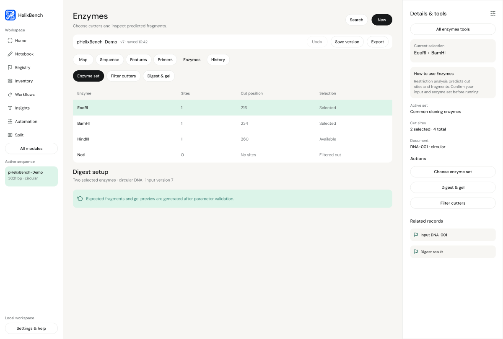

# SCR-06 · Enzymes

[Current Figma screen](https://www.figma.com/design/U1kWw1K5NZBgEYkuxMz3Qb/helixbench?node-id=107-30295) · Implementation phase P08D.

## Purpose and layout

Choose an enzyme set, inspect cut sites and simulate the digest.

Enzyme set and composable cut/region filters; cut-site table; restriction analysis setup and fragment/gel results with input provenance.

## Target requirements

- **SCR-06-R1:** Preserve enzyme sets, unique/double/non-cutter filters, cut counts, methylation-sensitive filtering and anywhere/selection/custom-region search.
- **SCR-06-R2:** A whole-sequence digest is not silently restricted to the selected promoter. Show topology, scope, enzyme set and input revision before running.
- **SCR-06-R3:** Results list fragments, lengths, cut positions and method assumptions; a gel is an additional view with a labeled ladder and migration model.
- **SCR-06-R4:** Zero cut sites is a completed result. Linear and circular fragment accounting use the domain engine rather than fixed prototype values.
- **SCR-06-R5:** Filter reset restores scope predictably; filtering never changes biological topology or the saved chosen-enzyme set without an explicit edit.

## User flow

1. Choose enzyme set
2. Filter by experimental constraints
3. Select enzymes
4. Review cut positions
5. Open digest and gel with the chosen set

Use the shared typed context, validation/review, persistence and return-location contracts at every relevant transition. Prototype fixture IDs and figures are never production defaults.

## States and recovery

- Loading: retain prior context and identify the active request/operation.
- Populated: show stable object identity, meaningful status and available actions.
- No data: offer the relevant creation/import action.
- No matches: retain query/scope and expose Reset or Change settings.
- Invalid prerequisite: explain the missing input and provide its remedy.
- Validation/write failure: retain draft values and show a constructive correction/retry.
- Dirty/partial/stale/unavailable states use the shared state machines when applicable.

## Screen-specific edge cases

- **SCR-06-EC1:** No enzyme selected, no sites, one cut in circular DNA, coincident cuts and ambiguous bases.
- **SCR-06-EC2:** Custom interval is invalid, empty or wraps the origin.
- **SCR-06-EC3:** A non-cutter filter combined with a region filter produces no rows.
- **SCR-06-EC4:** Fragment lengths and topology-specific totals remain correct at boundary cuts.
- **SCR-06-EC5:** Unknown enzyme name in an older document is reported and retained for review.
- **SCR-06-EC6:** Editing the source while a digest runs creates an older-input result rather than writing into the new source context.

## Current code ownership

- [crates/appcore/src/actions.rs:819](C:/Users/Admin/Documents/Qoder/2026-11-13/87e5a6b2/helixbench/crates/appcore/src/actions.rs:819) — `pub fn open_digest(app: &mut AppState)`
- [crates/appcore/src/actions.rs:823](C:/Users/Admin/Documents/Qoder/2026-11-13/87e5a6b2/helixbench/crates/appcore/src/actions.rs:823) — `pub fn digest_fragments(app: &AppState) -> Vec<domain::digest::Fragment>`

Domain modules: `crates/domain/src/enzyme.rs`, `crates/domain/src/enzyme_db.rs`, `crates/domain/src/enzyme_set.rs`, `crates/domain/src/digest.rs`.

Native presentation entry points:

- [apps/desktop_gpui/src/views/enzymes.rs:77](C:/Users/Admin/Documents/Qoder/2026-11-13/87e5a6b2/helixbench/apps/desktop_gpui/src/views/enzymes.rs:77) — `render_enzymes`
- [apps/desktop_gpui/src/dialogs.rs:2736](C:/Users/Admin/Documents/Qoder/2026-11-13/87e5a6b2/helixbench/apps/desktop_gpui/src/dialogs.rs:2736) — `digest`
- [apps/desktop_gpui/src/views/table_opts.rs:56](C:/Users/Admin/Documents/Qoder/2026-11-13/87e5a6b2/helixbench/apps/desktop_gpui/src/views/table_opts.rs:56) — `render_table_opts`

## Field/draft contracts

### EnzymeFilterState

[crates/appcore/src/state.rs:610](C:/Users/Admin/Documents/Qoder/2026-11-13/87e5a6b2/helixbench/crates/appcore/src/state.rs:610)

- `name: String` — Trim for validation; require a nonempty meaningful label where the owning operation creates an object. Preserve original editable draft on error.
- `cut_count: usize` — Use the owning feature/module requirements and the current typed source definition. Optional values remain distinguishable from empty/default values; validate before commit.
- `overhang: usize` — Use the owning feature/module requirements and the current typed source definition. Optional values remain distinguishable from empty/default values; validate before commit.
- `site_len: usize` — Use the owning feature/module requirements and the current typed source definition. Optional values remain distinguishable from empty/default values; validate before commit.
- `region: usize` — Use the owning feature/module requirements and the current typed source definition. Optional values remain distinguishable from empty/default values; validate before commit.
- `region_start: String` — Use the owning feature/module requirements and the current typed source definition. Optional values remain distinguishable from empty/default values; validate before commit.
- `region_end: String` — Use the owning feature/module requirements and the current typed source definition. Optional values remain distinguishable from empty/default values; validate before commit.

## Feature-level implementation contracts

### F-078 · Choose / apply enzyme set

**Status:** P08D predefined set application checks rendered source and uses an explicit undoable mutation.

**Entry:** Enzyme set → Set name (2 navigation click(s)).

**Prerequisite:** Active document.

**Outcome:** Apply selected set and show active-set name.

**Current evidence note:** Existing combo and Enzymes menu.

**Relevant code/action family:** [crates/appcore/src/actions.rs:819](C:/Users/Admin/Documents/Qoder/2026-11-13/87e5a6b2/helixbench/crates/appcore/src/actions.rs:819), [crates/appcore/src/actions.rs:823](C:/Users/Admin/Documents/Qoder/2026-11-13/87e5a6b2/helixbench/crates/appcore/src/actions.rs:823).

**Acceptance:**

- F-078-AC1: Given The owning page and the stated prerequisite are available. When The user follows Enzyme set → Set name. Then Apply selected set and show active-set name; feature entry requires at most two navigation clicks.
- F-078-AC2: Given The context contains two similar names or a changed table order. When This feature is activated. Then The command payload retains the exact selected typed identity, source revision and scope.
- F-078-AC3: Given The intended target was deleted or became inaccessible after rendering. When The user activates its row or link. Then Show a relevant recovery path without opening an unrelated record; retain a safe return location.

**Recovery and edge conditions:**

- Two same-name records and two stores with the same numeric ID resolve correctly.
- A missing/deleted/inaccessible target offers a relevant remedy rather than another record.
- Back restores the invoking task and selection; dirty work is preserved where necessary.
- Keyboard activation and labeled controls expose the same action as pointer input.
- Custom interval is invalid, empty or wraps the origin.
- A non-cutter filter combined with a region filter produces no rows.

### F-079 · Toggle enzyme membership

**Status:** P08D stable enzyme name plus captured document revision guards membership edits.

**Entry:** Row checkbox (1 navigation click(s)).

**Prerequisite:** Enzyme row.

**Outcome:** Update chosen enzymes and map cuts.

**Current evidence note:** Existing source checkbox.

**Relevant code/action family:** [crates/appcore/src/actions.rs:819](C:/Users/Admin/Documents/Qoder/2026-11-13/87e5a6b2/helixbench/crates/appcore/src/actions.rs:819), [crates/appcore/src/actions.rs:823](C:/Users/Admin/Documents/Qoder/2026-11-13/87e5a6b2/helixbench/crates/appcore/src/actions.rs:823).

**Acceptance:**

- F-079-AC1: Given The owning page and the stated prerequisite are available. When The user follows Row checkbox. Then Update chosen enzymes and map cuts; feature entry requires at most two navigation clicks.
- F-079-AC2: Given The context contains two similar names or a changed table order. When This feature is activated. Then The command payload retains the exact selected typed identity, source revision and scope.
- F-079-AC3: Given The intended target was deleted or became inaccessible after rendering. When The user activates its row or link. Then Show a relevant recovery path without opening an unrelated record; retain a safe return location.

**Recovery and edge conditions:**

- Two same-name records and two stores with the same numeric ID resolve correctly.
- A missing/deleted/inaccessible target offers a relevant remedy rather than another record.
- Back restores the invoking task and selection; dirty work is preserved where necessary.
- Keyboard activation and labeled controls expose the same action as pointer input.
- A non-cutter filter combined with a region filter produces no rows.
- Fragment lengths and topology-specific totals remain correct at boundary cuts.

### F-080 · Filter by enzyme name

**Status:** P08D name composes with count, overhang, length and region filters; reset and saved-view input reseeding verified.

**Entry:** Name field (1 navigation click(s)).

**Prerequisite:** None.

**Outcome:** Filter current table.

**Current evidence note:** Existing source control.

**Relevant code/action family:** [crates/appcore/src/actions.rs:819](C:/Users/Admin/Documents/Qoder/2026-11-13/87e5a6b2/helixbench/crates/appcore/src/actions.rs:819), [crates/appcore/src/actions.rs:823](C:/Users/Admin/Documents/Qoder/2026-11-13/87e5a6b2/helixbench/crates/appcore/src/actions.rs:823).

**Acceptance:**

- F-080-AC1: Given The owning page and the stated prerequisite are available. When The user follows Name field. Then Filter current table; feature entry requires at most two navigation clicks.
- F-080-AC2: Given The context contains two similar names or a changed table order. When This feature is activated. Then The command payload retains the exact selected typed identity, source revision and scope.
- F-080-AC3: Given Underlying records exist and a query or filter is active. When The query/filter matches no records. Then Show no matches with the active scope and reset remedy; do not claim that the dataset is empty or failed.

**Recovery and edge conditions:**

- Empty source, filtered-out records and failed load have different status/remedies.
- Sorting/filtering or a same-name record cannot change the selected stable identity.
- Returning restores the same query/filter/scope and scroll anchor where supported.
- Inspection-only changes do not mark scientific content dirty.
- Fragment lengths and topology-specific totals remain correct at boundary cuts.
- Unknown enzyme name in an older document is reported and retained for review.

### F-081 · Filter cut count

**Status:** P08D full-template cut counts compose with independent region constraint; saved preset round-trip verified.

**Entry:** Cuts → Count option (2 navigation click(s)).

**Prerequisite:** None.

**Outcome:** Show unique/noncutting/multiple-cut enzymes.

**Current evidence note:** Source combo omitted in design.

**Relevant code/action family:** [crates/appcore/src/actions.rs:819](C:/Users/Admin/Documents/Qoder/2026-11-13/87e5a6b2/helixbench/crates/appcore/src/actions.rs:819), [crates/appcore/src/actions.rs:823](C:/Users/Admin/Documents/Qoder/2026-11-13/87e5a6b2/helixbench/crates/appcore/src/actions.rs:823).

**Acceptance:**

- F-081-AC1: Given The owning page and the stated prerequisite are available. When The user follows Cuts → Count option. Then Show unique/noncutting/multiple-cut enzymes; feature entry requires at most two navigation clicks.
- F-081-AC2: Given The context contains two similar names or a changed table order. When This feature is activated. Then The command payload retains the exact selected typed identity, source revision and scope.
- F-081-AC3: Given Underlying records exist and a query or filter is active. When The query/filter matches no records. Then Show no matches with the active scope and reset remedy; do not claim that the dataset is empty or failed.

**Recovery and edge conditions:**

- Empty source, filtered-out records and failed load have different status/remedies.
- Sorting/filtering or a same-name record cannot change the selected stable identity.
- Returning restores the same query/filter/scope and scroll anchor where supported.
- Inspection-only changes do not mark scientific content dirty.
- Unknown enzyme name in an older document is reported and retained for review.
- Editing the source while a digest runs creates an older-input result rather than writing into the new source context.

### F-082 · Filter overhang type

**Status:** P08D existing overhang and Type IIS classification retained in composable persisted filters.

**Entry:** Overhang → Type (2 navigation click(s)).

**Prerequisite:** None.

**Outcome:** Blunt or sticky-end filtering.

**Current evidence note:** Source combo omitted in design.

**Relevant code/action family:** [crates/appcore/src/actions.rs:819](C:/Users/Admin/Documents/Qoder/2026-11-13/87e5a6b2/helixbench/crates/appcore/src/actions.rs:819), [crates/appcore/src/actions.rs:823](C:/Users/Admin/Documents/Qoder/2026-11-13/87e5a6b2/helixbench/crates/appcore/src/actions.rs:823).

**Acceptance:**

- F-082-AC1: Given The owning page and the stated prerequisite are available. When The user follows Overhang → Type. Then Blunt or sticky-end filtering; feature entry requires at most two navigation clicks.
- F-082-AC2: Given The context contains two similar names or a changed table order. When This feature is activated. Then The command payload retains the exact selected typed identity, source revision and scope.
- F-082-AC3: Given Underlying records exist and a query or filter is active. When The query/filter matches no records. Then Show no matches with the active scope and reset remedy; do not claim that the dataset is empty or failed.

**Recovery and edge conditions:**

- Empty source, filtered-out records and failed load have different status/remedies.
- Sorting/filtering or a same-name record cannot change the selected stable identity.
- Returning restores the same query/filter/scope and scroll anchor where supported.
- Inspection-only changes do not mark scientific content dirty.
- Editing the source while a digest runs creates an older-input result rather than writing into the new source context.
- No enzyme selected, no sites, one cut in circular DNA, coincident cuts and ambiguous bases.

### F-083 · Filter recognition length

**Status:** P08D recognition length composes with other filters and persists in saved views.

**Entry:** Site length → Length (2 navigation click(s)).

**Prerequisite:** None.

**Outcome:** Constrain recognition sequence length.

**Current evidence note:** Source combo omitted in design.

**Relevant code/action family:** [crates/appcore/src/actions.rs:819](C:/Users/Admin/Documents/Qoder/2026-11-13/87e5a6b2/helixbench/crates/appcore/src/actions.rs:819), [crates/appcore/src/actions.rs:823](C:/Users/Admin/Documents/Qoder/2026-11-13/87e5a6b2/helixbench/crates/appcore/src/actions.rs:823).

**Acceptance:**

- F-083-AC1: Given The owning page and the stated prerequisite are available. When The user follows Site length → Length. Then Constrain recognition sequence length; feature entry requires at most two navigation clicks.
- F-083-AC2: Given The context contains two similar names or a changed table order. When This feature is activated. Then The command payload retains the exact selected typed identity, source revision and scope.
- F-083-AC3: Given Underlying records exist and a query or filter is active. When The query/filter matches no records. Then Show no matches with the active scope and reset remedy; do not claim that the dataset is empty or failed.

**Recovery and edge conditions:**

- Empty source, filtered-out records and failed load have different status/remedies.
- Sorting/filtering or a same-name record cannot change the selected stable identity.
- Returning restores the same query/filter/scope and scroll anchor where supported.
- Inspection-only changes do not mark scientific content dirty.
- No enzyme selected, no sites, one cut in circular DNA, coincident cuts and ambiguous bases.
- Custom interval is invalid, empty or wraps the origin.

### F-084 · Filter a coordinate region

**Status:** P08D strict selection/custom region validation and circular origin wrapping; invalid scope cannot fall back.

**Entry:** Region control (1 navigation click(s)).

**Prerequisite:** Valid range or current selection.

**Outcome:** Show region and exclusion semantics explicitly.

**Current evidence note:** Source start/end plus region mode.

**Relevant code/action family:** [crates/appcore/src/actions.rs:819](C:/Users/Admin/Documents/Qoder/2026-11-13/87e5a6b2/helixbench/crates/appcore/src/actions.rs:819), [crates/appcore/src/actions.rs:823](C:/Users/Admin/Documents/Qoder/2026-11-13/87e5a6b2/helixbench/crates/appcore/src/actions.rs:823).

**Acceptance:**

- F-084-AC1: Given The owning page and the stated prerequisite are available. When The user follows Region control. Then Show region and exclusion semantics explicitly; feature entry requires at most two navigation clicks.
- F-084-AC2: Given The context contains two similar names or a changed table order. When This feature is activated. Then The command payload retains the exact selected typed identity, source revision and scope.
- F-084-AC3: Given Underlying records exist and a query or filter is active. When The query/filter matches no records. Then Show no matches with the active scope and reset remedy; do not claim that the dataset is empty or failed.

**Recovery and edge conditions:**

- Empty source, filtered-out records and failed load have different status/remedies.
- Sorting/filtering or a same-name record cannot change the selected stable identity.
- Returning restores the same query/filter/scope and scroll anchor where supported.
- Inspection-only changes do not mark scientific content dirty.
- Custom interval is invalid, empty or wraps the origin.
- A non-cutter filter combined with a region filter produces no rows.

### F-085 · Check / uncheck shown enzymes

**Status:** P08D explicit check or uncheck filtered names uses source validation and Undo; filters alone do not edit set.

**Entry:** Check shown or Uncheck shown (1 navigation click(s)).

**Prerequisite:** Filtered rows.

**Outcome:** Apply membership only to shown rows.

**Current evidence note:** Small icon actions in source.

**Relevant code/action family:** [crates/appcore/src/actions.rs:819](C:/Users/Admin/Documents/Qoder/2026-11-13/87e5a6b2/helixbench/crates/appcore/src/actions.rs:819), [crates/appcore/src/actions.rs:823](C:/Users/Admin/Documents/Qoder/2026-11-13/87e5a6b2/helixbench/crates/appcore/src/actions.rs:823).

**Acceptance:**

- F-085-AC1: Given The owning page and the stated prerequisite are available. When The user follows Check shown or Uncheck shown. Then Apply membership only to shown rows; feature entry requires at most two navigation clicks.
- F-085-AC2: Given The context contains two similar names or a changed table order. When This feature is activated. Then The command payload retains the exact selected typed identity, source revision and scope.
- F-085-AC3: Given The intended target was deleted or became inaccessible after rendering. When The user activates its row or link. Then Show a relevant recovery path without opening an unrelated record; retain a safe return location.

**Recovery and edge conditions:**

- Two same-name records and two stores with the same numeric ID resolve correctly.
- A missing/deleted/inaccessible target offers a relevant remedy rather than another record.
- Back restores the invoking task and selection; dirty work is preserved where necessary.
- Keyboard activation and labeled controls expose the same action as pointer input.
- A non-cutter filter combined with a region filter produces no rows.
- Fragment lengths and topology-specific totals remain correct at boundary cuts.

### F-086 · Clear chosen set

**Status:** P08D explicit clear-set action validates rendered source and remains undoable.

**Entry:** Clear set (1 navigation click(s)).

**Prerequisite:** Chosen set nonempty.

**Outcome:** Confirm scope and provide undo.

**Current evidence note:** Existing action.

**Relevant code/action family:** [crates/appcore/src/actions.rs:819](C:/Users/Admin/Documents/Qoder/2026-11-13/87e5a6b2/helixbench/crates/appcore/src/actions.rs:819), [crates/appcore/src/actions.rs:823](C:/Users/Admin/Documents/Qoder/2026-11-13/87e5a6b2/helixbench/crates/appcore/src/actions.rs:823).

**Acceptance:**

- F-086-AC1: Given The owning page and the stated prerequisite are available. When The user follows Clear set. Then Confirm scope and provide undo; feature entry requires at most two navigation clicks.
- F-086-AC2: Given The context contains two similar names or a changed table order. When This feature is activated. Then The command payload retains the exact selected typed identity, source revision and scope.
- F-086-AC3: Given The intended target was deleted or became inaccessible after rendering. When The user activates its row or link. Then Show a relevant recovery path without opening an unrelated record; retain a safe return location.

**Recovery and edge conditions:**

- Two same-name records and two stores with the same numeric ID resolve correctly.
- A missing/deleted/inaccessible target offers a relevant remedy rather than another record.
- Back restores the invoking task and selection; dirty work is preserved where necessary.
- Keyboard activation and labeled controls expose the same action as pointer input.
- Fragment lengths and topology-specific totals remain correct at boundary cuts.
- Unknown enzyme name in an older document is reported and retained for review.

### F-087 · Inspect cut position on map

**Status:** P08D row opens captured exact cleavage choices; second site navigates to Map with Back context.

**Entry:** Cut-position link (1 navigation click(s)).

**Prerequisite:** At least one cut.

**Outcome:** Open the exact cut rather than an unrelated selection.

**Current evidence note:** Row click currently recenters one cut.

**Relevant code/action family:** [crates/appcore/src/actions.rs:819](C:/Users/Admin/Documents/Qoder/2026-11-13/87e5a6b2/helixbench/crates/appcore/src/actions.rs:819), [crates/appcore/src/actions.rs:823](C:/Users/Admin/Documents/Qoder/2026-11-13/87e5a6b2/helixbench/crates/appcore/src/actions.rs:823).

**Acceptance:**

- F-087-AC1: Given The owning page and the stated prerequisite are available. When The user follows Cut-position link. Then Open the exact cut rather than an unrelated selection; feature entry requires at most two navigation clicks.
- F-087-AC2: Given The context contains two similar names or a changed table order. When This feature is activated. Then The command payload retains the exact selected typed identity, source revision and scope.
- F-087-AC3: Given The intended target was deleted or became inaccessible after rendering. When The user activates its row or link. Then Show a relevant recovery path without opening an unrelated record; retain a safe return location.

**Recovery and edge conditions:**

- Two same-name records and two stores with the same numeric ID resolve correctly.
- A missing/deleted/inaccessible target offers a relevant remedy rather than another record.
- Back restores the invoking task and selection; dirty work is preserved where necessary.
- Keyboard activation and labeled controls expose the same action as pointer input.
- Unknown enzyme name in an older document is reported and retained for review.
- Editing the source while a digest runs creates an older-input result rather than writing into the new source context.

### F-088 · Virtual digest and gel

**Status:** P08D explicit whole-template captured digest, no-sites completion, cleavage accounting and labeled gel verified.

**Entry:** Digest & gel (1 navigation click(s)).

**Prerequisite:** Chosen enzymes.

**Outcome:** Review fragments and simulated gel.

**Current evidence note:** Tools menu / design action.

**Relevant code/action family:** [crates/appcore/src/actions.rs:819](C:/Users/Admin/Documents/Qoder/2026-11-13/87e5a6b2/helixbench/crates/appcore/src/actions.rs:819), [crates/appcore/src/actions.rs:823](C:/Users/Admin/Documents/Qoder/2026-11-13/87e5a6b2/helixbench/crates/appcore/src/actions.rs:823).

**Acceptance:**

- F-088-AC1: Given The owning page and the stated prerequisite are available. When The user follows Digest & gel. Then Review fragments and simulated gel; feature entry requires at most two navigation clicks.
- F-088-AC2: Given The context contains two similar names or a changed table order. When This feature is activated. Then The command payload retains the exact selected typed identity, source revision and scope.
- F-088-AC3: Given Validated parameters and an immutable input have been captured. When The computation finishes with no scientific matches. Then Show a completed no-match diagnostic, preserve input provenance and offer a meaningful parameter change.

**Recovery and edge conditions:**

- No scientific matches is represented separately from invalid input or a failed computation.
- Changing the source/selection during execution does not substitute a newer input.
- Cancel is offered only at a supported stage; repeated Run does not duplicate an output commit.
- Saved output retains actual input revision, method, parameters and units.
- Editing the source while a digest runs creates an older-input result rather than writing into the new source context.
- No enzyme selected, no sites, one cut in circular DNA, coincident cuts and ambiguous bases.

### F-089 · Columns / saved views

**Status:** P08D complete enzyme presets persist and restore native fields; failed writes roll back memory and surface error.

**Entry:** Columns / Views → Named option (2 navigation click(s)).

**Prerequisite:** None.

**Outcome:** Save/load columns, filters and sort.

**Current evidence note:** Existing popup omitted from design.

**Relevant code/action family:** [crates/appcore/src/actions.rs:819](C:/Users/Admin/Documents/Qoder/2026-11-13/87e5a6b2/helixbench/crates/appcore/src/actions.rs:819), [crates/appcore/src/actions.rs:823](C:/Users/Admin/Documents/Qoder/2026-11-13/87e5a6b2/helixbench/crates/appcore/src/actions.rs:823).

**Acceptance:**

- F-089-AC1: Given The owning page and the stated prerequisite are available. When The user follows Columns / Views → Named option. Then Save/load columns, filters and sort; feature entry requires at most two navigation clicks.
- F-089-AC2: Given The context contains two similar names or a changed table order. When This feature is activated. Then The command payload retains the exact selected typed identity, source revision and scope.
- F-089-AC3: Given A file or store write is awaiting completion. When The OS dialog is canceled or the atomic write fails. Then Do not report success, change saved/dirty truth or continue a pending destructive intent; preserve original data.

**Recovery and edge conditions:**

- OS-dialog cancellation leaves drafts, source data and pending navigation intact.
- Permission denied, disk full, locked destination and rename failure never show success.
- Reopening/retrying the same operation preserves identity and does not duplicate successful output.
- Export/import preserves scope, encoding, units and declared lossy transformations.
- No enzyme selected, no sites, one cut in circular DNA, coincident cuts and ambiguous bases.
- Custom interval is invalid, empty or wraps the origin.

### F-090 · Sort enzymes

**Status:** Specified; not verified implemented.

**Entry:** Column header (1 navigation click(s)).

**Prerequisite:** Rows available.

**Outcome:** Visible ascending / descending state.

**Current evidence note:** Existing headers.

**Relevant code/action family:** [crates/appcore/src/actions.rs:819](C:/Users/Admin/Documents/Qoder/2026-11-13/87e5a6b2/helixbench/crates/appcore/src/actions.rs:819), [crates/appcore/src/actions.rs:823](C:/Users/Admin/Documents/Qoder/2026-11-13/87e5a6b2/helixbench/crates/appcore/src/actions.rs:823).

**Acceptance:**

- F-090-AC1: Given The owning page and the stated prerequisite are available. When The user follows Column header. Then Visible ascending / descending state; feature entry requires at most two navigation clicks.
- F-090-AC2: Given The context contains two similar names or a changed table order. When This feature is activated. Then The command payload retains the exact selected typed identity, source revision and scope.
- F-090-AC3: Given Underlying records exist and a query or filter is active. When The query/filter matches no records. Then Show no matches with the active scope and reset remedy; do not claim that the dataset is empty or failed.

**Recovery and edge conditions:**

- Empty source, filtered-out records and failed load have different status/remedies.
- Sorting/filtering or a same-name record cannot change the selected stable identity.
- Returning restores the same query/filter/scope and scroll anchor where supported.
- Inspection-only changes do not mark scientific content dirty.
- Custom interval is invalid, empty or wraps the origin.
- A non-cutter filter combined with a region filter produces no rows.

## P08D implemented flow and evidence — 16 November 2026

Choose a predefined set or toggle membership explicitly. Name, count, overhang, recognition
length and region filters compose without editing the chosen set or molecule topology.
Counts describe the whole template; a region adds the independent requirement that a
recognition start or top-strand cleavage boundary lies in it. Thus non-cutter plus region
can legitimately match no rows. Anywhere, current selection and custom1-based inclusive
range are supported. Blank/non-numeric/out-of-bounds custom ranges and missing selections
show correction feedback and no rows, never a whole-template fallback. Circular end before
start means wrap; linear end before start is invalid. Reset clears every filter and native
text field, returning to Anywhere while keeping the chosen set, document and dirty state.

Check shown/Uncheck shown/Clear set and predefined sets validate captured source revision
before one undoable mutation. Unknown names in older chosen sets remain visible as a review
warning; they are never silently removed or treated as a successful known-enzyme digest.

Click an enzyme row, then choose the exact cleavage site. Each choice captures enzyme,
source, recognition start, cleavage boundary and strand. A non-first site opens its exact
Map context; Back restores the Enzymes task and prior selection. Boundary numbers count
bases before the cut, rather than incorrectly showing the recognition start or boundary+1.
No-site rows cannot invent a cut. Stale sources or unavailable site identities are rejected.

Digest and gel opens captured setup. Scope is always the entire template and explicitly
independent of selection/table filters. Review topology, chosen enzymes and input revision,
then Run. Empty input/no chosen enzyme/unknown name and out-of-template linear cleavage
boundaries produce actionable errors. The last case uses signed enzyme offsets, including
mirrored reverse-strand offsets, rather than trusting already-clamped site coordinates.
Predictions retain an owned InputSnapshot, actual enzymes, CutSites and computed fragments.
Older-input output stays attached to its original version and is labeled if the source changes.

No recognition sites is Completed — no cut sites, with a whole-length accounting row.
A single circular cut linearizes the full molecule. Coincident cuts deduplicate, linear
boundary cuts create no zero-size fragment, and fragment totals equal template length.
The workflow now uses cleavage offsets, not recognition starts. The existing domain
recognition engine and logarithmic gel equation remain. The ladder/model range is labeled
100–10,000bp with edge clamping. Uncut circular DNA receives no misleading linear sample band.
Methylation and reaction efficiency are not modeled; no sensitivity metadata exists in the
current enzyme database, despite the original screen contract saying to preserve such a filter.

Columns / Views now persists every composed enzyme filter, sort and hidden columns.
Loading reseeds retained native name/start/end fields; an old visible field cannot overwrite
the restored preset on the next render. Legacy name-only views load with other filters reset.
Save/delete commit the in-memory view list only after a successful atomic write; failed
writes preserve the prior list, keep the editable name/current filters and surface an error.
The profile views envelope writes version2 with optional typed enzyme-filter data. Native
document format remains v4. No biological document edit is implied by saving a table preset.

Verification:18 appcore+2 domain P08D regressions and all392 workspace tests pass; strict core
Clippy and native build pass. Fresh review's exact-site, composed-preset, cached-input and
false-success findings were addressed in one fix pass. Native1280 confirmation showed
AccI second cleavage after2820 opening Map at base2820, Back restoring Enzymes, and a saved
Eco+Unique preset restored after Reset and changing the visible field to Bam. Earlier native
checks covered invalid custom scope, direct digest setup, a single EcoRI cut producing one
3021bp circular-template fragment, labeled gel and whole-template scope.

## P09 implemented flow and evidence — 17 November 2026

Completed digest and PCR runs expose Review / save completed result. Review retains the
owning setup and captured output; Back restores that draft. Save persists a validated,
immutable AnalysisResult with its ResultId, OperationId, creation time, method version,
full input snapshots, settings and actual output. Repeated Save is idempotent. Saving a
result does not save, rename or mark its source document clean. Catalog or receipt failure
keeps the completed run available for retry and refreshes visible operation Recovery.

Home offers Browse and search all results, independent of its recent-work shortlist.
Search resolves stable IDs, tool, method and input names. Opening a result reads the catalog
again; a corrupt/newer catalog is reported and preserved. Empty catalog, no search matches,
missing result and unreadable catalog are distinct states. Saved output remains readable
when its source changes or is closed/unavailable. Current, Older input and unavailable
labels compare the captured source identity and complete input hash. Unavailable does not
claim permanent deletion and never silently resurrects a closed document.

Inspect captured input shows source IDs, revision, length, topology, feature/primer counts,
hash and a bounded read-only DNA preview; exports contain the complete snapshots. Open
current source requires that same DocumentId already open and uses normal Map navigation;
Back restores the exact saved ResultId. Reopen a closed source before choosing current input.

Review rerun explicitly selects captured input or the current matching open source. Cancel
leaves the original result unchanged. Run revalidates supported method and input, creates
new result/operation IDs, and leaves a new unsaved output for explicit Save. Digest replays
captured enzyme definitions; PCR replays captured primer sequences and binding settings.
Only restriction-v1 and pcr-v1 currently have typed rerun adapters; later milestones own
their respective tool adapters. Unknown methods remain readable and exportable.

Compare selects another stable result ID and displays both methods, revisions and outputs,
with parameter/output equality indicators. JSON and CSV export preserve input snapshots,
methods, settings and output; comparison exports include both results. Native destination
selection is explicit and cancel writes nothing. Export cannot replace the result catalog,
config or open source paths. CSV scalar cells that could become spreadsheet formulas are
neutralized. All writes use the shared operation journal; success requires a completion
receipt. Catalog read/modify/write checks the hash of the exact bytes parsed and rejects
intervening catalog changes instead of overwriting another result. This is optimistic
conflict detection, not a new cross-process transaction service.

Verification: all 410 workspace tests pass, including 17 P09 appcore regressions and a native
UTC timestamp boundary test. Strict core Clippy and the native executable build pass.
Initial missing APIs and CSV formula behavior were observed failing before implementation.
Review regressions prove intervening-catalog rejection and failed export Recovery without
restart; the latter failed on the cached Recovery assertion before the fix.

Native 1280px sample walkthrough verified completed EcoRI digest, Save, captured-input
rerun with a different ResultId, compare, JSON export, source Map / Back, captured input,
search by ResultId and Older input after Undo. The exported JSON was read back and contains
both real result IDs, restriction-v1, complete snapshots and computed fragments. History
shows actual Undo/Redo target names and explicit UTC checkpoint creation timestamps.

Deferred minor review items: comparison currently reports parameter equality rather than
a field-by-field settings diff; the export UI does not yet explain CSV apostrophe
neutralization. Large catalog/history profiling, background scheduling and comprehensive
accessibility acceptance remain P19. Methylation prediction remains unsupported because
no scientific metadata/model has been specified. Named checkpoint retention can grow storage.
