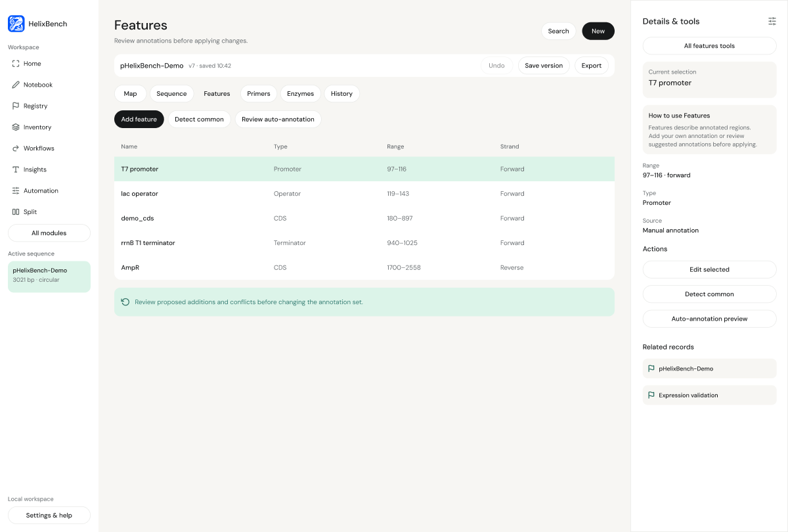

# SCR-04 · Features

[Current Figma screen](https://www.figma.com/design/U1kWw1K5NZBgEYkuxMz3Qb/helixbench?node-id=107-29886) · Implementation phase P08B.

## Purpose and layout

Create, verify and maintain annotations without detouring through a library.

Searchable/sortable feature table with selected-record inspector, explicit Add/Edit/Delete, detection preview and reusable feature library.

## Target requirements

- **SCR-04-R1:** Fields include name, kind, segments, direction, color, note, product, translation flag, genetic code, first-codon-Met option and frame offset. Preserve existing IDs when editing.
- **SCR-04-R2:** Segment parsing validates linear bounds, circular spans, empty ranges and supported multi-segment syntax; show errors beside the segment input.
- **SCR-04-R3:** Detect Common Features and bulk auto-annotation display candidate positions, strand, source motif and conflicts before applying a selected set.
- **SCR-04-R4:** Deleting a feature is an undoable document edit. Routine completion uses an inline status or toast; it does not require a second confirmation screen.
- **SCR-04-R5:** Column visibility, filters and sort do not change selection identity. A readable list is synchronized with map and sequence views.

## User flow

1. Filter or select an annotation
2. Inspect its range and biological meaning
3. Edit or create
4. Validate ranges and translation
5. Save and highlight it on Map / Sequence

Use the shared typed context, validation/review, persistence and return-location contracts at every relevant transition. Prototype fixture IDs and figures are never production defaults.

## States and recovery

- Loading: retain prior context and identify the active request/operation.
- Populated: show stable object identity, meaningful status and available actions.
- No data: offer the relevant creation/import action.
- No matches: retain query/scope and expose Reset or Change settings.
- Invalid prerequisite: explain the missing input and provide its remedy.
- Validation/write failure: retain draft values and show a constructive correction/retry.
- Dirty/partial/stale/unavailable states use the shared state machines when applicable.

## Screen-specific edge cases

- **SCR-04-EC1:** Duplicate names, empty name, invalid coordinates, wrapped segments and reverse-direction CDS.
- **SCR-04-EC2:** Frame offset outside 0–2; partial codon; absent product; a translation flag on a noncoding feature.
- **SCR-04-EC3:** Overlapping/duplicate detection candidates and ambiguous motif matches.
- **SCR-04-EC4:** Library motif is empty or incompatible with the sequence alphabet.
- **SCR-04-EC5:** Bulk annotation across dirty, empty and closed documents preserves per-document outcomes.
- **SCR-04-EC6:** Delete the selected row after sorting; clear the inspector and keep Undo available.

## Current code ownership

- [crates/appcore/src/actions.rs:103](C:/Users/Admin/Documents/Qoder/2026-11-13/87e5a6b2/helixbench/crates/appcore/src/actions.rs:103) — `pub fn save_feature_draft(app: &mut AppState, draft: &FeatureDraft) -> Result<(), String>`
- [crates/appcore/src/actions.rs:33](C:/Users/Admin/Documents/Qoder/2026-11-13/87e5a6b2/helixbench/crates/appcore/src/actions.rs:33) — `pub fn delete_feature(app: &mut AppState, id: u64)`
- [crates/appcore/src/actions.rs:219](C:/Users/Admin/Documents/Qoder/2026-11-13/87e5a6b2/helixbench/crates/appcore/src/actions.rs:219) — `pub fn apply_detected( app: &mut AppState, detected: &[domain::common_features::DetectedFeature], checked: &[bool], )`
- [crates/appcore/src/actions.rs:1464](C:/Users/Admin/Documents/Qoder/2026-11-13/87e5a6b2/helixbench/crates/appcore/src/actions.rs:1464) — `pub fn add_lib_feature(app: &mut AppState, name: &str, kind: &str, motif: &str)`
- [crates/appcore/src/actions.rs:1480](C:/Users/Admin/Documents/Qoder/2026-11-13/87e5a6b2/helixbench/crates/appcore/src/actions.rs:1480) — `pub fn delete_lib_feature(app: &mut AppState, idx: usize)`
- [crates/appcore/src/actions.rs:1488](C:/Users/Admin/Documents/Qoder/2026-11-13/87e5a6b2/helixbench/crates/appcore/src/actions.rs:1488) — `pub fn bulk_annotate(app: &mut AppState)`

Domain modules: `crates/domain/src/feature.rs`, `crates/domain/src/common_features.rs`, `crates/domain/src/feature_lib.rs`, `crates/domain/src/translate.rs`.

Native presentation entry points:

- [apps/desktop_gpui/src/views/features.rs:47](C:/Users/Admin/Documents/Qoder/2026-11-13/87e5a6b2/helixbench/apps/desktop_gpui/src/views/features.rs:47) — `render_features`
- [apps/desktop_gpui/src/dialogs.rs:711](C:/Users/Admin/Documents/Qoder/2026-11-13/87e5a6b2/helixbench/apps/desktop_gpui/src/dialogs.rs:711) — `feature_editor`
- [apps/desktop_gpui/src/dialogs.rs:1916](C:/Users/Admin/Documents/Qoder/2026-11-13/87e5a6b2/helixbench/apps/desktop_gpui/src/dialogs.rs:1916) — `detect_common`
- [apps/desktop_gpui/src/dialogs.rs:4395](C:/Users/Admin/Documents/Qoder/2026-11-13/87e5a6b2/helixbench/apps/desktop_gpui/src/dialogs.rs:4395) — `feature_lib`
- [apps/desktop_gpui/src/views/table_opts.rs:56](C:/Users/Admin/Documents/Qoder/2026-11-13/87e5a6b2/helixbench/apps/desktop_gpui/src/views/table_opts.rs:56) — `render_table_opts`

## Field/draft contracts

### FeatureDraft

[crates/appcore/src/state.rs:199](C:/Users/Admin/Documents/Qoder/2026-11-13/87e5a6b2/helixbench/crates/appcore/src/state.rs:199)

- `id: Option<u64>` — Resolve a stable typed identity from a labeled picker. Validate existence/kind at submit; do not persist a row index as a foreign key.
- `name: String` — Trim for validation; require a nonempty meaningful label where the owning operation creates an object. Preserve original editable draft on error.
- `kind: String` — Use a labeled finite choice with a visible selected value. Validate enum/mode availability; preserve unknown legacy values for review.
- `segments_text: String` — Use the owning feature/module requirements and the current typed source definition. Optional values remain distinguishable from empty/default values; validate before commit.
- `direction: Direction` — Use the owning feature/module requirements and the current typed source definition. Optional values remain distinguishable from empty/default values; validate before commit.
- `color: [u8; 3]` — Use the owning feature/module requirements and the current typed source definition. Optional values remain distinguishable from empty/default values; validate before commit.
- `note: String` — Use the owning feature/module requirements and the current typed source definition. Optional values remain distinguishable from empty/default values; validate before commit.
- `product: String` — Use the owning feature/module requirements and the current typed source definition. Optional values remain distinguishable from empty/default values; validate before commit.
- `translated: bool` — Explicit labeled toggle; default is specified by the owning feature. Persist only when the corresponding action is confirmed.
- `genetic_code: u8` — Use the owning feature/module requirements and the current typed source definition. Optional values remain distinguishable from empty/default values; validate before commit.
- `first_codon_met: bool` — Explicit labeled toggle; default is specified by the owning feature. Persist only when the corresponding action is confirmed.
- `frame_offset: usize` — Validate coordinate/length/frame using the owning tool; UI positions are 1-based inclusive. Reject empty/out-of-range spans and unsupported frame values.
- `error: Option<String>` — System-owned validation/error state; never an editable user field.

### FeatureLibDraft

[crates/appcore/src/state.rs:406](C:/Users/Admin/Documents/Qoder/2026-11-13/87e5a6b2/helixbench/crates/appcore/src/state.rs:406)

- `name: String` — Trim for validation; require a nonempty meaningful label where the owning operation creates an object. Preserve original editable draft on error.
- `kind: String` — Use a labeled finite choice with a visible selected value. Validate enum/mode availability; preserve unknown legacy values for review.
- `motif: String` — Validate the declared molecule/grammar before commit. Preserve original text and report meaningful normalization or unsupported syntax.
- `error: Option<String>` — System-owned validation/error state; never an editable user field.

## Feature-level implementation contracts

### F-051 · Add feature

**Status:** P08B source-bound feature creation and validation wired; reverse selection seeds direction.

**Entry:** Add feature (1 navigation click(s)).

**Prerequisite:** Active document.

**Outcome:** Name, kind, segments, direction, color, note, product and translation settings.

**Current evidence note:** Visible action.

**Relevant code/action family:** [crates/appcore/src/actions.rs:103](C:/Users/Admin/Documents/Qoder/2026-11-13/87e5a6b2/helixbench/crates/appcore/src/actions.rs:103), [crates/appcore/src/actions.rs:33](C:/Users/Admin/Documents/Qoder/2026-11-13/87e5a6b2/helixbench/crates/appcore/src/actions.rs:33), [crates/appcore/src/actions.rs:219](C:/Users/Admin/Documents/Qoder/2026-11-13/87e5a6b2/helixbench/crates/appcore/src/actions.rs:219), [crates/appcore/src/actions.rs:1464](C:/Users/Admin/Documents/Qoder/2026-11-13/87e5a6b2/helixbench/crates/appcore/src/actions.rs:1464), [crates/appcore/src/actions.rs:1480](C:/Users/Admin/Documents/Qoder/2026-11-13/87e5a6b2/helixbench/crates/appcore/src/actions.rs:1480), [crates/appcore/src/actions.rs:1488](C:/Users/Admin/Documents/Qoder/2026-11-13/87e5a6b2/helixbench/crates/appcore/src/actions.rs:1488).

**Acceptance:**

- F-051-AC1: Given The owning page and the stated prerequisite are available. When The user follows Add feature. Then Name, kind, segments, direction, color, note, product and translation settings; feature entry requires at most two navigation clicks.
- F-051-AC2: Given The context contains two similar names or a changed table order. When This feature is activated. Then The command payload retains the exact selected typed identity, source revision and scope.
- F-051-AC3: Given A draft contains an invalid or missing required value. When The user submits the form. Then Show a field-local error, retain the draft and perform no mutation.

**Recovery and edge conditions:**

- Invalid required fields are identified beside the input with original draft values retained.
- Cancel does not alter the source object or create an unrelated example record.
- A stale/deleted target is resolved explicitly instead of mutating a row index.
- Successful persistence updates the selected record, related views and audit consistently.
- Frame offset outside 0–2; partial codon; absent product; a translation flag on a noncoding feature.
- Overlapping/duplicate detection candidates and ambiguous motif matches.

### F-052 · Edit feature

**Status:** P08B stable feature ID and source revision validation verified; stale or missing targets rejected.

**Entry:** Feature row → Edit (2 navigation click(s)).

**Prerequisite:** Existing feature.

**Outcome:** Selected editor opens with all attributes.

**Current evidence note:** Selection plus toolbar or double-click.

**Relevant code/action family:** [crates/appcore/src/actions.rs:103](C:/Users/Admin/Documents/Qoder/2026-11-13/87e5a6b2/helixbench/crates/appcore/src/actions.rs:103), [crates/appcore/src/actions.rs:33](C:/Users/Admin/Documents/Qoder/2026-11-13/87e5a6b2/helixbench/crates/appcore/src/actions.rs:33), [crates/appcore/src/actions.rs:219](C:/Users/Admin/Documents/Qoder/2026-11-13/87e5a6b2/helixbench/crates/appcore/src/actions.rs:219), [crates/appcore/src/actions.rs:1464](C:/Users/Admin/Documents/Qoder/2026-11-13/87e5a6b2/helixbench/crates/appcore/src/actions.rs:1464), [crates/appcore/src/actions.rs:1480](C:/Users/Admin/Documents/Qoder/2026-11-13/87e5a6b2/helixbench/crates/appcore/src/actions.rs:1480), [crates/appcore/src/actions.rs:1488](C:/Users/Admin/Documents/Qoder/2026-11-13/87e5a6b2/helixbench/crates/appcore/src/actions.rs:1488).

**Acceptance:**

- F-052-AC1: Given The owning page and the stated prerequisite are available. When The user follows Feature row → Edit. Then Selected editor opens with all attributes; feature entry requires at most two navigation clicks.
- F-052-AC2: Given The context contains two similar names or a changed table order. When This feature is activated. Then The command payload retains the exact selected typed identity, source revision and scope.
- F-052-AC3: Given A draft contains an invalid or missing required value. When The user submits the form. Then Show a field-local error, retain the draft and perform no mutation.

**Recovery and edge conditions:**

- Invalid required fields are identified beside the input with original draft values retained.
- Cancel does not alter the source object or create an unrelated example record.
- A stale/deleted target is resolved explicitly instead of mutating a row index.
- Successful persistence updates the selected record, related views and audit consistently.
- Overlapping/duplicate detection candidates and ambiguous motif matches.
- Library motif is empty or incompatible with the sequence alphabet.

### F-053 · Delete feature

**Status:** P08B selected-feature deletion clears dependent range and retains existing undoable mutation.

**Entry:** Feature row → Delete (2 navigation click(s)).

**Prerequisite:** Existing feature.

**Outcome:** Show confirmation; retain undo after delete.

**Current evidence note:** Selection plus Delete.

**Relevant code/action family:** [crates/appcore/src/actions.rs:103](C:/Users/Admin/Documents/Qoder/2026-11-13/87e5a6b2/helixbench/crates/appcore/src/actions.rs:103), [crates/appcore/src/actions.rs:33](C:/Users/Admin/Documents/Qoder/2026-11-13/87e5a6b2/helixbench/crates/appcore/src/actions.rs:33), [crates/appcore/src/actions.rs:219](C:/Users/Admin/Documents/Qoder/2026-11-13/87e5a6b2/helixbench/crates/appcore/src/actions.rs:219), [crates/appcore/src/actions.rs:1464](C:/Users/Admin/Documents/Qoder/2026-11-13/87e5a6b2/helixbench/crates/appcore/src/actions.rs:1464), [crates/appcore/src/actions.rs:1480](C:/Users/Admin/Documents/Qoder/2026-11-13/87e5a6b2/helixbench/crates/appcore/src/actions.rs:1480), [crates/appcore/src/actions.rs:1488](C:/Users/Admin/Documents/Qoder/2026-11-13/87e5a6b2/helixbench/crates/appcore/src/actions.rs:1488).

**Acceptance:**

- F-053-AC1: Given The owning page and the stated prerequisite are available. When The user follows Feature row → Delete. Then Show confirmation; retain undo after delete; feature entry requires at most two navigation clicks.
- F-053-AC2: Given The context contains two similar names or a changed table order. When This feature is activated. Then The command payload retains the exact selected typed identity, source revision and scope.
- F-053-AC3: Given A consequence review identifies the selected record. When The user cancels or the commit fails. Then Keep the reviewed object unchanged, preserve useful draft context and show a recoverable outcome.

**Recovery and edge conditions:**

- Cancel before commit leaves the reviewed object and selection unchanged.
- Changing the selected object while the review is open cannot retarget the action.
- Blocked dependencies and persistence failure leave a constructive recovery path; no false success.
- Successful mutation clears or updates the exact selected context and retained references.
- Library motif is empty or incompatible with the sequence alphabet.
- Bulk annotation across dirty, empty and closed documents preserves per-document outcomes.

### F-054 · Detect common features

**Status:** P08B common-feature review exposes motif/range/strand/conflicts; only selected candidates apply.

**Entry:** Detect common (1 navigation click(s)).

**Prerequisite:** Active sequence.

**Outcome:** Detection checklist with Select new / Select none / Add.

**Current evidence note:** Features menu / page action.

**Relevant code/action family:** [crates/appcore/src/actions.rs:103](C:/Users/Admin/Documents/Qoder/2026-11-13/87e5a6b2/helixbench/crates/appcore/src/actions.rs:103), [crates/appcore/src/actions.rs:33](C:/Users/Admin/Documents/Qoder/2026-11-13/87e5a6b2/helixbench/crates/appcore/src/actions.rs:33), [crates/appcore/src/actions.rs:219](C:/Users/Admin/Documents/Qoder/2026-11-13/87e5a6b2/helixbench/crates/appcore/src/actions.rs:219), [crates/appcore/src/actions.rs:1464](C:/Users/Admin/Documents/Qoder/2026-11-13/87e5a6b2/helixbench/crates/appcore/src/actions.rs:1464), [crates/appcore/src/actions.rs:1480](C:/Users/Admin/Documents/Qoder/2026-11-13/87e5a6b2/helixbench/crates/appcore/src/actions.rs:1480), [crates/appcore/src/actions.rs:1488](C:/Users/Admin/Documents/Qoder/2026-11-13/87e5a6b2/helixbench/crates/appcore/src/actions.rs:1488).

**Acceptance:**

- F-054-AC1: Given The owning page and the stated prerequisite are available. When The user follows Detect common. Then Detection checklist with Select new / Select none / Add; feature entry requires at most two navigation clicks.
- F-054-AC2: Given The context contains two similar names or a changed table order. When This feature is activated. Then The command payload retains the exact selected typed identity, source revision and scope.
- F-054-AC3: Given The intended target was deleted or became inaccessible after rendering. When The user activates its row or link. Then Show a relevant recovery path without opening an unrelated record; retain a safe return location.

**Recovery and edge conditions:**

- Two same-name records and two stores with the same numeric ID resolve correctly.
- A missing/deleted/inaccessible target offers a relevant remedy rather than another record.
- Back restores the invoking task and selection; dirty work is preserved where necessary.
- Keyboard activation and labeled controls expose the same action as pointer input.
- Bulk annotation across dirty, empty and closed documents preserves per-document outcomes.
- Delete the selected row after sorting; clear the inspector and keep Undo available.

### F-055 · Show / hide feature

**Status:** P08B visibility actions bind captured source and feature ID; existing persisted visibility behavior retained.

**Entry:** Row visibility toggle (1 navigation click(s)).

**Prerequisite:** Existing feature.

**Outcome:** Map and Sequence update together.

**Current evidence note:** Visibility checkbox exists in source.

**Relevant code/action family:** [crates/appcore/src/actions.rs:103](C:/Users/Admin/Documents/Qoder/2026-11-13/87e5a6b2/helixbench/crates/appcore/src/actions.rs:103), [crates/appcore/src/actions.rs:33](C:/Users/Admin/Documents/Qoder/2026-11-13/87e5a6b2/helixbench/crates/appcore/src/actions.rs:33), [crates/appcore/src/actions.rs:219](C:/Users/Admin/Documents/Qoder/2026-11-13/87e5a6b2/helixbench/crates/appcore/src/actions.rs:219), [crates/appcore/src/actions.rs:1464](C:/Users/Admin/Documents/Qoder/2026-11-13/87e5a6b2/helixbench/crates/appcore/src/actions.rs:1464), [crates/appcore/src/actions.rs:1480](C:/Users/Admin/Documents/Qoder/2026-11-13/87e5a6b2/helixbench/crates/appcore/src/actions.rs:1480), [crates/appcore/src/actions.rs:1488](C:/Users/Admin/Documents/Qoder/2026-11-13/87e5a6b2/helixbench/crates/appcore/src/actions.rs:1488).

**Acceptance:**

- F-055-AC1: Given The owning page and the stated prerequisite are available. When The user follows Row visibility toggle. Then Map and Sequence update together; feature entry requires at most two navigation clicks.
- F-055-AC2: Given The context contains two similar names or a changed table order. When This feature is activated. Then The command payload retains the exact selected typed identity, source revision and scope.
- F-055-AC3: Given The intended target was deleted or became inaccessible after rendering. When The user activates its row or link. Then Show a relevant recovery path without opening an unrelated record; retain a safe return location.

**Recovery and edge conditions:**

- Two same-name records and two stores with the same numeric ID resolve correctly.
- A missing/deleted/inaccessible target offers a relevant remedy rather than another record.
- Back restores the invoking task and selection; dirty work is preserved where necessary.
- Keyboard activation and labeled controls expose the same action as pointer input.
- Delete the selected row after sorting; clear the inspector and keep Undo available.
- Duplicate names, empty name, invalid coordinates, wrapped segments and reverse-direction CDS.

### F-056 · Filter annotations

**Status:** Specified; not verified implemented.

**Entry:** Filter field (1 navigation click(s)).

**Prerequisite:** None.

**Outcome:** Filter data, not feature discovery.

**Current evidence note:** Existing name/kind/product matching.

**Relevant code/action family:** [crates/appcore/src/actions.rs:103](C:/Users/Admin/Documents/Qoder/2026-11-13/87e5a6b2/helixbench/crates/appcore/src/actions.rs:103), [crates/appcore/src/actions.rs:33](C:/Users/Admin/Documents/Qoder/2026-11-13/87e5a6b2/helixbench/crates/appcore/src/actions.rs:33), [crates/appcore/src/actions.rs:219](C:/Users/Admin/Documents/Qoder/2026-11-13/87e5a6b2/helixbench/crates/appcore/src/actions.rs:219), [crates/appcore/src/actions.rs:1464](C:/Users/Admin/Documents/Qoder/2026-11-13/87e5a6b2/helixbench/crates/appcore/src/actions.rs:1464), [crates/appcore/src/actions.rs:1480](C:/Users/Admin/Documents/Qoder/2026-11-13/87e5a6b2/helixbench/crates/appcore/src/actions.rs:1480), [crates/appcore/src/actions.rs:1488](C:/Users/Admin/Documents/Qoder/2026-11-13/87e5a6b2/helixbench/crates/appcore/src/actions.rs:1488).

**Acceptance:**

- F-056-AC1: Given The owning page and the stated prerequisite are available. When The user follows Filter field. Then Filter data, not feature discovery; feature entry requires at most two navigation clicks.
- F-056-AC2: Given The context contains two similar names or a changed table order. When This feature is activated. Then The command payload retains the exact selected typed identity, source revision and scope.
- F-056-AC3: Given Underlying records exist and a query or filter is active. When The query/filter matches no records. Then Show no matches with the active scope and reset remedy; do not claim that the dataset is empty or failed.

**Recovery and edge conditions:**

- Empty source, filtered-out records and failed load have different status/remedies.
- Sorting/filtering or a same-name record cannot change the selected stable identity.
- Returning restores the same query/filter/scope and scroll anchor where supported.
- Inspection-only changes do not mark scientific content dirty.
- Duplicate names, empty name, invalid coordinates, wrapped segments and reverse-direction CDS.
- Frame offset outside 0–2; partial codon; absent product; a translation flag on a noncoding feature.

### F-057 · Sort annotations

**Status:** Specified; not verified implemented.

**Entry:** Column header (1 navigation click(s)).

**Prerequisite:** Rows available.

**Outcome:** Sort state stays visible; repeat cycles direction.

**Current evidence note:** Existing sortable headers.

**Relevant code/action family:** [crates/appcore/src/actions.rs:103](C:/Users/Admin/Documents/Qoder/2026-11-13/87e5a6b2/helixbench/crates/appcore/src/actions.rs:103), [crates/appcore/src/actions.rs:33](C:/Users/Admin/Documents/Qoder/2026-11-13/87e5a6b2/helixbench/crates/appcore/src/actions.rs:33), [crates/appcore/src/actions.rs:219](C:/Users/Admin/Documents/Qoder/2026-11-13/87e5a6b2/helixbench/crates/appcore/src/actions.rs:219), [crates/appcore/src/actions.rs:1464](C:/Users/Admin/Documents/Qoder/2026-11-13/87e5a6b2/helixbench/crates/appcore/src/actions.rs:1464), [crates/appcore/src/actions.rs:1480](C:/Users/Admin/Documents/Qoder/2026-11-13/87e5a6b2/helixbench/crates/appcore/src/actions.rs:1480), [crates/appcore/src/actions.rs:1488](C:/Users/Admin/Documents/Qoder/2026-11-13/87e5a6b2/helixbench/crates/appcore/src/actions.rs:1488).

**Acceptance:**

- F-057-AC1: Given The owning page and the stated prerequisite are available. When The user follows Column header. Then Sort state stays visible; repeat cycles direction; feature entry requires at most two navigation clicks.
- F-057-AC2: Given The context contains two similar names or a changed table order. When This feature is activated. Then The command payload retains the exact selected typed identity, source revision and scope.
- F-057-AC3: Given Underlying records exist and a query or filter is active. When The query/filter matches no records. Then Show no matches with the active scope and reset remedy; do not claim that the dataset is empty or failed.

**Recovery and edge conditions:**

- Empty source, filtered-out records and failed load have different status/remedies.
- Sorting/filtering or a same-name record cannot change the selected stable identity.
- Returning restores the same query/filter/scope and scroll anchor where supported.
- Inspection-only changes do not mark scientific content dirty.
- Frame offset outside 0–2; partial codon; absent product; a translation flag on a noncoding feature.
- Overlapping/duplicate detection candidates and ambiguous motif matches.

### F-058 · Configure columns

**Status:** Specified; not verified implemented.

**Entry:** Columns / Views → Column name (2 navigation click(s)).

**Prerequisite:** None.

**Outcome:** Toggle individual columns.

**Current evidence note:** Source popup omitted from design.

**Relevant code/action family:** [crates/appcore/src/actions.rs:103](C:/Users/Admin/Documents/Qoder/2026-11-13/87e5a6b2/helixbench/crates/appcore/src/actions.rs:103), [crates/appcore/src/actions.rs:33](C:/Users/Admin/Documents/Qoder/2026-11-13/87e5a6b2/helixbench/crates/appcore/src/actions.rs:33), [crates/appcore/src/actions.rs:219](C:/Users/Admin/Documents/Qoder/2026-11-13/87e5a6b2/helixbench/crates/appcore/src/actions.rs:219), [crates/appcore/src/actions.rs:1464](C:/Users/Admin/Documents/Qoder/2026-11-13/87e5a6b2/helixbench/crates/appcore/src/actions.rs:1464), [crates/appcore/src/actions.rs:1480](C:/Users/Admin/Documents/Qoder/2026-11-13/87e5a6b2/helixbench/crates/appcore/src/actions.rs:1480), [crates/appcore/src/actions.rs:1488](C:/Users/Admin/Documents/Qoder/2026-11-13/87e5a6b2/helixbench/crates/appcore/src/actions.rs:1488).

**Acceptance:**

- F-058-AC1: Given The owning page and the stated prerequisite are available. When The user follows Columns / Views → Column name. Then Toggle individual columns; feature entry requires at most two navigation clicks.
- F-058-AC2: Given The context contains two similar names or a changed table order. When This feature is activated. Then The command payload retains the exact selected typed identity, source revision and scope.
- F-058-AC3: Given Underlying records exist and a query or filter is active. When The query/filter matches no records. Then Show no matches with the active scope and reset remedy; do not claim that the dataset is empty or failed.

**Recovery and edge conditions:**

- Empty source, filtered-out records and failed load have different status/remedies.
- Sorting/filtering or a same-name record cannot change the selected stable identity.
- Returning restores the same query/filter/scope and scroll anchor where supported.
- Inspection-only changes do not mark scientific content dirty.
- Overlapping/duplicate detection candidates and ambiguous motif matches.
- Library motif is empty or incompatible with the sequence alphabet.

### F-059 · Save current table view

**Status:** Specified; not verified implemented.

**Entry:** Columns / Views → Save view (2 navigation click(s)).

**Prerequisite:** Current filter/columns/sort.

**Outcome:** Name and persist table configuration.

**Current evidence note:** Source supports saved views.

**Relevant code/action family:** [crates/appcore/src/actions.rs:103](C:/Users/Admin/Documents/Qoder/2026-11-13/87e5a6b2/helixbench/crates/appcore/src/actions.rs:103), [crates/appcore/src/actions.rs:33](C:/Users/Admin/Documents/Qoder/2026-11-13/87e5a6b2/helixbench/crates/appcore/src/actions.rs:33), [crates/appcore/src/actions.rs:219](C:/Users/Admin/Documents/Qoder/2026-11-13/87e5a6b2/helixbench/crates/appcore/src/actions.rs:219), [crates/appcore/src/actions.rs:1464](C:/Users/Admin/Documents/Qoder/2026-11-13/87e5a6b2/helixbench/crates/appcore/src/actions.rs:1464), [crates/appcore/src/actions.rs:1480](C:/Users/Admin/Documents/Qoder/2026-11-13/87e5a6b2/helixbench/crates/appcore/src/actions.rs:1480), [crates/appcore/src/actions.rs:1488](C:/Users/Admin/Documents/Qoder/2026-11-13/87e5a6b2/helixbench/crates/appcore/src/actions.rs:1488).

**Acceptance:**

- F-059-AC1: Given The owning page and the stated prerequisite are available. When The user follows Columns / Views → Save view. Then Name and persist table configuration; feature entry requires at most two navigation clicks.
- F-059-AC2: Given The context contains two similar names or a changed table order. When This feature is activated. Then The command payload retains the exact selected typed identity, source revision and scope.
- F-059-AC3: Given A file or store write is awaiting completion. When The OS dialog is canceled or the atomic write fails. Then Do not report success, change saved/dirty truth or continue a pending destructive intent; preserve original data.

**Recovery and edge conditions:**

- OS-dialog cancellation leaves drafts, source data and pending navigation intact.
- Permission denied, disk full, locked destination and rename failure never show success.
- Reopening/retrying the same operation preserves identity and does not duplicate successful output.
- Export/import preserves scope, encoding, units and declared lossy transformations.
- Library motif is empty or incompatible with the sequence alphabet.
- Bulk annotation across dirty, empty and closed documents preserves per-document outcomes.

### F-060 · Load / delete saved view

**Status:** Specified; not verified implemented.

**Entry:** Views → Saved view or Delete (2 navigation click(s)).

**Prerequisite:** Saved view exists.

**Outcome:** Apply config or remove only the saved view.

**Current evidence note:** Source supports load/delete.

**Relevant code/action family:** [crates/appcore/src/actions.rs:103](C:/Users/Admin/Documents/Qoder/2026-11-13/87e5a6b2/helixbench/crates/appcore/src/actions.rs:103), [crates/appcore/src/actions.rs:33](C:/Users/Admin/Documents/Qoder/2026-11-13/87e5a6b2/helixbench/crates/appcore/src/actions.rs:33), [crates/appcore/src/actions.rs:219](C:/Users/Admin/Documents/Qoder/2026-11-13/87e5a6b2/helixbench/crates/appcore/src/actions.rs:219), [crates/appcore/src/actions.rs:1464](C:/Users/Admin/Documents/Qoder/2026-11-13/87e5a6b2/helixbench/crates/appcore/src/actions.rs:1464), [crates/appcore/src/actions.rs:1480](C:/Users/Admin/Documents/Qoder/2026-11-13/87e5a6b2/helixbench/crates/appcore/src/actions.rs:1480), [crates/appcore/src/actions.rs:1488](C:/Users/Admin/Documents/Qoder/2026-11-13/87e5a6b2/helixbench/crates/appcore/src/actions.rs:1488).

**Acceptance:**

- F-060-AC1: Given The owning page and the stated prerequisite are available. When The user follows Views → Saved view or Delete. Then Apply config or remove only the saved view; feature entry requires at most two navigation clicks.
- F-060-AC2: Given The context contains two similar names or a changed table order. When This feature is activated. Then The command payload retains the exact selected typed identity, source revision and scope.
- F-060-AC3: Given A consequence review identifies the selected record. When The user cancels or the commit fails. Then Keep the reviewed object unchanged, preserve useful draft context and show a recoverable outcome.

**Recovery and edge conditions:**

- Cancel before commit leaves the reviewed object and selection unchanged.
- Changing the selected object while the review is open cannot retarget the action.
- Blocked dependencies and persistence failure leave a constructive recovery path; no false success.
- Successful mutation clears or updates the exact selected context and retained references.
- Bulk annotation across dirty, empty and closed documents preserves per-document outcomes.
- Delete the selected row after sorting; clear the inspector and keep Undo available.

### F-061 · Translate feature / choose code / frame

**Status:** P08B frame/code validation and existing translation preview retained; source-bound fields preserved.

**Entry:** Feature row → Translation settings (2 navigation click(s)).

**Prerequisite:** CDS or translatable feature.

**Outcome:** Expose enable, code, first-codon methionine and frame offset.

**Current evidence note:** Inside feature editor.

**Relevant code/action family:** [crates/appcore/src/actions.rs:103](C:/Users/Admin/Documents/Qoder/2026-11-13/87e5a6b2/helixbench/crates/appcore/src/actions.rs:103), [crates/appcore/src/actions.rs:33](C:/Users/Admin/Documents/Qoder/2026-11-13/87e5a6b2/helixbench/crates/appcore/src/actions.rs:33), [crates/appcore/src/actions.rs:219](C:/Users/Admin/Documents/Qoder/2026-11-13/87e5a6b2/helixbench/crates/appcore/src/actions.rs:219), [crates/appcore/src/actions.rs:1464](C:/Users/Admin/Documents/Qoder/2026-11-13/87e5a6b2/helixbench/crates/appcore/src/actions.rs:1464), [crates/appcore/src/actions.rs:1480](C:/Users/Admin/Documents/Qoder/2026-11-13/87e5a6b2/helixbench/crates/appcore/src/actions.rs:1480), [crates/appcore/src/actions.rs:1488](C:/Users/Admin/Documents/Qoder/2026-11-13/87e5a6b2/helixbench/crates/appcore/src/actions.rs:1488).

**Acceptance:**

- F-061-AC1: Given The owning page and the stated prerequisite are available. When The user follows Feature row → Translation settings. Then Expose enable, code, first-codon methionine and frame offset; feature entry requires at most two navigation clicks.
- F-061-AC2: Given The context contains two similar names or a changed table order. When This feature is activated. Then The command payload retains the exact selected typed identity, source revision and scope.
- F-061-AC3: Given Validated parameters and an immutable input have been captured. When The computation finishes with no scientific matches. Then Show a completed no-match diagnostic, preserve input provenance and offer a meaningful parameter change.

**Recovery and edge conditions:**

- No scientific matches is represented separately from invalid input or a failed computation.
- Changing the source/selection during execution does not substitute a newer input.
- Cancel is offered only at a supported stage; repeated Run does not duplicate an output commit.
- Saved output retains actual input revision, method, parameters and units.
- Delete the selected row after sorting; clear the inspector and keep Undo available.
- Duplicate names, empty name, invalid coordinates, wrapped segments and reverse-direction CDS.

### F-062 · Color / product / notes / split segments

**Status:** P08B field preservation and circular/joined segment validation verified; overlapping legacy joins warn without rewriting.

**Entry:** Feature row → Edit details (2 navigation click(s)).

**Prerequisite:** Existing annotation.

**Outcome:** Support multi-segment ranges and explain syntax.

**Current evidence note:** Inside feature editor.

**Relevant code/action family:** [crates/appcore/src/actions.rs:103](C:/Users/Admin/Documents/Qoder/2026-11-13/87e5a6b2/helixbench/crates/appcore/src/actions.rs:103), [crates/appcore/src/actions.rs:33](C:/Users/Admin/Documents/Qoder/2026-11-13/87e5a6b2/helixbench/crates/appcore/src/actions.rs:33), [crates/appcore/src/actions.rs:219](C:/Users/Admin/Documents/Qoder/2026-11-13/87e5a6b2/helixbench/crates/appcore/src/actions.rs:219), [crates/appcore/src/actions.rs:1464](C:/Users/Admin/Documents/Qoder/2026-11-13/87e5a6b2/helixbench/crates/appcore/src/actions.rs:1464), [crates/appcore/src/actions.rs:1480](C:/Users/Admin/Documents/Qoder/2026-11-13/87e5a6b2/helixbench/crates/appcore/src/actions.rs:1480), [crates/appcore/src/actions.rs:1488](C:/Users/Admin/Documents/Qoder/2026-11-13/87e5a6b2/helixbench/crates/appcore/src/actions.rs:1488).

**Acceptance:**

- F-062-AC1: Given The owning page and the stated prerequisite are available. When The user follows Feature row → Edit details. Then Support multi-segment ranges and explain syntax; feature entry requires at most two navigation clicks.
- F-062-AC2: Given The context contains two similar names or a changed table order. When This feature is activated. Then The command payload retains the exact selected typed identity, source revision and scope.
- F-062-AC3: Given Underlying records exist and a query or filter is active. When The query/filter matches no records. Then Show no matches with the active scope and reset remedy; do not claim that the dataset is empty or failed.

**Recovery and edge conditions:**

- Empty source, filtered-out records and failed load have different status/remedies.
- Sorting/filtering or a same-name record cannot change the selected stable identity.
- Returning restores the same query/filter/scope and scroll anchor where supported.
- Inspection-only changes do not mark scientific content dirty.
- Duplicate names, empty name, invalid coordinates, wrapped segments and reverse-direction CDS.
- Frame offset outside 0–2; partial codon; absent product; a translation flag on a noncoding feature.

### F-063 · Reveal in Map or Sequence

**Status:** Specified; not verified implemented.

**Entry:** Feature row → Show on map or sequence (2 navigation click(s)).

**Prerequisite:** Existing feature.

**Outcome:** Jump to the exact region.

**Current evidence note:** Selection synchronization is indirect.

**Relevant code/action family:** [crates/appcore/src/actions.rs:103](C:/Users/Admin/Documents/Qoder/2026-11-13/87e5a6b2/helixbench/crates/appcore/src/actions.rs:103), [crates/appcore/src/actions.rs:33](C:/Users/Admin/Documents/Qoder/2026-11-13/87e5a6b2/helixbench/crates/appcore/src/actions.rs:33), [crates/appcore/src/actions.rs:219](C:/Users/Admin/Documents/Qoder/2026-11-13/87e5a6b2/helixbench/crates/appcore/src/actions.rs:219), [crates/appcore/src/actions.rs:1464](C:/Users/Admin/Documents/Qoder/2026-11-13/87e5a6b2/helixbench/crates/appcore/src/actions.rs:1464), [crates/appcore/src/actions.rs:1480](C:/Users/Admin/Documents/Qoder/2026-11-13/87e5a6b2/helixbench/crates/appcore/src/actions.rs:1480), [crates/appcore/src/actions.rs:1488](C:/Users/Admin/Documents/Qoder/2026-11-13/87e5a6b2/helixbench/crates/appcore/src/actions.rs:1488).

**Acceptance:**

- F-063-AC1: Given The owning page and the stated prerequisite are available. When The user follows Feature row → Show on map or sequence. Then Jump to the exact region; feature entry requires at most two navigation clicks.
- F-063-AC2: Given The context contains two similar names or a changed table order. When This feature is activated. Then The command payload retains the exact selected typed identity, source revision and scope.
- F-063-AC3: Given The intended target was deleted or became inaccessible after rendering. When The user activates its row or link. Then Show a relevant recovery path without opening an unrelated record; retain a safe return location.

**Recovery and edge conditions:**

- Two same-name records and two stores with the same numeric ID resolve correctly.
- A missing/deleted/inaccessible target offers a relevant remedy rather than another record.
- Back restores the invoking task and selection; dirty work is preserved where necessary.
- Keyboard activation and labeled controls expose the same action as pointer input.
- Frame offset outside 0–2; partial codon; absent product; a translation flag on a noncoding feature.
- Overlapping/duplicate detection candidates and ambiguous motif matches.

### F-064 · Motif library / bulk auto-annotate

**Status:** P08B explicit per-document library annotation review/apply/outcomes and undo verified; ambiguous duplicate names blocked.

**Entry:** Feature library (1 navigation click(s)).

**Prerequisite:** Motifs; target documents selected for bulk.

**Outcome:** Review matches and duplicates before applying.

**Current evidence note:** Tools menu only.

**Relevant code/action family:** [crates/appcore/src/actions.rs:1460](C:/Users/Admin/Documents/Qoder/2026-11-13/87e5a6b2/helixbench/crates/appcore/src/actions.rs:1460), [crates/appcore/src/actions.rs:1464](C:/Users/Admin/Documents/Qoder/2026-11-13/87e5a6b2/helixbench/crates/appcore/src/actions.rs:1464), [crates/appcore/src/actions.rs:1488](C:/Users/Admin/Documents/Qoder/2026-11-13/87e5a6b2/helixbench/crates/appcore/src/actions.rs:1488).

**Acceptance:**

- F-064-AC1: Given The owning page and the stated prerequisite are available. When The user follows Feature library. Then Review matches and duplicates before applying; feature entry requires at most two navigation clicks.
- F-064-AC2: Given The context contains two similar names or a changed table order. When This feature is activated. Then The command payload retains the exact selected typed identity, source revision and scope.
- F-064-AC3: Given The intended target was deleted or became inaccessible after rendering. When The user activates its row or link. Then Show a relevant recovery path without opening an unrelated record; retain a safe return location.

**Recovery and edge conditions:**

- Two same-name records and two stores with the same numeric ID resolve correctly.
- A missing/deleted/inaccessible target offers a relevant remedy rather than another record.
- Back restores the invoking task and selection; dirty work is preserved where necessary.
- Keyboard activation and labeled controls expose the same action as pointer input.
- Overlapping/duplicate detection candidates and ambiguous motif matches.
- Library motif is empty or incompatible with the sequence alphabet.

## P08B implemented flow and evidence — 16 November 2026

Select a stable feature row, then Edit. The draft captures document/revision and feature
ID. Name/type, direction, color, note, product, translation flag/code, first-codon-Met
and frame offset survive the edit. Invalid bounds, empty ranges/names, unsupported
codes and frame offsets outside0–2 retain the draft with correction feedback. A deleted
feature or changed source cannot produce a silent successful save or empty checkpoint.
Successful save selects the exact feature; Undo restores the prior document.

Segments use1-based inclusive UI coordinates. Circular origin-spanning and unrolled
legacy spans remain supported. Existing joined overlaps are preserved and explicitly
warned about; stricter bounds validation does not reinterpret their scientific meaning.
Duplicate names remain valid for ordinary features; library-entry names must be unique
because they identify source motifs in review.

Detect Common and Review auto-annotation open captured proposals with range, strand,
motif source and duplicate/overlap warnings. Overlap proposals start unchecked. Select
individual candidates or Select all/Clear per document, then Apply selected. Cancel
changes no document. The review displays each document's added/skipped/error outcome;
stale sources and closed documents cannot be silently replaced. Changes are unsaved
document edits, not a claim of disk persistence. Each changed open document retains its
own Undo checkpoint through the existing document-session controller.

The library scan retains its existing exact-motif and existing-name skip behavior.
Empty/invalid motif data and duplicate library names block ambiguous previews with
guidance. The original common-feature detector is reused. The obsolete immediate
detection mutation path was removed. The direct Features entry makes review reachable
without opening the library first; existing library management remains available.

Verification:10 domain and5 appcore P08B tests, all355 workspace tests, strict core
Clippy, formatting/diff/source/manifest checks and native executable build passed.
Native1280px checks covered toolbar fit, editor, inline invalid-range errors, common
review/conflicts, explicit apply(13→14 features), per-document outcome, Undo(14→13 and
clean state), direct library review/cancel, and the final overlapping-join warning.
Broader large-data profiling and complete accessibility acceptance remain P19.
