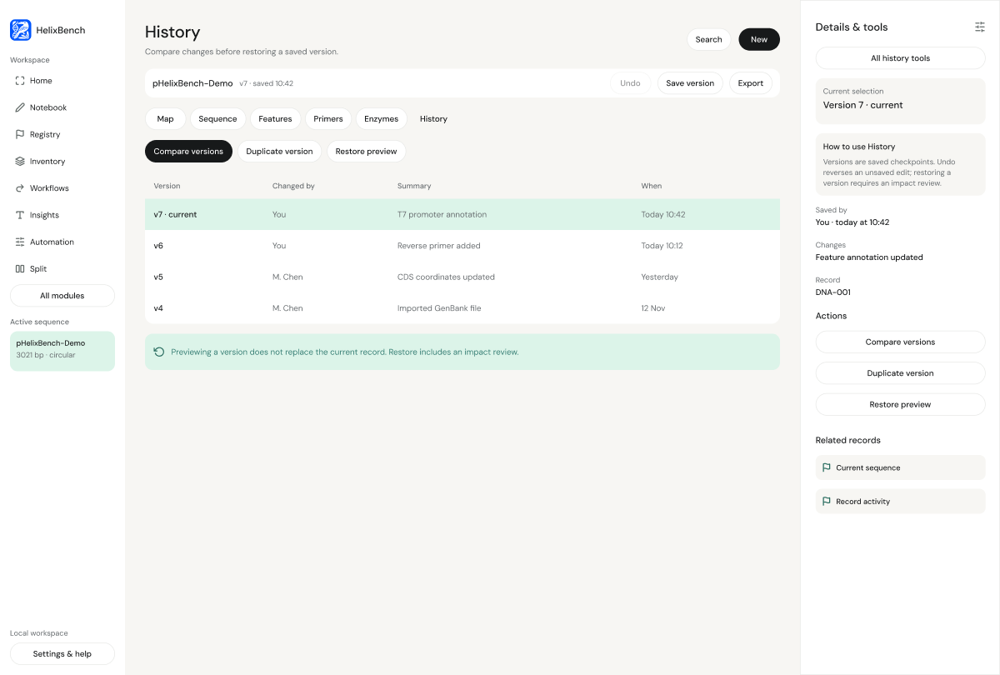

# SCR-07 · History

[Current Figma screen](https://www.figma.com/design/U1kWw1K5NZBgEYkuxMz3Qb/helixbench?node-id=107-30500) · Implementation phase P08D.

## Purpose and layout

Understand a change and recover a previous state confidently.

Separate edit Undo/Redo history and persistent named checkpoints; current version marker; compare/restore preview; linked result provenance.

## Target requirements

- **SCR-07-R1:** Undo/Redo act on the current document edit stack. Named versions are persistent checkpoints and are not substitutes for Undo.
- **SCR-07-R2:** Restore previews changes to sequence, features and primers and creates an intentional current state; older result provenance remains tied to the original snapshot.
- **SCR-07-R3:** Use durable revision IDs instead of list indexes in persisted references. The existing 20-checkpoint retention cap cannot erase an input referenced by a retained result.
- **SCR-07-R4:** Dirty-state calculation remains correct after save, undo-to-saved, redo and branching edits. Mark unsaved versions explicitly.
- **SCR-07-R5:** Canceling restore leaves current state, version list and selection untouched. A failed native save does not falsely mark the document clean.

## User flow

1. Choose an operation or saved version
2. Preview affected regions
3. Request revert or restore
4. Confirm scope
5. Return to the recovered document with an undo route

Use the shared typed context, validation/review, persistence and return-location contracts at every relevant transition. Prototype fixture IDs and figures are never production defaults.

## States and recovery

- Loading: retain prior context and identify the active request/operation.
- Populated: show stable object identity, meaningful status and available actions.
- No data: offer the relevant creation/import action.
- No matches: retain query/scope and expose Reset or Change settings.
- Invalid prerequisite: explain the missing input and provide its remedy.
- Validation/write failure: retain draft values and show a constructive correction/retry.
- Dirty/partial/stale/unavailable states use the shared state machines when applicable.

## Screen-specific edge cases

- **SCR-07-EC1:** Undo at the first edit, redo at the last edit, branch after undo and undo back to the saved point.
- **SCR-07-EC2:** Empty version list, repeated labels and restoration of an unavailable snapshot.
- **SCR-07-EC3:** Pinned result input reaches the checkpoint-retention boundary.
- **SCR-07-EC4:** Restore while another document is active or an analysis result is pending.
- **SCR-07-EC5:** Clock changes affect timestamp ordering but not stable revision identity.
- **SCR-07-EC6:** Legacy version indexes are migrated once and are never used as permanent cross-record IDs.

## Current code ownership

- [crates/appcore/src/actions.rs:943](C:/Users/Admin/Documents/Qoder/2026-11-13/87e5a6b2/helixbench/crates/appcore/src/actions.rs:943) — `pub fn save_version(app: &mut AppState, label: &str)`
- [crates/appcore/src/actions.rs:954](C:/Users/Admin/Documents/Qoder/2026-11-13/87e5a6b2/helixbench/crates/appcore/src/actions.rs:954) — `pub fn restore_version(app: &mut AppState, idx: usize)`

Domain modules: `crates/domain/src/document.rs`.

Native presentation entry points:

- [apps/desktop_gpui/src/views/history.rs:27](C:/Users/Admin/Documents/Qoder/2026-11-13/87e5a6b2/helixbench/apps/desktop_gpui/src/views/history.rs:27) — `render_history`

## Field/draft contracts

## Feature-level implementation contracts

### F-091 · Undo latest edit

**Status:** P08D edit Undo preserves named checkpoints and correct saved/dirty truth; target-name button copy deferred.

**Entry:** Undo (1 navigation click(s)).

**Prerequisite:** Undo stack nonempty.

**Outcome:** Name the operation being undone.

**Current evidence note:** Existing icon action / shortcut.

**Relevant code/action family:** [crates/appcore/src/actions.rs:943](C:/Users/Admin/Documents/Qoder/2026-11-13/87e5a6b2/helixbench/crates/appcore/src/actions.rs:943), [crates/appcore/src/actions.rs:954](C:/Users/Admin/Documents/Qoder/2026-11-13/87e5a6b2/helixbench/crates/appcore/src/actions.rs:954).

**Acceptance:**

- F-091-AC1: Given The owning page and the stated prerequisite are available. When The user follows Undo. Then Name the operation being undone; feature entry requires at most two navigation clicks.
- F-091-AC2: Given The context contains two similar names or a changed table order. When This feature is activated. Then The command payload retains the exact selected typed identity, source revision and scope.
- F-091-AC3: Given A draft contains an invalid or missing required value. When The user submits the form. Then Show a field-local error, retain the draft and perform no mutation.

**Recovery and edge conditions:**

- Invalid required fields are identified beside the input with original draft values retained.
- Cancel does not alter the source object or create an unrelated example record.
- A stale/deleted target is resolved explicitly instead of mutating a row index.
- Successful persistence updates the selected record, related views and audit consistently.
- Empty version list, repeated labels and restoration of an unavailable snapshot.
- Pinned result input reaches the checkpoint-retention boundary.

### F-092 · Redo edit

**Status:** P08D edit Redo preserves named checkpoints and saved baseline; target-name button copy deferred.

**Entry:** Redo (1 navigation click(s)).

**Prerequisite:** Redo stack nonempty.

**Outcome:** Name the redo target.

**Current evidence note:** Existing icon action / shortcut.

**Relevant code/action family:** [crates/appcore/src/actions.rs:943](C:/Users/Admin/Documents/Qoder/2026-11-13/87e5a6b2/helixbench/crates/appcore/src/actions.rs:943), [crates/appcore/src/actions.rs:954](C:/Users/Admin/Documents/Qoder/2026-11-13/87e5a6b2/helixbench/crates/appcore/src/actions.rs:954).

**Acceptance:**

- F-092-AC1: Given The owning page and the stated prerequisite are available. When The user follows Redo. Then Name the redo target; feature entry requires at most two navigation clicks.
- F-092-AC2: Given The context contains two similar names or a changed table order. When This feature is activated. Then The command payload retains the exact selected typed identity, source revision and scope.
- F-092-AC3: Given A draft contains an invalid or missing required value. When The user submits the form. Then Show a field-local error, retain the draft and perform no mutation.

**Recovery and edge conditions:**

- Invalid required fields are identified beside the input with original draft values retained.
- Cancel does not alter the source object or create an unrelated example record.
- A stale/deleted target is resolved explicitly instead of mutating a row index.
- Successful persistence updates the selected record, related views and audit consistently.
- Pinned result input reaches the checkpoint-retention boundary.
- Restore while another document is active or an analysis result is pending.

### F-093 · Inspect affected regions

**Status:** P08D source-bound highlight action retained without changing scientific data.

**Entry:** Operation row (1 navigation click(s)).

**Prerequisite:** Recorded operation.

**Outcome:** Show ranges and source-view highlight.

**Current evidence note:** Click highlight exists.

**Relevant code/action family:** [crates/appcore/src/actions.rs:943](C:/Users/Admin/Documents/Qoder/2026-11-13/87e5a6b2/helixbench/crates/appcore/src/actions.rs:943), [crates/appcore/src/actions.rs:954](C:/Users/Admin/Documents/Qoder/2026-11-13/87e5a6b2/helixbench/crates/appcore/src/actions.rs:954).

**Acceptance:**

- F-093-AC1: Given The owning page and the stated prerequisite are available. When The user follows Operation row. Then Show ranges and source-view highlight; feature entry requires at most two navigation clicks.
- F-093-AC2: Given The context contains two similar names or a changed table order. When This feature is activated. Then The command payload retains the exact selected typed identity, source revision and scope.
- F-093-AC3: Given The intended target was deleted or became inaccessible after rendering. When The user activates its row or link. Then Show a relevant recovery path without opening an unrelated record; retain a safe return location.

**Recovery and edge conditions:**

- Two same-name records and two stores with the same numeric ID resolve correctly.
- A missing/deleted/inaccessible target offers a relevant remedy rather than another record.
- Back restores the invoking task and selection; dirty work is preserved where necessary.
- Keyboard activation and labeled controls expose the same action as pointer input.
- Restore while another document is active or an analysis result is pending.
- Clock changes affect timestamp ordering but not stable revision identity.

### F-094 · Revert to before operation

**Status:** P08D before-edit snapshot review and explicit restore create a new undoable revision.

**Entry:** Operation row → Revert to before (2 navigation click(s)).

**Prerequisite:** Recorded operation.

**Outcome:** Preview scope, then confirm separately.

**Current evidence note:** Existing selected button and hidden double-click.

**Relevant code/action family:** [crates/appcore/src/actions.rs:943](C:/Users/Admin/Documents/Qoder/2026-11-13/87e5a6b2/helixbench/crates/appcore/src/actions.rs:943), [crates/appcore/src/actions.rs:954](C:/Users/Admin/Documents/Qoder/2026-11-13/87e5a6b2/helixbench/crates/appcore/src/actions.rs:954).

**Acceptance:**

- F-094-AC1: Given The owning page and the stated prerequisite are available. When The user follows Operation row → Revert to before. Then Preview scope, then confirm separately; feature entry requires at most two navigation clicks.
- F-094-AC2: Given The context contains two similar names or a changed table order. When This feature is activated. Then The command payload retains the exact selected typed identity, source revision and scope.
- F-094-AC3: Given The intended target was deleted or became inaccessible after rendering. When The user activates its row or link. Then Show a relevant recovery path without opening an unrelated record; retain a safe return location.

**Recovery and edge conditions:**

- Two same-name records and two stores with the same numeric ID resolve correctly.
- A missing/deleted/inaccessible target offers a relevant remedy rather than another record.
- Back restores the invoking task and selection; dirty work is preserved where necessary.
- Keyboard activation and labeled controls expose the same action as pointer input.
- Clock changes affect timestamp ordering but not stable revision identity.
- Legacy version indexes are migrated once and are never used as permanent cross-record IDs.

### F-095 · Save a version snapshot

**Status:** P08D named local checkpoints retain scientific source identity and survive Undo; disk save state is explicit.

**Entry:** Save version (1 navigation click(s)).

**Prerequisite:** Active document.

**Outcome:** Name / timestamp a recoverable snapshot.

**Current evidence note:** Existing action.

**Relevant code/action family:** [crates/appcore/src/actions.rs:2674](C:/Users/Admin/Documents/Qoder/2026-11-13/87e5a6b2/helixbench/crates/appcore/src/actions.rs:2674).

**Acceptance:**

- F-095-AC1: Given The owning page and the stated prerequisite are available. When The user follows Save version. Then Name / timestamp a recoverable snapshot; feature entry requires at most two navigation clicks.
- F-095-AC2: Given The context contains two similar names or a changed table order. When This feature is activated. Then The command payload retains the exact selected typed identity, source revision and scope.
- F-095-AC3: Given A file or store write is awaiting completion. When The OS dialog is canceled or the atomic write fails. Then Do not report success, change saved/dirty truth or continue a pending destructive intent; preserve original data.

**Recovery and edge conditions:**

- OS-dialog cancellation leaves drafts, source data and pending navigation intact.
- Permission denied, disk full, locked destination and rename failure never show success.
- Reopening/retrying the same operation preserves identity and does not duplicate successful output.
- Export/import preserves scope, encoding, units and declared lossy transformations.
- Legacy version indexes are migrated once and are never used as permanent cross-record IDs.
- Undo at the first edit, redo at the last edit, branch after undo and undo back to the saved point.

### F-096 · Restore saved version

**Status:** P08D exact checkpoint capture, impact preview, Cancel and new-revision undoable restore verified.

**Entry:** Version row → Restore (2 navigation click(s)).

**Prerequisite:** Saved version.

**Outcome:** Review differences and preserve current work before restore.

**Current evidence note:** Source Restore per version.

**Relevant code/action family:** [crates/appcore/src/actions.rs:943](C:/Users/Admin/Documents/Qoder/2026-11-13/87e5a6b2/helixbench/crates/appcore/src/actions.rs:943), [crates/appcore/src/actions.rs:954](C:/Users/Admin/Documents/Qoder/2026-11-13/87e5a6b2/helixbench/crates/appcore/src/actions.rs:954).

**Acceptance:**

- F-096-AC1: Given The owning page and the stated prerequisite are available. When The user follows Version row → Restore. Then Review differences and preserve current work before restore; feature entry requires at most two navigation clicks.
- F-096-AC2: Given The context contains two similar names or a changed table order. When This feature is activated. Then The command payload retains the exact selected typed identity, source revision and scope.
- F-096-AC3: Given A consequence review identifies the selected record. When The user cancels or the commit fails. Then Keep the reviewed object unchanged, preserve useful draft context and show a recoverable outcome.

**Recovery and edge conditions:**

- Cancel before commit leaves the reviewed object and selection unchanged.
- Changing the selected object while the review is open cannot retarget the action.
- Blocked dependencies and persistence failure leave a constructive recovery path; no false success.
- Successful mutation clears or updates the exact selected context and retained references.
- Undo at the first edit, redo at the last edit, branch after undo and undo back to the saved point.
- Empty version list, repeated labels and restoration of an unavailable snapshot.

### F-097 · Open current state

**Status:** P08D Show current state clears transient history highlighting with rendered source validation.

**Entry:** Current state (1 navigation click(s)).

**Prerequisite:** Active document.

**Outcome:** Return to latest state and selection.

**Current evidence note:** Existing marker.

**Relevant code/action family:** [crates/appcore/src/actions.rs:943](C:/Users/Admin/Documents/Qoder/2026-11-13/87e5a6b2/helixbench/crates/appcore/src/actions.rs:943), [crates/appcore/src/actions.rs:954](C:/Users/Admin/Documents/Qoder/2026-11-13/87e5a6b2/helixbench/crates/appcore/src/actions.rs:954).

**Acceptance:**

- F-097-AC1: Given The owning page and the stated prerequisite are available. When The user follows Current state. Then Return to latest state and selection; feature entry requires at most two navigation clicks.
- F-097-AC2: Given The context contains two similar names or a changed table order. When This feature is activated. Then The command payload retains the exact selected typed identity, source revision and scope.
- F-097-AC3: Given The intended target was deleted or became inaccessible after rendering. When The user activates its row or link. Then Show a relevant recovery path without opening an unrelated record; retain a safe return location.

**Recovery and edge conditions:**

- Two same-name records and two stores with the same numeric ID resolve correctly.
- A missing/deleted/inaccessible target offers a relevant remedy rather than another record.
- Back restores the invoking task and selection; dirty work is preserved where necessary.
- Keyboard activation and labeled controls expose the same action as pointer input.
- Empty version list, repeated labels and restoration of an unavailable snapshot.
- Pinned result input reaches the checkpoint-retention boundary.

## P08D implemented flow and evidence — 16 November 2026

History visibly separates Named checkpoints from this session's Edit Undo / Redo. Name
checkpoint opens an unapplied naming draft, requires a meaningful label and reports Local
checkpoint — save document until that exact checkpoint exists in the saved native baseline.
Checkpoint creation keeps the scientific document/revision identity. Repeated labels and
multiple names for the same scientific revision are supported by capturing the exact Version
object, not a row index. Source-only legacy lookups reject same-identity/different-content
ambiguity rather than substituting another snapshot. Clock order is never identity.

Compare / restore opens a nonmutating impact review: sequence length/differing base positions,
topology, feature and primer content changes/counts, enzyme counts, name and target previews.
The target sequence preview is capped at80bases and target feature/primer lists at10 each;
summary counts describe the whole snapshot. Cancel leaves revision, selection, checkpoints
and edit stack untouched. Restore validates the captured source plus complete current base
and exact checkpoint before copying content. It creates a new unsaved revision in the same
document, preserves checkpoint list and monotonic object allocator, clears dependent selection,
and records an Undo checkpoint. It does not clear the existing edit stack. Undo can recover
the state from before restoration; Redo and branching retain the established edit semantics.

Review before edit uses a validated session position plus captured snapshot identity, presents
the same impact review and requires explicit confirmation. Double-click no longer silently
reverts. Highlight regions and Show current state are source-bound presentation actions.

Undo/Redo preserve the current named-checkpoint list instead of replacing it with older list
metadata embedded in transient edit snapshots. Dirty truth includes both edit saved-depth and
checkpoint-list comparison with the saved native baseline. A new local checkpoint remains
dirty after undoing edits; after a successful save, Undo leaves dirty and Redo to the saved
point becomes clean. Save failure retains the current document, checkpoint list and dirty flag.

The silent20-checkpoint retention cap is removed; all named checkpoints remain until an
explicit deletion policy exists. P01 InputSnapshot already owns full result input separately,
so retained analyses do not depend on the checkpoint list. The original result-retention
regression now checks25retained checkpoints and explicit checkpoint removal while retaining
its original source/content/digest assertions. No historical result input is relabeled as
the restored current revision. P09 owns saved analysis result UI/lifecycle integration.

Verification:required restore_cancel_leaves_current_revision plus stale review/source,
same-revision label, undoable restore, checkpoint-retention/Undo/Redo and real save-success/
failure cases pass among18appcore P08D tests. Full392-test workspace, strict core Clippy and
native executable build passed. Native1280 observed naming, Local checkpoint status, retained
checkpoint after Undo, actual impact enzyme count0→1, Cancel preserving0, and confirmed
restore producing a new Restore operation with1enzyme and Undo available.

Deferred minor review findings: Undo/Redo button labels do not yet include their target
operation names, and checkpoint row timestamps are stored but not displayed. Large-history
profiling, background scheduling and comprehensive accessibility acceptance remain P19.

## P08D follow-up delivered with P09 — 17 November 2026

Undo and Redo now name their actual next operation, with explicit unavailable labels when
the corresponding stack is empty. Checkpoint rows show Created YYYY-MM-DD HH:MM:SS UTC.
Epoch, UTC date rollover, leap day and invalid timestamp fallback have regression coverage.
Native 1280px verification observed the target label on both actions and a newly named
checkpoint's timestamp. These two previously deferred UI items are resolved. The existing
methylation limitation and checkpoint storage-growth note still apply.
