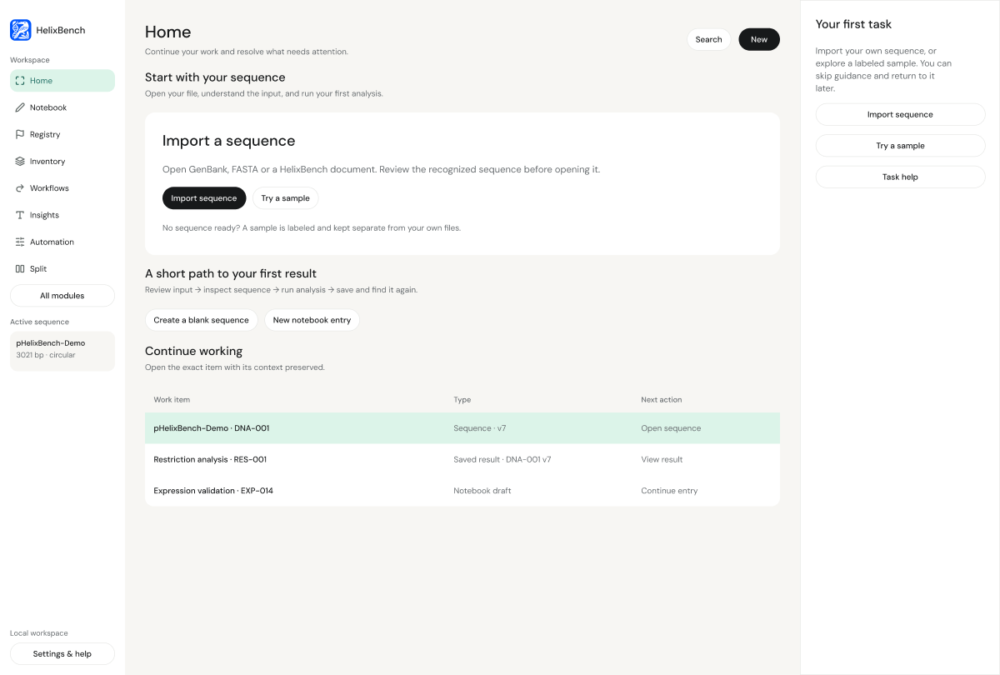

# SCR-01 · Home

[Current Figma screen](https://www.figma.com/design/U1kWw1K5NZBgEYkuxMz3Qb/helixbench?node-id=107-29237) · Implementation phase P06.

## Purpose and layout

Resume the right work or start a task without learning the navigation.

Labeled workspace navigation; Import sequence and Try a sample on first use; exact recent records and resumable work on populated Home; contextual next steps at right.

## Target requirements

- **SCR-01-R1:** First launch offers an empty personal workspace and an explicit sample choice. Existing installations restore their own workspace without replacing it with demo data.
- **SCR-01-R2:** Recent rows resolve a typed identity or a normalized file path, never a row index or display-name match. Missing files offer Locate or Remove without altering the document.
- **SCR-01-R3:** Resume a task, notebook entry or saved analysis with its selection, query, return route and persistence status. Display unsaved documents separately from saved files.
- **SCR-01-R4:** Project/folder changes validate parent existence and cycles. Bulk tag/export/close operates on the reviewed ID set; canceling a dirty-document close leaves the remaining queue intact.
- **SCR-01-R5:** Calendar and work totals are derived from local records; date navigation changes scope without modifying records. An empty calendar day is not a loading failure.

## User flow

1. Choose a document or task
2. Resume its exact context
3. Do the work
4. Save or submit
5. Return to Home with updated status

Use the shared typed context, validation/review, persistence and return-location contracts at every relevant transition. Prototype fixture IDs and figures are never production defaults.

## States and recovery

- Loading: retain prior context and identify the active request/operation.
- Populated: show stable object identity, meaningful status and available actions.
- No data: offer the relevant creation/import action.
- No matches: retain query/scope and expose Reset or Change settings.
- Invalid prerequisite: explain the missing input and provide its remedy.
- Validation/write failure: retain draft values and show a constructive correction/retry.
- Dirty/partial/stale/unavailable states use the shared state machines when applicable.

## Screen-specific edge cases

- **SCR-01-EC1:** Fresh config versus existing config with no open document.
- **SCR-01-EC2:** Recent path moved, inaccessible, duplicated with different spelling, or points to a newer native-file format.
- **SCR-01-EC3:** Two documents share a name; the intended stable ID must open.
- **SCR-01-EC4:** One dirty document in a multi-close operation fails to save or the user cancels.
- **SCR-01-EC5:** A task or entry disappears between list rendering and activation.
- **SCR-01-EC6:** Sample workspace exit, personal copy and restarting the application do not merge sample and personal records.

## Current code ownership

- [crates/appcore/src/actions.rs:1793](C:/Users/Admin/Documents/Qoder/2026-11-13/87e5a6b2/helixbench/crates/appcore/src/actions.rs:1793) — `pub fn open_home(app: &mut AppState)`
- [crates/appcore/src/actions.rs:633](C:/Users/Admin/Documents/Qoder/2026-11-13/87e5a6b2/helixbench/crates/appcore/src/actions.rs:633) — `pub fn recent_open(app: &mut AppState, path: PathBuf)`
- [crates/appcore/src/actions.rs:730](C:/Users/Admin/Documents/Qoder/2026-11-13/87e5a6b2/helixbench/crates/appcore/src/actions.rs:730) — `pub fn switch_doc(app: &mut AppState, idx: usize)`
- [crates/appcore/src/actions.rs:609](C:/Users/Admin/Documents/Qoder/2026-11-13/87e5a6b2/helixbench/crates/appcore/src/actions.rs:609) — `pub fn create_from_dialog(app: &mut AppState, state: &NewSeqState) -> Result<(), String>`
- [crates/appcore/src/actions.rs:1636](C:/Users/Admin/Documents/Qoder/2026-11-13/87e5a6b2/helixbench/crates/appcore/src/actions.rs:1636) — `pub fn open_entry_editor(app: &mut AppState, id: Option<u64>, template: usize)`
- [crates/appcore/src/actions.rs:1611](C:/Users/Admin/Documents/Qoder/2026-11-13/87e5a6b2/helixbench/crates/appcore/src/actions.rs:1611) — `pub fn open_projects(app: &mut AppState)`
- [crates/appcore/src/actions.rs:1797](C:/Users/Admin/Documents/Qoder/2026-11-13/87e5a6b2/helixbench/crates/appcore/src/actions.rs:1797) — `pub fn open_audit(app: &mut AppState)`
- [crates/appcore/src/actions.rs:1535](C:/Users/Admin/Documents/Qoder/2026-11-13/87e5a6b2/helixbench/crates/appcore/src/actions.rs:1535) — `pub fn bulk_tag(app: &mut AppState, draft: &WorkspaceDraft)`
- [crates/appcore/src/actions.rs:1556](C:/Users/Admin/Documents/Qoder/2026-11-13/87e5a6b2/helixbench/crates/appcore/src/actions.rs:1556) — `pub fn bulk_export(app: &mut AppState, draft: &WorkspaceDraft)`
- [crates/appcore/src/actions.rs:1579](C:/Users/Admin/Documents/Qoder/2026-11-13/87e5a6b2/helixbench/crates/appcore/src/actions.rs:1579) — `pub fn bulk_delete(app: &mut AppState, draft: &WorkspaceDraft)`

Domain modules: `crates/domain/src/project.rs`, `crates/domain/src/audit.rs`.

Native presentation entry points:

- [apps/desktop_gpui/src/lab.rs:38](C:/Users/Admin/Documents/Qoder/2026-11-13/87e5a6b2/helixbench/apps/desktop_gpui/src/lab.rs:38) — `render_home`
- [apps/desktop_gpui/src/dialogs.rs:5130](C:/Users/Admin/Documents/Qoder/2026-11-13/87e5a6b2/helixbench/apps/desktop_gpui/src/dialogs.rs:5130) — `home`
- [apps/desktop_gpui/src/dialogs.rs:4917](C:/Users/Admin/Documents/Qoder/2026-11-13/87e5a6b2/helixbench/apps/desktop_gpui/src/dialogs.rs:4917) — `projects`
- [apps/desktop_gpui/src/dialogs.rs:4497](C:/Users/Admin/Documents/Qoder/2026-11-13/87e5a6b2/helixbench/apps/desktop_gpui/src/dialogs.rs:4497) — `workspace`
- [apps/desktop_gpui/src/dialogs.rs:5022](C:/Users/Admin/Documents/Qoder/2026-11-13/87e5a6b2/helixbench/apps/desktop_gpui/src/dialogs.rs:5022) — `audit`

## Field/draft contracts

### HomeDraft

[crates/appcore/src/state.rs:450](C:/Users/Admin/Documents/Qoder/2026-11-13/87e5a6b2/helixbench/crates/appcore/src/state.rs:450)

### ProjectsDraft

[crates/appcore/src/state.rs:438](C:/Users/Admin/Documents/Qoder/2026-11-13/87e5a6b2/helixbench/crates/appcore/src/state.rs:438)

- `name: String` — Trim for validation; require a nonempty meaningful label where the owning operation creates an object. Preserve original editable draft on error.
- `parent: Option<u64>` — Resolve a stable typed identity from a labeled picker. Validate existence/kind at submit; do not persist a row index as a foreign key.
- `error: Option<String>` — System-owned validation/error state; never an editable user field.

### WorkspaceDraft

[crates/appcore/src/state.rs:414](C:/Users/Admin/Documents/Qoder/2026-11-13/87e5a6b2/helixbench/crates/appcore/src/state.rs:414)

- `selected: Vec<bool>` — Selection state must be backed by stable IDs before mutation; positions alone are not command identity.
- `tag: String` — Trim for validation; require a nonempty meaningful label where the owning operation creates an object. Preserve original editable draft on error.
- `error: Option<String>` — System-owned validation/error state; never an editable user field.

### AuditDraft

[crates/appcore/src/state.rs:445](C:/Users/Admin/Documents/Qoder/2026-11-13/87e5a6b2/helixbench/crates/appcore/src/state.rs:445)

- `filter: String` — Use a labeled finite choice with a visible selected value. Validate enum/mode availability; preserve unknown legacy values for review.

## Feature-level implementation contracts

### F-001 · Resume open document

**Status:** Specified; not verified implemented.

**Entry:** Document row (1 navigation click(s)).

**Prerequisite:** An open document.

**Outcome:** Activate this document, not a generic demo.

**Current evidence note:** My Work Switch exists; dashboard says Resume.

**Relevant code/action family:** [crates/appcore/src/actions.rs:1793](C:/Users/Admin/Documents/Qoder/2026-11-13/87e5a6b2/helixbench/crates/appcore/src/actions.rs:1793), [crates/appcore/src/actions.rs:633](C:/Users/Admin/Documents/Qoder/2026-11-13/87e5a6b2/helixbench/crates/appcore/src/actions.rs:633), [crates/appcore/src/actions.rs:730](C:/Users/Admin/Documents/Qoder/2026-11-13/87e5a6b2/helixbench/crates/appcore/src/actions.rs:730), [crates/appcore/src/actions.rs:609](C:/Users/Admin/Documents/Qoder/2026-11-13/87e5a6b2/helixbench/crates/appcore/src/actions.rs:609), [crates/appcore/src/actions.rs:1636](C:/Users/Admin/Documents/Qoder/2026-11-13/87e5a6b2/helixbench/crates/appcore/src/actions.rs:1636), [crates/appcore/src/actions.rs:1611](C:/Users/Admin/Documents/Qoder/2026-11-13/87e5a6b2/helixbench/crates/appcore/src/actions.rs:1611), [crates/appcore/src/actions.rs:1797](C:/Users/Admin/Documents/Qoder/2026-11-13/87e5a6b2/helixbench/crates/appcore/src/actions.rs:1797), [crates/appcore/src/actions.rs:1535](C:/Users/Admin/Documents/Qoder/2026-11-13/87e5a6b2/helixbench/crates/appcore/src/actions.rs:1535), [crates/appcore/src/actions.rs:1556](C:/Users/Admin/Documents/Qoder/2026-11-13/87e5a6b2/helixbench/crates/appcore/src/actions.rs:1556), [crates/appcore/src/actions.rs:1579](C:/Users/Admin/Documents/Qoder/2026-11-13/87e5a6b2/helixbench/crates/appcore/src/actions.rs:1579).

**Acceptance:**

- F-001-AC1: Given The owning page and the stated prerequisite are available. When The user follows Document row. Then Activate this document, not a generic demo; feature entry requires at most two navigation clicks.
- F-001-AC2: Given The context contains two similar names or a changed table order. When This feature is activated. Then The command payload retains the exact selected typed identity, source revision and scope.
- F-001-AC3: Given The intended target was deleted or became inaccessible after rendering. When The user activates its row or link. Then Show a relevant recovery path without opening an unrelated record; retain a safe return location.

**Recovery and edge conditions:**

- Two same-name records and two stores with the same numeric ID resolve correctly.
- A missing/deleted/inaccessible target offers a relevant remedy rather than another record.
- Back restores the invoking task and selection; dirty work is preserved where necessary.
- Keyboard activation and labeled controls expose the same action as pointer input.
- Recent path moved, inaccessible, duplicated with different spelling, or points to a newer native-file format.
- Two documents share a name; the intended stable ID must open.

### F-002 · Open recent file

**Status:** Specified; not verified implemented.

**Entry:** Recent-file row (1 navigation click(s)).

**Prerequisite:** A recent file.

**Outcome:** Open that path; handle missing file in place.

**Current evidence note:** Home Recent files exists in code but omitted from selected dashboard.

**Relevant code/action family:** [crates/appcore/src/actions.rs:1793](C:/Users/Admin/Documents/Qoder/2026-11-13/87e5a6b2/helixbench/crates/appcore/src/actions.rs:1793), [crates/appcore/src/actions.rs:633](C:/Users/Admin/Documents/Qoder/2026-11-13/87e5a6b2/helixbench/crates/appcore/src/actions.rs:633), [crates/appcore/src/actions.rs:730](C:/Users/Admin/Documents/Qoder/2026-11-13/87e5a6b2/helixbench/crates/appcore/src/actions.rs:730), [crates/appcore/src/actions.rs:609](C:/Users/Admin/Documents/Qoder/2026-11-13/87e5a6b2/helixbench/crates/appcore/src/actions.rs:609), [crates/appcore/src/actions.rs:1636](C:/Users/Admin/Documents/Qoder/2026-11-13/87e5a6b2/helixbench/crates/appcore/src/actions.rs:1636), [crates/appcore/src/actions.rs:1611](C:/Users/Admin/Documents/Qoder/2026-11-13/87e5a6b2/helixbench/crates/appcore/src/actions.rs:1611), [crates/appcore/src/actions.rs:1797](C:/Users/Admin/Documents/Qoder/2026-11-13/87e5a6b2/helixbench/crates/appcore/src/actions.rs:1797), [crates/appcore/src/actions.rs:1535](C:/Users/Admin/Documents/Qoder/2026-11-13/87e5a6b2/helixbench/crates/appcore/src/actions.rs:1535), [crates/appcore/src/actions.rs:1556](C:/Users/Admin/Documents/Qoder/2026-11-13/87e5a6b2/helixbench/crates/appcore/src/actions.rs:1556), [crates/appcore/src/actions.rs:1579](C:/Users/Admin/Documents/Qoder/2026-11-13/87e5a6b2/helixbench/crates/appcore/src/actions.rs:1579).

**Acceptance:**

- F-002-AC1: Given The owning page and the stated prerequisite are available. When The user follows Recent-file row. Then Open that path; handle missing file in place; feature entry requires at most two navigation clicks.
- F-002-AC2: Given The context contains two similar names or a changed table order. When This feature is activated. Then The command payload retains the exact selected typed identity, source revision and scope.
- F-002-AC3: Given A file or store write is awaiting completion. When The OS dialog is canceled or the atomic write fails. Then Do not report success, change saved/dirty truth or continue a pending destructive intent; preserve original data.

**Recovery and edge conditions:**

- OS-dialog cancellation leaves drafts, source data and pending navigation intact.
- Permission denied, disk full, locked destination and rename failure never show success.
- Reopening/retrying the same operation preserves identity and does not duplicate successful output.
- Export/import preserves scope, encoding, units and declared lossy transformations.
- Two documents share a name; the intended stable ID must open.
- One dirty document in a multi-close operation fails to save or the user cancels.

### F-003 · Create sequence

**Status:** Specified; not verified implemented.

**Entry:** New document (1 navigation click(s)).

**Prerequisite:** None.

**Outcome:** Name, molecule, topology and sequence form.

**Current evidence note:** Global unlabeled plus.

**Relevant code/action family:** [crates/appcore/src/actions.rs:1793](C:/Users/Admin/Documents/Qoder/2026-11-13/87e5a6b2/helixbench/crates/appcore/src/actions.rs:1793), [crates/appcore/src/actions.rs:633](C:/Users/Admin/Documents/Qoder/2026-11-13/87e5a6b2/helixbench/crates/appcore/src/actions.rs:633), [crates/appcore/src/actions.rs:730](C:/Users/Admin/Documents/Qoder/2026-11-13/87e5a6b2/helixbench/crates/appcore/src/actions.rs:730), [crates/appcore/src/actions.rs:609](C:/Users/Admin/Documents/Qoder/2026-11-13/87e5a6b2/helixbench/crates/appcore/src/actions.rs:609), [crates/appcore/src/actions.rs:1636](C:/Users/Admin/Documents/Qoder/2026-11-13/87e5a6b2/helixbench/crates/appcore/src/actions.rs:1636), [crates/appcore/src/actions.rs:1611](C:/Users/Admin/Documents/Qoder/2026-11-13/87e5a6b2/helixbench/crates/appcore/src/actions.rs:1611), [crates/appcore/src/actions.rs:1797](C:/Users/Admin/Documents/Qoder/2026-11-13/87e5a6b2/helixbench/crates/appcore/src/actions.rs:1797), [crates/appcore/src/actions.rs:1535](C:/Users/Admin/Documents/Qoder/2026-11-13/87e5a6b2/helixbench/crates/appcore/src/actions.rs:1535), [crates/appcore/src/actions.rs:1556](C:/Users/Admin/Documents/Qoder/2026-11-13/87e5a6b2/helixbench/crates/appcore/src/actions.rs:1556), [crates/appcore/src/actions.rs:1579](C:/Users/Admin/Documents/Qoder/2026-11-13/87e5a6b2/helixbench/crates/appcore/src/actions.rs:1579).

**Acceptance:**

- F-003-AC1: Given The owning page and the stated prerequisite are available. When The user follows New document. Then Name, molecule, topology and sequence form; feature entry requires at most two navigation clicks.
- F-003-AC2: Given The context contains two similar names or a changed table order. When This feature is activated. Then The command payload retains the exact selected typed identity, source revision and scope.
- F-003-AC3: Given A draft contains an invalid or missing required value. When The user submits the form. Then Show a field-local error, retain the draft and perform no mutation.

**Recovery and edge conditions:**

- Invalid required fields are identified beside the input with original draft values retained.
- Cancel does not alter the source object or create an unrelated example record.
- A stale/deleted target is resolved explicitly instead of mutating a row index.
- Successful persistence updates the selected record, related views and audit consistently.
- One dirty document in a multi-close operation fails to save or the user cancels.
- A task or entry disappears between list rendering and activation.

### F-004 · Open/import file

**Status:** Specified; not verified implemented.

**Entry:** Open file (1 navigation click(s)).

**Prerequisite:** None.

**Outcome:** Native picker with supported .hbx / FASTA / GenBank formats.

**Current evidence note:** File menu only.

**Relevant code/action family:** [crates/appcore/src/actions.rs:1793](C:/Users/Admin/Documents/Qoder/2026-11-13/87e5a6b2/helixbench/crates/appcore/src/actions.rs:1793), [crates/appcore/src/actions.rs:633](C:/Users/Admin/Documents/Qoder/2026-11-13/87e5a6b2/helixbench/crates/appcore/src/actions.rs:633), [crates/appcore/src/actions.rs:730](C:/Users/Admin/Documents/Qoder/2026-11-13/87e5a6b2/helixbench/crates/appcore/src/actions.rs:730), [crates/appcore/src/actions.rs:609](C:/Users/Admin/Documents/Qoder/2026-11-13/87e5a6b2/helixbench/crates/appcore/src/actions.rs:609), [crates/appcore/src/actions.rs:1636](C:/Users/Admin/Documents/Qoder/2026-11-13/87e5a6b2/helixbench/crates/appcore/src/actions.rs:1636), [crates/appcore/src/actions.rs:1611](C:/Users/Admin/Documents/Qoder/2026-11-13/87e5a6b2/helixbench/crates/appcore/src/actions.rs:1611), [crates/appcore/src/actions.rs:1797](C:/Users/Admin/Documents/Qoder/2026-11-13/87e5a6b2/helixbench/crates/appcore/src/actions.rs:1797), [crates/appcore/src/actions.rs:1535](C:/Users/Admin/Documents/Qoder/2026-11-13/87e5a6b2/helixbench/crates/appcore/src/actions.rs:1535), [crates/appcore/src/actions.rs:1556](C:/Users/Admin/Documents/Qoder/2026-11-13/87e5a6b2/helixbench/crates/appcore/src/actions.rs:1556), [crates/appcore/src/actions.rs:1579](C:/Users/Admin/Documents/Qoder/2026-11-13/87e5a6b2/helixbench/crates/appcore/src/actions.rs:1579).

**Acceptance:**

- F-004-AC1: Given The owning page and the stated prerequisite are available. When The user follows Open file. Then Native picker with supported .hbx / FASTA / GenBank formats; feature entry requires at most two navigation clicks.
- F-004-AC2: Given The context contains two similar names or a changed table order. When This feature is activated. Then The command payload retains the exact selected typed identity, source revision and scope.
- F-004-AC3: Given A file or store write is awaiting completion. When The OS dialog is canceled or the atomic write fails. Then Do not report success, change saved/dirty truth or continue a pending destructive intent; preserve original data.

**Recovery and edge conditions:**

- OS-dialog cancellation leaves drafts, source data and pending navigation intact.
- Permission denied, disk full, locked destination and rename failure never show success.
- Reopening/retrying the same operation preserves identity and does not duplicate successful output.
- Export/import preserves scope, encoding, units and declared lossy transformations.
- A task or entry disappears between list rendering and activation.
- Sample workspace exit, personal copy and restarting the application do not merge sample and personal records.

### F-005 · Create notebook entry

**Status:** Specified; not verified implemented.

**Entry:** New entry (1 navigation click(s)).

**Prerequisite:** None.

**Outcome:** New-entry form with a clear save action.

**Current evidence note:** Must discover Notebook first.

**Relevant code/action family:** [crates/appcore/src/actions.rs:1793](C:/Users/Admin/Documents/Qoder/2026-11-13/87e5a6b2/helixbench/crates/appcore/src/actions.rs:1793), [crates/appcore/src/actions.rs:633](C:/Users/Admin/Documents/Qoder/2026-11-13/87e5a6b2/helixbench/crates/appcore/src/actions.rs:633), [crates/appcore/src/actions.rs:730](C:/Users/Admin/Documents/Qoder/2026-11-13/87e5a6b2/helixbench/crates/appcore/src/actions.rs:730), [crates/appcore/src/actions.rs:609](C:/Users/Admin/Documents/Qoder/2026-11-13/87e5a6b2/helixbench/crates/appcore/src/actions.rs:609), [crates/appcore/src/actions.rs:1636](C:/Users/Admin/Documents/Qoder/2026-11-13/87e5a6b2/helixbench/crates/appcore/src/actions.rs:1636), [crates/appcore/src/actions.rs:1611](C:/Users/Admin/Documents/Qoder/2026-11-13/87e5a6b2/helixbench/crates/appcore/src/actions.rs:1611), [crates/appcore/src/actions.rs:1797](C:/Users/Admin/Documents/Qoder/2026-11-13/87e5a6b2/helixbench/crates/appcore/src/actions.rs:1797), [crates/appcore/src/actions.rs:1535](C:/Users/Admin/Documents/Qoder/2026-11-13/87e5a6b2/helixbench/crates/appcore/src/actions.rs:1535), [crates/appcore/src/actions.rs:1556](C:/Users/Admin/Documents/Qoder/2026-11-13/87e5a6b2/helixbench/crates/appcore/src/actions.rs:1556), [crates/appcore/src/actions.rs:1579](C:/Users/Admin/Documents/Qoder/2026-11-13/87e5a6b2/helixbench/crates/appcore/src/actions.rs:1579).

**Acceptance:**

- F-005-AC1: Given The owning page and the stated prerequisite are available. When The user follows New entry. Then New-entry form with a clear save action; feature entry requires at most two navigation clicks.
- F-005-AC2: Given The context contains two similar names or a changed table order. When This feature is activated. Then The command payload retains the exact selected typed identity, source revision and scope.
- F-005-AC3: Given A draft contains an invalid or missing required value. When The user submits the form. Then Show a field-local error, retain the draft and perform no mutation.

**Recovery and edge conditions:**

- Invalid required fields are identified beside the input with original draft values retained.
- Cancel does not alter the source object or create an unrelated example record.
- A stale/deleted target is resolved explicitly instead of mutating a row index.
- Successful persistence updates the selected record, related views and audit consistently.
- Sample workspace exit, personal copy and restarting the application do not merge sample and personal records.
- Fresh config versus existing config with no open document.

### F-006 · Open recent entry

**Status:** Specified; not verified implemented.

**Entry:** Entry row (1 navigation click(s)).

**Prerequisite:** Existing entry.

**Outcome:** Open selected entry and preserve return location.

**Current evidence note:** Existing recent-entry shortcut.

**Relevant code/action family:** [crates/appcore/src/actions.rs:1793](C:/Users/Admin/Documents/Qoder/2026-11-13/87e5a6b2/helixbench/crates/appcore/src/actions.rs:1793), [crates/appcore/src/actions.rs:633](C:/Users/Admin/Documents/Qoder/2026-11-13/87e5a6b2/helixbench/crates/appcore/src/actions.rs:633), [crates/appcore/src/actions.rs:730](C:/Users/Admin/Documents/Qoder/2026-11-13/87e5a6b2/helixbench/crates/appcore/src/actions.rs:730), [crates/appcore/src/actions.rs:609](C:/Users/Admin/Documents/Qoder/2026-11-13/87e5a6b2/helixbench/crates/appcore/src/actions.rs:609), [crates/appcore/src/actions.rs:1636](C:/Users/Admin/Documents/Qoder/2026-11-13/87e5a6b2/helixbench/crates/appcore/src/actions.rs:1636), [crates/appcore/src/actions.rs:1611](C:/Users/Admin/Documents/Qoder/2026-11-13/87e5a6b2/helixbench/crates/appcore/src/actions.rs:1611), [crates/appcore/src/actions.rs:1797](C:/Users/Admin/Documents/Qoder/2026-11-13/87e5a6b2/helixbench/crates/appcore/src/actions.rs:1797), [crates/appcore/src/actions.rs:1535](C:/Users/Admin/Documents/Qoder/2026-11-13/87e5a6b2/helixbench/crates/appcore/src/actions.rs:1535), [crates/appcore/src/actions.rs:1556](C:/Users/Admin/Documents/Qoder/2026-11-13/87e5a6b2/helixbench/crates/appcore/src/actions.rs:1556), [crates/appcore/src/actions.rs:1579](C:/Users/Admin/Documents/Qoder/2026-11-13/87e5a6b2/helixbench/crates/appcore/src/actions.rs:1579).

**Acceptance:**

- F-006-AC1: Given The owning page and the stated prerequisite are available. When The user follows Entry row. Then Open selected entry and preserve return location; feature entry requires at most two navigation clicks.
- F-006-AC2: Given The context contains two similar names or a changed table order. When This feature is activated. Then The command payload retains the exact selected typed identity, source revision and scope.
- F-006-AC3: Given The intended target was deleted or became inaccessible after rendering. When The user activates its row or link. Then Show a relevant recovery path without opening an unrelated record; retain a safe return location.

**Recovery and edge conditions:**

- Two same-name records and two stores with the same numeric ID resolve correctly.
- A missing/deleted/inaccessible target offers a relevant remedy rather than another record.
- Back restores the invoking task and selection; dirty work is preserved where necessary.
- Keyboard activation and labeled controls expose the same action as pointer input.
- Fresh config versus existing config with no open document.
- Recent path moved, inaccessible, duplicated with different spelling, or points to a newer native-file format.

### F-007 · Resume selected task

**Status:** Specified; not verified implemented.

**Entry:** Worklist row (1 navigation click(s)).

**Prerequisite:** Existing task.

**Outcome:** Deep-link to task detail.

**Current evidence note:** Code currently opens Workflows without selecting the task.

**Relevant code/action family:** [crates/appcore/src/actions.rs:1793](C:/Users/Admin/Documents/Qoder/2026-11-13/87e5a6b2/helixbench/crates/appcore/src/actions.rs:1793), [crates/appcore/src/actions.rs:633](C:/Users/Admin/Documents/Qoder/2026-11-13/87e5a6b2/helixbench/crates/appcore/src/actions.rs:633), [crates/appcore/src/actions.rs:730](C:/Users/Admin/Documents/Qoder/2026-11-13/87e5a6b2/helixbench/crates/appcore/src/actions.rs:730), [crates/appcore/src/actions.rs:609](C:/Users/Admin/Documents/Qoder/2026-11-13/87e5a6b2/helixbench/crates/appcore/src/actions.rs:609), [crates/appcore/src/actions.rs:1636](C:/Users/Admin/Documents/Qoder/2026-11-13/87e5a6b2/helixbench/crates/appcore/src/actions.rs:1636), [crates/appcore/src/actions.rs:1611](C:/Users/Admin/Documents/Qoder/2026-11-13/87e5a6b2/helixbench/crates/appcore/src/actions.rs:1611), [crates/appcore/src/actions.rs:1797](C:/Users/Admin/Documents/Qoder/2026-11-13/87e5a6b2/helixbench/crates/appcore/src/actions.rs:1797), [crates/appcore/src/actions.rs:1535](C:/Users/Admin/Documents/Qoder/2026-11-13/87e5a6b2/helixbench/crates/appcore/src/actions.rs:1535), [crates/appcore/src/actions.rs:1556](C:/Users/Admin/Documents/Qoder/2026-11-13/87e5a6b2/helixbench/crates/appcore/src/actions.rs:1556), [crates/appcore/src/actions.rs:1579](C:/Users/Admin/Documents/Qoder/2026-11-13/87e5a6b2/helixbench/crates/appcore/src/actions.rs:1579).

**Acceptance:**

- F-007-AC1: Given The owning page and the stated prerequisite are available. When The user follows Worklist row. Then Deep-link to task detail; feature entry requires at most two navigation clicks.
- F-007-AC2: Given The context contains two similar names or a changed table order. When This feature is activated. Then The command payload retains the exact selected typed identity, source revision and scope.
- F-007-AC3: Given The intended target was deleted or became inaccessible after rendering. When The user activates its row or link. Then Show a relevant recovery path without opening an unrelated record; retain a safe return location.

**Recovery and edge conditions:**

- Two same-name records and two stores with the same numeric ID resolve correctly.
- A missing/deleted/inaccessible target offers a relevant remedy rather than another record.
- Back restores the invoking task and selection; dirty work is preserved where necessary.
- Keyboard activation and labeled controls expose the same action as pointer input.
- Recent path moved, inaccessible, duplicated with different spelling, or points to a newer native-file format.
- Two documents share a name; the intended stable ID must open.

### F-008 · Calendar date activity

**Status:** Specified; not verified implemented.

**Entry:** Calendar day (1 navigation click(s)).

**Prerequisite:** Entries or tasks on that date.

**Outcome:** Show that day's entries and tasks.

**Current evidence note:** Date buckets exist in code.

**Relevant code/action family:** [crates/appcore/src/actions.rs:1793](C:/Users/Admin/Documents/Qoder/2026-11-13/87e5a6b2/helixbench/crates/appcore/src/actions.rs:1793), [crates/appcore/src/actions.rs:633](C:/Users/Admin/Documents/Qoder/2026-11-13/87e5a6b2/helixbench/crates/appcore/src/actions.rs:633), [crates/appcore/src/actions.rs:730](C:/Users/Admin/Documents/Qoder/2026-11-13/87e5a6b2/helixbench/crates/appcore/src/actions.rs:730), [crates/appcore/src/actions.rs:609](C:/Users/Admin/Documents/Qoder/2026-11-13/87e5a6b2/helixbench/crates/appcore/src/actions.rs:609), [crates/appcore/src/actions.rs:1636](C:/Users/Admin/Documents/Qoder/2026-11-13/87e5a6b2/helixbench/crates/appcore/src/actions.rs:1636), [crates/appcore/src/actions.rs:1611](C:/Users/Admin/Documents/Qoder/2026-11-13/87e5a6b2/helixbench/crates/appcore/src/actions.rs:1611), [crates/appcore/src/actions.rs:1797](C:/Users/Admin/Documents/Qoder/2026-11-13/87e5a6b2/helixbench/crates/appcore/src/actions.rs:1797), [crates/appcore/src/actions.rs:1535](C:/Users/Admin/Documents/Qoder/2026-11-13/87e5a6b2/helixbench/crates/appcore/src/actions.rs:1535), [crates/appcore/src/actions.rs:1556](C:/Users/Admin/Documents/Qoder/2026-11-13/87e5a6b2/helixbench/crates/appcore/src/actions.rs:1556), [crates/appcore/src/actions.rs:1579](C:/Users/Admin/Documents/Qoder/2026-11-13/87e5a6b2/helixbench/crates/appcore/src/actions.rs:1579).

**Acceptance:**

- F-008-AC1: Given The owning page and the stated prerequisite are available. When The user follows Calendar day. Then Show that day's entries and tasks; feature entry requires at most two navigation clicks.
- F-008-AC2: Given The context contains two similar names or a changed table order. When This feature is activated. Then The command payload retains the exact selected typed identity, source revision and scope.
- F-008-AC3: Given Underlying records exist and a query or filter is active. When The query/filter matches no records. Then Show no matches with the active scope and reset remedy; do not claim that the dataset is empty or failed.

**Recovery and edge conditions:**

- Empty source, filtered-out records and failed load have different status/remedies.
- Sorting/filtering or a same-name record cannot change the selected stable identity.
- Returning restores the same query/filter/scope and scroll anchor where supported.
- Inspection-only changes do not mark scientific content dirty.
- Two documents share a name; the intended stable ID must open.
- One dirty document in a multi-close operation fails to save or the user cancels.

### F-009 · Change calendar month / Today

**Status:** Specified; not verified implemented.

**Entry:** Month arrow or Today (1 navigation click(s)).

**Prerequisite:** None.

**Outcome:** Update date range without losing selected work.

**Current evidence note:** Existing controls are small.

**Relevant code/action family:** [crates/appcore/src/actions.rs:1793](C:/Users/Admin/Documents/Qoder/2026-11-13/87e5a6b2/helixbench/crates/appcore/src/actions.rs:1793), [crates/appcore/src/actions.rs:633](C:/Users/Admin/Documents/Qoder/2026-11-13/87e5a6b2/helixbench/crates/appcore/src/actions.rs:633), [crates/appcore/src/actions.rs:730](C:/Users/Admin/Documents/Qoder/2026-11-13/87e5a6b2/helixbench/crates/appcore/src/actions.rs:730), [crates/appcore/src/actions.rs:609](C:/Users/Admin/Documents/Qoder/2026-11-13/87e5a6b2/helixbench/crates/appcore/src/actions.rs:609), [crates/appcore/src/actions.rs:1636](C:/Users/Admin/Documents/Qoder/2026-11-13/87e5a6b2/helixbench/crates/appcore/src/actions.rs:1636), [crates/appcore/src/actions.rs:1611](C:/Users/Admin/Documents/Qoder/2026-11-13/87e5a6b2/helixbench/crates/appcore/src/actions.rs:1611), [crates/appcore/src/actions.rs:1797](C:/Users/Admin/Documents/Qoder/2026-11-13/87e5a6b2/helixbench/crates/appcore/src/actions.rs:1797), [crates/appcore/src/actions.rs:1535](C:/Users/Admin/Documents/Qoder/2026-11-13/87e5a6b2/helixbench/crates/appcore/src/actions.rs:1535), [crates/appcore/src/actions.rs:1556](C:/Users/Admin/Documents/Qoder/2026-11-13/87e5a6b2/helixbench/crates/appcore/src/actions.rs:1556), [crates/appcore/src/actions.rs:1579](C:/Users/Admin/Documents/Qoder/2026-11-13/87e5a6b2/helixbench/crates/appcore/src/actions.rs:1579).

**Acceptance:**

- F-009-AC1: Given The owning page and the stated prerequisite are available. When The user follows Month arrow or Today. Then Update date range without losing selected work; feature entry requires at most two navigation clicks.
- F-009-AC2: Given The context contains two similar names or a changed table order. When This feature is activated. Then The command payload retains the exact selected typed identity, source revision and scope.
- F-009-AC3: Given Underlying records exist and a query or filter is active. When The query/filter matches no records. Then Show no matches with the active scope and reset remedy; do not claim that the dataset is empty or failed.

**Recovery and edge conditions:**

- Empty source, filtered-out records and failed load have different status/remedies.
- Sorting/filtering or a same-name record cannot change the selected stable identity.
- Returning restores the same query/filter/scope and scroll anchor where supported.
- Inspection-only changes do not mark scientific content dirty.
- One dirty document in a multi-close operation fails to save or the user cancels.
- A task or entry disappears between list rendering and activation.

### F-010 · Workspace totals

**Status:** Specified; not verified implemented.

**Entry:** Registry / Inventory / Tasks total (1 navigation click(s)).

**Prerequisite:** None.

**Outcome:** Open the named collection, retaining context.

**Current evidence note:** Totals are mostly passive figures.

**Relevant code/action family:** [crates/appcore/src/actions.rs:1793](C:/Users/Admin/Documents/Qoder/2026-11-13/87e5a6b2/helixbench/crates/appcore/src/actions.rs:1793), [crates/appcore/src/actions.rs:633](C:/Users/Admin/Documents/Qoder/2026-11-13/87e5a6b2/helixbench/crates/appcore/src/actions.rs:633), [crates/appcore/src/actions.rs:730](C:/Users/Admin/Documents/Qoder/2026-11-13/87e5a6b2/helixbench/crates/appcore/src/actions.rs:730), [crates/appcore/src/actions.rs:609](C:/Users/Admin/Documents/Qoder/2026-11-13/87e5a6b2/helixbench/crates/appcore/src/actions.rs:609), [crates/appcore/src/actions.rs:1636](C:/Users/Admin/Documents/Qoder/2026-11-13/87e5a6b2/helixbench/crates/appcore/src/actions.rs:1636), [crates/appcore/src/actions.rs:1611](C:/Users/Admin/Documents/Qoder/2026-11-13/87e5a6b2/helixbench/crates/appcore/src/actions.rs:1611), [crates/appcore/src/actions.rs:1797](C:/Users/Admin/Documents/Qoder/2026-11-13/87e5a6b2/helixbench/crates/appcore/src/actions.rs:1797), [crates/appcore/src/actions.rs:1535](C:/Users/Admin/Documents/Qoder/2026-11-13/87e5a6b2/helixbench/crates/appcore/src/actions.rs:1535), [crates/appcore/src/actions.rs:1556](C:/Users/Admin/Documents/Qoder/2026-11-13/87e5a6b2/helixbench/crates/appcore/src/actions.rs:1556), [crates/appcore/src/actions.rs:1579](C:/Users/Admin/Documents/Qoder/2026-11-13/87e5a6b2/helixbench/crates/appcore/src/actions.rs:1579).

**Acceptance:**

- F-010-AC1: Given The owning page and the stated prerequisite are available. When The user follows Registry / Inventory / Tasks total. Then Open the named collection, retaining context; feature entry requires at most two navigation clicks.
- F-010-AC2: Given The context contains two similar names or a changed table order. When This feature is activated. Then The command payload retains the exact selected typed identity, source revision and scope.
- F-010-AC3: Given The intended target was deleted or became inaccessible after rendering. When The user activates its row or link. Then Show a relevant recovery path without opening an unrelated record; retain a safe return location.

**Recovery and edge conditions:**

- Two same-name records and two stores with the same numeric ID resolve correctly.
- A missing/deleted/inaccessible target offers a relevant remedy rather than another record.
- Back restores the invoking task and selection; dirty work is preserved where necessary.
- Keyboard activation and labeled controls expose the same action as pointer input.
- A task or entry disappears between list rendering and activation.
- Sample workspace exit, personal copy and restarting the application do not merge sample and personal records.

### F-011 · Projects and folders

**Status:** Specified; not verified implemented.

**Entry:** Workspace actions → Projects & folders (2 navigation click(s)).

**Prerequisite:** None.

**Outcome:** Project tree and create/move controls.

**Current evidence note:** Lab menu / separate dialog.

**Relevant code/action family:** [crates/appcore/src/actions.rs:1611](C:/Users/Admin/Documents/Qoder/2026-11-13/87e5a6b2/helixbench/crates/appcore/src/actions.rs:1611), [crates/appcore/src/actions.rs:1615](C:/Users/Admin/Documents/Qoder/2026-11-13/87e5a6b2/helixbench/crates/appcore/src/actions.rs:1615), [crates/appcore/src/actions.rs:1625](C:/Users/Admin/Documents/Qoder/2026-11-13/87e5a6b2/helixbench/crates/appcore/src/actions.rs:1625).

**Acceptance:**

- F-011-AC1: Given The owning page and the stated prerequisite are available. When The user follows Workspace actions → Projects & folders. Then Project tree and create/move controls; feature entry requires at most two navigation clicks.
- F-011-AC2: Given The context contains two similar names or a changed table order. When This feature is activated. Then The command payload retains the exact selected typed identity, source revision and scope.
- F-011-AC3: Given The intended target was deleted or became inaccessible after rendering. When The user activates its row or link. Then Show a relevant recovery path without opening an unrelated record; retain a safe return location.

**Recovery and edge conditions:**

- Two same-name records and two stores with the same numeric ID resolve correctly.
- A missing/deleted/inaccessible target offers a relevant remedy rather than another record.
- Back restores the invoking task and selection; dirty work is preserved where necessary.
- Keyboard activation and labeled controls expose the same action as pointer input.
- Sample workspace exit, personal copy and restarting the application do not merge sample and personal records.
- Fresh config versus existing config with no open document.

### F-012 · Bulk document operations

**Status:** Specified; not verified implemented.

**Entry:** Select documents → Bulk actions (2 navigation click(s)).

**Prerequisite:** At least one document selected.

**Outcome:** Tag, export FASTA and close selected documents.

**Current evidence note:** Tools > Workspace / Bulk.

**Relevant code/action family:** [crates/appcore/src/actions.rs:1793](C:/Users/Admin/Documents/Qoder/2026-11-13/87e5a6b2/helixbench/crates/appcore/src/actions.rs:1793), [crates/appcore/src/actions.rs:633](C:/Users/Admin/Documents/Qoder/2026-11-13/87e5a6b2/helixbench/crates/appcore/src/actions.rs:633), [crates/appcore/src/actions.rs:730](C:/Users/Admin/Documents/Qoder/2026-11-13/87e5a6b2/helixbench/crates/appcore/src/actions.rs:730), [crates/appcore/src/actions.rs:609](C:/Users/Admin/Documents/Qoder/2026-11-13/87e5a6b2/helixbench/crates/appcore/src/actions.rs:609), [crates/appcore/src/actions.rs:1636](C:/Users/Admin/Documents/Qoder/2026-11-13/87e5a6b2/helixbench/crates/appcore/src/actions.rs:1636), [crates/appcore/src/actions.rs:1611](C:/Users/Admin/Documents/Qoder/2026-11-13/87e5a6b2/helixbench/crates/appcore/src/actions.rs:1611), [crates/appcore/src/actions.rs:1797](C:/Users/Admin/Documents/Qoder/2026-11-13/87e5a6b2/helixbench/crates/appcore/src/actions.rs:1797), [crates/appcore/src/actions.rs:1535](C:/Users/Admin/Documents/Qoder/2026-11-13/87e5a6b2/helixbench/crates/appcore/src/actions.rs:1535), [crates/appcore/src/actions.rs:1556](C:/Users/Admin/Documents/Qoder/2026-11-13/87e5a6b2/helixbench/crates/appcore/src/actions.rs:1556), [crates/appcore/src/actions.rs:1579](C:/Users/Admin/Documents/Qoder/2026-11-13/87e5a6b2/helixbench/crates/appcore/src/actions.rs:1579).

**Acceptance:**

- F-012-AC1: Given The owning page and the stated prerequisite are available. When The user follows Select documents → Bulk actions. Then Tag, export FASTA and close selected documents; feature entry requires at most two navigation clicks.
- F-012-AC2: Given The context contains two similar names or a changed table order. When This feature is activated. Then The command payload retains the exact selected typed identity, source revision and scope.
- F-012-AC3: Given The intended target was deleted or became inaccessible after rendering. When The user activates its row or link. Then Show a relevant recovery path without opening an unrelated record; retain a safe return location.

**Recovery and edge conditions:**

- Two same-name records and two stores with the same numeric ID resolve correctly.
- A missing/deleted/inaccessible target offers a relevant remedy rather than another record.
- Back restores the invoking task and selection; dirty work is preserved where necessary.
- Keyboard activation and labeled controls expose the same action as pointer input.
- Fresh config versus existing config with no open document.
- Recent path moved, inaccessible, duplicated with different spelling, or points to a newer native-file format.

### F-013 · Audit log

**Status:** Specified; not verified implemented.

**Entry:** Workspace actions → Audit log (2 navigation click(s)).

**Prerequisite:** None.

**Outcome:** Read events and export CSV.

**Current evidence note:** Lab menu only.

**Relevant code/action family:** [crates/appcore/src/actions.rs:1797](C:/Users/Admin/Documents/Qoder/2026-11-13/87e5a6b2/helixbench/crates/appcore/src/actions.rs:1797), [crates/appcore/src/actions.rs:1801](C:/Users/Admin/Documents/Qoder/2026-11-13/87e5a6b2/helixbench/crates/appcore/src/actions.rs:1801).

**Acceptance:**

- F-013-AC1: Given The owning page and the stated prerequisite are available. When The user follows Workspace actions → Audit log. Then Read events and export CSV; feature entry requires at most two navigation clicks.
- F-013-AC2: Given The context contains two similar names or a changed table order. When This feature is activated. Then The command payload retains the exact selected typed identity, source revision and scope.
- F-013-AC3: Given The intended target was deleted or became inaccessible after rendering. When The user activates its row or link. Then Show a relevant recovery path without opening an unrelated record; retain a safe return location.

**Recovery and edge conditions:**

- Two same-name records and two stores with the same numeric ID resolve correctly.
- A missing/deleted/inaccessible target offers a relevant remedy rather than another record.
- Back restores the invoking task and selection; dirty work is preserved where necessary.
- Keyboard activation and labeled controls expose the same action as pointer input.
- Recent path moved, inaccessible, duplicated with different spelling, or points to a newer native-file format.
- Two documents share a name; the intended stable ID must open.

### F-014 · Open seeded demo

**Status:** Specified; not verified implemented.

**Entry:** Workspace actions → Open demo (2 navigation click(s)).

**Prerequisite:** None.

**Outcome:** Open the documented demo with unsaved-change protection.

**Current evidence note:** File menu only.

**Relevant code/action family:** [crates/appcore/src/actions.rs:1793](C:/Users/Admin/Documents/Qoder/2026-11-13/87e5a6b2/helixbench/crates/appcore/src/actions.rs:1793), [crates/appcore/src/actions.rs:633](C:/Users/Admin/Documents/Qoder/2026-11-13/87e5a6b2/helixbench/crates/appcore/src/actions.rs:633), [crates/appcore/src/actions.rs:730](C:/Users/Admin/Documents/Qoder/2026-11-13/87e5a6b2/helixbench/crates/appcore/src/actions.rs:730), [crates/appcore/src/actions.rs:609](C:/Users/Admin/Documents/Qoder/2026-11-13/87e5a6b2/helixbench/crates/appcore/src/actions.rs:609), [crates/appcore/src/actions.rs:1636](C:/Users/Admin/Documents/Qoder/2026-11-13/87e5a6b2/helixbench/crates/appcore/src/actions.rs:1636), [crates/appcore/src/actions.rs:1611](C:/Users/Admin/Documents/Qoder/2026-11-13/87e5a6b2/helixbench/crates/appcore/src/actions.rs:1611), [crates/appcore/src/actions.rs:1797](C:/Users/Admin/Documents/Qoder/2026-11-13/87e5a6b2/helixbench/crates/appcore/src/actions.rs:1797), [crates/appcore/src/actions.rs:1535](C:/Users/Admin/Documents/Qoder/2026-11-13/87e5a6b2/helixbench/crates/appcore/src/actions.rs:1535), [crates/appcore/src/actions.rs:1556](C:/Users/Admin/Documents/Qoder/2026-11-13/87e5a6b2/helixbench/crates/appcore/src/actions.rs:1556), [crates/appcore/src/actions.rs:1579](C:/Users/Admin/Documents/Qoder/2026-11-13/87e5a6b2/helixbench/crates/appcore/src/actions.rs:1579).

**Acceptance:**

- F-014-AC1: Given The owning page and the stated prerequisite are available. When The user follows Workspace actions → Open demo. Then Open the documented demo with unsaved-change protection; feature entry requires at most two navigation clicks.
- F-014-AC2: Given The context contains two similar names or a changed table order. When This feature is activated. Then The command payload retains the exact selected typed identity, source revision and scope.
- F-014-AC3: Given The intended target was deleted or became inaccessible after rendering. When The user activates its row or link. Then Show a relevant recovery path without opening an unrelated record; retain a safe return location.

**Recovery and edge conditions:**

- Two same-name records and two stores with the same numeric ID resolve correctly.
- A missing/deleted/inaccessible target offers a relevant remedy rather than another record.
- Back restores the invoking task and selection; dirty work is preserved where necessary.
- Keyboard activation and labeled controls expose the same action as pointer input.
- Two documents share a name; the intended stable ID must open.
- One dirty document in a multi-close operation fails to save or the user cancels.

## P09 implemented flow and evidence — 17 November 2026

Completed digest and PCR runs expose Review / save completed result. Review retains the
owning setup and captured output; Back restores that draft. Save persists a validated,
immutable AnalysisResult with its ResultId, OperationId, creation time, method version,
full input snapshots, settings and actual output. Repeated Save is idempotent. Saving a
result does not save, rename or mark its source document clean. Catalog or receipt failure
keeps the completed run available for retry and refreshes visible operation Recovery.

Home offers Browse and search all results, independent of its recent-work shortlist.
Search resolves stable IDs, tool, method and input names. Opening a result reads the catalog
again; a corrupt/newer catalog is reported and preserved. Empty catalog, no search matches,
missing result and unreadable catalog are distinct states. Saved output remains readable
when its source changes or is closed/unavailable. Current, Older input and unavailable
labels compare the captured source identity and complete input hash. Unavailable does not
claim permanent deletion and never silently resurrects a closed document.

Inspect captured input shows source IDs, revision, length, topology, feature/primer counts,
hash and a bounded read-only DNA preview; exports contain the complete snapshots. Open
current source requires that same DocumentId already open and uses normal Map navigation;
Back restores the exact saved ResultId. Reopen a closed source before choosing current input.

Review rerun explicitly selects captured input or the current matching open source. Cancel
leaves the original result unchanged. Run revalidates supported method and input, creates
new result/operation IDs, and leaves a new unsaved output for explicit Save. Digest replays
captured enzyme definitions; PCR replays captured primer sequences and binding settings.
Only restriction-v1 and pcr-v1 currently have typed rerun adapters; later milestones own
their respective tool adapters. Unknown methods remain readable and exportable.

Compare selects another stable result ID and displays both methods, revisions and outputs,
with parameter/output equality indicators. JSON and CSV export preserve input snapshots,
methods, settings and output; comparison exports include both results. Native destination
selection is explicit and cancel writes nothing. Export cannot replace the result catalog,
config or open source paths. CSV scalar cells that could become spreadsheet formulas are
neutralized. All writes use the shared operation journal; success requires a completion
receipt. Catalog read/modify/write checks the hash of the exact bytes parsed and rejects
intervening catalog changes instead of overwriting another result. This is optimistic
conflict detection, not a new cross-process transaction service.

Verification: all 410 workspace tests pass, including 17 P09 appcore regressions and a native
UTC timestamp boundary test. Strict core Clippy and the native executable build pass.
Initial missing APIs and CSV formula behavior were observed failing before implementation.
Review regressions prove intervening-catalog rejection and failed export Recovery without
restart; the latter failed on the cached Recovery assertion before the fix.

Native 1280px sample walkthrough verified completed EcoRI digest, Save, captured-input
rerun with a different ResultId, compare, JSON export, source Map / Back, captured input,
search by ResultId and Older input after Undo. The exported JSON was read back and contains
both real result IDs, restriction-v1, complete snapshots and computed fragments. History
shows actual Undo/Redo target names and explicit UTC checkpoint creation timestamps.

Deferred minor review items: comparison currently reports parameter equality rather than
a field-by-field settings diff; the export UI does not yet explain CSV apostrophe
neutralization. Large catalog/history profiling, background scheduling and comprehensive
accessibility acceptance remain P19. Methylation prediction remains unsupported because
no scientific metadata/model has been specified. Named checkpoint retention can grow storage.
