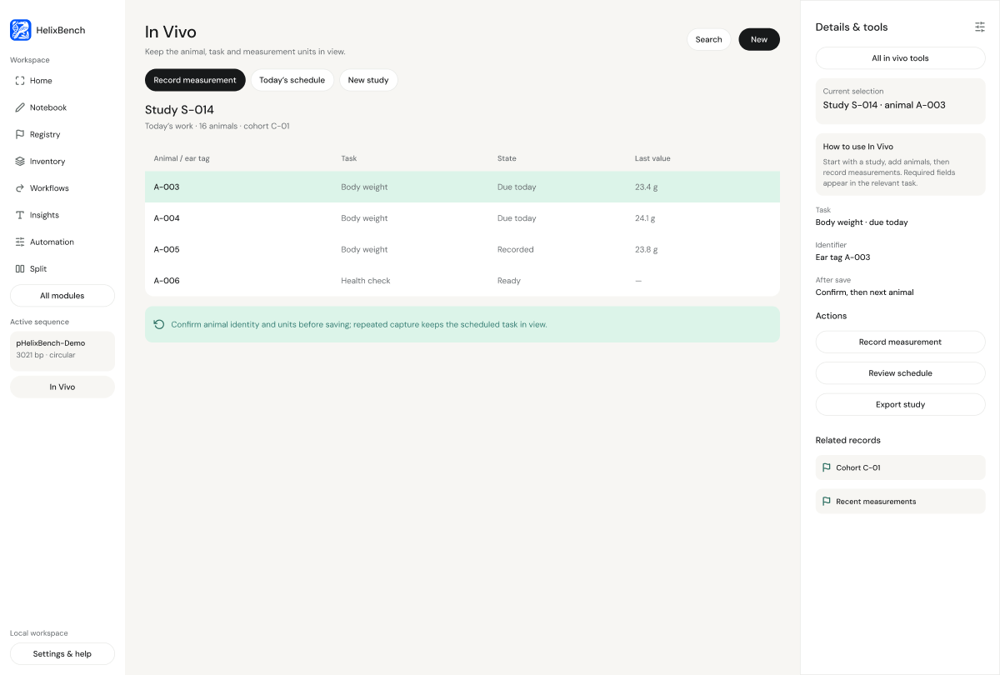

# SCR-18 · In Vivo

[Current Figma screen](https://www.figma.com/design/U1kWw1K5NZBgEYkuxMz3Qb/helixbench?node-id=107-32841) · Implementation phase P18.

## Purpose and layout

Track a study, add measurements and understand cohort context.

Study identity/species/strain; animals and cohorts; measurement timeline; explicit-unit calculation helper; study schedule and exports.

## Target requirements

- **SCR-18-R1:** Keep study and animal IDs distinct. Measurements bind to the selected animal and date/day, not the currently highlighted row after a filter.
- **SCR-18-R2:** Weight and measurement units are visible. Numeric inputs must be finite and compatible with the domain model; conversions are explicit.
- **SCR-18-R3:** Cohort randomization captures seed, group count and the animal set; preview imbalance and avoid silently re-randomizing an established assignment.
- **SCR-18-R4:** The calculation helper displays formula, input units and output units and remains a calculation aid; no treatment recommendation is inferred from a prototype fixture.
- **SCR-18-R5:** Study deletion reviews animals, measurements and downstream references; canceled or failed persistence retains the existing study.

## User flow

1. Create/select study
2. Add animals
3. Review cohorts and planned measurements
4. Record measurements
5. Inspect welfare and trends
6. Review calculation inputs and result

Use the shared typed context, validation/review, persistence and return-location contracts at every relevant transition. Prototype fixture IDs and figures are never production defaults.

## States and recovery

- Loading: retain prior context and identify the active request/operation.
- Populated: show stable object identity, meaningful status and available actions.
- No data: offer the relevant creation/import action.
- No matches: retain query/scope and expose Reset or Change settings.
- Invalid prerequisite: explain the missing input and provide its remedy.
- Validation/write failure: retain draft values and show a constructive correction/retry.
- Dirty/partial/stale/unavailable states use the shared state machines when applicable.

## Screen-specific edge cases

- **SCR-18-EC1:** No study/animal selected, duplicate animal tag within a study, missing species and deleted study.
- **SCR-18-EC2:** Negative/nonfinite weight or measurement; missing unit; duplicate day entries.
- **SCR-18-EC3:** Group count exceeds animal count, empty cohort, unequal groups and repeated randomization with the same seed.
- **SCR-18-EC4:** Concentration is zero or units are incompatible in the calculation helper.
- **SCR-18-EC5:** A measurement edit occurs after a cohort summary was computed.
- **SCR-18-EC6:** Export includes animal/study IDs and units without conflating identical tags in different studies.

## Current code ownership

- [crates/appcore/src/actions.rs:2308](C:/Users/Admin/Documents/Qoder/2026-11-13/87e5a6b2/helixbench/crates/appcore/src/actions.rs:2308) — `pub fn open_iv_study(app: &mut AppState)`
- [crates/appcore/src/actions.rs:2316](C:/Users/Admin/Documents/Qoder/2026-11-13/87e5a6b2/helixbench/crates/appcore/src/actions.rs:2316) — `pub fn iv_study_save(app: &mut AppState, draft: &IvStudyDraft) -> Result<u64, String>`
- [crates/appcore/src/actions.rs:2335](C:/Users/Admin/Documents/Qoder/2026-11-13/87e5a6b2/helixbench/crates/appcore/src/actions.rs:2335) — `pub fn open_iv_animal(app: &mut AppState)`
- [crates/appcore/src/actions.rs:2342](C:/Users/Admin/Documents/Qoder/2026-11-13/87e5a6b2/helixbench/crates/appcore/src/actions.rs:2342) — `pub fn iv_animal_save(app: &mut AppState, draft: &IvAnimalDraft) -> Result<u64, String>`
- [crates/appcore/src/actions.rs:2365](C:/Users/Admin/Documents/Qoder/2026-11-13/87e5a6b2/helixbench/crates/appcore/src/actions.rs:2365) — `pub fn open_iv_measure(app: &mut AppState)`
- [crates/appcore/src/actions.rs:2372](C:/Users/Admin/Documents/Qoder/2026-11-13/87e5a6b2/helixbench/crates/appcore/src/actions.rs:2372) — `pub fn iv_measure_save(app: &mut AppState, draft: &IvMeasureDraft) -> Result<(), String>`
- [crates/appcore/src/actions.rs:2422](C:/Users/Admin/Documents/Qoder/2026-11-13/87e5a6b2/helixbench/crates/appcore/src/actions.rs:2422) — `pub fn iv_randomize(app: &mut AppState, groups: u32, seed: u64)`
- [crates/appcore/src/actions.rs:2452](C:/Users/Admin/Documents/Qoder/2026-11-13/87e5a6b2/helixbench/crates/appcore/src/actions.rs:2452) — `pub fn iv_delete_study(app: &mut AppState, id: u64)`

Domain modules: `crates/domain/src/invivo.rs`.

Native presentation entry points:

- [apps/desktop_gpui/src/lab.rs:1623](C:/Users/Admin/Documents/Qoder/2026-11-13/87e5a6b2/helixbench/apps/desktop_gpui/src/lab.rs:1623) — `render_invivo`
- [apps/desktop_gpui/src/dialogs.rs:6476](C:/Users/Admin/Documents/Qoder/2026-11-13/87e5a6b2/helixbench/apps/desktop_gpui/src/dialogs.rs:6476) — `iv_study`
- [apps/desktop_gpui/src/dialogs.rs:6539](C:/Users/Admin/Documents/Qoder/2026-11-13/87e5a6b2/helixbench/apps/desktop_gpui/src/dialogs.rs:6539) — `iv_animal`
- [apps/desktop_gpui/src/dialogs.rs:6614](C:/Users/Admin/Documents/Qoder/2026-11-13/87e5a6b2/helixbench/apps/desktop_gpui/src/dialogs.rs:6614) — `iv_measure`

## Field/draft contracts

### IvStudyDraft

[crates/appcore/src/state.rs:508](C:/Users/Admin/Documents/Qoder/2026-11-13/87e5a6b2/helixbench/crates/appcore/src/state.rs:508)

- `name: String` — Trim for validation; require a nonempty meaningful label where the owning operation creates an object. Preserve original editable draft on error.
- `species: String` — Use the owning feature/module requirements and the current typed source definition. Optional values remain distinguishable from empty/default values; validate before commit.
- `strain: String` — Use the owning feature/module requirements and the current typed source definition. Optional values remain distinguishable from empty/default values; validate before commit.
- `error: Option<String>` — System-owned validation/error state; never an editable user field.

### IvAnimalDraft

[crates/appcore/src/state.rs:517](C:/Users/Admin/Documents/Qoder/2026-11-13/87e5a6b2/helixbench/crates/appcore/src/state.rs:517)

- `tag: String` — Trim for validation; require a nonempty meaningful label where the owning operation creates an object. Preserve original editable draft on error.
- `sex: usize` — Use a labeled finite choice with a visible selected value. Validate enum/mode availability; preserve unknown legacy values for review.
- `weight: String` — Parse finite numeric input, display units/range where relevant and apply domain-specific bounds. Do not silently substitute a default after invalid input.
- `error: Option<String>` — System-owned validation/error state; never an editable user field.

### IvMeasureDraft

[crates/appcore/src/state.rs:526](C:/Users/Admin/Documents/Qoder/2026-11-13/87e5a6b2/helixbench/crates/appcore/src/state.rs:526)

- `animal: usize` — Resolve a stable typed identity from a labeled picker. Validate existence/kind at submit; do not persist a row index as a foreign key.
- `day: String` — Parse finite numeric input, display units/range where relevant and apply domain-specific bounds. Do not silently substitute a default after invalid input.
- `weight: String` — Parse finite numeric input, display units/range where relevant and apply domain-specific bounds. Do not silently substitute a default after invalid input.
- `tumor: String` — Parse finite numeric input, display units/range where relevant and apply domain-specific bounds. Do not silently substitute a default after invalid input.
- `error: Option<String>` — System-owned validation/error state; never an editable user field.

## Feature-level implementation contracts

### F-191 · Create study

**Status:** Specified; not verified implemented.

**Entry:** New study (1 navigation click(s)).

**Prerequisite:** Study name/species/strain.

**Outcome:** Named study form.

**Current evidence note:** Existing dialog.

**Relevant code/action family:** [crates/appcore/src/actions.rs:2308](C:/Users/Admin/Documents/Qoder/2026-11-13/87e5a6b2/helixbench/crates/appcore/src/actions.rs:2308), [crates/appcore/src/actions.rs:2316](C:/Users/Admin/Documents/Qoder/2026-11-13/87e5a6b2/helixbench/crates/appcore/src/actions.rs:2316), [crates/appcore/src/actions.rs:2335](C:/Users/Admin/Documents/Qoder/2026-11-13/87e5a6b2/helixbench/crates/appcore/src/actions.rs:2335), [crates/appcore/src/actions.rs:2342](C:/Users/Admin/Documents/Qoder/2026-11-13/87e5a6b2/helixbench/crates/appcore/src/actions.rs:2342), [crates/appcore/src/actions.rs:2365](C:/Users/Admin/Documents/Qoder/2026-11-13/87e5a6b2/helixbench/crates/appcore/src/actions.rs:2365), [crates/appcore/src/actions.rs:2372](C:/Users/Admin/Documents/Qoder/2026-11-13/87e5a6b2/helixbench/crates/appcore/src/actions.rs:2372), [crates/appcore/src/actions.rs:2422](C:/Users/Admin/Documents/Qoder/2026-11-13/87e5a6b2/helixbench/crates/appcore/src/actions.rs:2422), [crates/appcore/src/actions.rs:2452](C:/Users/Admin/Documents/Qoder/2026-11-13/87e5a6b2/helixbench/crates/appcore/src/actions.rs:2452).

**Acceptance:**

- F-191-AC1: Given The owning page and the stated prerequisite are available. When The user follows New study. Then Named study form; feature entry requires at most two navigation clicks.
- F-191-AC2: Given The context contains two similar names or a changed table order. When This feature is activated. Then The command payload retains the exact selected typed identity, source revision and scope.
- F-191-AC3: Given A draft contains an invalid or missing required value. When The user submits the form. Then Show a field-local error, retain the draft and perform no mutation.

**Recovery and edge conditions:**

- Invalid required fields are identified beside the input with original draft values retained.
- Cancel does not alter the source object or create an unrelated example record.
- A stale/deleted target is resolved explicitly instead of mutating a row index.
- Successful persistence updates the selected record, related views and audit consistently.
- Negative/nonfinite weight or measurement; missing unit; duplicate day entries.
- Group count exceeds animal count, empty cohort, unequal groups and repeated randomization with the same seed.

### F-192 · Select study

**Status:** Specified; not verified implemented.

**Entry:** Study row (1 navigation click(s)).

**Prerequisite:** Existing study.

**Outcome:** Preserve study identity across tabs.

**Current evidence note:** Select button.

**Relevant code/action family:** [crates/appcore/src/actions.rs:2308](C:/Users/Admin/Documents/Qoder/2026-11-13/87e5a6b2/helixbench/crates/appcore/src/actions.rs:2308), [crates/appcore/src/actions.rs:2316](C:/Users/Admin/Documents/Qoder/2026-11-13/87e5a6b2/helixbench/crates/appcore/src/actions.rs:2316), [crates/appcore/src/actions.rs:2335](C:/Users/Admin/Documents/Qoder/2026-11-13/87e5a6b2/helixbench/crates/appcore/src/actions.rs:2335), [crates/appcore/src/actions.rs:2342](C:/Users/Admin/Documents/Qoder/2026-11-13/87e5a6b2/helixbench/crates/appcore/src/actions.rs:2342), [crates/appcore/src/actions.rs:2365](C:/Users/Admin/Documents/Qoder/2026-11-13/87e5a6b2/helixbench/crates/appcore/src/actions.rs:2365), [crates/appcore/src/actions.rs:2372](C:/Users/Admin/Documents/Qoder/2026-11-13/87e5a6b2/helixbench/crates/appcore/src/actions.rs:2372), [crates/appcore/src/actions.rs:2422](C:/Users/Admin/Documents/Qoder/2026-11-13/87e5a6b2/helixbench/crates/appcore/src/actions.rs:2422), [crates/appcore/src/actions.rs:2452](C:/Users/Admin/Documents/Qoder/2026-11-13/87e5a6b2/helixbench/crates/appcore/src/actions.rs:2452).

**Acceptance:**

- F-192-AC1: Given The owning page and the stated prerequisite are available. When The user follows Study row. Then Preserve study identity across tabs; feature entry requires at most two navigation clicks.
- F-192-AC2: Given The context contains two similar names or a changed table order. When This feature is activated. Then The command payload retains the exact selected typed identity, source revision and scope.
- F-192-AC3: Given The intended target was deleted or became inaccessible after rendering. When The user activates its row or link. Then Show a relevant recovery path without opening an unrelated record; retain a safe return location.

**Recovery and edge conditions:**

- Two same-name records and two stores with the same numeric ID resolve correctly.
- A missing/deleted/inaccessible target offers a relevant remedy rather than another record.
- Back restores the invoking task and selection; dirty work is preserved where necessary.
- Keyboard activation and labeled controls expose the same action as pointer input.
- Group count exceeds animal count, empty cohort, unequal groups and repeated randomization with the same seed.
- Concentration is zero or units are incompatible in the calculation helper.

### F-193 · Add animal

**Status:** Specified; not verified implemented.

**Entry:** Study row → Add animal (2 navigation click(s)).

**Prerequisite:** Study selected.

**Outcome:** Tag, sex and baseline measurement form.

**Current evidence note:** Visible only after selecting study.

**Relevant code/action family:** [crates/appcore/src/actions.rs:2308](C:/Users/Admin/Documents/Qoder/2026-11-13/87e5a6b2/helixbench/crates/appcore/src/actions.rs:2308), [crates/appcore/src/actions.rs:2316](C:/Users/Admin/Documents/Qoder/2026-11-13/87e5a6b2/helixbench/crates/appcore/src/actions.rs:2316), [crates/appcore/src/actions.rs:2335](C:/Users/Admin/Documents/Qoder/2026-11-13/87e5a6b2/helixbench/crates/appcore/src/actions.rs:2335), [crates/appcore/src/actions.rs:2342](C:/Users/Admin/Documents/Qoder/2026-11-13/87e5a6b2/helixbench/crates/appcore/src/actions.rs:2342), [crates/appcore/src/actions.rs:2365](C:/Users/Admin/Documents/Qoder/2026-11-13/87e5a6b2/helixbench/crates/appcore/src/actions.rs:2365), [crates/appcore/src/actions.rs:2372](C:/Users/Admin/Documents/Qoder/2026-11-13/87e5a6b2/helixbench/crates/appcore/src/actions.rs:2372), [crates/appcore/src/actions.rs:2422](C:/Users/Admin/Documents/Qoder/2026-11-13/87e5a6b2/helixbench/crates/appcore/src/actions.rs:2422), [crates/appcore/src/actions.rs:2452](C:/Users/Admin/Documents/Qoder/2026-11-13/87e5a6b2/helixbench/crates/appcore/src/actions.rs:2452).

**Acceptance:**

- F-193-AC1: Given The owning page and the stated prerequisite are available. When The user follows Study row → Add animal. Then Tag, sex and baseline measurement form; feature entry requires at most two navigation clicks.
- F-193-AC2: Given The context contains two similar names or a changed table order. When This feature is activated. Then The command payload retains the exact selected typed identity, source revision and scope.
- F-193-AC3: Given A draft contains an invalid or missing required value. When The user submits the form. Then Show a field-local error, retain the draft and perform no mutation.

**Recovery and edge conditions:**

- Invalid required fields are identified beside the input with original draft values retained.
- Cancel does not alter the source object or create an unrelated example record.
- A stale/deleted target is resolved explicitly instead of mutating a row index.
- Successful persistence updates the selected record, related views and audit consistently.
- Concentration is zero or units are incompatible in the calculation helper.
- A measurement edit occurs after a cohort summary was computed.

### F-194 · Record measurement

**Status:** Specified; not verified implemented.

**Entry:** Study row → Record measurement (2 navigation click(s)).

**Prerequisite:** Study/animal available.

**Outcome:** Date/day and measurement inputs with units.

**Current evidence note:** Current dialog chooses an animal.

**Relevant code/action family:** [crates/appcore/src/actions.rs:2372](C:/Users/Admin/Documents/Qoder/2026-11-13/87e5a6b2/helixbench/crates/appcore/src/actions.rs:2372).

**Acceptance:**

- F-194-AC1: Given The owning page and the stated prerequisite are available. When The user follows Study row → Record measurement. Then Date/day and measurement inputs with units; feature entry requires at most two navigation clicks.
- F-194-AC2: Given The context contains two similar names or a changed table order. When This feature is activated. Then The command payload retains the exact selected typed identity, source revision and scope.
- F-194-AC3: Given A draft contains an invalid or missing required value. When The user submits the form. Then Show a field-local error, retain the draft and perform no mutation.

**Recovery and edge conditions:**

- Invalid required fields are identified beside the input with original draft values retained.
- Cancel does not alter the source object or create an unrelated example record.
- A stale/deleted target is resolved explicitly instead of mutating a row index.
- Successful persistence updates the selected record, related views and audit consistently.
- A measurement edit occurs after a cohort summary was computed.
- Export includes animal/study IDs and units without conflating identical tags in different studies.

### F-195 · Inspect animals and current weights

**Status:** Specified; not verified implemented.

**Entry:** Study row → Animals tab (2 navigation click(s)).

**Prerequisite:** Study exists.

**Outcome:** Animal identity, group and latest measurement.

**Current evidence note:** Long selected-study section.

**Relevant code/action family:** [crates/appcore/src/actions.rs:2308](C:/Users/Admin/Documents/Qoder/2026-11-13/87e5a6b2/helixbench/crates/appcore/src/actions.rs:2308), [crates/appcore/src/actions.rs:2316](C:/Users/Admin/Documents/Qoder/2026-11-13/87e5a6b2/helixbench/crates/appcore/src/actions.rs:2316), [crates/appcore/src/actions.rs:2335](C:/Users/Admin/Documents/Qoder/2026-11-13/87e5a6b2/helixbench/crates/appcore/src/actions.rs:2335), [crates/appcore/src/actions.rs:2342](C:/Users/Admin/Documents/Qoder/2026-11-13/87e5a6b2/helixbench/crates/appcore/src/actions.rs:2342), [crates/appcore/src/actions.rs:2365](C:/Users/Admin/Documents/Qoder/2026-11-13/87e5a6b2/helixbench/crates/appcore/src/actions.rs:2365), [crates/appcore/src/actions.rs:2372](C:/Users/Admin/Documents/Qoder/2026-11-13/87e5a6b2/helixbench/crates/appcore/src/actions.rs:2372), [crates/appcore/src/actions.rs:2422](C:/Users/Admin/Documents/Qoder/2026-11-13/87e5a6b2/helixbench/crates/appcore/src/actions.rs:2422), [crates/appcore/src/actions.rs:2452](C:/Users/Admin/Documents/Qoder/2026-11-13/87e5a6b2/helixbench/crates/appcore/src/actions.rs:2452).

**Acceptance:**

- F-195-AC1: Given The owning page and the stated prerequisite are available. When The user follows Study row → Animals tab. Then Animal identity, group and latest measurement; feature entry requires at most two navigation clicks.
- F-195-AC2: Given The context contains two similar names or a changed table order. When This feature is activated. Then The command payload retains the exact selected typed identity, source revision and scope.
- F-195-AC3: Given The intended target was deleted or became inaccessible after rendering. When The user activates its row or link. Then Show a relevant recovery path without opening an unrelated record; retain a safe return location.

**Recovery and edge conditions:**

- Two same-name records and two stores with the same numeric ID resolve correctly.
- A missing/deleted/inaccessible target offers a relevant remedy rather than another record.
- Back restores the invoking task and selection; dirty work is preserved where necessary.
- Keyboard activation and labeled controls expose the same action as pointer input.
- Export includes animal/study IDs and units without conflating identical tags in different studies.
- No study/animal selected, duplicate animal tag within a study, missing species and deleted study.

### F-196 · Randomize cohorts

**Status:** Specified; not verified implemented.

**Entry:** Study row → Randomize cohorts (2 navigation click(s)).

**Prerequisite:** Animals available.

**Outcome:** Expose group count/seed and preview balance.

**Current evidence note:** Hardcoded two groups and seed 42 in handler.

**Relevant code/action family:** [crates/appcore/src/actions.rs:2422](C:/Users/Admin/Documents/Qoder/2026-11-13/87e5a6b2/helixbench/crates/appcore/src/actions.rs:2422).

**Acceptance:**

- F-196-AC1: Given The owning page and the stated prerequisite are available. When The user follows Study row → Randomize cohorts. Then Expose group count/seed and preview balance; feature entry requires at most two navigation clicks.
- F-196-AC2: Given The context contains two similar names or a changed table order. When This feature is activated. Then The command payload retains the exact selected typed identity, source revision and scope.
- F-196-AC3: Given Validated parameters and an immutable input have been captured. When The computation finishes with no scientific matches. Then Show a completed no-match diagnostic, preserve input provenance and offer a meaningful parameter change.

**Recovery and edge conditions:**

- No scientific matches is represented separately from invalid input or a failed computation.
- Changing the source/selection during execution does not substitute a newer input.
- Cancel is offered only at a supported stage; repeated Run does not duplicate an output commit.
- Saved output retains actual input revision, method, parameters and units.
- No study/animal selected, duplicate animal tag within a study, missing species and deleted study.
- Negative/nonfinite weight or measurement; missing unit; duplicate day entries.

### F-197 · Inspect mean weight by day

**Status:** Specified; not verified implemented.

**Entry:** Study row → Measurements tab (2 navigation click(s)).

**Prerequisite:** Measurements available.

**Outcome:** Day axis and weight units.

**Current evidence note:** Chart below animals.

**Relevant code/action family:** [crates/appcore/src/actions.rs:2308](C:/Users/Admin/Documents/Qoder/2026-11-13/87e5a6b2/helixbench/crates/appcore/src/actions.rs:2308), [crates/appcore/src/actions.rs:2316](C:/Users/Admin/Documents/Qoder/2026-11-13/87e5a6b2/helixbench/crates/appcore/src/actions.rs:2316), [crates/appcore/src/actions.rs:2335](C:/Users/Admin/Documents/Qoder/2026-11-13/87e5a6b2/helixbench/crates/appcore/src/actions.rs:2335), [crates/appcore/src/actions.rs:2342](C:/Users/Admin/Documents/Qoder/2026-11-13/87e5a6b2/helixbench/crates/appcore/src/actions.rs:2342), [crates/appcore/src/actions.rs:2365](C:/Users/Admin/Documents/Qoder/2026-11-13/87e5a6b2/helixbench/crates/appcore/src/actions.rs:2365), [crates/appcore/src/actions.rs:2372](C:/Users/Admin/Documents/Qoder/2026-11-13/87e5a6b2/helixbench/crates/appcore/src/actions.rs:2372), [crates/appcore/src/actions.rs:2422](C:/Users/Admin/Documents/Qoder/2026-11-13/87e5a6b2/helixbench/crates/appcore/src/actions.rs:2422), [crates/appcore/src/actions.rs:2452](C:/Users/Admin/Documents/Qoder/2026-11-13/87e5a6b2/helixbench/crates/appcore/src/actions.rs:2452).

**Acceptance:**

- F-197-AC1: Given The owning page and the stated prerequisite are available. When The user follows Study row → Measurements tab. Then Day axis and weight units; feature entry requires at most two navigation clicks.
- F-197-AC2: Given The context contains two similar names or a changed table order. When This feature is activated. Then The command payload retains the exact selected typed identity, source revision and scope.
- F-197-AC3: Given The intended target was deleted or became inaccessible after rendering. When The user activates its row or link. Then Show a relevant recovery path without opening an unrelated record; retain a safe return location.

**Recovery and edge conditions:**

- Two same-name records and two stores with the same numeric ID resolve correctly.
- A missing/deleted/inaccessible target offers a relevant remedy rather than another record.
- Back restores the invoking task and selection; dirty work is preserved where necessary.
- Keyboard activation and labeled controls expose the same action as pointer input.
- Negative/nonfinite weight or measurement; missing unit; duplicate day entries.
- Group count exceeds animal count, empty cohort, unequal groups and repeated randomization with the same seed.

### F-198 · Inspect welfare alerts

**Status:** Specified; not verified implemented.

**Entry:** Study row → Welfare tab (2 navigation click(s)).

**Prerequisite:** Measurements available.

**Outcome:** Show rule, observed change and review context.

**Current evidence note:** Below animals when alert exists.

**Relevant code/action family:** [crates/appcore/src/actions.rs:2308](C:/Users/Admin/Documents/Qoder/2026-11-13/87e5a6b2/helixbench/crates/appcore/src/actions.rs:2308), [crates/appcore/src/actions.rs:2316](C:/Users/Admin/Documents/Qoder/2026-11-13/87e5a6b2/helixbench/crates/appcore/src/actions.rs:2316), [crates/appcore/src/actions.rs:2335](C:/Users/Admin/Documents/Qoder/2026-11-13/87e5a6b2/helixbench/crates/appcore/src/actions.rs:2335), [crates/appcore/src/actions.rs:2342](C:/Users/Admin/Documents/Qoder/2026-11-13/87e5a6b2/helixbench/crates/appcore/src/actions.rs:2342), [crates/appcore/src/actions.rs:2365](C:/Users/Admin/Documents/Qoder/2026-11-13/87e5a6b2/helixbench/crates/appcore/src/actions.rs:2365), [crates/appcore/src/actions.rs:2372](C:/Users/Admin/Documents/Qoder/2026-11-13/87e5a6b2/helixbench/crates/appcore/src/actions.rs:2372), [crates/appcore/src/actions.rs:2422](C:/Users/Admin/Documents/Qoder/2026-11-13/87e5a6b2/helixbench/crates/appcore/src/actions.rs:2422), [crates/appcore/src/actions.rs:2452](C:/Users/Admin/Documents/Qoder/2026-11-13/87e5a6b2/helixbench/crates/appcore/src/actions.rs:2452).

**Acceptance:**

- F-198-AC1: Given The owning page and the stated prerequisite are available. When The user follows Study row → Welfare tab. Then Show rule, observed change and review context; feature entry requires at most two navigation clicks.
- F-198-AC2: Given The context contains two similar names or a changed table order. When This feature is activated. Then The command payload retains the exact selected typed identity, source revision and scope.
- F-198-AC3: Given The intended target was deleted or became inaccessible after rendering. When The user activates its row or link. Then Show a relevant recovery path without opening an unrelated record; retain a safe return location.

**Recovery and edge conditions:**

- Two same-name records and two stores with the same numeric ID resolve correctly.
- A missing/deleted/inaccessible target offers a relevant remedy rather than another record.
- Back restores the invoking task and selection; dirty work is preserved where necessary.
- Keyboard activation and labeled controls expose the same action as pointer input.
- Group count exceeds animal count, empty cohort, unequal groups and repeated randomization with the same seed.
- Concentration is zero or units are incompatible in the calculation helper.

### F-199 · Open dosing calculator

**Status:** Specified; not verified implemented.

**Entry:** Study row → Dosing tab (2 navigation click(s)).

**Prerequisite:** Study and animal weights.

**Outcome:** Visible dose/concentration units and per-animal results.

**Current evidence note:** Bottom-of-page fields.

**Relevant code/action family:** [crates/appcore/src/actions.rs:2308](C:/Users/Admin/Documents/Qoder/2026-11-13/87e5a6b2/helixbench/crates/appcore/src/actions.rs:2308), [crates/appcore/src/actions.rs:2316](C:/Users/Admin/Documents/Qoder/2026-11-13/87e5a6b2/helixbench/crates/appcore/src/actions.rs:2316), [crates/appcore/src/actions.rs:2335](C:/Users/Admin/Documents/Qoder/2026-11-13/87e5a6b2/helixbench/crates/appcore/src/actions.rs:2335), [crates/appcore/src/actions.rs:2342](C:/Users/Admin/Documents/Qoder/2026-11-13/87e5a6b2/helixbench/crates/appcore/src/actions.rs:2342), [crates/appcore/src/actions.rs:2365](C:/Users/Admin/Documents/Qoder/2026-11-13/87e5a6b2/helixbench/crates/appcore/src/actions.rs:2365), [crates/appcore/src/actions.rs:2372](C:/Users/Admin/Documents/Qoder/2026-11-13/87e5a6b2/helixbench/crates/appcore/src/actions.rs:2372), [crates/appcore/src/actions.rs:2422](C:/Users/Admin/Documents/Qoder/2026-11-13/87e5a6b2/helixbench/crates/appcore/src/actions.rs:2422), [crates/appcore/src/actions.rs:2452](C:/Users/Admin/Documents/Qoder/2026-11-13/87e5a6b2/helixbench/crates/appcore/src/actions.rs:2452).

**Acceptance:**

- F-199-AC1: Given The owning page and the stated prerequisite are available. When The user follows Study row → Dosing tab. Then Visible dose/concentration units and per-animal results; feature entry requires at most two navigation clicks.
- F-199-AC2: Given The context contains two similar names or a changed table order. When This feature is activated. Then The command payload retains the exact selected typed identity, source revision and scope.
- F-199-AC3: Given Validated parameters and an immutable input have been captured. When The computation finishes with no scientific matches. Then Show a completed no-match diagnostic, preserve input provenance and offer a meaningful parameter change.

**Recovery and edge conditions:**

- No scientific matches is represented separately from invalid input or a failed computation.
- Changing the source/selection during execution does not substitute a newer input.
- Cancel is offered only at a supported stage; repeated Run does not duplicate an output commit.
- Saved output retains actual input revision, method, parameters and units.
- Concentration is zero or units are incompatible in the calculation helper.
- A measurement edit occurs after a cohort summary was computed.

### F-200 · Delete study

**Status:** Specified; not verified implemented.

**Entry:** Study row → Delete (2 navigation click(s)).

**Prerequisite:** Existing study.

**Outcome:** Confirm all affected animal/measurement data.

**Current evidence note:** Existing direct delete.

**Relevant code/action family:** [crates/appcore/src/actions.rs:2308](C:/Users/Admin/Documents/Qoder/2026-11-13/87e5a6b2/helixbench/crates/appcore/src/actions.rs:2308), [crates/appcore/src/actions.rs:2316](C:/Users/Admin/Documents/Qoder/2026-11-13/87e5a6b2/helixbench/crates/appcore/src/actions.rs:2316), [crates/appcore/src/actions.rs:2335](C:/Users/Admin/Documents/Qoder/2026-11-13/87e5a6b2/helixbench/crates/appcore/src/actions.rs:2335), [crates/appcore/src/actions.rs:2342](C:/Users/Admin/Documents/Qoder/2026-11-13/87e5a6b2/helixbench/crates/appcore/src/actions.rs:2342), [crates/appcore/src/actions.rs:2365](C:/Users/Admin/Documents/Qoder/2026-11-13/87e5a6b2/helixbench/crates/appcore/src/actions.rs:2365), [crates/appcore/src/actions.rs:2372](C:/Users/Admin/Documents/Qoder/2026-11-13/87e5a6b2/helixbench/crates/appcore/src/actions.rs:2372), [crates/appcore/src/actions.rs:2422](C:/Users/Admin/Documents/Qoder/2026-11-13/87e5a6b2/helixbench/crates/appcore/src/actions.rs:2422), [crates/appcore/src/actions.rs:2452](C:/Users/Admin/Documents/Qoder/2026-11-13/87e5a6b2/helixbench/crates/appcore/src/actions.rs:2452).

**Acceptance:**

- F-200-AC1: Given The owning page and the stated prerequisite are available. When The user follows Study row → Delete. Then Confirm all affected animal/measurement data; feature entry requires at most two navigation clicks.
- F-200-AC2: Given The context contains two similar names or a changed table order. When This feature is activated. Then The command payload retains the exact selected typed identity, source revision and scope.
- F-200-AC3: Given A consequence review identifies the selected record. When The user cancels or the commit fails. Then Keep the reviewed object unchanged, preserve useful draft context and show a recoverable outcome.

**Recovery and edge conditions:**

- Cancel before commit leaves the reviewed object and selection unchanged.
- Changing the selected object while the review is open cannot retarget the action.
- Blocked dependencies and persistence failure leave a constructive recovery path; no false success.
- Successful mutation clears or updates the exact selected context and retained references.
- A measurement edit occurs after a cohort summary was computed.
- Export includes animal/study IDs and units without conflating identical tags in different studies.

