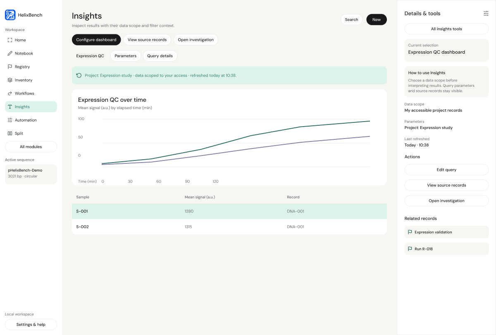

# SCR-12 · Insights

[Current Figma screen](https://www.figma.com/design/U1kWw1K5NZBgEYkuxMz3Qb/helixbench?node-id=107-31682) · Implementation phase P15.

## Purpose and layout

Build a useful view of workspace data and export exactly what is shown.

Local dashboard blocks with visible source scope, grouping/filter parameters, chart/table alternatives, refresh status and CSV export.

## Target requirements

- **SCR-12-R1:** Identify the underlying dataset and its local scope before interpreting a block. Display the query/grouping/filter assumptions and refresh timestamp.
- **SCR-12-R2:** Distinguish no source records, no matching filtered rows, a missing parameter, query failure and unavailable source references.
- **SCR-12-R3:** Chart axes, units and category legends are labeled. Offer a readable data table and stable-ID links back to the contributing records.
- **SCR-12-R4:** Parameters and dataset revision form the cache key; changing a filter or source invalidates stale aggregates without replacing a different block.
- **SCR-12-R5:** CSV export uses the displayed scope, correct quoting and an explicit local destination; cancellation or failed write does not report export success.

## User flow

1. Add insight
2. Choose dataset and grouping
3. Preview chart
4. Save the dashboard state
5. Export the named source or displayed result

Use the shared typed context, validation/review, persistence and return-location contracts at every relevant transition. Prototype fixture IDs and figures are never production defaults.

## States and recovery

- Loading: retain prior context and identify the active request/operation.
- Populated: show stable object identity, meaningful status and available actions.
- No data: offer the relevant creation/import action.
- No matches: retain query/scope and expose Reset or Change settings.
- Invalid prerequisite: explain the missing input and provide its remedy.
- Validation/write failure: retain draft values and show a constructive correction/retry.
- Dirty/partial/stale/unavailable states use the shared state machines when applicable.

## Screen-specific edge cases

- **SCR-12-EC1:** Empty dataset, a category with no values, missing numeric values and nonfinite input.
- **SCR-12-EC2:** Filter excludes all rows; selected grouping column no longer exists.
- **SCR-12-EC3:** Source records change while aggregation runs.
- **SCR-12-EC4:** Long labels, many categories and horizontal scrolling at smaller widths.
- **SCR-12-EC5:** Dataset is local but a referenced source file is inaccessible or deleted.
- **SCR-12-EC6:** CSV contains commas, quotes, newlines, Unicode and values that spreadsheet applications interpret as formulas.

## Current code ownership

- [crates/appcore/src/actions.rs:2799](C:/Users/Admin/Documents/Qoder/2026-11-13/87e5a6b2/helixbench/crates/appcore/src/actions.rs:2799) — `pub fn datasets(app: &AppState) -> Vec<domain::insights::Dataset>`
- [crates/appcore/src/actions.rs:2862](C:/Users/Admin/Documents/Qoder/2026-11-13/87e5a6b2/helixbench/crates/appcore/src/actions.rs:2862) — `pub fn insights_add_block( app: &mut AppState, name: &str, source: &str, chart: domain::insights::Chart, group_by: Option<String>, )`
- [crates/appcore/src/actions.rs:2879](C:/Users/Admin/Documents/Qoder/2026-11-13/87e5a6b2/helixbench/crates/appcore/src/actions.rs:2879) — `pub fn insights_export(app: &mut AppState, source: &str)`

Domain modules: `crates/domain/src/insights.rs`.

Native presentation entry points:

- [apps/desktop_gpui/src/lab.rs:808](C:/Users/Admin/Documents/Qoder/2026-11-13/87e5a6b2/helixbench/apps/desktop_gpui/src/lab.rs:808) — `render_insights`

## Field/draft contracts

Use the typed domain/store models in the data reference and the proposed request/operation models. No nonexistent UI draft is assumed.

## Feature-level implementation contracts

### F-144 · Add a registry / inventory / tasks / entries insight

**Status:** Specified; not verified implemented.

**Entry:** Add insight → Dataset (2 navigation click(s)).

**Prerequisite:** Dataset available.

**Outcome:** Clearly label creation; avoid duplicates on exploration.

**Current evidence note:** Dataset button immediately adds a block.

**Relevant code/action family:** [crates/appcore/src/actions.rs:2799](C:/Users/Admin/Documents/Qoder/2026-11-13/87e5a6b2/helixbench/crates/appcore/src/actions.rs:2799), [crates/appcore/src/actions.rs:2862](C:/Users/Admin/Documents/Qoder/2026-11-13/87e5a6b2/helixbench/crates/appcore/src/actions.rs:2862), [crates/appcore/src/actions.rs:2879](C:/Users/Admin/Documents/Qoder/2026-11-13/87e5a6b2/helixbench/crates/appcore/src/actions.rs:2879).

**Acceptance:**

- F-144-AC1: Given The owning page and the stated prerequisite are available. When The user follows Add insight → Dataset. Then Clearly label creation; avoid duplicates on exploration; feature entry requires at most two navigation clicks.
- F-144-AC2: Given The context contains two similar names or a changed table order. When This feature is activated. Then The command payload retains the exact selected typed identity, source revision and scope.
- F-144-AC3: Given A draft contains an invalid or missing required value. When The user submits the form. Then Show a field-local error, retain the draft and perform no mutation.

**Recovery and edge conditions:**

- Invalid required fields are identified beside the input with original draft values retained.
- Cancel does not alter the source object or create an unrelated example record.
- A stale/deleted target is resolved explicitly instead of mutating a row index.
- Successful persistence updates the selected record, related views and audit consistently.
- Filter excludes all rows; selected grouping column no longer exists.
- Source records change while aggregation runs.

### F-145 · Inspect chart source and grouping

**Status:** Specified; not verified implemented.

**Entry:** Chart title → Details (2 navigation click(s)).

**Prerequisite:** Existing insight.

**Outcome:** Show source, grouping and meaning of bar values.

**Current evidence note:** Group defaults inferred in source.

**Relevant code/action family:** [crates/appcore/src/actions.rs:2799](C:/Users/Admin/Documents/Qoder/2026-11-13/87e5a6b2/helixbench/crates/appcore/src/actions.rs:2799), [crates/appcore/src/actions.rs:2862](C:/Users/Admin/Documents/Qoder/2026-11-13/87e5a6b2/helixbench/crates/appcore/src/actions.rs:2862), [crates/appcore/src/actions.rs:2879](C:/Users/Admin/Documents/Qoder/2026-11-13/87e5a6b2/helixbench/crates/appcore/src/actions.rs:2879).

**Acceptance:**

- F-145-AC1: Given The owning page and the stated prerequisite are available. When The user follows Chart title → Details. Then Show source, grouping and meaning of bar values; feature entry requires at most two navigation clicks.
- F-145-AC2: Given The context contains two similar names or a changed table order. When This feature is activated. Then The command payload retains the exact selected typed identity, source revision and scope.
- F-145-AC3: Given The intended target was deleted or became inaccessible after rendering. When The user activates its row or link. Then Show a relevant recovery path without opening an unrelated record; retain a safe return location.

**Recovery and edge conditions:**

- Two same-name records and two stores with the same numeric ID resolve correctly.
- A missing/deleted/inaccessible target offers a relevant remedy rather than another record.
- Back restores the invoking task and selection; dirty work is preserved where necessary.
- Keyboard activation and labeled controls expose the same action as pointer input.
- Source records change while aggregation runs.
- Long labels, many categories and horizontal scrolling at smaller widths.

### F-146 · View grouped counts

**Status:** Specified; not verified implemented.

**Entry:** Chart (1 navigation click(s)).

**Prerequisite:** Data available.

**Outcome:** Explicit labels and count units.

**Current evidence note:** Existing local bar visualization.

**Relevant code/action family:** [crates/appcore/src/actions.rs:2799](C:/Users/Admin/Documents/Qoder/2026-11-13/87e5a6b2/helixbench/crates/appcore/src/actions.rs:2799), [crates/appcore/src/actions.rs:2862](C:/Users/Admin/Documents/Qoder/2026-11-13/87e5a6b2/helixbench/crates/appcore/src/actions.rs:2862), [crates/appcore/src/actions.rs:2879](C:/Users/Admin/Documents/Qoder/2026-11-13/87e5a6b2/helixbench/crates/appcore/src/actions.rs:2879).

**Acceptance:**

- F-146-AC1: Given The owning page and the stated prerequisite are available. When The user follows Chart. Then Explicit labels and count units; feature entry requires at most two navigation clicks.
- F-146-AC2: Given The context contains two similar names or a changed table order. When This feature is activated. Then The command payload retains the exact selected typed identity, source revision and scope.
- F-146-AC3: Given Underlying records exist and a query or filter is active. When The query/filter matches no records. Then Show no matches with the active scope and reset remedy; do not claim that the dataset is empty or failed.

**Recovery and edge conditions:**

- Empty source, filtered-out records and failed load have different status/remedies.
- Sorting/filtering or a same-name record cannot change the selected stable identity.
- Returning restores the same query/filter/scope and scroll anchor where supported.
- Inspection-only changes do not mark scientific content dirty.
- Long labels, many categories and horizontal scrolling at smaller widths.
- Dataset is local but a referenced source file is inaccessible or deleted.

### F-147 · Export source CSV

**Status:** Specified; not verified implemented.

**Entry:** Chart Export CSV (1 navigation click(s)).

**Prerequisite:** Source dataset.

**Outcome:** Label export scope accurately as source dataset.

**Current evidence note:** Existing per-block export.

**Relevant code/action family:** [crates/appcore/src/actions.rs:2799](C:/Users/Admin/Documents/Qoder/2026-11-13/87e5a6b2/helixbench/crates/appcore/src/actions.rs:2799), [crates/appcore/src/actions.rs:2862](C:/Users/Admin/Documents/Qoder/2026-11-13/87e5a6b2/helixbench/crates/appcore/src/actions.rs:2862), [crates/appcore/src/actions.rs:2879](C:/Users/Admin/Documents/Qoder/2026-11-13/87e5a6b2/helixbench/crates/appcore/src/actions.rs:2879).

**Acceptance:**

- F-147-AC1: Given The owning page and the stated prerequisite are available. When The user follows Chart Export CSV. Then Label export scope accurately as source dataset; feature entry requires at most two navigation clicks.
- F-147-AC2: Given The context contains two similar names or a changed table order. When This feature is activated. Then The command payload retains the exact selected typed identity, source revision and scope.
- F-147-AC3: Given A file or store write is awaiting completion. When The OS dialog is canceled or the atomic write fails. Then Do not report success, change saved/dirty truth or continue a pending destructive intent; preserve original data.

**Recovery and edge conditions:**

- OS-dialog cancellation leaves drafts, source data and pending navigation intact.
- Permission denied, disk full, locked destination and rename failure never show success.
- Reopening/retrying the same operation preserves identity and does not duplicate successful output.
- Export/import preserves scope, encoding, units and declared lossy transformations.
- Dataset is local but a referenced source file is inaccessible or deleted.
- CSV contains commas, quotes, newlines, Unicode and values that spreadsheet applications interpret as formulas.

### F-148 · Change source/grouping

**Status:** Specified; not verified implemented.

**Entry:** Chart → Configure (2 navigation click(s)).

**Prerequisite:** Existing block.

**Outcome:** Preview a changed analysis without deleting it.

**Current evidence note:** Not exposed by current page.

**Relevant code/action family:** [crates/appcore/src/actions.rs:2799](C:/Users/Admin/Documents/Qoder/2026-11-13/87e5a6b2/helixbench/crates/appcore/src/actions.rs:2799), [crates/appcore/src/actions.rs:2862](C:/Users/Admin/Documents/Qoder/2026-11-13/87e5a6b2/helixbench/crates/appcore/src/actions.rs:2862), [crates/appcore/src/actions.rs:2879](C:/Users/Admin/Documents/Qoder/2026-11-13/87e5a6b2/helixbench/crates/appcore/src/actions.rs:2879).

**Acceptance:**

- F-148-AC1: Given The owning page and the stated prerequisite are available. When The user follows Chart → Configure. Then Preview a changed analysis without deleting it; feature entry requires at most two navigation clicks.
- F-148-AC2: Given The context contains two similar names or a changed table order. When This feature is activated. Then The command payload retains the exact selected typed identity, source revision and scope.
- F-148-AC3: Given The intended target was deleted or became inaccessible after rendering. When The user activates its row or link. Then Show a relevant recovery path without opening an unrelated record; retain a safe return location.

**Recovery and edge conditions:**

- Two same-name records and two stores with the same numeric ID resolve correctly.
- A missing/deleted/inaccessible target offers a relevant remedy rather than another record.
- Back restores the invoking task and selection; dirty work is preserved where necessary.
- Keyboard activation and labeled controls expose the same action as pointer input.
- CSV contains commas, quotes, newlines, Unicode and values that spreadsheet applications interpret as formulas.
- Empty dataset, a category with no values, missing numeric values and nonfinite input.

### F-149 · Remove a chart

**Status:** Specified; not verified implemented.

**Entry:** Chart → Remove insight (2 navigation click(s)).

**Prerequisite:** Existing block.

**Outcome:** Remove view only, retain workspace data.

**Current evidence note:** No removal control verified.

**Relevant code/action family:** [crates/appcore/src/actions.rs:2799](C:/Users/Admin/Documents/Qoder/2026-11-13/87e5a6b2/helixbench/crates/appcore/src/actions.rs:2799), [crates/appcore/src/actions.rs:2862](C:/Users/Admin/Documents/Qoder/2026-11-13/87e5a6b2/helixbench/crates/appcore/src/actions.rs:2862), [crates/appcore/src/actions.rs:2879](C:/Users/Admin/Documents/Qoder/2026-11-13/87e5a6b2/helixbench/crates/appcore/src/actions.rs:2879).

**Acceptance:**

- F-149-AC1: Given The owning page and the stated prerequisite are available. When The user follows Chart → Remove insight. Then Remove view only, retain workspace data; feature entry requires at most two navigation clicks.
- F-149-AC2: Given The context contains two similar names or a changed table order. When This feature is activated. Then The command payload retains the exact selected typed identity, source revision and scope.
- F-149-AC3: Given A consequence review identifies the selected record. When The user cancels or the commit fails. Then Keep the reviewed object unchanged, preserve useful draft context and show a recoverable outcome.

**Recovery and edge conditions:**

- Cancel before commit leaves the reviewed object and selection unchanged.
- Changing the selected object while the review is open cannot retarget the action.
- Blocked dependencies and persistence failure leave a constructive recovery path; no false success.
- Successful mutation clears or updates the exact selected context and retained references.
- Empty dataset, a category with no values, missing numeric values and nonfinite input.
- Filter excludes all rows; selected grouping column no longer exists.

