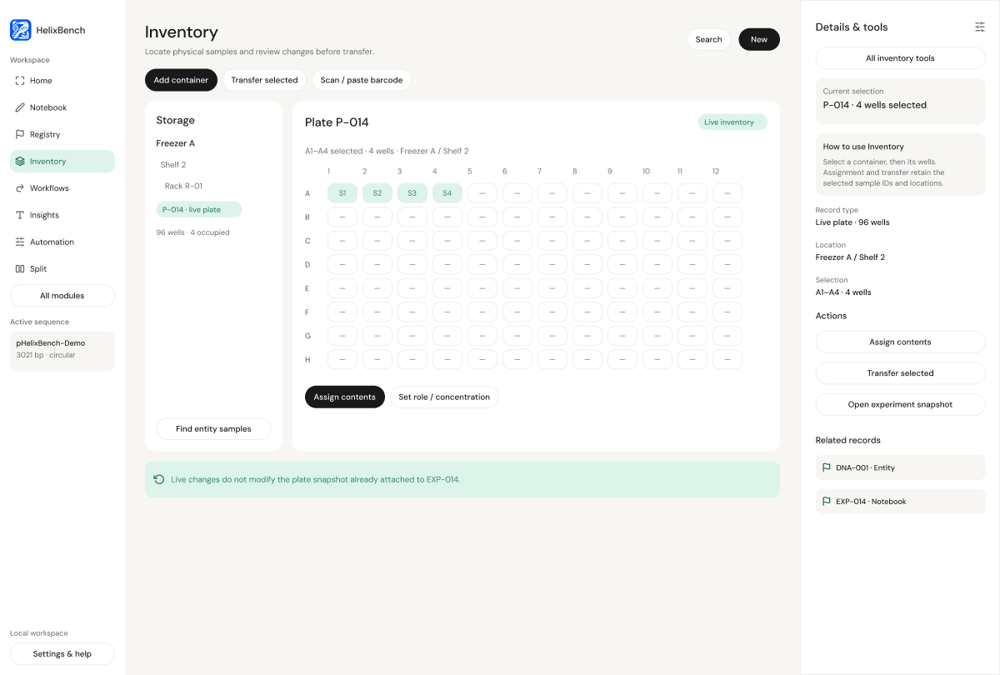

# SCR-10 · Inventory

[Current Figma screen](https://www.figma.com/design/U1kWw1K5NZBgEYkuxMz3Qb/helixbench?node-id=107-31089) · Implementation phase P13.

## Purpose and layout

Locate materials and manage a selected container or plate in place.

Storage hierarchy and plate grid; separate inspect-well and bulk-selection context; assignment review; transfer mapping; immutable snapshot access.

## Target requirements

- **SCR-10-R1:** Scientific entity identity is distinct from physical container/sample identity. Store typed entity references, container IDs and explicit quantity/concentration units.
- **SCR-10-R2:** A well control carries its own plate ID and coordinate; bulk assignment carries the complete reviewed set of well IDs. Row indexes and a fixed A1–A4 string are not action payloads.
- **SCR-10-R3:** Assignment reviews previous contents, proposed entity, role and quantity; occupied wells require explicit replacement review.
- **SCR-10-R4:** Transfer validates all source volumes, destination occupancy, units and mappings before committing the entire reviewed operation. Source subtraction, destination addition and audit use a recoverable persistence boundary.
- **SCR-10-R5:** Refreshing or returning from an operation updates occupancy, counts, selected-well details and filters. Earlier notebook snapshots do not change.
- **SCR-10-R6:** Validate storage parent/cycle rules and plate dimensions; barcode keyboard input/paste is lookup data, not evidence of camera/scanner integration.

## User flow

1. Select location / container
2. Inspect contents or plate
3. Add or assign material
4. Validate quantity / placement
5. Save or snapshot into a notebook entry

Use the shared typed context, validation/review, persistence and return-location contracts at every relevant transition. Prototype fixture IDs and figures are never production defaults.

## States and recovery

- Loading: retain prior context and identify the active request/operation.
- Populated: show stable object identity, meaningful status and available actions.
- No data: offer the relevant creation/import action.
- No matches: retain query/scope and expose Reset or Change settings.
- Invalid prerequisite: explain the missing input and provide its remedy.
- Validation/write failure: retain draft values and show a constructive correction/retry.
- Dirty/partial/stale/unavailable states use the shared state machines when applicable.

## Screen-specific edge cases

- **SCR-10-EC1:** Empty and occupied wells, A1/H12 boundaries, another plate with the same coordinate, empty selection and bulk selection.
- **SCR-10-EC2:** Negative, zero, nonfinite quantity; missing legacy concentration unit; incompatible mass/volume units.
- **SCR-10-EC3:** Destination is occupied, source equals destination, duplicate destinations or source volume is insufficient.
- **SCR-10-EC4:** One of four reviewed transfers fails before commit or persistence fails after staging.
- **SCR-10-EC5:** A storage node is moved into its own descendant or a selected container is deleted.
- **SCR-10-EC6:** Live updates leave immutable experiment snapshots unchanged; inspect-well does not silently alter the bulk selected set.

## Current code ownership

- [crates/appcore/src/actions.rs:2611](C:/Users/Admin/Documents/Qoder/2026-11-13/87e5a6b2/helixbench/crates/appcore/src/actions.rs:2611) — `pub fn open_inventory(app: &mut AppState)`
- [crates/appcore/src/actions.rs:2615](C:/Users/Admin/Documents/Qoder/2026-11-13/87e5a6b2/helixbench/crates/appcore/src/actions.rs:2615) — `pub fn inv_add(app: &mut AppState, draft: &InventoryDraft)`
- [crates/appcore/src/actions.rs:2674](C:/Users/Admin/Documents/Qoder/2026-11-13/87e5a6b2/helixbench/crates/appcore/src/actions.rs:2674) — `pub fn inv_snapshot_to_entry(app: &mut AppState, plate: u64)`

Domain modules: `crates/domain/src/inventory.rs`.

Native presentation entry points:

- [apps/desktop_gpui/src/lab.rs:653](C:/Users/Admin/Documents/Qoder/2026-11-13/87e5a6b2/helixbench/apps/desktop_gpui/src/lab.rs:653) — `render_inventory`
- [apps/desktop_gpui/src/dialogs.rs:5469](C:/Users/Admin/Documents/Qoder/2026-11-13/87e5a6b2/helixbench/apps/desktop_gpui/src/dialogs.rs:5469) — `inventory`

## Field/draft contracts

### InventoryDraft

[crates/appcore/src/state.rs:564](C:/Users/Admin/Documents/Qoder/2026-11-13/87e5a6b2/helixbench/crates/appcore/src/state.rs:564)

- `name: String` — Trim for validation; require a nonempty meaningful label where the owning operation creates an object. Preserve original editable draft on error.
- `kind: usize` — Use a labeled finite choice with a visible selected value. Validate enum/mode availability; preserve unknown legacy values for review.
- `parent: Option<u64>` — Resolve a stable typed identity from a labeled picker. Validate existence/kind at submit; do not persist a row index as a foreign key.
- `selected_plate: Option<u64>` — Resolve a stable typed identity from a labeled picker. Validate existence/kind at submit; do not persist a row index as a foreign key.
- `lookup: String` — Use the owning feature/module requirements and the current typed source definition. Optional values remain distinguishable from empty/default values; validate before commit.
- `error: Option<String>` — System-owned validation/error state; never an editable user field.

## Feature-level implementation contracts

### F-122 · Add location / box / plate / tube

**Status:** Specified; not verified implemented.

**Entry:** Add container → Container kind (2 navigation click(s)).

**Prerequisite:** Parent location when applicable.

**Outcome:** Named container form; avoid silent generic creation.

**Current evidence note:** Separate buttons plus manager kind selector.

**Relevant code/action family:** [crates/appcore/src/actions.rs:2611](C:/Users/Admin/Documents/Qoder/2026-11-13/87e5a6b2/helixbench/crates/appcore/src/actions.rs:2611), [crates/appcore/src/actions.rs:2615](C:/Users/Admin/Documents/Qoder/2026-11-13/87e5a6b2/helixbench/crates/appcore/src/actions.rs:2615), [crates/appcore/src/actions.rs:2674](C:/Users/Admin/Documents/Qoder/2026-11-13/87e5a6b2/helixbench/crates/appcore/src/actions.rs:2674).

**Acceptance:**

- F-122-AC1: Given The owning page and the stated prerequisite are available. When The user follows Add container → Container kind. Then Named container form; avoid silent generic creation; feature entry requires at most two navigation clicks.
- F-122-AC2: Given The context contains two similar names or a changed table order. When This feature is activated. Then The command payload retains the exact selected typed identity, source revision and scope.
- F-122-AC3: Given A draft contains an invalid or missing required value. When The user submits the form. Then Show a field-local error, retain the draft and perform no mutation.

**Recovery and edge conditions:**

- Invalid required fields are identified beside the input with original draft values retained.
- Cancel does not alter the source object or create an unrelated example record.
- A stale/deleted target is resolved explicitly instead of mutating a row index.
- Successful persistence updates the selected record, related views and audit consistently.
- Negative, zero, nonfinite quantity; missing legacy concentration unit; incompatible mass/volume units.
- Destination is occupied, source equals destination, duplicate destinations or source volume is insufficient.

### F-123 · Browse hierarchy

**Status:** Specified; not verified implemented.

**Entry:** Storage-tree row (1 navigation click(s)).

**Prerequisite:** Existing storage.

**Outcome:** Show parent, path and child counts.

**Current evidence note:** Manager tree and flattened page list.

**Relevant code/action family:** [crates/appcore/src/actions.rs:2611](C:/Users/Admin/Documents/Qoder/2026-11-13/87e5a6b2/helixbench/crates/appcore/src/actions.rs:2611), [crates/appcore/src/actions.rs:2615](C:/Users/Admin/Documents/Qoder/2026-11-13/87e5a6b2/helixbench/crates/appcore/src/actions.rs:2615), [crates/appcore/src/actions.rs:2674](C:/Users/Admin/Documents/Qoder/2026-11-13/87e5a6b2/helixbench/crates/appcore/src/actions.rs:2674).

**Acceptance:**

- F-123-AC1: Given The owning page and the stated prerequisite are available. When The user follows Storage-tree row. Then Show parent, path and child counts; feature entry requires at most two navigation clicks.
- F-123-AC2: Given The context contains two similar names or a changed table order. When This feature is activated. Then The command payload retains the exact selected typed identity, source revision and scope.
- F-123-AC3: Given The intended target was deleted or became inaccessible after rendering. When The user activates its row or link. Then Show a relevant recovery path without opening an unrelated record; retain a safe return location.

**Recovery and edge conditions:**

- Two same-name records and two stores with the same numeric ID resolve correctly.
- A missing/deleted/inaccessible target offers a relevant remedy rather than another record.
- Back restores the invoking task and selection; dirty work is preserved where necessary.
- Keyboard activation and labeled controls expose the same action as pointer input.
- Destination is occupied, source equals destination, duplicate destinations or source volume is insufficient.
- One of four reviewed transfers fails before commit or persistence fails after staging.

### F-124 · Inspect selected container

**Status:** Specified; not verified implemented.

**Entry:** Container row (1 navigation click(s)).

**Prerequisite:** Container exists.

**Outcome:** Keep details beside hierarchy.

**Current evidence note:** Manage opens a separate dialog.

**Relevant code/action family:** [crates/appcore/src/actions.rs:2611](C:/Users/Admin/Documents/Qoder/2026-11-13/87e5a6b2/helixbench/crates/appcore/src/actions.rs:2611), [crates/appcore/src/actions.rs:2615](C:/Users/Admin/Documents/Qoder/2026-11-13/87e5a6b2/helixbench/crates/appcore/src/actions.rs:2615), [crates/appcore/src/actions.rs:2674](C:/Users/Admin/Documents/Qoder/2026-11-13/87e5a6b2/helixbench/crates/appcore/src/actions.rs:2674).

**Acceptance:**

- F-124-AC1: Given The owning page and the stated prerequisite are available. When The user follows Container row. Then Keep details beside hierarchy; feature entry requires at most two navigation clicks.
- F-124-AC2: Given The context contains two similar names or a changed table order. When This feature is activated. Then The command payload retains the exact selected typed identity, source revision and scope.
- F-124-AC3: Given The intended target was deleted or became inaccessible after rendering. When The user activates its row or link. Then Show a relevant recovery path without opening an unrelated record; retain a safe return location.

**Recovery and edge conditions:**

- Two same-name records and two stores with the same numeric ID resolve correctly.
- A missing/deleted/inaccessible target offers a relevant remedy rather than another record.
- Back restores the invoking task and selection; dirty work is preserved where necessary.
- Keyboard activation and labeled controls expose the same action as pointer input.
- One of four reviewed transfers fails before commit or persistence fails after staging.
- A storage node is moved into its own descendant or a selected container is deleted.

### F-125 · Find containers for an entity

**Status:** Specified; not verified implemented.

**Entry:** Find entity field (1 navigation click(s)).

**Prerequisite:** Registry identity known.

**Outcome:** Return matching locations and quantities.

**Current evidence note:** Manager-only lookup.

**Relevant code/action family:** [crates/appcore/src/actions.rs:2611](C:/Users/Admin/Documents/Qoder/2026-11-13/87e5a6b2/helixbench/crates/appcore/src/actions.rs:2611), [crates/appcore/src/actions.rs:2615](C:/Users/Admin/Documents/Qoder/2026-11-13/87e5a6b2/helixbench/crates/appcore/src/actions.rs:2615), [crates/appcore/src/actions.rs:2674](C:/Users/Admin/Documents/Qoder/2026-11-13/87e5a6b2/helixbench/crates/appcore/src/actions.rs:2674).

**Acceptance:**

- F-125-AC1: Given The owning page and the stated prerequisite are available. When The user follows Find entity field. Then Return matching locations and quantities; feature entry requires at most two navigation clicks.
- F-125-AC2: Given The context contains two similar names or a changed table order. When This feature is activated. Then The command payload retains the exact selected typed identity, source revision and scope.
- F-125-AC3: Given Underlying records exist and a query or filter is active. When The query/filter matches no records. Then Show no matches with the active scope and reset remedy; do not claim that the dataset is empty or failed.

**Recovery and edge conditions:**

- Empty source, filtered-out records and failed load have different status/remedies.
- Sorting/filtering or a same-name record cannot change the selected stable identity.
- Returning restores the same query/filter/scope and scroll anchor where supported.
- Inspection-only changes do not mark scientific content dirty.
- A storage node is moved into its own descendant or a selected container is deleted.
- Live updates leave immutable experiment snapshots unchanged; inspect-well does not silently alter the bulk selected set.

### F-126 · View selected plate wells

**Status:** Specified; not verified implemented.

**Entry:** Plate row (1 navigation click(s)).

**Prerequisite:** Plate selected.

**Outcome:** Show coordinates, well roles and occupancy.

**Current evidence note:** Grid inside manager.

**Relevant code/action family:** [crates/appcore/src/actions.rs:2611](C:/Users/Admin/Documents/Qoder/2026-11-13/87e5a6b2/helixbench/crates/appcore/src/actions.rs:2611), [crates/appcore/src/actions.rs:2615](C:/Users/Admin/Documents/Qoder/2026-11-13/87e5a6b2/helixbench/crates/appcore/src/actions.rs:2615), [crates/appcore/src/actions.rs:2674](C:/Users/Admin/Documents/Qoder/2026-11-13/87e5a6b2/helixbench/crates/appcore/src/actions.rs:2674).

**Acceptance:**

- F-126-AC1: Given The owning page and the stated prerequisite are available. When The user follows Plate row. Then Show coordinates, well roles and occupancy; feature entry requires at most two navigation clicks.
- F-126-AC2: Given The context contains two similar names or a changed table order. When This feature is activated. Then The command payload retains the exact selected typed identity, source revision and scope.
- F-126-AC3: Given Underlying records exist and a query or filter is active. When The query/filter matches no records. Then Show no matches with the active scope and reset remedy; do not claim that the dataset is empty or failed.

**Recovery and edge conditions:**

- Empty source, filtered-out records and failed load have different status/remedies.
- Sorting/filtering or a same-name record cannot change the selected stable identity.
- Returning restores the same query/filter/scope and scroll anchor where supported.
- Inspection-only changes do not mark scientific content dirty.
- Live updates leave immutable experiment snapshots unchanged; inspect-well does not silently alter the bulk selected set.
- Empty and occupied wells, A1/H12 boundaries, another plate with the same coordinate, empty selection and bulk selection.

### F-127 · Assign / fill wells

**Status:** Specified; not verified implemented.

**Entry:** Plate row → Assign wells (2 navigation click(s)).

**Prerequisite:** Plate selected; material available.

**Outcome:** Review range, entity, role and quantity.

**Current evidence note:** Source exposes Fill demo wells only.

**Relevant code/action family:** [crates/appcore/src/actions.rs:2611](C:/Users/Admin/Documents/Qoder/2026-11-13/87e5a6b2/helixbench/crates/appcore/src/actions.rs:2611), [crates/appcore/src/actions.rs:2615](C:/Users/Admin/Documents/Qoder/2026-11-13/87e5a6b2/helixbench/crates/appcore/src/actions.rs:2615), [crates/appcore/src/actions.rs:2674](C:/Users/Admin/Documents/Qoder/2026-11-13/87e5a6b2/helixbench/crates/appcore/src/actions.rs:2674).

**Acceptance:**

- F-127-AC1: Given The owning page and the stated prerequisite are available. When The user follows Plate row → Assign wells. Then Review range, entity, role and quantity; feature entry requires at most two navigation clicks.
- F-127-AC2: Given The context contains two similar names or a changed table order. When This feature is activated. Then The command payload retains the exact selected typed identity, source revision and scope.
- F-127-AC3: Given A draft contains an invalid or missing required value. When The user submits the form. Then Show a field-local error, retain the draft and perform no mutation.

**Recovery and edge conditions:**

- Invalid required fields are identified beside the input with original draft values retained.
- Cancel does not alter the source object or create an unrelated example record.
- A stale/deleted target is resolved explicitly instead of mutating a row index.
- Successful persistence updates the selected record, related views and audit consistently.
- Empty and occupied wells, A1/H12 boundaries, another plate with the same coordinate, empty selection and bulk selection.
- Negative, zero, nonfinite quantity; missing legacy concentration unit; incompatible mass/volume units.

### F-128 · Inspect well contents

**Status:** Specified; not verified implemented.

**Entry:** Plate row → Well (2 navigation click(s)).

**Prerequisite:** Plate selected.

**Outcome:** Show entity, quantity, concentration and role.

**Current evidence note:** Grid currently descriptive.

**Relevant code/action family:** [crates/appcore/src/actions.rs:2611](C:/Users/Admin/Documents/Qoder/2026-11-13/87e5a6b2/helixbench/crates/appcore/src/actions.rs:2611), [crates/appcore/src/actions.rs:2615](C:/Users/Admin/Documents/Qoder/2026-11-13/87e5a6b2/helixbench/crates/appcore/src/actions.rs:2615), [crates/appcore/src/actions.rs:2674](C:/Users/Admin/Documents/Qoder/2026-11-13/87e5a6b2/helixbench/crates/appcore/src/actions.rs:2674).

**Acceptance:**

- F-128-AC1: Given The owning page and the stated prerequisite are available. When The user follows Plate row → Well. Then Show entity, quantity, concentration and role; feature entry requires at most two navigation clicks.
- F-128-AC2: Given The context contains two similar names or a changed table order. When This feature is activated. Then The command payload retains the exact selected typed identity, source revision and scope.
- F-128-AC3: Given The intended target was deleted or became inaccessible after rendering. When The user activates its row or link. Then Show a relevant recovery path without opening an unrelated record; retain a safe return location.

**Recovery and edge conditions:**

- Two same-name records and two stores with the same numeric ID resolve correctly.
- A missing/deleted/inaccessible target offers a relevant remedy rather than another record.
- Back restores the invoking task and selection; dirty work is preserved where necessary.
- Keyboard activation and labeled controls expose the same action as pointer input.
- Negative, zero, nonfinite quantity; missing legacy concentration unit; incompatible mass/volume units.
- Destination is occupied, source equals destination, duplicate destinations or source volume is insufficient.

### F-129 · Snapshot plate into notebook

**Status:** Specified; not verified implemented.

**Entry:** Plate row → Snapshot to notebook (2 navigation click(s)).

**Prerequisite:** Plate exists; target entry context.

**Outcome:** Choose/confirm entry; preserve immutable contents.

**Current evidence note:** Manager-only action.

**Relevant code/action family:** [crates/appcore/src/actions.rs:2674](C:/Users/Admin/Documents/Qoder/2026-11-13/87e5a6b2/helixbench/crates/appcore/src/actions.rs:2674).

**Acceptance:**

- F-129-AC1: Given The owning page and the stated prerequisite are available. When The user follows Plate row → Snapshot to notebook. Then Choose/confirm entry; preserve immutable contents; feature entry requires at most two navigation clicks.
- F-129-AC2: Given The context contains two similar names or a changed table order. When This feature is activated. Then The command payload retains the exact selected typed identity, source revision and scope.
- F-129-AC3: Given The intended target was deleted or became inaccessible after rendering. When The user activates its row or link. Then Show a relevant recovery path without opening an unrelated record; retain a safe return location.

**Recovery and edge conditions:**

- Two same-name records and two stores with the same numeric ID resolve correctly.
- A missing/deleted/inaccessible target offers a relevant remedy rather than another record.
- Back restores the invoking task and selection; dirty work is preserved where necessary.
- Keyboard activation and labeled controls expose the same action as pointer input.
- Destination is occupied, source equals destination, duplicate destinations or source volume is insufficient.
- One of four reviewed transfers fails before commit or persistence fails after staging.

### F-130 · Review physical quantity and concentration

**Status:** Specified; not verified implemented.

**Entry:** Container row → Details (2 navigation click(s)).

**Prerequisite:** Container selected.

**Outcome:** Expose current amount, unit and concentration.

**Current evidence note:** Domain fields exist; limited visible editing.

**Relevant code/action family:** [crates/appcore/src/actions.rs:1725](C:/Users/Admin/Documents/Qoder/2026-11-13/87e5a6b2/helixbench/crates/appcore/src/actions.rs:1725).

**Acceptance:**

- F-130-AC1: Given The owning page and the stated prerequisite are available. When The user follows Container row → Details. Then Expose current amount, unit and concentration; feature entry requires at most two navigation clicks.
- F-130-AC2: Given The context contains two similar names or a changed table order. When This feature is activated. Then The command payload retains the exact selected typed identity, source revision and scope.
- F-130-AC3: Given Underlying records exist and a query or filter is active. When The query/filter matches no records. Then Show no matches with the active scope and reset remedy; do not claim that the dataset is empty or failed.

**Recovery and edge conditions:**

- Empty source, filtered-out records and failed load have different status/remedies.
- Sorting/filtering or a same-name record cannot change the selected stable identity.
- Returning restores the same query/filter/scope and scroll anchor where supported.
- Inspection-only changes do not mark scientific content dirty.
- One of four reviewed transfers fails before commit or persistence fails after staging.
- A storage node is moved into its own descendant or a selected container is deleted.

### F-131 · Move container / change placement

**Status:** Specified; not verified implemented.

**Entry:** Container row → Move (2 navigation click(s)).

**Prerequisite:** Target storage exists.

**Outcome:** Validate target and capacity.

**Current evidence note:** Parent/position data exists; dedicated move control not verified.

**Relevant code/action family:** [crates/appcore/src/actions.rs:2611](C:/Users/Admin/Documents/Qoder/2026-11-13/87e5a6b2/helixbench/crates/appcore/src/actions.rs:2611), [crates/appcore/src/actions.rs:2615](C:/Users/Admin/Documents/Qoder/2026-11-13/87e5a6b2/helixbench/crates/appcore/src/actions.rs:2615), [crates/appcore/src/actions.rs:2674](C:/Users/Admin/Documents/Qoder/2026-11-13/87e5a6b2/helixbench/crates/appcore/src/actions.rs:2674).

**Acceptance:**

- F-131-AC1: Given The owning page and the stated prerequisite are available. When The user follows Container row → Move. Then Validate target and capacity; feature entry requires at most two navigation clicks.
- F-131-AC2: Given The context contains two similar names or a changed table order. When This feature is activated. Then The command payload retains the exact selected typed identity, source revision and scope.
- F-131-AC3: Given A draft contains an invalid or missing required value. When The user submits the form. Then Show a field-local error, retain the draft and perform no mutation.

**Recovery and edge conditions:**

- Invalid required fields are identified beside the input with original draft values retained.
- Cancel does not alter the source object or create an unrelated example record.
- A stale/deleted target is resolved explicitly instead of mutating a row index.
- Successful persistence updates the selected record, related views and audit consistently.
- A storage node is moved into its own descendant or a selected container is deleted.
- Live updates leave immutable experiment snapshots unchanged; inspect-well does not silently alter the bulk selected set.

### F-132 · Open linked entity

**Status:** Specified; not verified implemented.

**Entry:** Container row → Open entity (2 navigation click(s)).

**Prerequisite:** Entity link available.

**Outcome:** Return to exact Registry record.

**Current evidence note:** Custody and identity are currently separated.

**Relevant code/action family:** [crates/appcore/src/actions.rs:2611](C:/Users/Admin/Documents/Qoder/2026-11-13/87e5a6b2/helixbench/crates/appcore/src/actions.rs:2611), [crates/appcore/src/actions.rs:2615](C:/Users/Admin/Documents/Qoder/2026-11-13/87e5a6b2/helixbench/crates/appcore/src/actions.rs:2615), [crates/appcore/src/actions.rs:2674](C:/Users/Admin/Documents/Qoder/2026-11-13/87e5a6b2/helixbench/crates/appcore/src/actions.rs:2674).

**Acceptance:**

- F-132-AC1: Given The owning page and the stated prerequisite are available. When The user follows Container row → Open entity. Then Return to exact Registry record; feature entry requires at most two navigation clicks.
- F-132-AC2: Given The context contains two similar names or a changed table order. When This feature is activated. Then The command payload retains the exact selected typed identity, source revision and scope.
- F-132-AC3: Given A draft contains an invalid or missing required value. When The user submits the form. Then Show a field-local error, retain the draft and perform no mutation.

**Recovery and edge conditions:**

- Invalid required fields are identified beside the input with original draft values retained.
- Cancel does not alter the source object or create an unrelated example record.
- A stale/deleted target is resolved explicitly instead of mutating a row index.
- Successful persistence updates the selected record, related views and audit consistently.
- Live updates leave immutable experiment snapshots unchanged; inspect-well does not silently alter the bulk selected set.
- Empty and occupied wells, A1/H12 boundaries, another plate with the same coordinate, empty selection and bulk selection.

