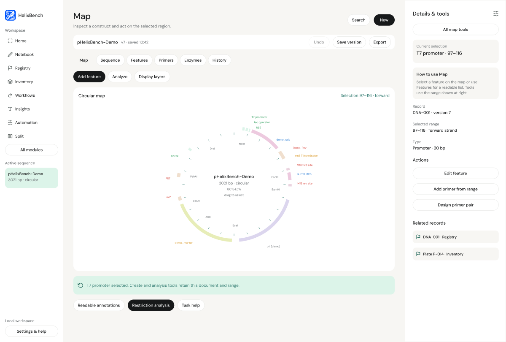

# SCR-02 · Map

[Current Figma screen](https://www.figma.com/design/U1kWw1K5NZBgEYkuxMz3Qb/helixbench?node-id=107-29429) · Implementation phase P08A.

## Purpose and layout

Understand a construct and act directly on its sequence region.

Document identity and saved/draft state; six scientific views; editable map with zoom and readable-annotation alternative; selection-bound right tools panel.

## Target requirements

- **SCR-02-R1:** Map representation (Plasmid/Linear) is independent of biological topology. A display switch does not edit the molecule.
- **SCR-02-R2:** All coordinates displayed to users are 1-based inclusive; internal Range remains zero-based start plus length. Circular origin-spanning selections retain ordered segments.
- **SCR-02-R3:** Feature, primer and enzyme selection synchronizes the map, list and inspector. Clear selection removes dependent actions rather than retaining the previous record.
- **SCR-02-R4:** Display toggles, zoom, fit, center and minimap remain available. Readable annotation lists carry the same IDs and coordinates when labels are dense.
- **SCR-02-R5:** Mutating topology, origin or sequence direction has an impact preview for affected annotations/primers and remains undoable; analyses retain their captured input.

## User flow

1. Open a construct
2. Select a feature or range
3. Choose a contextual action
4. Review prefilled inputs
5. Apply and return to the same map region

Use the shared typed context, validation/review, persistence and return-location contracts at every relevant transition. Prototype fixture IDs and figures are never production defaults.

## States and recovery

- Loading: retain prior context and identify the active request/operation.
- Populated: show stable object identity, meaningful status and available actions.
- No data: offer the relevant creation/import action.
- No matches: retain query/scope and expose Reset or Change settings.
- Invalid prerequisite: explain the missing input and provide its remedy.
- Validation/write failure: retain draft values and show a constructive correction/retry.
- Dirty/partial/stale/unavailable states use the shared state machines when applicable.

## Screen-specific edge cases

- **SCR-02-EC1:** Empty sequence, one-base sequence, very long sequence or dense overlapping annotations.
- **SCR-02-EC2:** Drag across the circular origin; reverse-strand feature; discontiguous feature segments.
- **SCR-02-EC3:** Map display is Linear while topology is Circular, and the reverse.
- **SCR-02-EC4:** Selection or document changes after opening a tool.
- **SCR-02-EC5:** Zoom/minimap movement must not accidentally edit a feature.
- **SCR-02-EC6:** Undo after a topology/origin edit restores selection and annotations; read-only display changes do not mark dirty.

## Current code ownership

- [crates/appcore/src/actions.rs:201](C:/Users/Admin/Documents/Qoder/2026-11-13/87e5a6b2/helixbench/crates/appcore/src/actions.rs:201) — `pub fn primer_from_selection(app: &mut AppState)`
- [crates/appcore/src/actions.rs:103](C:/Users/Admin/Documents/Qoder/2026-11-13/87e5a6b2/helixbench/crates/appcore/src/actions.rs:103) — `pub fn save_feature_draft(app: &mut AppState, draft: &FeatureDraft) -> Result<(), String>`
- [crates/appcore/src/actions.rs:373](C:/Users/Admin/Documents/Qoder/2026-11-13/87e5a6b2/helixbench/crates/appcore/src/actions.rs:373) — `pub fn set_topology(app: &mut AppState, topology: Topology)`
- [crates/appcore/src/actions.rs:357](C:/Users/Admin/Documents/Qoder/2026-11-13/87e5a6b2/helixbench/crates/appcore/src/actions.rs:357) — `pub fn rotate_to(app: &mut AppState, pos: usize)`
- [crates/appcore/src/actions.rs:328](C:/Users/Admin/Documents/Qoder/2026-11-13/87e5a6b2/helixbench/crates/appcore/src/actions.rs:328) — `pub fn reverse_complement_sequence(app: &mut AppState)`
- [crates/appcore/src/actions.rs:819](C:/Users/Admin/Documents/Qoder/2026-11-13/87e5a6b2/helixbench/crates/appcore/src/actions.rs:819) — `pub fn open_digest(app: &mut AppState)`
- [crates/appcore/src/actions.rs:423](C:/Users/Admin/Documents/Qoder/2026-11-13/87e5a6b2/helixbench/crates/appcore/src/actions.rs:423) — `pub fn open_color_selection(app: &mut AppState)`

Domain modules: `crates/domain/src/enzyme.rs`, `crates/domain/src/feature.rs`, `crates/domain/src/sequence.rs`.

Native presentation entry points:

- [apps/desktop_gpui/src/app.rs:284](C:/Users/Admin/Documents/Qoder/2026-11-13/87e5a6b2/helixbench/apps/desktop_gpui/src/app.rs:284) — `render_menu`
- [apps/desktop_gpui/src/dialogs.rs:1624](C:/Users/Admin/Documents/Qoder/2026-11-13/87e5a6b2/helixbench/apps/desktop_gpui/src/dialogs.rs:1624) — `options`
- [apps/desktop_gpui/src/dialogs.rs:1776](C:/Users/Admin/Documents/Qoder/2026-11-13/87e5a6b2/helixbench/apps/desktop_gpui/src/dialogs.rs:1776) — `rotate`
- [apps/desktop_gpui/src/dialogs.rs:1916](C:/Users/Admin/Documents/Qoder/2026-11-13/87e5a6b2/helixbench/apps/desktop_gpui/src/dialogs.rs:1916) — `detect_common`
- [apps/desktop_gpui/src/dialogs.rs:2106](C:/Users/Admin/Documents/Qoder/2026-11-13/87e5a6b2/helixbench/apps/desktop_gpui/src/dialogs.rs:2106) — `color_selection`

## Field/draft contracts

### FeatureDraft

[crates/appcore/src/state.rs:199](C:/Users/Admin/Documents/Qoder/2026-11-13/87e5a6b2/helixbench/crates/appcore/src/state.rs:199)

- `id: Option<u64>` — Resolve a stable typed identity from a labeled picker. Validate existence/kind at submit; do not persist a row index as a foreign key.
- `name: String` — Trim for validation; require a nonempty meaningful label where the owning operation creates an object. Preserve original editable draft on error.
- `kind: String` — Use a labeled finite choice with a visible selected value. Validate enum/mode availability; preserve unknown legacy values for review.
- `segments_text: String` — Use the owning feature/module requirements and the current typed source definition. Optional values remain distinguishable from empty/default values; validate before commit.
- `direction: Direction` — Use the owning feature/module requirements and the current typed source definition. Optional values remain distinguishable from empty/default values; validate before commit.
- `color: [u8; 3]` — Use the owning feature/module requirements and the current typed source definition. Optional values remain distinguishable from empty/default values; validate before commit.
- `note: String` — Use the owning feature/module requirements and the current typed source definition. Optional values remain distinguishable from empty/default values; validate before commit.
- `product: String` — Use the owning feature/module requirements and the current typed source definition. Optional values remain distinguishable from empty/default values; validate before commit.
- `translated: bool` — Explicit labeled toggle; default is specified by the owning feature. Persist only when the corresponding action is confirmed.
- `genetic_code: u8` — Use the owning feature/module requirements and the current typed source definition. Optional values remain distinguishable from empty/default values; validate before commit.
- `first_codon_met: bool` — Explicit labeled toggle; default is specified by the owning feature. Persist only when the corresponding action is confirmed.
- `frame_offset: usize` — Validate coordinate/length/frame using the owning tool; UI positions are 1-based inclusive. Reject empty/out-of-range spans and unsupported frame values.
- `error: Option<String>` — System-owned validation/error state; never an editable user field.

### PrimerDraft

[crates/appcore/src/state.rs:216](C:/Users/Admin/Documents/Qoder/2026-11-13/87e5a6b2/helixbench/crates/appcore/src/state.rs:216)

- `id: Option<u64>` — Resolve a stable typed identity from a labeled picker. Validate existence/kind at submit; do not persist a row index as a foreign key.
- `name: String` — Trim for validation; require a nonempty meaningful label where the owning operation creates an object. Preserve original editable draft on error.
- `sequence: String` — Validate the declared molecule/grammar before commit. Preserve original text and report meaningful normalization or unsupported syntax.
- `description: String` — Use the owning feature/module requirements and the current typed source definition. Optional values remain distinguishable from empty/default values; validate before commit.
- `color: [u8; 3]` — Use the owning feature/module requirements and the current typed source definition. Optional values remain distinguishable from empty/default values; validate before commit.
- `phosphorylated: bool` — Explicit labeled toggle; default is specified by the owning feature. Persist only when the corresponding action is confirmed.
- `error: Option<String>` — System-owned validation/error state; never an editable user field.

### ColorDraft

[crates/appcore/src/state.rs:312](C:/Users/Admin/Documents/Qoder/2026-11-13/87e5a6b2/helixbench/crates/appcore/src/state.rs:312)

- `range: Range` — Use the owning feature/module requirements and the current typed source definition. Optional values remain distinguishable from empty/default values; validate before commit.
- `color: [u8; 3]` — Use the owning feature/module requirements and the current typed source definition. Optional values remain distinguishable from empty/default values; validate before commit.
- `strands: StrandMask` — Use the owning feature/module requirements and the current typed source definition. Optional values remain distinguishable from empty/default values; validate before commit.

## Feature-level implementation contracts

### F-015 · Circular / linear representation

**Status:** Specified; not verified implemented.

**Entry:** Plasmid or Linear tab (1 navigation click(s)).

**Prerequisite:** Active document.

**Outcome:** Change representation without changing molecule topology.

**Current evidence note:** Representation tabs already present.

**Relevant code/action family:** [crates/appcore/src/actions.rs:201](C:/Users/Admin/Documents/Qoder/2026-11-13/87e5a6b2/helixbench/crates/appcore/src/actions.rs:201), [crates/appcore/src/actions.rs:103](C:/Users/Admin/Documents/Qoder/2026-11-13/87e5a6b2/helixbench/crates/appcore/src/actions.rs:103), [crates/appcore/src/actions.rs:373](C:/Users/Admin/Documents/Qoder/2026-11-13/87e5a6b2/helixbench/crates/appcore/src/actions.rs:373), [crates/appcore/src/actions.rs:357](C:/Users/Admin/Documents/Qoder/2026-11-13/87e5a6b2/helixbench/crates/appcore/src/actions.rs:357), [crates/appcore/src/actions.rs:328](C:/Users/Admin/Documents/Qoder/2026-11-13/87e5a6b2/helixbench/crates/appcore/src/actions.rs:328), [crates/appcore/src/actions.rs:819](C:/Users/Admin/Documents/Qoder/2026-11-13/87e5a6b2/helixbench/crates/appcore/src/actions.rs:819), [crates/appcore/src/actions.rs:423](C:/Users/Admin/Documents/Qoder/2026-11-13/87e5a6b2/helixbench/crates/appcore/src/actions.rs:423).

**Acceptance:**

- F-015-AC1: Given The owning page and the stated prerequisite are available. When The user follows Plasmid or Linear tab. Then Change representation without changing molecule topology; feature entry requires at most two navigation clicks.
- F-015-AC2: Given The context contains two similar names or a changed table order. When This feature is activated. Then The command payload retains the exact selected typed identity, source revision and scope.
- F-015-AC3: Given The intended target was deleted or became inaccessible after rendering. When The user activates its row or link. Then Show a relevant recovery path without opening an unrelated record; retain a safe return location.

**Recovery and edge conditions:**

- Two same-name records and two stores with the same numeric ID resolve correctly.
- A missing/deleted/inaccessible target offers a relevant remedy rather than another record.
- Back restores the invoking task and selection; dirty work is preserved where necessary.
- Keyboard activation and labeled controls expose the same action as pointer input.
- Drag across the circular origin; reverse-strand feature; discontiguous feature segments.
- Map display is Linear while topology is Circular, and the reverse.

### F-016 · Document metadata

**Status:** Specified; not verified implemented.

**Entry:** Metadata tab (1 navigation click(s)).

**Prerequisite:** Active document.

**Outcome:** View/edit description and document properties.

**Current evidence note:** Existing map metadata view.

**Relevant code/action family:** [crates/appcore/src/actions.rs:201](C:/Users/Admin/Documents/Qoder/2026-11-13/87e5a6b2/helixbench/crates/appcore/src/actions.rs:201), [crates/appcore/src/actions.rs:103](C:/Users/Admin/Documents/Qoder/2026-11-13/87e5a6b2/helixbench/crates/appcore/src/actions.rs:103), [crates/appcore/src/actions.rs:373](C:/Users/Admin/Documents/Qoder/2026-11-13/87e5a6b2/helixbench/crates/appcore/src/actions.rs:373), [crates/appcore/src/actions.rs:357](C:/Users/Admin/Documents/Qoder/2026-11-13/87e5a6b2/helixbench/crates/appcore/src/actions.rs:357), [crates/appcore/src/actions.rs:328](C:/Users/Admin/Documents/Qoder/2026-11-13/87e5a6b2/helixbench/crates/appcore/src/actions.rs:328), [crates/appcore/src/actions.rs:819](C:/Users/Admin/Documents/Qoder/2026-11-13/87e5a6b2/helixbench/crates/appcore/src/actions.rs:819), [crates/appcore/src/actions.rs:423](C:/Users/Admin/Documents/Qoder/2026-11-13/87e5a6b2/helixbench/crates/appcore/src/actions.rs:423).

**Acceptance:**

- F-016-AC1: Given The owning page and the stated prerequisite are available. When The user follows Metadata tab. Then View/edit description and document properties; feature entry requires at most two navigation clicks.
- F-016-AC2: Given The context contains two similar names or a changed table order. When This feature is activated. Then The command payload retains the exact selected typed identity, source revision and scope.
- F-016-AC3: Given The intended target was deleted or became inaccessible after rendering. When The user activates its row or link. Then Show a relevant recovery path without opening an unrelated record; retain a safe return location.

**Recovery and edge conditions:**

- Two same-name records and two stores with the same numeric ID resolve correctly.
- A missing/deleted/inaccessible target offers a relevant remedy rather than another record.
- Back restores the invoking task and selection; dirty work is preserved where necessary.
- Keyboard activation and labeled controls expose the same action as pointer input.
- Map display is Linear while topology is Circular, and the reverse.
- Selection or document changes after opening a tool.

### F-017 · Inspect feature / enzyme / primer

**Status:** Specified; not verified implemented.

**Entry:** Annotation click (1 navigation click(s)).

**Prerequisite:** Visible annotation.

**Outcome:** Open synchronized selection inspector.

**Current evidence note:** Canvas labels require hit-target discovery.

**Relevant code/action family:** [crates/appcore/src/actions.rs:201](C:/Users/Admin/Documents/Qoder/2026-11-13/87e5a6b2/helixbench/crates/appcore/src/actions.rs:201), [crates/appcore/src/actions.rs:103](C:/Users/Admin/Documents/Qoder/2026-11-13/87e5a6b2/helixbench/crates/appcore/src/actions.rs:103), [crates/appcore/src/actions.rs:373](C:/Users/Admin/Documents/Qoder/2026-11-13/87e5a6b2/helixbench/crates/appcore/src/actions.rs:373), [crates/appcore/src/actions.rs:357](C:/Users/Admin/Documents/Qoder/2026-11-13/87e5a6b2/helixbench/crates/appcore/src/actions.rs:357), [crates/appcore/src/actions.rs:328](C:/Users/Admin/Documents/Qoder/2026-11-13/87e5a6b2/helixbench/crates/appcore/src/actions.rs:328), [crates/appcore/src/actions.rs:819](C:/Users/Admin/Documents/Qoder/2026-11-13/87e5a6b2/helixbench/crates/appcore/src/actions.rs:819), [crates/appcore/src/actions.rs:423](C:/Users/Admin/Documents/Qoder/2026-11-13/87e5a6b2/helixbench/crates/appcore/src/actions.rs:423).

**Acceptance:**

- F-017-AC1: Given The owning page and the stated prerequisite are available. When The user follows Annotation click. Then Open synchronized selection inspector; feature entry requires at most two navigation clicks.
- F-017-AC2: Given The context contains two similar names or a changed table order. When This feature is activated. Then The command payload retains the exact selected typed identity, source revision and scope.
- F-017-AC3: Given The intended target was deleted or became inaccessible after rendering. When The user activates its row or link. Then Show a relevant recovery path without opening an unrelated record; retain a safe return location.

**Recovery and edge conditions:**

- Two same-name records and two stores with the same numeric ID resolve correctly.
- A missing/deleted/inaccessible target offers a relevant remedy rather than another record.
- Back restores the invoking task and selection; dirty work is preserved where necessary.
- Keyboard activation and labeled controls expose the same action as pointer input.
- Selection or document changes after opening a tool.
- Zoom/minimap movement must not accidentally edit a feature.

### F-018 · Create feature from range

**Status:** Specified; not verified implemented.

**Entry:** Add feature (1 navigation click(s)).

**Prerequisite:** Optional sequence range.

**Outcome:** Feature editor seeded with range and direction.

**Current evidence note:** Features menu or Features page.

**Relevant code/action family:** [crates/appcore/src/actions.rs:201](C:/Users/Admin/Documents/Qoder/2026-11-13/87e5a6b2/helixbench/crates/appcore/src/actions.rs:201), [crates/appcore/src/actions.rs:103](C:/Users/Admin/Documents/Qoder/2026-11-13/87e5a6b2/helixbench/crates/appcore/src/actions.rs:103), [crates/appcore/src/actions.rs:373](C:/Users/Admin/Documents/Qoder/2026-11-13/87e5a6b2/helixbench/crates/appcore/src/actions.rs:373), [crates/appcore/src/actions.rs:357](C:/Users/Admin/Documents/Qoder/2026-11-13/87e5a6b2/helixbench/crates/appcore/src/actions.rs:357), [crates/appcore/src/actions.rs:328](C:/Users/Admin/Documents/Qoder/2026-11-13/87e5a6b2/helixbench/crates/appcore/src/actions.rs:328), [crates/appcore/src/actions.rs:819](C:/Users/Admin/Documents/Qoder/2026-11-13/87e5a6b2/helixbench/crates/appcore/src/actions.rs:819), [crates/appcore/src/actions.rs:423](C:/Users/Admin/Documents/Qoder/2026-11-13/87e5a6b2/helixbench/crates/appcore/src/actions.rs:423).

**Acceptance:**

- F-018-AC1: Given The owning page and the stated prerequisite are available. When The user follows Add feature. Then Feature editor seeded with range and direction; feature entry requires at most two navigation clicks.
- F-018-AC2: Given The context contains two similar names or a changed table order. When This feature is activated. Then The command payload retains the exact selected typed identity, source revision and scope.
- F-018-AC3: Given A draft contains an invalid or missing required value. When The user submits the form. Then Show a field-local error, retain the draft and perform no mutation.

**Recovery and edge conditions:**

- Invalid required fields are identified beside the input with original draft values retained.
- Cancel does not alter the source object or create an unrelated example record.
- A stale/deleted target is resolved explicitly instead of mutating a row index.
- Successful persistence updates the selected record, related views and audit consistently.
- Zoom/minimap movement must not accidentally edit a feature.
- Undo after a topology/origin edit restores selection and annotations; read-only display changes do not mark dirty.

### F-019 · Edit selected feature

**Status:** Specified; not verified implemented.

**Entry:** Select feature → Edit feature (2 navigation click(s)).

**Prerequisite:** Visible feature.

**Outcome:** Open selected feature editor.

**Current evidence note:** Menu edit; sometimes double-click knowledge required.

**Relevant code/action family:** [crates/appcore/src/actions.rs:201](C:/Users/Admin/Documents/Qoder/2026-11-13/87e5a6b2/helixbench/crates/appcore/src/actions.rs:201), [crates/appcore/src/actions.rs:103](C:/Users/Admin/Documents/Qoder/2026-11-13/87e5a6b2/helixbench/crates/appcore/src/actions.rs:103), [crates/appcore/src/actions.rs:373](C:/Users/Admin/Documents/Qoder/2026-11-13/87e5a6b2/helixbench/crates/appcore/src/actions.rs:373), [crates/appcore/src/actions.rs:357](C:/Users/Admin/Documents/Qoder/2026-11-13/87e5a6b2/helixbench/crates/appcore/src/actions.rs:357), [crates/appcore/src/actions.rs:328](C:/Users/Admin/Documents/Qoder/2026-11-13/87e5a6b2/helixbench/crates/appcore/src/actions.rs:328), [crates/appcore/src/actions.rs:819](C:/Users/Admin/Documents/Qoder/2026-11-13/87e5a6b2/helixbench/crates/appcore/src/actions.rs:819), [crates/appcore/src/actions.rs:423](C:/Users/Admin/Documents/Qoder/2026-11-13/87e5a6b2/helixbench/crates/appcore/src/actions.rs:423).

**Acceptance:**

- F-019-AC1: Given The owning page and the stated prerequisite are available. When The user follows Select feature → Edit feature. Then Open selected feature editor; feature entry requires at most two navigation clicks.
- F-019-AC2: Given The context contains two similar names or a changed table order. When This feature is activated. Then The command payload retains the exact selected typed identity, source revision and scope.
- F-019-AC3: Given A draft contains an invalid or missing required value. When The user submits the form. Then Show a field-local error, retain the draft and perform no mutation.

**Recovery and edge conditions:**

- Invalid required fields are identified beside the input with original draft values retained.
- Cancel does not alter the source object or create an unrelated example record.
- A stale/deleted target is resolved explicitly instead of mutating a row index.
- Successful persistence updates the selected record, related views and audit consistently.
- Undo after a topology/origin edit restores selection and annotations; read-only display changes do not mark dirty.
- Empty sequence, one-base sequence, very long sequence or dense overlapping annotations.

### F-020 · Add primer from selection

**Status:** Specified; not verified implemented.

**Entry:** Selection actions → Add primer (2 navigation click(s)).

**Prerequisite:** DNA range selected.

**Outcome:** Seed primer direction and sequence.

**Current evidence note:** Primers menu > Add from selection.

**Relevant code/action family:** [crates/appcore/src/actions.rs:201](C:/Users/Admin/Documents/Qoder/2026-11-13/87e5a6b2/helixbench/crates/appcore/src/actions.rs:201), [crates/appcore/src/actions.rs:103](C:/Users/Admin/Documents/Qoder/2026-11-13/87e5a6b2/helixbench/crates/appcore/src/actions.rs:103), [crates/appcore/src/actions.rs:373](C:/Users/Admin/Documents/Qoder/2026-11-13/87e5a6b2/helixbench/crates/appcore/src/actions.rs:373), [crates/appcore/src/actions.rs:357](C:/Users/Admin/Documents/Qoder/2026-11-13/87e5a6b2/helixbench/crates/appcore/src/actions.rs:357), [crates/appcore/src/actions.rs:328](C:/Users/Admin/Documents/Qoder/2026-11-13/87e5a6b2/helixbench/crates/appcore/src/actions.rs:328), [crates/appcore/src/actions.rs:819](C:/Users/Admin/Documents/Qoder/2026-11-13/87e5a6b2/helixbench/crates/appcore/src/actions.rs:819), [crates/appcore/src/actions.rs:423](C:/Users/Admin/Documents/Qoder/2026-11-13/87e5a6b2/helixbench/crates/appcore/src/actions.rs:423).

**Acceptance:**

- F-020-AC1: Given The owning page and the stated prerequisite are available. When The user follows Selection actions → Add primer. Then Seed primer direction and sequence; feature entry requires at most two navigation clicks.
- F-020-AC2: Given The context contains two similar names or a changed table order. When This feature is activated. Then The command payload retains the exact selected typed identity, source revision and scope.
- F-020-AC3: Given A draft contains an invalid or missing required value. When The user submits the form. Then Show a field-local error, retain the draft and perform no mutation.

**Recovery and edge conditions:**

- Invalid required fields are identified beside the input with original draft values retained.
- Cancel does not alter the source object or create an unrelated example record.
- A stale/deleted target is resolved explicitly instead of mutating a row index.
- Successful persistence updates the selected record, related views and audit consistently.
- Empty sequence, one-base sequence, very long sequence or dense overlapping annotations.
- Drag across the circular origin; reverse-strand feature; discontiguous feature segments.

### F-021 · Design primer pair

**Status:** Specified; not verified implemented.

**Entry:** Design primers (1 navigation click(s)).

**Prerequisite:** Target range optional.

**Outcome:** Open design form with target preserved.

**Current evidence note:** Tools menu or All tools detour.

**Relevant code/action family:** [crates/appcore/src/actions.rs:747](C:/Users/Admin/Documents/Qoder/2026-11-13/87e5a6b2/helixbench/crates/appcore/src/actions.rs:747), [crates/appcore/src/actions.rs:765](C:/Users/Admin/Documents/Qoder/2026-11-13/87e5a6b2/helixbench/crates/appcore/src/actions.rs:765), [crates/appcore/src/actions.rs:795](C:/Users/Admin/Documents/Qoder/2026-11-13/87e5a6b2/helixbench/crates/appcore/src/actions.rs:795).

**Acceptance:**

- F-021-AC1: Given The owning page and the stated prerequisite are available. When The user follows Design primers. Then Open design form with target preserved; feature entry requires at most two navigation clicks.
- F-021-AC2: Given The context contains two similar names or a changed table order. When This feature is activated. Then The command payload retains the exact selected typed identity, source revision and scope.
- F-021-AC3: Given Validated parameters and an immutable input have been captured. When The computation finishes with no scientific matches. Then Show a completed no-match diagnostic, preserve input provenance and offer a meaningful parameter change.

**Recovery and edge conditions:**

- No scientific matches is represented separately from invalid input or a failed computation.
- Changing the source/selection during execution does not substitute a newer input.
- Cancel is offered only at a supported stage; repeated Run does not duplicate an output commit.
- Saved output retains actual input revision, method, parameters and units.
- Drag across the circular origin; reverse-strand feature; discontiguous feature segments.
- Map display is Linear while topology is Circular, and the reverse.

### F-022 · Simulate PCR

**Status:** Specified; not verified implemented.

**Entry:** Analyze → PCR simulation (2 navigation click(s)).

**Prerequisite:** Active template and suitable primers.

**Outcome:** Open template-scoped PCR form.

**Current evidence note:** Tools > In-silico PCR.

**Relevant code/action family:** [crates/appcore/src/actions.rs:644](C:/Users/Admin/Documents/Qoder/2026-11-13/87e5a6b2/helixbench/crates/appcore/src/actions.rs:644), [crates/appcore/src/actions.rs:664](C:/Users/Admin/Documents/Qoder/2026-11-13/87e5a6b2/helixbench/crates/appcore/src/actions.rs:664), [crates/appcore/src/actions.rs:691](C:/Users/Admin/Documents/Qoder/2026-11-13/87e5a6b2/helixbench/crates/appcore/src/actions.rs:691).

**Acceptance:**

- F-022-AC1: Given The owning page and the stated prerequisite are available. When The user follows Analyze → PCR simulation. Then Open template-scoped PCR form; feature entry requires at most two navigation clicks.
- F-022-AC2: Given The context contains two similar names or a changed table order. When This feature is activated. Then The command payload retains the exact selected typed identity, source revision and scope.
- F-022-AC3: Given Validated parameters and an immutable input have been captured. When The computation finishes with no scientific matches. Then Show a completed no-match diagnostic, preserve input provenance and offer a meaningful parameter change.

**Recovery and edge conditions:**

- No scientific matches is represented separately from invalid input or a failed computation.
- Changing the source/selection during execution does not substitute a newer input.
- Cancel is offered only at a supported stage; repeated Run does not duplicate an output commit.
- Saved output retains actual input revision, method, parameters and units.
- Map display is Linear while topology is Circular, and the reverse.
- Selection or document changes after opening a tool.

### F-023 · Virtual digest and gel

**Status:** Specified; not verified implemented.

**Entry:** Analyze → Virtual digest & gel (2 navigation click(s)).

**Prerequisite:** Active template.

**Outcome:** Open selected-enzyme fragment and gel view.

**Current evidence note:** Tools menu.

**Relevant code/action family:** [crates/appcore/src/actions.rs:819](C:/Users/Admin/Documents/Qoder/2026-11-13/87e5a6b2/helixbench/crates/appcore/src/actions.rs:819), [crates/appcore/src/actions.rs:823](C:/Users/Admin/Documents/Qoder/2026-11-13/87e5a6b2/helixbench/crates/appcore/src/actions.rs:823).

**Acceptance:**

- F-023-AC1: Given The owning page and the stated prerequisite are available. When The user follows Analyze → Virtual digest & gel. Then Open selected-enzyme fragment and gel view; feature entry requires at most two navigation clicks.
- F-023-AC2: Given The context contains two similar names or a changed table order. When This feature is activated. Then The command payload retains the exact selected typed identity, source revision and scope.
- F-023-AC3: Given Validated parameters and an immutable input have been captured. When The computation finishes with no scientific matches. Then Show a completed no-match diagnostic, preserve input provenance and offer a meaningful parameter change.

**Recovery and edge conditions:**

- No scientific matches is represented separately from invalid input or a failed computation.
- Changing the source/selection during execution does not substitute a newer input.
- Cancel is offered only at a supported stage; repeated Run does not duplicate an output commit.
- Saved output retains actual input revision, method, parameters and units.
- Selection or document changes after opening a tool.
- Zoom/minimap movement must not accidentally edit a feature.

### F-024 · Alignment

**Status:** Specified; not verified implemented.

**Entry:** Analyze → Alignment (2 navigation click(s)).

**Prerequisite:** At least two sequences for comparison.

**Outcome:** Choose comparison and retain reference.

**Current evidence note:** Tools menu.

**Relevant code/action family:** [crates/appcore/src/actions.rs:839](C:/Users/Admin/Documents/Qoder/2026-11-13/87e5a6b2/helixbench/crates/appcore/src/actions.rs:839), [crates/appcore/src/actions.rs:849](C:/Users/Admin/Documents/Qoder/2026-11-13/87e5a6b2/helixbench/crates/appcore/src/actions.rs:849), [crates/appcore/src/actions.rs:891](C:/Users/Admin/Documents/Qoder/2026-11-13/87e5a6b2/helixbench/crates/appcore/src/actions.rs:891), [crates/appcore/src/actions.rs:915](C:/Users/Admin/Documents/Qoder/2026-11-13/87e5a6b2/helixbench/crates/appcore/src/actions.rs:915).

**Acceptance:**

- F-024-AC1: Given The owning page and the stated prerequisite are available. When The user follows Analyze → Alignment. Then Choose comparison and retain reference; feature entry requires at most two navigation clicks.
- F-024-AC2: Given The context contains two similar names or a changed table order. When This feature is activated. Then The command payload retains the exact selected typed identity, source revision and scope.
- F-024-AC3: Given Validated parameters and an immutable input have been captured. When The computation finishes with no scientific matches. Then Show a completed no-match diagnostic, preserve input provenance and offer a meaningful parameter change.

**Recovery and edge conditions:**

- No scientific matches is represented separately from invalid input or a failed computation.
- Changing the source/selection during execution does not substitute a newer input.
- Cancel is offered only at a supported stage; repeated Run does not duplicate an output commit.
- Saved output retains actual input revision, method, parameters and units.
- Zoom/minimap movement must not accidentally edit a feature.
- Undo after a topology/origin edit restores selection and annotations; read-only display changes do not mark dirty.

### F-025 · Assembly / combinatorial assembly

**Status:** Specified; not verified implemented.

**Entry:** Analyze → Assembly (2 navigation click(s)).

**Prerequisite:** Vector and inserts available.

**Outcome:** Assembly panel exposes method and combinatorial mode.

**Current evidence note:** Two separate Tools items.

**Relevant code/action family:** [crates/appcore/src/actions.rs:1243](C:/Users/Admin/Documents/Qoder/2026-11-13/87e5a6b2/helixbench/crates/appcore/src/actions.rs:1243), [crates/appcore/src/actions.rs:1283](C:/Users/Admin/Documents/Qoder/2026-11-13/87e5a6b2/helixbench/crates/appcore/src/actions.rs:1283), [crates/appcore/src/actions.rs:1336](C:/Users/Admin/Documents/Qoder/2026-11-13/87e5a6b2/helixbench/crates/appcore/src/actions.rs:1336), [crates/appcore/src/actions.rs:988](C:/Users/Admin/Documents/Qoder/2026-11-13/87e5a6b2/helixbench/crates/appcore/src/actions.rs:988), [crates/appcore/src/actions.rs:1001](C:/Users/Admin/Documents/Qoder/2026-11-13/87e5a6b2/helixbench/crates/appcore/src/actions.rs:1001), [crates/appcore/src/actions.rs:1018](C:/Users/Admin/Documents/Qoder/2026-11-13/87e5a6b2/helixbench/crates/appcore/src/actions.rs:1018).

**Acceptance:**

- F-025-AC1: Given The owning page and the stated prerequisite are available. When The user follows Analyze → Assembly. Then Assembly panel exposes method and combinatorial mode; feature entry requires at most two navigation clicks.
- F-025-AC2: Given The context contains two similar names or a changed table order. When This feature is activated. Then The command payload retains the exact selected typed identity, source revision and scope.
- F-025-AC3: Given Validated parameters and an immutable input have been captured. When The computation finishes with no scientific matches. Then Show a completed no-match diagnostic, preserve input provenance and offer a meaningful parameter change.

**Recovery and edge conditions:**

- No scientific matches is represented separately from invalid input or a failed computation.
- Changing the source/selection during execution does not substitute a newer input.
- Cancel is offered only at a supported stage; repeated Run does not duplicate an output commit.
- Saved output retains actual input revision, method, parameters and units.
- Undo after a topology/origin edit restores selection and annotations; read-only display changes do not mark dirty.
- Empty sequence, one-base sequence, very long sequence or dense overlapping annotations.

### F-026 · CRISPR guides

**Status:** Specified; not verified implemented.

**Entry:** Analyze → CRISPR guides (2 navigation click(s)).

**Prerequisite:** Active sequence.

**Outcome:** Open guide scan seeded with active sequence.

**Current evidence note:** Tools menu.

**Relevant code/action family:** [crates/appcore/src/actions.rs:1052](C:/Users/Admin/Documents/Qoder/2026-11-13/87e5a6b2/helixbench/crates/appcore/src/actions.rs:1052), [crates/appcore/src/actions.rs:1061](C:/Users/Admin/Documents/Qoder/2026-11-13/87e5a6b2/helixbench/crates/appcore/src/actions.rs:1061), [crates/appcore/src/actions.rs:1089](C:/Users/Admin/Documents/Qoder/2026-11-13/87e5a6b2/helixbench/crates/appcore/src/actions.rs:1089).

**Acceptance:**

- F-026-AC1: Given The owning page and the stated prerequisite are available. When The user follows Analyze → CRISPR guides. Then Open guide scan seeded with active sequence; feature entry requires at most two navigation clicks.
- F-026-AC2: Given The context contains two similar names or a changed table order. When This feature is activated. Then The command payload retains the exact selected typed identity, source revision and scope.
- F-026-AC3: Given Validated parameters and an immutable input have been captured. When The computation finishes with no scientific matches. Then Show a completed no-match diagnostic, preserve input provenance and offer a meaningful parameter change.

**Recovery and edge conditions:**

- No scientific matches is represented separately from invalid input or a failed computation.
- Changing the source/selection during execution does not substitute a newer input.
- Cancel is offered only at a supported stage; repeated Run does not duplicate an output commit.
- Saved output retains actual input revision, method, parameters and units.
- Empty sequence, one-base sequence, very long sequence or dense overlapping annotations.
- Drag across the circular origin; reverse-strand feature; discontiguous feature segments.

### F-027 · Codon optimization / protein analysis / BLAST

**Status:** Specified; not verified implemented.

**Entry:** Analyze → Named analysis tool (2 navigation click(s)).

**Prerequisite:** Appropriate DNA/CDS/protein input.

**Outcome:** Open tool with explicit molecule context.

**Current evidence note:** Separate Tools entries.

**Relevant code/action family:** [crates/appcore/src/actions.rs:1111](C:/Users/Admin/Documents/Qoder/2026-11-13/87e5a6b2/helixbench/crates/appcore/src/actions.rs:1111), [crates/appcore/src/actions.rs:1133](C:/Users/Admin/Documents/Qoder/2026-11-13/87e5a6b2/helixbench/crates/appcore/src/actions.rs:1133), [crates/appcore/src/actions.rs:1159](C:/Users/Admin/Documents/Qoder/2026-11-13/87e5a6b2/helixbench/crates/appcore/src/actions.rs:1159), [crates/appcore/src/actions.rs:1180](C:/Users/Admin/Documents/Qoder/2026-11-13/87e5a6b2/helixbench/crates/appcore/src/actions.rs:1180), [crates/appcore/src/actions.rs:1222](C:/Users/Admin/Documents/Qoder/2026-11-13/87e5a6b2/helixbench/crates/appcore/src/actions.rs:1222), [crates/appcore/src/actions.rs:1190](C:/Users/Admin/Documents/Qoder/2026-11-13/87e5a6b2/helixbench/crates/appcore/src/actions.rs:1190), [crates/appcore/src/actions.rs:1442](C:/Users/Admin/Documents/Qoder/2026-11-13/87e5a6b2/helixbench/crates/appcore/src/actions.rs:1442), [crates/appcore/src/actions.rs:1446](C:/Users/Admin/Documents/Qoder/2026-11-13/87e5a6b2/helixbench/crates/appcore/src/actions.rs:1446).

**Acceptance:**

- F-027-AC1: Given The owning page and the stated prerequisite are available. When The user follows Analyze → Named analysis tool. Then Open tool with explicit molecule context; feature entry requires at most two navigation clicks.
- F-027-AC2: Given The context contains two similar names or a changed table order. When This feature is activated. Then The command payload retains the exact selected typed identity, source revision and scope.
- F-027-AC3: Given Validated parameters and an immutable input have been captured. When The computation finishes with no scientific matches. Then Show a completed no-match diagnostic, preserve input provenance and offer a meaningful parameter change.

**Recovery and edge conditions:**

- No scientific matches is represented separately from invalid input or a failed computation.
- Changing the source/selection during execution does not substitute a newer input.
- Cancel is offered only at a supported stage; repeated Run does not duplicate an output commit.
- Saved output retains actual input revision, method, parameters and units.
- Drag across the circular origin; reverse-strand feature; discontiguous feature segments.
- Map display is Linear while topology is Circular, and the reverse.

### F-028 · Detect common features

**Status:** Specified; not verified implemented.

**Entry:** Annotations → Detect common features (2 navigation click(s)).

**Prerequisite:** Active sequence.

**Outcome:** Review new detections before adding.

**Current evidence note:** Features menu.

**Relevant code/action family:** [crates/appcore/src/actions.rs:201](C:/Users/Admin/Documents/Qoder/2026-11-13/87e5a6b2/helixbench/crates/appcore/src/actions.rs:201), [crates/appcore/src/actions.rs:103](C:/Users/Admin/Documents/Qoder/2026-11-13/87e5a6b2/helixbench/crates/appcore/src/actions.rs:103), [crates/appcore/src/actions.rs:373](C:/Users/Admin/Documents/Qoder/2026-11-13/87e5a6b2/helixbench/crates/appcore/src/actions.rs:373), [crates/appcore/src/actions.rs:357](C:/Users/Admin/Documents/Qoder/2026-11-13/87e5a6b2/helixbench/crates/appcore/src/actions.rs:357), [crates/appcore/src/actions.rs:328](C:/Users/Admin/Documents/Qoder/2026-11-13/87e5a6b2/helixbench/crates/appcore/src/actions.rs:328), [crates/appcore/src/actions.rs:819](C:/Users/Admin/Documents/Qoder/2026-11-13/87e5a6b2/helixbench/crates/appcore/src/actions.rs:819), [crates/appcore/src/actions.rs:423](C:/Users/Admin/Documents/Qoder/2026-11-13/87e5a6b2/helixbench/crates/appcore/src/actions.rs:423).

**Acceptance:**

- F-028-AC1: Given The owning page and the stated prerequisite are available. When The user follows Annotations → Detect common features. Then Review new detections before adding; feature entry requires at most two navigation clicks.
- F-028-AC2: Given The context contains two similar names or a changed table order. When This feature is activated. Then The command payload retains the exact selected typed identity, source revision and scope.
- F-028-AC3: Given The intended target was deleted or became inaccessible after rendering. When The user activates its row or link. Then Show a relevant recovery path without opening an unrelated record; retain a safe return location.

**Recovery and edge conditions:**

- Two same-name records and two stores with the same numeric ID resolve correctly.
- A missing/deleted/inaccessible target offers a relevant remedy rather than another record.
- Back restores the invoking task and selection; dirty work is preserved where necessary.
- Keyboard activation and labeled controls expose the same action as pointer input.
- Map display is Linear while topology is Circular, and the reverse.
- Selection or document changes after opening a tool.

### F-029 · Feature library / bulk auto-annotation

**Status:** Specified; not verified implemented.

**Entry:** Annotations → Feature library (2 navigation click(s)).

**Prerequisite:** Library motifs; open documents for bulk.

**Outcome:** Select motifs and clearly preview affected documents.

**Current evidence note:** Tools menu.

**Relevant code/action family:** [crates/appcore/src/actions.rs:1460](C:/Users/Admin/Documents/Qoder/2026-11-13/87e5a6b2/helixbench/crates/appcore/src/actions.rs:1460), [crates/appcore/src/actions.rs:1464](C:/Users/Admin/Documents/Qoder/2026-11-13/87e5a6b2/helixbench/crates/appcore/src/actions.rs:1464), [crates/appcore/src/actions.rs:1488](C:/Users/Admin/Documents/Qoder/2026-11-13/87e5a6b2/helixbench/crates/appcore/src/actions.rs:1488).

**Acceptance:**

- F-029-AC1: Given The owning page and the stated prerequisite are available. When The user follows Annotations → Feature library. Then Select motifs and clearly preview affected documents; feature entry requires at most two navigation clicks.
- F-029-AC2: Given The context contains two similar names or a changed table order. When This feature is activated. Then The command payload retains the exact selected typed identity, source revision and scope.
- F-029-AC3: Given The intended target was deleted or became inaccessible after rendering. When The user activates its row or link. Then Show a relevant recovery path without opening an unrelated record; retain a safe return location.

**Recovery and edge conditions:**

- Two same-name records and two stores with the same numeric ID resolve correctly.
- A missing/deleted/inaccessible target offers a relevant remedy rather than another record.
- Back restores the invoking task and selection; dirty work is preserved where necessary.
- Keyboard activation and labeled controls expose the same action as pointer input.
- Selection or document changes after opening a tool.
- Zoom/minimap movement must not accidentally edit a feature.

### F-030 · Show features / primers / enzymes / ORFs / translation

**Status:** Specified; not verified implemented.

**Entry:** Display → Named layer toggle (2 navigation click(s)).

**Prerequisite:** Active document.

**Outcome:** Toggle the named layer; keep active state visible.

**Current evidence note:** View menu or Options.

**Relevant code/action family:** [crates/appcore/src/actions.rs:201](C:/Users/Admin/Documents/Qoder/2026-11-13/87e5a6b2/helixbench/crates/appcore/src/actions.rs:201), [crates/appcore/src/actions.rs:103](C:/Users/Admin/Documents/Qoder/2026-11-13/87e5a6b2/helixbench/crates/appcore/src/actions.rs:103), [crates/appcore/src/actions.rs:373](C:/Users/Admin/Documents/Qoder/2026-11-13/87e5a6b2/helixbench/crates/appcore/src/actions.rs:373), [crates/appcore/src/actions.rs:357](C:/Users/Admin/Documents/Qoder/2026-11-13/87e5a6b2/helixbench/crates/appcore/src/actions.rs:357), [crates/appcore/src/actions.rs:328](C:/Users/Admin/Documents/Qoder/2026-11-13/87e5a6b2/helixbench/crates/appcore/src/actions.rs:328), [crates/appcore/src/actions.rs:819](C:/Users/Admin/Documents/Qoder/2026-11-13/87e5a6b2/helixbench/crates/appcore/src/actions.rs:819), [crates/appcore/src/actions.rs:423](C:/Users/Admin/Documents/Qoder/2026-11-13/87e5a6b2/helixbench/crates/appcore/src/actions.rs:423).

**Acceptance:**

- F-030-AC1: Given The owning page and the stated prerequisite are available. When The user follows Display → Named layer toggle. Then Toggle the named layer; keep active state visible; feature entry requires at most two navigation clicks.
- F-030-AC2: Given The context contains two similar names or a changed table order. When This feature is activated. Then The command payload retains the exact selected typed identity, source revision and scope.
- F-030-AC3: Given Validated parameters and an immutable input have been captured. When The computation finishes with no scientific matches. Then Show a completed no-match diagnostic, preserve input provenance and offer a meaningful parameter change.

**Recovery and edge conditions:**

- No scientific matches is represented separately from invalid input or a failed computation.
- Changing the source/selection during execution does not substitute a newer input.
- Cancel is offered only at a supported stage; repeated Run does not duplicate an output commit.
- Saved output retains actual input revision, method, parameters and units.
- Zoom/minimap movement must not accidentally edit a feature.
- Undo after a topology/origin edit restores selection and annotations; read-only display changes do not mark dirty.

### F-031 · Zoom / fit / center / minimap

**Status:** Specified; not verified implemented.

**Entry:** Zoom control (1 navigation click(s)).

**Prerequisite:** Active document.

**Outcome:** Keep zoom controls visible by default; fit returns full map.

**Current evidence note:** Zoom controls must first be enabled in View menu.

**Relevant code/action family:** [crates/appcore/src/actions.rs:201](C:/Users/Admin/Documents/Qoder/2026-11-13/87e5a6b2/helixbench/crates/appcore/src/actions.rs:201), [crates/appcore/src/actions.rs:103](C:/Users/Admin/Documents/Qoder/2026-11-13/87e5a6b2/helixbench/crates/appcore/src/actions.rs:103), [crates/appcore/src/actions.rs:373](C:/Users/Admin/Documents/Qoder/2026-11-13/87e5a6b2/helixbench/crates/appcore/src/actions.rs:373), [crates/appcore/src/actions.rs:357](C:/Users/Admin/Documents/Qoder/2026-11-13/87e5a6b2/helixbench/crates/appcore/src/actions.rs:357), [crates/appcore/src/actions.rs:328](C:/Users/Admin/Documents/Qoder/2026-11-13/87e5a6b2/helixbench/crates/appcore/src/actions.rs:328), [crates/appcore/src/actions.rs:819](C:/Users/Admin/Documents/Qoder/2026-11-13/87e5a6b2/helixbench/crates/appcore/src/actions.rs:819), [crates/appcore/src/actions.rs:423](C:/Users/Admin/Documents/Qoder/2026-11-13/87e5a6b2/helixbench/crates/appcore/src/actions.rs:423).

**Acceptance:**

- F-031-AC1: Given The owning page and the stated prerequisite are available. When The user follows Zoom control. Then Keep zoom controls visible by default; fit returns full map; feature entry requires at most two navigation clicks.
- F-031-AC2: Given The context contains two similar names or a changed table order. When This feature is activated. Then The command payload retains the exact selected typed identity, source revision and scope.
- F-031-AC3: Given Underlying records exist and a query or filter is active. When The query/filter matches no records. Then Show no matches with the active scope and reset remedy; do not claim that the dataset is empty or failed.

**Recovery and edge conditions:**

- Empty source, filtered-out records and failed load have different status/remedies.
- Sorting/filtering or a same-name record cannot change the selected stable identity.
- Returning restores the same query/filter/scope and scroll anchor where supported.
- Inspection-only changes do not mark scientific content dirty.
- Undo after a topology/origin edit restores selection and annotations; read-only display changes do not mark dirty.
- Empty sequence, one-base sequence, very long sequence or dense overlapping annotations.

### F-032 · Rotate origin / reverse complement / topology

**Status:** Specified; not verified implemented.

**Entry:** Sequence actions → Named transform (2 navigation click(s)).

**Prerequisite:** Circular molecule for rotate.

**Outcome:** Preview coordinate effects and preserve undo.

**Current evidence note:** Tools menu.

**Relevant code/action family:** [crates/appcore/src/actions.rs:328](C:/Users/Admin/Documents/Qoder/2026-11-13/87e5a6b2/helixbench/crates/appcore/src/actions.rs:328), [crates/appcore/src/actions.rs:357](C:/Users/Admin/Documents/Qoder/2026-11-13/87e5a6b2/helixbench/crates/appcore/src/actions.rs:357), [crates/appcore/src/actions.rs:373](C:/Users/Admin/Documents/Qoder/2026-11-13/87e5a6b2/helixbench/crates/appcore/src/actions.rs:373).

**Acceptance:**

- F-032-AC1: Given The owning page and the stated prerequisite are available. When The user follows Sequence actions → Named transform. Then Preview coordinate effects and preserve undo; feature entry requires at most two navigation clicks.
- F-032-AC2: Given The context contains two similar names or a changed table order. When This feature is activated. Then The command payload retains the exact selected typed identity, source revision and scope.
- F-032-AC3: Given The intended target was deleted or became inaccessible after rendering. When The user activates its row or link. Then Show a relevant recovery path without opening an unrelated record; retain a safe return location.

**Recovery and edge conditions:**

- Two same-name records and two stores with the same numeric ID resolve correctly.
- A missing/deleted/inaccessible target offers a relevant remedy rather than another record.
- Back restores the invoking task and selection; dirty work is preserved where necessary.
- Keyboard activation and labeled controls expose the same action as pointer input.
- Empty sequence, one-base sequence, very long sequence or dense overlapping annotations.
- Drag across the circular origin; reverse-strand feature; discontiguous feature segments.

### F-033 · Color selection / clear colors

**Status:** Specified; not verified implemented.

**Entry:** Selection actions → Color selection or Clear colors (2 navigation click(s)).

**Prerequisite:** Selected range for color.

**Outcome:** Choose strands and color; reversibly apply.

**Current evidence note:** Edit menu.

**Relevant code/action family:** [crates/appcore/src/actions.rs:201](C:/Users/Admin/Documents/Qoder/2026-11-13/87e5a6b2/helixbench/crates/appcore/src/actions.rs:201), [crates/appcore/src/actions.rs:103](C:/Users/Admin/Documents/Qoder/2026-11-13/87e5a6b2/helixbench/crates/appcore/src/actions.rs:103), [crates/appcore/src/actions.rs:373](C:/Users/Admin/Documents/Qoder/2026-11-13/87e5a6b2/helixbench/crates/appcore/src/actions.rs:373), [crates/appcore/src/actions.rs:357](C:/Users/Admin/Documents/Qoder/2026-11-13/87e5a6b2/helixbench/crates/appcore/src/actions.rs:357), [crates/appcore/src/actions.rs:328](C:/Users/Admin/Documents/Qoder/2026-11-13/87e5a6b2/helixbench/crates/appcore/src/actions.rs:328), [crates/appcore/src/actions.rs:819](C:/Users/Admin/Documents/Qoder/2026-11-13/87e5a6b2/helixbench/crates/appcore/src/actions.rs:819), [crates/appcore/src/actions.rs:423](C:/Users/Admin/Documents/Qoder/2026-11-13/87e5a6b2/helixbench/crates/appcore/src/actions.rs:423).

**Acceptance:**

- F-033-AC1: Given The owning page and the stated prerequisite are available. When The user follows Selection actions → Color selection or Clear colors. Then Choose strands and color; reversibly apply; feature entry requires at most two navigation clicks.
- F-033-AC2: Given The context contains two similar names or a changed table order. When This feature is activated. Then The command payload retains the exact selected typed identity, source revision and scope.
- F-033-AC3: Given Underlying records exist and a query or filter is active. When The query/filter matches no records. Then Show no matches with the active scope and reset remedy; do not claim that the dataset is empty or failed.

**Recovery and edge conditions:**

- Empty source, filtered-out records and failed load have different status/remedies.
- Sorting/filtering or a same-name record cannot change the selected stable identity.
- Returning restores the same query/filter/scope and scroll anchor where supported.
- Inspection-only changes do not mark scientific content dirty.
- Drag across the circular origin; reverse-strand feature; discontiguous feature segments.
- Map display is Linear while topology is Circular, and the reverse.

### F-034 · Genetic code / nucleotide letter help

**Status:** Specified; not verified implemented.

**Entry:** Display → Genetic code or Letter codes (2 navigation click(s)).

**Prerequisite:** Active document for default code.

**Outcome:** Show current translation code and contextual help.

**Current evidence note:** Tools menu, not near translation.

**Relevant code/action family:** [crates/appcore/src/actions.rs:201](C:/Users/Admin/Documents/Qoder/2026-11-13/87e5a6b2/helixbench/crates/appcore/src/actions.rs:201), [crates/appcore/src/actions.rs:103](C:/Users/Admin/Documents/Qoder/2026-11-13/87e5a6b2/helixbench/crates/appcore/src/actions.rs:103), [crates/appcore/src/actions.rs:373](C:/Users/Admin/Documents/Qoder/2026-11-13/87e5a6b2/helixbench/crates/appcore/src/actions.rs:373), [crates/appcore/src/actions.rs:357](C:/Users/Admin/Documents/Qoder/2026-11-13/87e5a6b2/helixbench/crates/appcore/src/actions.rs:357), [crates/appcore/src/actions.rs:328](C:/Users/Admin/Documents/Qoder/2026-11-13/87e5a6b2/helixbench/crates/appcore/src/actions.rs:328), [crates/appcore/src/actions.rs:819](C:/Users/Admin/Documents/Qoder/2026-11-13/87e5a6b2/helixbench/crates/appcore/src/actions.rs:819), [crates/appcore/src/actions.rs:423](C:/Users/Admin/Documents/Qoder/2026-11-13/87e5a6b2/helixbench/crates/appcore/src/actions.rs:423).

**Acceptance:**

- F-034-AC1: Given The owning page and the stated prerequisite are available. When The user follows Display → Genetic code or Letter codes. Then Show current translation code and contextual help; feature entry requires at most two navigation clicks.
- F-034-AC2: Given The context contains two similar names or a changed table order. When This feature is activated. Then The command payload retains the exact selected typed identity, source revision and scope.
- F-034-AC3: Given The intended target was deleted or became inaccessible after rendering. When The user activates its row or link. Then Show a relevant recovery path without opening an unrelated record; retain a safe return location.

**Recovery and edge conditions:**

- Two same-name records and two stores with the same numeric ID resolve correctly.
- A missing/deleted/inaccessible target offers a relevant remedy rather than another record.
- Back restores the invoking task and selection; dirty work is preserved where necessary.
- Keyboard activation and labeled controls expose the same action as pointer input.
- Map display is Linear while topology is Circular, and the reverse.
- Selection or document changes after opening a tool.

