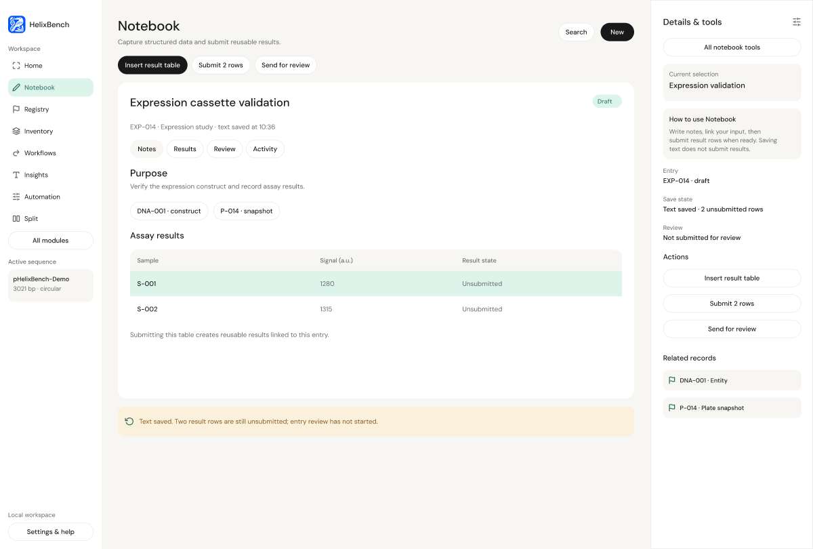

# SCR-08 · Notebook

[Current Figma screen](https://www.figma.com/design/U1kWw1K5NZBgEYkuxMz3Qb/helixbench?node-id=107-30702) · Implementation phase P11.

## Purpose and layout

Capture results and move entries through review without losing work.

Entry list and document editor with blank/template choice; linked inputs; structured tables; separate text-save, table-submit and review status.

## Target requirements

- **SCR-08-R1:** New entries are genuinely blank. A template adds declared headings/table schemas, never unrelated measurements or a silent source link.
- **SCR-08-R2:** Structured result submission validates columns, required values and source links; creates reusable results and records exactly which rows were submitted.
- **SCR-08-R3:** Capture immutable submitted revisions for review. Draft edits and submitted snapshots remain distinguishable; approved/archived content is protected.
- **SCR-08-R4:** Review is a local workflow in this release. Actor labels and local status recording must not imply a network message, authenticated remote reviewer or public sharing.
- **SCR-08-R5:** Draft → InReview → ChangesRequested → InReview → Approved/Archived transitions retain entry ID, result IDs, source revisions, comments and revision number.
- **SCR-08-R6:** Plate snapshots attached to an entry stay immutable after live inventory changes.

## User flow

1. Create entry or choose template
2. Enter notes and results
3. Save draft
4. Submit or write back a table
5. Review / request changes / approve with clear status

Use the shared typed context, validation/review, persistence and return-location contracts at every relevant transition. Prototype fixture IDs and figures are never production defaults.

## States and recovery

- Loading: retain prior context and identify the active request/operation.
- Populated: show stable object identity, meaningful status and available actions.
- No data: offer the relevant creation/import action.
- No matches: retain query/scope and expose Reset or Change settings.
- Invalid prerequisite: explain the missing input and provide its remedy.
- Validation/write failure: retain draft values and show a constructive correction/retry.
- Dirty/partial/stale/unavailable states use the shared state machines when applicable.

## Screen-specific edge cases

- **SCR-08-EC1:** Blank title, missing project, deleted source and invalid/ragged result rows.
- **SCR-08-EC2:** Cancel template application or switch templates after writing notes.
- **SCR-08-EC3:** Submit twice, amend a submitted table or persist only some of a multi-store result submission.
- **SCR-08-EC4:** Request review before required results exist, reject with a comment and resubmit the same entry.
- **SCR-08-EC5:** Attempt to edit an approved, archived or submitted read-only snapshot.
- **SCR-08-EC6:** An automation table with 96 submitted rows and a manual table with two draft rows remain separate data groups.

## Current code ownership

- [crates/appcore/src/actions.rs:1632](C:/Users/Admin/Documents/Qoder/2026-11-13/87e5a6b2/helixbench/crates/appcore/src/actions.rs:1632) — `pub fn open_notebook(app: &mut AppState)`
- [crates/appcore/src/actions.rs:1636](C:/Users/Admin/Documents/Qoder/2026-11-13/87e5a6b2/helixbench/crates/appcore/src/actions.rs:1636) — `pub fn open_entry_editor(app: &mut AppState, id: Option<u64>, template: usize)`
- [crates/appcore/src/actions.rs:1683](C:/Users/Admin/Documents/Qoder/2026-11-13/87e5a6b2/helixbench/crates/appcore/src/actions.rs:1683) — `pub fn save_entry(app: &mut AppState, draft: &EntryEditDraft) -> Result<u64, String>`
- [crates/appcore/src/actions.rs:1725](C:/Users/Admin/Documents/Qoder/2026-11-13/87e5a6b2/helixbench/crates/appcore/src/actions.rs:1725) — `pub fn entry_action(app: &mut AppState, id: u64, action: &str)`
- [crates/appcore/src/actions.rs:1751](C:/Users/Admin/Documents/Qoder/2026-11-13/87e5a6b2/helixbench/crates/appcore/src/actions.rs:1751) — `pub fn submit_entry_table(app: &mut AppState, entry_id: u64, table_idx: usize)`

Domain modules: `crates/domain/src/notebook.rs`, `crates/domain/src/project.rs`.

Native presentation entry points:

- [apps/desktop_gpui/src/lab.rs:421](C:/Users/Admin/Documents/Qoder/2026-11-13/87e5a6b2/helixbench/apps/desktop_gpui/src/lab.rs:421) — `render_notebook`
- [apps/desktop_gpui/src/dialogs.rs:4634](C:/Users/Admin/Documents/Qoder/2026-11-13/87e5a6b2/helixbench/apps/desktop_gpui/src/dialogs.rs:4634) — `notebook`
- [apps/desktop_gpui/src/dialogs.rs:4772](C:/Users/Admin/Documents/Qoder/2026-11-13/87e5a6b2/helixbench/apps/desktop_gpui/src/dialogs.rs:4772) — `entry_editor`
- [apps/desktop_gpui/src/dialogs.rs:4917](C:/Users/Admin/Documents/Qoder/2026-11-13/87e5a6b2/helixbench/apps/desktop_gpui/src/dialogs.rs:4917) — `projects`

## Field/draft contracts

### NotebookDraft

[crates/appcore/src/state.rs:421](C:/Users/Admin/Documents/Qoder/2026-11-13/87e5a6b2/helixbench/crates/appcore/src/state.rs:421)

- `filter: usize` — Use a labeled finite choice with a visible selected value. Validate enum/mode availability; preserve unknown legacy values for review.
- `error: Option<String>` — System-owned validation/error state; never an editable user field.

### EntryEditDraft

[crates/appcore/src/state.rs:427](C:/Users/Admin/Documents/Qoder/2026-11-13/87e5a6b2/helixbench/crates/appcore/src/state.rs:427)

- `id: Option<u64>` — Resolve a stable typed identity from a labeled picker. Validate existence/kind at submit; do not persist a row index as a foreign key.
- `title: String` — Trim for validation; require a nonempty meaningful label where the owning operation creates an object. Preserve original editable draft on error.
- `project: Option<u64>` — Resolve a stable typed identity from a labeled picker. Validate existence/kind at submit; do not persist a row index as a foreign key.
- `template: usize` — Use a labeled finite choice with a visible selected value. Validate enum/mode availability; preserve unknown legacy values for review.
- `sections: Vec<(String, String)>` — Use the owning feature/module requirements and the current typed source definition. Optional values remain distinguishable from empty/default values; validate before commit.
- `tables: Vec<domain::notebook::ResultTable>` — Use the owning feature/module requirements and the current typed source definition. Optional values remain distinguishable from empty/default values; validate before commit.
- `error: Option<String>` — System-owned validation/error state; never an editable user field.

### ProjectsDraft

[crates/appcore/src/state.rs:438](C:/Users/Admin/Documents/Qoder/2026-11-13/87e5a6b2/helixbench/crates/appcore/src/state.rs:438)

- `name: String` — Trim for validation; require a nonempty meaningful label where the owning operation creates an object. Preserve original editable draft on error.
- `parent: Option<u64>` — Resolve a stable typed identity from a labeled picker. Validate existence/kind at submit; do not persist a row index as a foreign key.
- `error: Option<String>` — System-owned validation/error state; never an editable user field.

## Feature-level implementation contracts

### F-098 · Create entry

**Status:** Specified; not verified implemented.

**Entry:** New entry (1 navigation click(s)).

**Prerequisite:** None.

**Outcome:** Entry editor opens with title and known sections.

**Current evidence note:** Visible action.

**Relevant code/action family:** [crates/appcore/src/actions.rs:1632](C:/Users/Admin/Documents/Qoder/2026-11-13/87e5a6b2/helixbench/crates/appcore/src/actions.rs:1632), [crates/appcore/src/actions.rs:1636](C:/Users/Admin/Documents/Qoder/2026-11-13/87e5a6b2/helixbench/crates/appcore/src/actions.rs:1636), [crates/appcore/src/actions.rs:1683](C:/Users/Admin/Documents/Qoder/2026-11-13/87e5a6b2/helixbench/crates/appcore/src/actions.rs:1683), [crates/appcore/src/actions.rs:1725](C:/Users/Admin/Documents/Qoder/2026-11-13/87e5a6b2/helixbench/crates/appcore/src/actions.rs:1725), [crates/appcore/src/actions.rs:1751](C:/Users/Admin/Documents/Qoder/2026-11-13/87e5a6b2/helixbench/crates/appcore/src/actions.rs:1751).

**Acceptance:**

- F-098-AC1: Given The owning page and the stated prerequisite are available. When The user follows New entry. Then Entry editor opens with title and known sections; feature entry requires at most two navigation clicks.
- F-098-AC2: Given The context contains two similar names or a changed table order. When This feature is activated. Then The command payload retains the exact selected typed identity, source revision and scope.
- F-098-AC3: Given A draft contains an invalid or missing required value. When The user submits the form. Then Show a field-local error, retain the draft and perform no mutation.

**Recovery and edge conditions:**

- Invalid required fields are identified beside the input with original draft values retained.
- Cancel does not alter the source object or create an unrelated example record.
- A stale/deleted target is resolved explicitly instead of mutating a row index.
- Successful persistence updates the selected record, related views and audit consistently.
- Cancel template application or switch templates after writing notes.
- Submit twice, amend a submitted table or persist only some of a multi-store result submission.

### F-099 · Choose an entry template

**Status:** Specified; not verified implemented.

**Entry:** From template (1 navigation click(s)).

**Prerequisite:** None.

**Outcome:** Show a real template picker before the editor.

**Current evidence note:** Currently same opener as New entry.

**Relevant code/action family:** [crates/appcore/src/actions.rs:1632](C:/Users/Admin/Documents/Qoder/2026-11-13/87e5a6b2/helixbench/crates/appcore/src/actions.rs:1632), [crates/appcore/src/actions.rs:1636](C:/Users/Admin/Documents/Qoder/2026-11-13/87e5a6b2/helixbench/crates/appcore/src/actions.rs:1636), [crates/appcore/src/actions.rs:1683](C:/Users/Admin/Documents/Qoder/2026-11-13/87e5a6b2/helixbench/crates/appcore/src/actions.rs:1683), [crates/appcore/src/actions.rs:1725](C:/Users/Admin/Documents/Qoder/2026-11-13/87e5a6b2/helixbench/crates/appcore/src/actions.rs:1725), [crates/appcore/src/actions.rs:1751](C:/Users/Admin/Documents/Qoder/2026-11-13/87e5a6b2/helixbench/crates/appcore/src/actions.rs:1751).

**Acceptance:**

- F-099-AC1: Given The owning page and the stated prerequisite are available. When The user follows From template. Then Show a real template picker before the editor; feature entry requires at most two navigation clicks.
- F-099-AC2: Given The context contains two similar names or a changed table order. When This feature is activated. Then The command payload retains the exact selected typed identity, source revision and scope.
- F-099-AC3: Given The intended target was deleted or became inaccessible after rendering. When The user activates its row or link. Then Show a relevant recovery path without opening an unrelated record; retain a safe return location.

**Recovery and edge conditions:**

- Two same-name records and two stores with the same numeric ID resolve correctly.
- A missing/deleted/inaccessible target offers a relevant remedy rather than another record.
- Back restores the invoking task and selection; dirty work is preserved where necessary.
- Keyboard activation and labeled controls expose the same action as pointer input.
- Submit twice, amend a submitted table or persist only some of a multi-store result submission.
- Request review before required results exist, reject with a comment and resubmit the same entry.

### F-100 · Open / edit existing entry

**Status:** Specified; not verified implemented.

**Entry:** Entry row (1 navigation click(s)).

**Prerequisite:** Existing entry.

**Outcome:** Open full entry rather than a nested manager.

**Current evidence note:** Existing Open per record.

**Relevant code/action family:** [crates/appcore/src/actions.rs:1632](C:/Users/Admin/Documents/Qoder/2026-11-13/87e5a6b2/helixbench/crates/appcore/src/actions.rs:1632), [crates/appcore/src/actions.rs:1636](C:/Users/Admin/Documents/Qoder/2026-11-13/87e5a6b2/helixbench/crates/appcore/src/actions.rs:1636), [crates/appcore/src/actions.rs:1683](C:/Users/Admin/Documents/Qoder/2026-11-13/87e5a6b2/helixbench/crates/appcore/src/actions.rs:1683), [crates/appcore/src/actions.rs:1725](C:/Users/Admin/Documents/Qoder/2026-11-13/87e5a6b2/helixbench/crates/appcore/src/actions.rs:1725), [crates/appcore/src/actions.rs:1751](C:/Users/Admin/Documents/Qoder/2026-11-13/87e5a6b2/helixbench/crates/appcore/src/actions.rs:1751).

**Acceptance:**

- F-100-AC1: Given The owning page and the stated prerequisite are available. When The user follows Entry row. Then Open full entry rather than a nested manager; feature entry requires at most two navigation clicks.
- F-100-AC2: Given The context contains two similar names or a changed table order. When This feature is activated. Then The command payload retains the exact selected typed identity, source revision and scope.
- F-100-AC3: Given A draft contains an invalid or missing required value. When The user submits the form. Then Show a field-local error, retain the draft and perform no mutation.

**Recovery and edge conditions:**

- Invalid required fields are identified beside the input with original draft values retained.
- Cancel does not alter the source object or create an unrelated example record.
- A stale/deleted target is resolved explicitly instead of mutating a row index.
- Successful persistence updates the selected record, related views and audit consistently.
- Request review before required results exist, reject with a comment and resubmit the same entry.
- Attempt to edit an approved, archived or submitted read-only snapshot.

### F-101 · Save draft

**Status:** Specified; not verified implemented.

**Entry:** Save draft (1 navigation click(s)).

**Prerequisite:** Entry editor open.

**Outcome:** Save without submitting for review.

**Current evidence note:** Save entry inside modal.

**Relevant code/action family:** [crates/appcore/src/actions.rs:1632](C:/Users/Admin/Documents/Qoder/2026-11-13/87e5a6b2/helixbench/crates/appcore/src/actions.rs:1632), [crates/appcore/src/actions.rs:1636](C:/Users/Admin/Documents/Qoder/2026-11-13/87e5a6b2/helixbench/crates/appcore/src/actions.rs:1636), [crates/appcore/src/actions.rs:1683](C:/Users/Admin/Documents/Qoder/2026-11-13/87e5a6b2/helixbench/crates/appcore/src/actions.rs:1683), [crates/appcore/src/actions.rs:1725](C:/Users/Admin/Documents/Qoder/2026-11-13/87e5a6b2/helixbench/crates/appcore/src/actions.rs:1725), [crates/appcore/src/actions.rs:1751](C:/Users/Admin/Documents/Qoder/2026-11-13/87e5a6b2/helixbench/crates/appcore/src/actions.rs:1751).

**Acceptance:**

- F-101-AC1: Given The owning page and the stated prerequisite are available. When The user follows Save draft. Then Save without submitting for review; feature entry requires at most two navigation clicks.
- F-101-AC2: Given The context contains two similar names or a changed table order. When This feature is activated. Then The command payload retains the exact selected typed identity, source revision and scope.
- F-101-AC3: Given A file or store write is awaiting completion. When The OS dialog is canceled or the atomic write fails. Then Do not report success, change saved/dirty truth or continue a pending destructive intent; preserve original data.

**Recovery and edge conditions:**

- OS-dialog cancellation leaves drafts, source data and pending navigation intact.
- Permission denied, disk full, locked destination and rename failure never show success.
- Reopening/retrying the same operation preserves identity and does not duplicate successful output.
- Export/import preserves scope, encoding, units and declared lossy transformations.
- Attempt to edit an approved, archived or submitted read-only snapshot.
- An automation table with 96 submitted rows and a manual table with two draft rows remain separate data groups.

### F-102 · Submit entry for review

**Status:** Specified; not verified implemented.

**Entry:** Entry row → Submit (2 navigation click(s)).

**Prerequisite:** Draft saved.

**Outcome:** Confirm content is saved; status becomes Submitted.

**Current evidence note:** Visible only in eligible states.

**Relevant code/action family:** [crates/appcore/src/actions.rs:1725](C:/Users/Admin/Documents/Qoder/2026-11-13/87e5a6b2/helixbench/crates/appcore/src/actions.rs:1725).

**Acceptance:**

- F-102-AC1: Given The owning page and the stated prerequisite are available. When The user follows Entry row → Submit. Then Confirm content is saved; status becomes Submitted; feature entry requires at most two navigation clicks.
- F-102-AC2: Given The context contains two similar names or a changed table order. When This feature is activated. Then The command payload retains the exact selected typed identity, source revision and scope.
- F-102-AC3: Given A file or store write is awaiting completion. When The OS dialog is canceled or the atomic write fails. Then Do not report success, change saved/dirty truth or continue a pending destructive intent; preserve original data.

**Recovery and edge conditions:**

- OS-dialog cancellation leaves drafts, source data and pending navigation intact.
- Permission denied, disk full, locked destination and rename failure never show success.
- Reopening/retrying the same operation preserves identity and does not duplicate successful output.
- Export/import preserves scope, encoding, units and declared lossy transformations.
- An automation table with 96 submitted rows and a manual table with two draft rows remain separate data groups.
- Blank title, missing project, deleted source and invalid/ragged result rows.

### F-103 · Request changes / approve

**Status:** Specified; not verified implemented.

**Entry:** Submitted entry → Review action (2 navigation click(s)).

**Prerequisite:** Submitted entry.

**Outcome:** Name next state and capture requested changes.

**Current evidence note:** Source page actions exist.

**Relevant code/action family:** [crates/appcore/src/actions.rs:1725](C:/Users/Admin/Documents/Qoder/2026-11-13/87e5a6b2/helixbench/crates/appcore/src/actions.rs:1725).

**Acceptance:**

- F-103-AC1: Given The owning page and the stated prerequisite are available. When The user follows Submitted entry → Review action. Then Name next state and capture requested changes; feature entry requires at most two navigation clicks.
- F-103-AC2: Given The context contains two similar names or a changed table order. When This feature is activated. Then The command payload retains the exact selected typed identity, source revision and scope.
- F-103-AC3: Given The intended target was deleted or became inaccessible after rendering. When The user activates its row or link. Then Show a relevant recovery path without opening an unrelated record; retain a safe return location.

**Recovery and edge conditions:**

- Two same-name records and two stores with the same numeric ID resolve correctly.
- A missing/deleted/inaccessible target offers a relevant remedy rather than another record.
- Back restores the invoking task and selection; dirty work is preserved where necessary.
- Keyboard activation and labeled controls expose the same action as pointer input.
- Blank title, missing project, deleted source and invalid/ragged result rows.
- Cancel template application or switch templates after writing notes.

### F-104 · Resubmit changed entry

**Status:** Specified; not verified implemented.

**Entry:** Changed entry → Resubmit (2 navigation click(s)).

**Prerequisite:** Changes-requested state.

**Outcome:** Save latest draft before submitting again.

**Current evidence note:** Source exists.

**Relevant code/action family:** [crates/appcore/src/actions.rs:1632](C:/Users/Admin/Documents/Qoder/2026-11-13/87e5a6b2/helixbench/crates/appcore/src/actions.rs:1632), [crates/appcore/src/actions.rs:1636](C:/Users/Admin/Documents/Qoder/2026-11-13/87e5a6b2/helixbench/crates/appcore/src/actions.rs:1636), [crates/appcore/src/actions.rs:1683](C:/Users/Admin/Documents/Qoder/2026-11-13/87e5a6b2/helixbench/crates/appcore/src/actions.rs:1683), [crates/appcore/src/actions.rs:1725](C:/Users/Admin/Documents/Qoder/2026-11-13/87e5a6b2/helixbench/crates/appcore/src/actions.rs:1725), [crates/appcore/src/actions.rs:1751](C:/Users/Admin/Documents/Qoder/2026-11-13/87e5a6b2/helixbench/crates/appcore/src/actions.rs:1751).

**Acceptance:**

- F-104-AC1: Given The owning page and the stated prerequisite are available. When The user follows Changed entry → Resubmit. Then Save latest draft before submitting again; feature entry requires at most two navigation clicks.
- F-104-AC2: Given The context contains two similar names or a changed table order. When This feature is activated. Then The command payload retains the exact selected typed identity, source revision and scope.
- F-104-AC3: Given A file or store write is awaiting completion. When The OS dialog is canceled or the atomic write fails. Then Do not report success, change saved/dirty truth or continue a pending destructive intent; preserve original data.

**Recovery and edge conditions:**

- OS-dialog cancellation leaves drafts, source data and pending navigation intact.
- Permission denied, disk full, locked destination and rename failure never show success.
- Reopening/retrying the same operation preserves identity and does not duplicate successful output.
- Export/import preserves scope, encoding, units and declared lossy transformations.
- Cancel template application or switch templates after writing notes.
- Submit twice, amend a submitted table or persist only some of a multi-store result submission.

### F-105 · Structured result tables

**Status:** Specified; not verified implemented.

**Entry:** Entry row → Results tab (2 navigation click(s)).

**Prerequisite:** Existing entry with tables.

**Outcome:** Show complete result table and submission state.

**Current evidence note:** Tables rendered inside entry editor.

**Relevant code/action family:** [crates/appcore/src/actions.rs:1632](C:/Users/Admin/Documents/Qoder/2026-11-13/87e5a6b2/helixbench/crates/appcore/src/actions.rs:1632), [crates/appcore/src/actions.rs:1636](C:/Users/Admin/Documents/Qoder/2026-11-13/87e5a6b2/helixbench/crates/appcore/src/actions.rs:1636), [crates/appcore/src/actions.rs:1683](C:/Users/Admin/Documents/Qoder/2026-11-13/87e5a6b2/helixbench/crates/appcore/src/actions.rs:1683), [crates/appcore/src/actions.rs:1725](C:/Users/Admin/Documents/Qoder/2026-11-13/87e5a6b2/helixbench/crates/appcore/src/actions.rs:1725), [crates/appcore/src/actions.rs:1751](C:/Users/Admin/Documents/Qoder/2026-11-13/87e5a6b2/helixbench/crates/appcore/src/actions.rs:1751).

**Acceptance:**

- F-105-AC1: Given The owning page and the stated prerequisite are available. When The user follows Entry row → Results tab. Then Show complete result table and submission state; feature entry requires at most two navigation clicks.
- F-105-AC2: Given The context contains two similar names or a changed table order. When This feature is activated. Then The command payload retains the exact selected typed identity, source revision and scope.
- F-105-AC3: Given The intended target was deleted or became inaccessible after rendering. When The user activates its row or link. Then Show a relevant recovery path without opening an unrelated record; retain a safe return location.

**Recovery and edge conditions:**

- Two same-name records and two stores with the same numeric ID resolve correctly.
- A missing/deleted/inaccessible target offers a relevant remedy rather than another record.
- Back restores the invoking task and selection; dirty work is preserved where necessary.
- Keyboard activation and labeled controls expose the same action as pointer input.
- Submit twice, amend a submitted table or persist only some of a multi-store result submission.
- Request review before required results exist, reject with a comment and resubmit the same entry.

### F-106 · Write table back to registry

**Status:** Specified; not verified implemented.

**Entry:** Result table → Submit results (2 navigation click(s)).

**Prerequisite:** Saved entry; valid table mapping.

**Outcome:** Preview destination and affected records before writeback.

**Current evidence note:** Submit table (write back) in entry editor.

**Relevant code/action family:** [crates/appcore/src/actions.rs:1632](C:/Users/Admin/Documents/Qoder/2026-11-13/87e5a6b2/helixbench/crates/appcore/src/actions.rs:1632), [crates/appcore/src/actions.rs:1636](C:/Users/Admin/Documents/Qoder/2026-11-13/87e5a6b2/helixbench/crates/appcore/src/actions.rs:1636), [crates/appcore/src/actions.rs:1683](C:/Users/Admin/Documents/Qoder/2026-11-13/87e5a6b2/helixbench/crates/appcore/src/actions.rs:1683), [crates/appcore/src/actions.rs:1725](C:/Users/Admin/Documents/Qoder/2026-11-13/87e5a6b2/helixbench/crates/appcore/src/actions.rs:1725), [crates/appcore/src/actions.rs:1751](C:/Users/Admin/Documents/Qoder/2026-11-13/87e5a6b2/helixbench/crates/appcore/src/actions.rs:1751).

**Acceptance:**

- F-106-AC1: Given The owning page and the stated prerequisite are available. When The user follows Result table → Submit results. Then Preview destination and affected records before writeback; feature entry requires at most two navigation clicks.
- F-106-AC2: Given The context contains two similar names or a changed table order. When This feature is activated. Then The command payload retains the exact selected typed identity, source revision and scope.
- F-106-AC3: Given The intended target was deleted or became inaccessible after rendering. When The user activates its row or link. Then Show a relevant recovery path without opening an unrelated record; retain a safe return location.

**Recovery and edge conditions:**

- Two same-name records and two stores with the same numeric ID resolve correctly.
- A missing/deleted/inaccessible target offers a relevant remedy rather than another record.
- Back restores the invoking task and selection; dirty work is preserved where necessary.
- Keyboard activation and labeled controls expose the same action as pointer input.
- Request review before required results exist, reject with a comment and resubmit the same entry.
- Attempt to edit an approved, archived or submitted read-only snapshot.

### F-107 · Open linked plate snapshot

**Status:** Specified; not verified implemented.

**Entry:** Entry row → Inventory snapshot (2 navigation click(s)).

**Prerequisite:** Entry contains a snapshot.

**Outcome:** Read immutable snapshot with source plate link.

**Current evidence note:** Inventory snapshot is captured separately.

**Relevant code/action family:** [crates/appcore/src/actions.rs:2674](C:/Users/Admin/Documents/Qoder/2026-11-13/87e5a6b2/helixbench/crates/appcore/src/actions.rs:2674).

**Acceptance:**

- F-107-AC1: Given The owning page and the stated prerequisite are available. When The user follows Entry row → Inventory snapshot. Then Read immutable snapshot with source plate link; feature entry requires at most two navigation clicks.
- F-107-AC2: Given The context contains two similar names or a changed table order. When This feature is activated. Then The command payload retains the exact selected typed identity, source revision and scope.
- F-107-AC3: Given A draft contains an invalid or missing required value. When The user submits the form. Then Show a field-local error, retain the draft and perform no mutation.

**Recovery and edge conditions:**

- Invalid required fields are identified beside the input with original draft values retained.
- Cancel does not alter the source object or create an unrelated example record.
- A stale/deleted target is resolved explicitly instead of mutating a row index.
- Successful persistence updates the selected record, related views and audit consistently.
- Attempt to edit an approved, archived or submitted read-only snapshot.
- An automation table with 96 submitted rows and a manual table with two draft rows remain separate data groups.

### F-108 · Project association

**Status:** Specified; not verified implemented.

**Entry:** Entry row → Project details (2 navigation click(s)).

**Prerequisite:** Project exists.

**Outcome:** Keep project context visible.

**Current evidence note:** Projects live in separate manager.

**Relevant code/action family:** [crates/appcore/src/actions.rs:1611](C:/Users/Admin/Documents/Qoder/2026-11-13/87e5a6b2/helixbench/crates/appcore/src/actions.rs:1611), [crates/appcore/src/actions.rs:1615](C:/Users/Admin/Documents/Qoder/2026-11-13/87e5a6b2/helixbench/crates/appcore/src/actions.rs:1615), [crates/appcore/src/actions.rs:1625](C:/Users/Admin/Documents/Qoder/2026-11-13/87e5a6b2/helixbench/crates/appcore/src/actions.rs:1625).

**Acceptance:**

- F-108-AC1: Given The owning page and the stated prerequisite are available. When The user follows Entry row → Project details. Then Keep project context visible; feature entry requires at most two navigation clicks.
- F-108-AC2: Given The context contains two similar names or a changed table order. When This feature is activated. Then The command payload retains the exact selected typed identity, source revision and scope.
- F-108-AC3: Given The intended target was deleted or became inaccessible after rendering. When The user activates its row or link. Then Show a relevant recovery path without opening an unrelated record; retain a safe return location.

**Recovery and edge conditions:**

- Two same-name records and two stores with the same numeric ID resolve correctly.
- A missing/deleted/inaccessible target offers a relevant remedy rather than another record.
- Back restores the invoking task and selection; dirty work is preserved where necessary.
- Keyboard activation and labeled controls expose the same action as pointer input.
- An automation table with 96 submitted rows and a manual table with two draft rows remain separate data groups.
- Blank title, missing project, deleted source and invalid/ragged result rows.

### F-109 · Sections / result authoring controls

**Status:** Specified; not verified implemented.

**Entry:** Entry row → Sections or Results (2 navigation click(s)).

**Prerequisite:** Entry open.

**Outcome:** Explicitly separate supported editing from new section/table creation.

**Current evidence note:** Current editor edits seeded sections and previews tables.

**Relevant code/action family:** [crates/appcore/src/actions.rs:1632](C:/Users/Admin/Documents/Qoder/2026-11-13/87e5a6b2/helixbench/crates/appcore/src/actions.rs:1632), [crates/appcore/src/actions.rs:1636](C:/Users/Admin/Documents/Qoder/2026-11-13/87e5a6b2/helixbench/crates/appcore/src/actions.rs:1636), [crates/appcore/src/actions.rs:1683](C:/Users/Admin/Documents/Qoder/2026-11-13/87e5a6b2/helixbench/crates/appcore/src/actions.rs:1683), [crates/appcore/src/actions.rs:1725](C:/Users/Admin/Documents/Qoder/2026-11-13/87e5a6b2/helixbench/crates/appcore/src/actions.rs:1725), [crates/appcore/src/actions.rs:1751](C:/Users/Admin/Documents/Qoder/2026-11-13/87e5a6b2/helixbench/crates/appcore/src/actions.rs:1751).

**Acceptance:**

- F-109-AC1: Given The owning page and the stated prerequisite are available. When The user follows Entry row → Sections or Results. Then Explicitly separate supported editing from new section/table creation; feature entry requires at most two navigation clicks.
- F-109-AC2: Given The context contains two similar names or a changed table order. When This feature is activated. Then The command payload retains the exact selected typed identity, source revision and scope.
- F-109-AC3: Given The intended target was deleted or became inaccessible after rendering. When The user activates its row or link. Then Show a relevant recovery path without opening an unrelated record; retain a safe return location.

**Recovery and edge conditions:**

- Two same-name records and two stores with the same numeric ID resolve correctly.
- A missing/deleted/inaccessible target offers a relevant remedy rather than another record.
- Back restores the invoking task and selection; dirty work is preserved where necessary.
- Keyboard activation and labeled controls expose the same action as pointer input.
- Blank title, missing project, deleted source and invalid/ragged result rows.
- Cancel template application or switch templates after writing notes.

