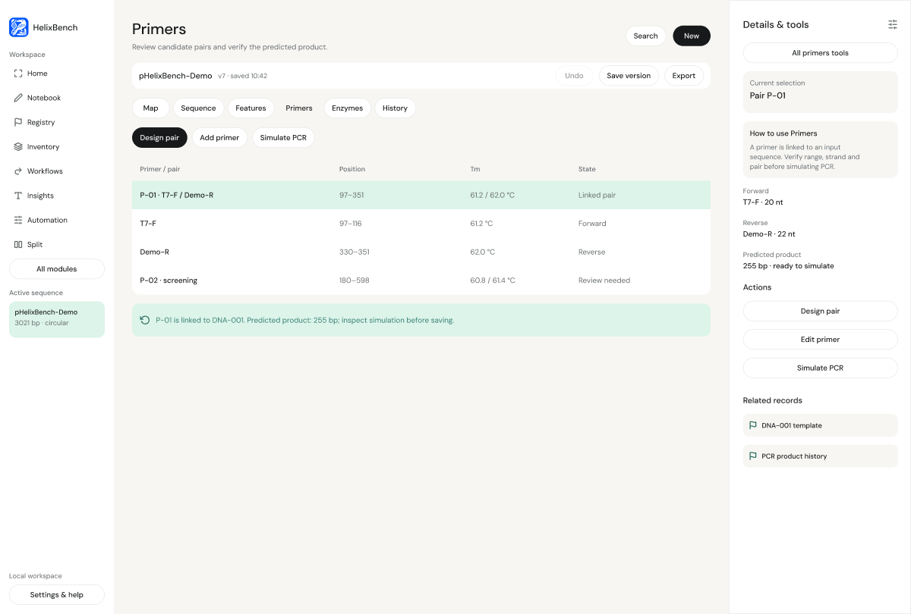

# SCR-05 · Primers

[Current Figma screen](https://www.figma.com/design/U1kWw1K5NZBgEYkuxMz3Qb/helixbench?node-id=107-30093) · Implementation phase P08C.

## Purpose and layout

Design or edit an oligo, check its structure and reuse it in PCR.

Primer/pair table with binding context, length/GC/Tm/structure indicators; selected pair inspector; separate design and PCR setup/results.

## Target requirements

- **SCR-05-R1:** Primer sequence is entered 5′→3′ and validated using supported primer symbols; preserve phosphorylation, description and color. Display the assumed hybridization/Tm method and conditions.
- **SCR-05-R2:** Design setup distinguishes the current selection anchor from the proposed amplification target. Show start, target length, target Tm, 5′ overhang and explicit forward/reverse candidate selection.
- **SCR-05-R3:** Candidates include length, GC, Tm and hairpin/self-dimer indicators. An unselected or stale candidate cannot be added as an unrelated pair.
- **SCR-05-R4:** PCR captures template version, both primer IDs/sequences, binding positions/directions and feature-copy policy. Open the product as a new, independently identified document.
- **SCR-05-R5:** No binding or incompatible orientation is a successful diagnostic outcome, distinct from a computation error. Existing pair/primer capability remains available from the owning page within two clicks.

## User flow

1. Select target or primer
2. Design or edit
3. Review Tm / GC / secondary structure
4. Save pair
5. Continue directly to PCR or assembly

Use the shared typed context, validation/review, persistence and return-location contracts at every relevant transition. Prototype fixture IDs and figures are never production defaults.

## States and recovery

- Loading: retain prior context and identify the active request/operation.
- Populated: show stable object identity, meaningful status and available actions.
- No data: offer the relevant creation/import action.
- No matches: retain query/scope and expose Reset or Change settings.
- Invalid prerequisite: explain the missing input and provide its remedy.
- Validation/write failure: retain draft values and show a constructive correction/retry.
- Dirty/partial/stale/unavailable states use the shared state machines when applicable.

## Screen-specific edge cases

- **SCR-05-EC1:** Blank/invalid sequence, ambiguous binding, multiple sites and reverse-primer orientation.
- **SCR-05-EC2:** Selection changes after setup; a linked primer is edited or deleted before Run.
- **SCR-05-EC3:** Overhang is valid but changes the product length; primer body and overhang must be distinguished.
- **SCR-05-EC4:** Target start/length exceeds a linear molecule or spans a circular origin.
- **SCR-05-EC5:** No valid candidates, hairpin warning and no predicted PCR product.
- **SCR-05-EC6:** Product creation with feature copy, repeated product names and canceled save retains source identity.

## Current code ownership

- [crates/appcore/src/actions.rs:145](C:/Users/Admin/Documents/Qoder/2026-11-13/87e5a6b2/helixbench/crates/appcore/src/actions.rs:145) — `pub fn save_primer_draft(app: &mut AppState, draft: &PrimerDraft) -> Result<(), String>`
- [crates/appcore/src/actions.rs:49](C:/Users/Admin/Documents/Qoder/2026-11-13/87e5a6b2/helixbench/crates/appcore/src/actions.rs:49) — `pub fn delete_primer(app: &mut AppState, id: u64)`
- [crates/appcore/src/actions.rs:201](C:/Users/Admin/Documents/Qoder/2026-11-13/87e5a6b2/helixbench/crates/appcore/src/actions.rs:201) — `pub fn primer_from_selection(app: &mut AppState)`
- [crates/appcore/src/actions.rs:747](C:/Users/Admin/Documents/Qoder/2026-11-13/87e5a6b2/helixbench/crates/appcore/src/actions.rs:747) — `pub fn open_primer_design(app: &mut AppState)`
- [crates/appcore/src/actions.rs:765](C:/Users/Admin/Documents/Qoder/2026-11-13/87e5a6b2/helixbench/crates/appcore/src/actions.rs:765) — `pub fn run_primer_design(app: &mut AppState, draft: &mut PrimerDesignDraft)`
- [crates/appcore/src/actions.rs:795](C:/Users/Admin/Documents/Qoder/2026-11-13/87e5a6b2/helixbench/crates/appcore/src/actions.rs:795) — `pub fn add_designed_primers(app: &mut AppState, draft: &PrimerDesignDraft) -> Result<(), String>`
- [crates/appcore/src/actions.rs:644](C:/Users/Admin/Documents/Qoder/2026-11-13/87e5a6b2/helixbench/crates/appcore/src/actions.rs:644) — `pub fn open_pcr(app: &mut AppState)`
- [crates/appcore/src/actions.rs:664](C:/Users/Admin/Documents/Qoder/2026-11-13/87e5a6b2/helixbench/crates/appcore/src/actions.rs:664) — `pub fn pcr_preview(app: &AppState, draft: &PcrDraft) -> Option<domain::pcr::PcrProduct>`
- [crates/appcore/src/actions.rs:691](C:/Users/Admin/Documents/Qoder/2026-11-13/87e5a6b2/helixbench/crates/appcore/src/actions.rs:691) — `pub fn create_pcr_product(app: &mut AppState, draft: &PcrDraft) -> Result<(), String>`

Domain modules: `crates/domain/src/primer.rs`, `crates/domain/src/primer_design.rs`, `crates/domain/src/primer_struct.rs`, `crates/domain/src/pcr.rs`.

Native presentation entry points:

- [apps/desktop_gpui/src/views/primers.rs:48](C:/Users/Admin/Documents/Qoder/2026-11-13/87e5a6b2/helixbench/apps/desktop_gpui/src/views/primers.rs:48) — `render_primers`
- [apps/desktop_gpui/src/dialogs.rs:969](C:/Users/Admin/Documents/Qoder/2026-11-13/87e5a6b2/helixbench/apps/desktop_gpui/src/dialogs.rs:969) — `primer_editor`
- [apps/desktop_gpui/src/dialogs.rs:2521](C:/Users/Admin/Documents/Qoder/2026-11-13/87e5a6b2/helixbench/apps/desktop_gpui/src/dialogs.rs:2521) — `primer_design`
- [apps/desktop_gpui/src/dialogs.rs:2371](C:/Users/Admin/Documents/Qoder/2026-11-13/87e5a6b2/helixbench/apps/desktop_gpui/src/dialogs.rs:2371) — `pcr`
- [apps/desktop_gpui/src/views/table_opts.rs:56](C:/Users/Admin/Documents/Qoder/2026-11-13/87e5a6b2/helixbench/apps/desktop_gpui/src/views/table_opts.rs:56) — `render_table_opts`

## Field/draft contracts

### PrimerDraft

[crates/appcore/src/state.rs:216](C:/Users/Admin/Documents/Qoder/2026-11-13/87e5a6b2/helixbench/crates/appcore/src/state.rs:216)

- `id: Option<u64>` — Resolve a stable typed identity from a labeled picker. Validate existence/kind at submit; do not persist a row index as a foreign key.
- `name: String` — Trim for validation; require a nonempty meaningful label where the owning operation creates an object. Preserve original editable draft on error.
- `sequence: String` — Validate the declared molecule/grammar before commit. Preserve original text and report meaningful normalization or unsupported syntax.
- `description: String` — Use the owning feature/module requirements and the current typed source definition. Optional values remain distinguishable from empty/default values; validate before commit.
- `color: [u8; 3]` — Use the owning feature/module requirements and the current typed source definition. Optional values remain distinguishable from empty/default values; validate before commit.
- `phosphorylated: bool` — Explicit labeled toggle; default is specified by the owning feature. Persist only when the corresponding action is confirmed.
- `error: Option<String>` — System-owned validation/error state; never an editable user field.

### PrimerDesignDraft

[crates/appcore/src/state.rs:335](C:/Users/Admin/Documents/Qoder/2026-11-13/87e5a6b2/helixbench/crates/appcore/src/state.rs:335)

- `start: String` — Validate coordinate/length/frame using the owning tool; UI positions are 1-based inclusive. Reject empty/out-of-range spans and unsupported frame values.
- `len: String` — Validate coordinate/length/frame using the owning tool; UI positions are 1-based inclusive. Reject empty/out-of-range spans and unsupported frame values.
- `target_tm: String` — Parse finite numeric input, display units/range where relevant and apply domain-specific bounds. Do not silently substitute a default after invalid input.
- `overhang: String` — Use the owning feature/module requirements and the current typed source definition. Optional values remain distinguishable from empty/default values; validate before commit.
- `fwd: Vec<domain::primer_design::Candidate>` — Computed preview/output state. Clear or mark stale when relevant input changes; never commit an unrelated result.
- `rev: Vec<domain::primer_design::Candidate>` — Computed preview/output state. Clear or mark stale when relevant input changes; never commit an unrelated result.
- `fwd_pick: Option<usize>` — Use the owning feature/module requirements and the current typed source definition. Optional values remain distinguishable from empty/default values; validate before commit.
- `rev_pick: Option<usize>` — Use the owning feature/module requirements and the current typed source definition. Optional values remain distinguishable from empty/default values; validate before commit.
- `error: Option<String>` — System-owned validation/error state; never an editable user field.

### PcrDraft

[crates/appcore/src/state.rs:327](C:/Users/Admin/Documents/Qoder/2026-11-13/87e5a6b2/helixbench/crates/appcore/src/state.rs:327)

- `fwd: String` — Current primer input is a string. The target resolves selected primer IDs to their explicit 5′→3′ sequence; never pass a display label such as T7-F as sequence bases.
- `rev: String` — Current primer input is a string. The target resolves selected primer IDs to their explicit 5′→3′ sequence; never pass a display label such as T7-F as sequence bases.
- `copy_features: bool` — Explicit labeled toggle; default is specified by the owning feature. Persist only when the corresponding action is confirmed.
- `error: Option<String>` — System-owned validation/error state; never an editable user field.

## Feature-level implementation contracts

### F-065 · Add primer manually

**Status:** P08C source-bound primer validation wired; existing metadata retained.

**Entry:** Add primer (1 navigation click(s)).

**Prerequisite:** Active document.

**Outcome:** Name, sequence, description, color and phosphorylation.

**Current evidence note:** Visible toolbar/menu action.

**Relevant code/action family:** [crates/appcore/src/actions.rs:145](C:/Users/Admin/Documents/Qoder/2026-11-13/87e5a6b2/helixbench/crates/appcore/src/actions.rs:145), [crates/appcore/src/actions.rs:49](C:/Users/Admin/Documents/Qoder/2026-11-13/87e5a6b2/helixbench/crates/appcore/src/actions.rs:49), [crates/appcore/src/actions.rs:201](C:/Users/Admin/Documents/Qoder/2026-11-13/87e5a6b2/helixbench/crates/appcore/src/actions.rs:201), [crates/appcore/src/actions.rs:747](C:/Users/Admin/Documents/Qoder/2026-11-13/87e5a6b2/helixbench/crates/appcore/src/actions.rs:747), [crates/appcore/src/actions.rs:765](C:/Users/Admin/Documents/Qoder/2026-11-13/87e5a6b2/helixbench/crates/appcore/src/actions.rs:765), [crates/appcore/src/actions.rs:795](C:/Users/Admin/Documents/Qoder/2026-11-13/87e5a6b2/helixbench/crates/appcore/src/actions.rs:795), [crates/appcore/src/actions.rs:644](C:/Users/Admin/Documents/Qoder/2026-11-13/87e5a6b2/helixbench/crates/appcore/src/actions.rs:644), [crates/appcore/src/actions.rs:664](C:/Users/Admin/Documents/Qoder/2026-11-13/87e5a6b2/helixbench/crates/appcore/src/actions.rs:664), [crates/appcore/src/actions.rs:691](C:/Users/Admin/Documents/Qoder/2026-11-13/87e5a6b2/helixbench/crates/appcore/src/actions.rs:691).

**Acceptance:**

- F-065-AC1: Given The owning page and the stated prerequisite are available. When The user follows Add primer. Then Name, sequence, description, color and phosphorylation; feature entry requires at most two navigation clicks.
- F-065-AC2: Given The context contains two similar names or a changed table order. When This feature is activated. Then The command payload retains the exact selected typed identity, source revision and scope.
- F-065-AC3: Given A draft contains an invalid or missing required value. When The user submits the form. Then Show a field-local error, retain the draft and perform no mutation.

**Recovery and edge conditions:**

- Invalid required fields are identified beside the input with original draft values retained.
- Cancel does not alter the source object or create an unrelated example record.
- A stale/deleted target is resolved explicitly instead of mutating a row index.
- Successful persistence updates the selected record, related views and audit consistently.
- Selection changes after setup; a linked primer is edited or deleted before Run.
- Overhang is valid but changes the product length; primer body and overhang must be distinguished.

### F-066 · Primer from sequence selection

**Status:** P08C selection-derived primer captures source and orientation; stale source rejected.

**Entry:** From selection (1 navigation click(s)).

**Prerequisite:** Range selected on active document.

**Outcome:** Copy bases and direction into editor.

**Current evidence note:** Primers menu only.

**Relevant code/action family:** [crates/appcore/src/actions.rs:145](C:/Users/Admin/Documents/Qoder/2026-11-13/87e5a6b2/helixbench/crates/appcore/src/actions.rs:145), [crates/appcore/src/actions.rs:49](C:/Users/Admin/Documents/Qoder/2026-11-13/87e5a6b2/helixbench/crates/appcore/src/actions.rs:49), [crates/appcore/src/actions.rs:201](C:/Users/Admin/Documents/Qoder/2026-11-13/87e5a6b2/helixbench/crates/appcore/src/actions.rs:201), [crates/appcore/src/actions.rs:747](C:/Users/Admin/Documents/Qoder/2026-11-13/87e5a6b2/helixbench/crates/appcore/src/actions.rs:747), [crates/appcore/src/actions.rs:765](C:/Users/Admin/Documents/Qoder/2026-11-13/87e5a6b2/helixbench/crates/appcore/src/actions.rs:765), [crates/appcore/src/actions.rs:795](C:/Users/Admin/Documents/Qoder/2026-11-13/87e5a6b2/helixbench/crates/appcore/src/actions.rs:795), [crates/appcore/src/actions.rs:644](C:/Users/Admin/Documents/Qoder/2026-11-13/87e5a6b2/helixbench/crates/appcore/src/actions.rs:644), [crates/appcore/src/actions.rs:664](C:/Users/Admin/Documents/Qoder/2026-11-13/87e5a6b2/helixbench/crates/appcore/src/actions.rs:664), [crates/appcore/src/actions.rs:691](C:/Users/Admin/Documents/Qoder/2026-11-13/87e5a6b2/helixbench/crates/appcore/src/actions.rs:691).

**Acceptance:**

- F-066-AC1: Given The owning page and the stated prerequisite are available. When The user follows From selection. Then Copy bases and direction into editor; feature entry requires at most two navigation clicks.
- F-066-AC2: Given The context contains two similar names or a changed table order. When This feature is activated. Then The command payload retains the exact selected typed identity, source revision and scope.
- F-066-AC3: Given The intended target was deleted or became inaccessible after rendering. When The user activates its row or link. Then Show a relevant recovery path without opening an unrelated record; retain a safe return location.

**Recovery and edge conditions:**

- Two same-name records and two stores with the same numeric ID resolve correctly.
- A missing/deleted/inaccessible target offers a relevant remedy rather than another record.
- Back restores the invoking task and selection; dirty work is preserved where necessary.
- Keyboard activation and labeled controls expose the same action as pointer input.
- Overhang is valid but changes the product length; primer body and overhang must be distinguished.
- Target start/length exceeds a linear molecule or spans a circular origin.

### F-067 · Edit primer

**Status:** P08C stable primer ID and source revision checked before save; missing target rejected.

**Entry:** Primer row → Edit (2 navigation click(s)).

**Prerequisite:** Existing primer.

**Outcome:** Keep full sequence visible in editor.

**Current evidence note:** Double-click or selected Edit.

**Relevant code/action family:** [crates/appcore/src/actions.rs:145](C:/Users/Admin/Documents/Qoder/2026-11-13/87e5a6b2/helixbench/crates/appcore/src/actions.rs:145), [crates/appcore/src/actions.rs:49](C:/Users/Admin/Documents/Qoder/2026-11-13/87e5a6b2/helixbench/crates/appcore/src/actions.rs:49), [crates/appcore/src/actions.rs:201](C:/Users/Admin/Documents/Qoder/2026-11-13/87e5a6b2/helixbench/crates/appcore/src/actions.rs:201), [crates/appcore/src/actions.rs:747](C:/Users/Admin/Documents/Qoder/2026-11-13/87e5a6b2/helixbench/crates/appcore/src/actions.rs:747), [crates/appcore/src/actions.rs:765](C:/Users/Admin/Documents/Qoder/2026-11-13/87e5a6b2/helixbench/crates/appcore/src/actions.rs:765), [crates/appcore/src/actions.rs:795](C:/Users/Admin/Documents/Qoder/2026-11-13/87e5a6b2/helixbench/crates/appcore/src/actions.rs:795), [crates/appcore/src/actions.rs:644](C:/Users/Admin/Documents/Qoder/2026-11-13/87e5a6b2/helixbench/crates/appcore/src/actions.rs:644), [crates/appcore/src/actions.rs:664](C:/Users/Admin/Documents/Qoder/2026-11-13/87e5a6b2/helixbench/crates/appcore/src/actions.rs:664), [crates/appcore/src/actions.rs:691](C:/Users/Admin/Documents/Qoder/2026-11-13/87e5a6b2/helixbench/crates/appcore/src/actions.rs:691).

**Acceptance:**

- F-067-AC1: Given The owning page and the stated prerequisite are available. When The user follows Primer row → Edit. Then Keep full sequence visible in editor; feature entry requires at most two navigation clicks.
- F-067-AC2: Given The context contains two similar names or a changed table order. When This feature is activated. Then The command payload retains the exact selected typed identity, source revision and scope.
- F-067-AC3: Given A draft contains an invalid or missing required value. When The user submits the form. Then Show a field-local error, retain the draft and perform no mutation.

**Recovery and edge conditions:**

- Invalid required fields are identified beside the input with original draft values retained.
- Cancel does not alter the source object or create an unrelated example record.
- A stale/deleted target is resolved explicitly instead of mutating a row index.
- Successful persistence updates the selected record, related views and audit consistently.
- Target start/length exceeds a linear molecule or spans a circular origin.
- No valid candidates, hairpin warning and no predicted PCR product.

### F-068 · Delete primer

**Status:** P08C rendered source and stable primer ID guard existing undoable delete.

**Entry:** Primer row → Delete (2 navigation click(s)).

**Prerequisite:** Existing primer.

**Outcome:** Confirm deletion and preserve undo.

**Current evidence note:** Selected Delete.

**Relevant code/action family:** [crates/appcore/src/actions.rs:145](C:/Users/Admin/Documents/Qoder/2026-11-13/87e5a6b2/helixbench/crates/appcore/src/actions.rs:145), [crates/appcore/src/actions.rs:49](C:/Users/Admin/Documents/Qoder/2026-11-13/87e5a6b2/helixbench/crates/appcore/src/actions.rs:49), [crates/appcore/src/actions.rs:201](C:/Users/Admin/Documents/Qoder/2026-11-13/87e5a6b2/helixbench/crates/appcore/src/actions.rs:201), [crates/appcore/src/actions.rs:747](C:/Users/Admin/Documents/Qoder/2026-11-13/87e5a6b2/helixbench/crates/appcore/src/actions.rs:747), [crates/appcore/src/actions.rs:765](C:/Users/Admin/Documents/Qoder/2026-11-13/87e5a6b2/helixbench/crates/appcore/src/actions.rs:765), [crates/appcore/src/actions.rs:795](C:/Users/Admin/Documents/Qoder/2026-11-13/87e5a6b2/helixbench/crates/appcore/src/actions.rs:795), [crates/appcore/src/actions.rs:644](C:/Users/Admin/Documents/Qoder/2026-11-13/87e5a6b2/helixbench/crates/appcore/src/actions.rs:644), [crates/appcore/src/actions.rs:664](C:/Users/Admin/Documents/Qoder/2026-11-13/87e5a6b2/helixbench/crates/appcore/src/actions.rs:664), [crates/appcore/src/actions.rs:691](C:/Users/Admin/Documents/Qoder/2026-11-13/87e5a6b2/helixbench/crates/appcore/src/actions.rs:691).

**Acceptance:**

- F-068-AC1: Given The owning page and the stated prerequisite are available. When The user follows Primer row → Delete. Then Confirm deletion and preserve undo; feature entry requires at most two navigation clicks.
- F-068-AC2: Given The context contains two similar names or a changed table order. When This feature is activated. Then The command payload retains the exact selected typed identity, source revision and scope.
- F-068-AC3: Given A consequence review identifies the selected record. When The user cancels or the commit fails. Then Keep the reviewed object unchanged, preserve useful draft context and show a recoverable outcome.

**Recovery and edge conditions:**

- Cancel before commit leaves the reviewed object and selection unchanged.
- Changing the selected object while the review is open cannot retarget the action.
- Blocked dependencies and persistence failure leave a constructive recovery path; no false success.
- Successful mutation clears or updates the exact selected context and retained references.
- No valid candidates, hairpin warning and no predicted PCR product.
- Product creation with feature copy, repeated product names and canceled save retains source identity.

### F-069 · Design forward/reverse pair

**Status:** P08C independent anchor and target, immutable candidate capture and explicit pair choices verified.

**Entry:** Design pair (1 navigation click(s)).

**Prerequisite:** Target region optional.

**Outcome:** Edit length, Tm and overhang; ranked candidates.

**Current evidence note:** Tools > Primer Design.

**Relevant code/action family:** [crates/appcore/src/actions.rs:145](C:/Users/Admin/Documents/Qoder/2026-11-13/87e5a6b2/helixbench/crates/appcore/src/actions.rs:145), [crates/appcore/src/actions.rs:49](C:/Users/Admin/Documents/Qoder/2026-11-13/87e5a6b2/helixbench/crates/appcore/src/actions.rs:49), [crates/appcore/src/actions.rs:201](C:/Users/Admin/Documents/Qoder/2026-11-13/87e5a6b2/helixbench/crates/appcore/src/actions.rs:201), [crates/appcore/src/actions.rs:747](C:/Users/Admin/Documents/Qoder/2026-11-13/87e5a6b2/helixbench/crates/appcore/src/actions.rs:747), [crates/appcore/src/actions.rs:765](C:/Users/Admin/Documents/Qoder/2026-11-13/87e5a6b2/helixbench/crates/appcore/src/actions.rs:765), [crates/appcore/src/actions.rs:795](C:/Users/Admin/Documents/Qoder/2026-11-13/87e5a6b2/helixbench/crates/appcore/src/actions.rs:795), [crates/appcore/src/actions.rs:644](C:/Users/Admin/Documents/Qoder/2026-11-13/87e5a6b2/helixbench/crates/appcore/src/actions.rs:644), [crates/appcore/src/actions.rs:664](C:/Users/Admin/Documents/Qoder/2026-11-13/87e5a6b2/helixbench/crates/appcore/src/actions.rs:664), [crates/appcore/src/actions.rs:691](C:/Users/Admin/Documents/Qoder/2026-11-13/87e5a6b2/helixbench/crates/appcore/src/actions.rs:691).

**Acceptance:**

- F-069-AC1: Given The owning page and the stated prerequisite are available. When The user follows Design pair. Then Edit length, Tm and overhang; ranked candidates; feature entry requires at most two navigation clicks.
- F-069-AC2: Given The context contains two similar names or a changed table order. When This feature is activated. Then The command payload retains the exact selected typed identity, source revision and scope.
- F-069-AC3: Given Validated parameters and an immutable input have been captured. When The computation finishes with no scientific matches. Then Show a completed no-match diagnostic, preserve input provenance and offer a meaningful parameter change.

**Recovery and edge conditions:**

- No scientific matches is represented separately from invalid input or a failed computation.
- Changing the source/selection during execution does not substitute a newer input.
- Cancel is offered only at a supported stage; repeated Run does not duplicate an output commit.
- Saved output retains actual input revision, method, parameters and units.
- Product creation with feature copy, repeated product names and canceled save retains source identity.
- Blank/invalid sequence, ambiguous binding, multiple sites and reverse-primer orientation.

### F-070 · Review hairpin / self-dimer

**Status:** P08C existing hairpin and self-dimer heuristics disclosed per candidate; algorithm unchanged.

**Entry:** Primer row → Structure tab (2 navigation click(s)).

**Prerequisite:** Valid oligo sequence.

**Outcome:** Show structure detail and meaningful risk labels.

**Current evidence note:** Editor preview and badges.

**Relevant code/action family:** [crates/appcore/src/actions.rs:1725](C:/Users/Admin/Documents/Qoder/2026-11-13/87e5a6b2/helixbench/crates/appcore/src/actions.rs:1725).

**Acceptance:**

- F-070-AC1: Given The owning page and the stated prerequisite are available. When The user follows Primer row → Structure tab. Then Show structure detail and meaningful risk labels; feature entry requires at most two navigation clicks.
- F-070-AC2: Given The context contains two similar names or a changed table order. When This feature is activated. Then The command payload retains the exact selected typed identity, source revision and scope.
- F-070-AC3: Given Underlying records exist and a query or filter is active. When The query/filter matches no records. Then Show no matches with the active scope and reset remedy; do not claim that the dataset is empty or failed.

**Recovery and edge conditions:**

- Empty source, filtered-out records and failed load have different status/remedies.
- Sorting/filtering or a same-name record cannot change the selected stable identity.
- Returning restores the same query/filter/scope and scroll anchor where supported.
- Inspection-only changes do not mark scientific content dirty.
- Blank/invalid sequence, ambiguous binding, multiple sites and reverse-primer orientation.
- Selection changes after setup; a linked primer is edited or deleted before Run.

### F-071 · Inspect Tm / GC / binding sites

**Status:** P08C candidate body length, tail, GC, Tm and conditions shown; existing binding engine retained.

**Entry:** Primer row (1 navigation click(s)).

**Prerequisite:** Existing primer.

**Outcome:** Show calculation context and binding-site locations.

**Current evidence note:** Table values exist.

**Relevant code/action family:** [crates/appcore/src/actions.rs:145](C:/Users/Admin/Documents/Qoder/2026-11-13/87e5a6b2/helixbench/crates/appcore/src/actions.rs:145), [crates/appcore/src/actions.rs:49](C:/Users/Admin/Documents/Qoder/2026-11-13/87e5a6b2/helixbench/crates/appcore/src/actions.rs:49), [crates/appcore/src/actions.rs:201](C:/Users/Admin/Documents/Qoder/2026-11-13/87e5a6b2/helixbench/crates/appcore/src/actions.rs:201), [crates/appcore/src/actions.rs:747](C:/Users/Admin/Documents/Qoder/2026-11-13/87e5a6b2/helixbench/crates/appcore/src/actions.rs:747), [crates/appcore/src/actions.rs:765](C:/Users/Admin/Documents/Qoder/2026-11-13/87e5a6b2/helixbench/crates/appcore/src/actions.rs:765), [crates/appcore/src/actions.rs:795](C:/Users/Admin/Documents/Qoder/2026-11-13/87e5a6b2/helixbench/crates/appcore/src/actions.rs:795), [crates/appcore/src/actions.rs:644](C:/Users/Admin/Documents/Qoder/2026-11-13/87e5a6b2/helixbench/crates/appcore/src/actions.rs:644), [crates/appcore/src/actions.rs:664](C:/Users/Admin/Documents/Qoder/2026-11-13/87e5a6b2/helixbench/crates/appcore/src/actions.rs:664), [crates/appcore/src/actions.rs:691](C:/Users/Admin/Documents/Qoder/2026-11-13/87e5a6b2/helixbench/crates/appcore/src/actions.rs:691).

**Acceptance:**

- F-071-AC1: Given The owning page and the stated prerequisite are available. When The user follows Primer row. Then Show calculation context and binding-site locations; feature entry requires at most two navigation clicks.
- F-071-AC2: Given The context contains two similar names or a changed table order. When This feature is activated. Then The command payload retains the exact selected typed identity, source revision and scope.
- F-071-AC3: Given The intended target was deleted or became inaccessible after rendering. When The user activates its row or link. Then Show a relevant recovery path without opening an unrelated record; retain a safe return location.

**Recovery and edge conditions:**

- Two same-name records and two stores with the same numeric ID resolve correctly.
- A missing/deleted/inaccessible target offers a relevant remedy rather than another record.
- Back restores the invoking task and selection; dirty work is preserved where necessary.
- Keyboard activation and labeled controls expose the same action as pointer input.
- Selection changes after setup; a linked primer is edited or deleted before Run.
- Overhang is valid but changes the product length; primer body and overhang must be distinguished.

### F-072 · Use selected pair in PCR

**Status:** P08C explicit pair-to-PCR handoff and captured prediction; independent product provenance verified.

**Entry:** Select pair → Simulate PCR (2 navigation click(s)).

**Prerequisite:** Compatible forward/reverse pair.

**Outcome:** Open PCR form with both primers preselected.

**Current evidence note:** PCR separate Tools item.

**Relevant code/action family:** [crates/appcore/src/actions.rs:644](C:/Users/Admin/Documents/Qoder/2026-11-13/87e5a6b2/helixbench/crates/appcore/src/actions.rs:644), [crates/appcore/src/actions.rs:664](C:/Users/Admin/Documents/Qoder/2026-11-13/87e5a6b2/helixbench/crates/appcore/src/actions.rs:664), [crates/appcore/src/actions.rs:691](C:/Users/Admin/Documents/Qoder/2026-11-13/87e5a6b2/helixbench/crates/appcore/src/actions.rs:691).

**Acceptance:**

- F-072-AC1: Given The owning page and the stated prerequisite are available. When The user follows Select pair → Simulate PCR. Then Open PCR form with both primers preselected; feature entry requires at most two navigation clicks.
- F-072-AC2: Given The context contains two similar names or a changed table order. When This feature is activated. Then The command payload retains the exact selected typed identity, source revision and scope.
- F-072-AC3: Given Validated parameters and an immutable input have been captured. When The computation finishes with no scientific matches. Then Show a completed no-match diagnostic, preserve input provenance and offer a meaningful parameter change.

**Recovery and edge conditions:**

- No scientific matches is represented separately from invalid input or a failed computation.
- Changing the source/selection during execution does not substitute a newer input.
- Cancel is offered only at a supported stage; repeated Run does not duplicate an output commit.
- Saved output retains actual input revision, method, parameters and units.
- Overhang is valid but changes the product length; primer body and overhang must be distinguished.
- Target start/length exceeds a linear molecule or spans a circular origin.

### F-073 · Filter / sort primers

**Status:** Specified; not verified implemented.

**Entry:** Filter field or Column header (1 navigation click(s)).

**Prerequisite:** None.

**Outcome:** Find by documented fields and show active sort.

**Current evidence note:** Existing controls.

**Relevant code/action family:** [crates/appcore/src/actions.rs:145](C:/Users/Admin/Documents/Qoder/2026-11-13/87e5a6b2/helixbench/crates/appcore/src/actions.rs:145), [crates/appcore/src/actions.rs:49](C:/Users/Admin/Documents/Qoder/2026-11-13/87e5a6b2/helixbench/crates/appcore/src/actions.rs:49), [crates/appcore/src/actions.rs:201](C:/Users/Admin/Documents/Qoder/2026-11-13/87e5a6b2/helixbench/crates/appcore/src/actions.rs:201), [crates/appcore/src/actions.rs:747](C:/Users/Admin/Documents/Qoder/2026-11-13/87e5a6b2/helixbench/crates/appcore/src/actions.rs:747), [crates/appcore/src/actions.rs:765](C:/Users/Admin/Documents/Qoder/2026-11-13/87e5a6b2/helixbench/crates/appcore/src/actions.rs:765), [crates/appcore/src/actions.rs:795](C:/Users/Admin/Documents/Qoder/2026-11-13/87e5a6b2/helixbench/crates/appcore/src/actions.rs:795), [crates/appcore/src/actions.rs:644](C:/Users/Admin/Documents/Qoder/2026-11-13/87e5a6b2/helixbench/crates/appcore/src/actions.rs:644), [crates/appcore/src/actions.rs:664](C:/Users/Admin/Documents/Qoder/2026-11-13/87e5a6b2/helixbench/crates/appcore/src/actions.rs:664), [crates/appcore/src/actions.rs:691](C:/Users/Admin/Documents/Qoder/2026-11-13/87e5a6b2/helixbench/crates/appcore/src/actions.rs:691).

**Acceptance:**

- F-073-AC1: Given The owning page and the stated prerequisite are available. When The user follows Filter field or Column header. Then Find by documented fields and show active sort; feature entry requires at most two navigation clicks.
- F-073-AC2: Given The context contains two similar names or a changed table order. When This feature is activated. Then The command payload retains the exact selected typed identity, source revision and scope.
- F-073-AC3: Given Underlying records exist and a query or filter is active. When The query/filter matches no records. Then Show no matches with the active scope and reset remedy; do not claim that the dataset is empty or failed.

**Recovery and edge conditions:**

- Empty source, filtered-out records and failed load have different status/remedies.
- Sorting/filtering or a same-name record cannot change the selected stable identity.
- Returning restores the same query/filter/scope and scroll anchor where supported.
- Inspection-only changes do not mark scientific content dirty.
- Target start/length exceeds a linear molecule or spans a circular origin.
- No valid candidates, hairpin warning and no predicted PCR product.

### F-074 · Show / hide primer

**Status:** P08C rendered source and stable primer ID guard visibility actions.

**Entry:** Row visibility toggle (1 navigation click(s)).

**Prerequisite:** Existing primer.

**Outcome:** Synchronize Map and Sequence.

**Current evidence note:** Source visibility checkbox.

**Relevant code/action family:** [crates/appcore/src/actions.rs:145](C:/Users/Admin/Documents/Qoder/2026-11-13/87e5a6b2/helixbench/crates/appcore/src/actions.rs:145), [crates/appcore/src/actions.rs:49](C:/Users/Admin/Documents/Qoder/2026-11-13/87e5a6b2/helixbench/crates/appcore/src/actions.rs:49), [crates/appcore/src/actions.rs:201](C:/Users/Admin/Documents/Qoder/2026-11-13/87e5a6b2/helixbench/crates/appcore/src/actions.rs:201), [crates/appcore/src/actions.rs:747](C:/Users/Admin/Documents/Qoder/2026-11-13/87e5a6b2/helixbench/crates/appcore/src/actions.rs:747), [crates/appcore/src/actions.rs:765](C:/Users/Admin/Documents/Qoder/2026-11-13/87e5a6b2/helixbench/crates/appcore/src/actions.rs:765), [crates/appcore/src/actions.rs:795](C:/Users/Admin/Documents/Qoder/2026-11-13/87e5a6b2/helixbench/crates/appcore/src/actions.rs:795), [crates/appcore/src/actions.rs:644](C:/Users/Admin/Documents/Qoder/2026-11-13/87e5a6b2/helixbench/crates/appcore/src/actions.rs:644), [crates/appcore/src/actions.rs:664](C:/Users/Admin/Documents/Qoder/2026-11-13/87e5a6b2/helixbench/crates/appcore/src/actions.rs:664), [crates/appcore/src/actions.rs:691](C:/Users/Admin/Documents/Qoder/2026-11-13/87e5a6b2/helixbench/crates/appcore/src/actions.rs:691).

**Acceptance:**

- F-074-AC1: Given The owning page and the stated prerequisite are available. When The user follows Row visibility toggle. Then Synchronize Map and Sequence; feature entry requires at most two navigation clicks.
- F-074-AC2: Given The context contains two similar names or a changed table order. When This feature is activated. Then The command payload retains the exact selected typed identity, source revision and scope.
- F-074-AC3: Given The intended target was deleted or became inaccessible after rendering. When The user activates its row or link. Then Show a relevant recovery path without opening an unrelated record; retain a safe return location.

**Recovery and edge conditions:**

- Two same-name records and two stores with the same numeric ID resolve correctly.
- A missing/deleted/inaccessible target offers a relevant remedy rather than another record.
- Back restores the invoking task and selection; dirty work is preserved where necessary.
- Keyboard activation and labeled controls expose the same action as pointer input.
- No valid candidates, hairpin warning and no predicted PCR product.
- Product creation with feature copy, repeated product names and canceled save retains source identity.

### F-075 · Columns / saved views

**Status:** Specified; not verified implemented.

**Entry:** Columns / Views → Named option (2 navigation click(s)).

**Prerequisite:** None.

**Outcome:** Configure, save, load and remove table views.

**Current evidence note:** Source table popup.

**Relevant code/action family:** [crates/appcore/src/actions.rs:145](C:/Users/Admin/Documents/Qoder/2026-11-13/87e5a6b2/helixbench/crates/appcore/src/actions.rs:145), [crates/appcore/src/actions.rs:49](C:/Users/Admin/Documents/Qoder/2026-11-13/87e5a6b2/helixbench/crates/appcore/src/actions.rs:49), [crates/appcore/src/actions.rs:201](C:/Users/Admin/Documents/Qoder/2026-11-13/87e5a6b2/helixbench/crates/appcore/src/actions.rs:201), [crates/appcore/src/actions.rs:747](C:/Users/Admin/Documents/Qoder/2026-11-13/87e5a6b2/helixbench/crates/appcore/src/actions.rs:747), [crates/appcore/src/actions.rs:765](C:/Users/Admin/Documents/Qoder/2026-11-13/87e5a6b2/helixbench/crates/appcore/src/actions.rs:765), [crates/appcore/src/actions.rs:795](C:/Users/Admin/Documents/Qoder/2026-11-13/87e5a6b2/helixbench/crates/appcore/src/actions.rs:795), [crates/appcore/src/actions.rs:644](C:/Users/Admin/Documents/Qoder/2026-11-13/87e5a6b2/helixbench/crates/appcore/src/actions.rs:644), [crates/appcore/src/actions.rs:664](C:/Users/Admin/Documents/Qoder/2026-11-13/87e5a6b2/helixbench/crates/appcore/src/actions.rs:664), [crates/appcore/src/actions.rs:691](C:/Users/Admin/Documents/Qoder/2026-11-13/87e5a6b2/helixbench/crates/appcore/src/actions.rs:691).

**Acceptance:**

- F-075-AC1: Given The owning page and the stated prerequisite are available. When The user follows Columns / Views → Named option. Then Configure, save, load and remove table views; feature entry requires at most two navigation clicks.
- F-075-AC2: Given The context contains two similar names or a changed table order. When This feature is activated. Then The command payload retains the exact selected typed identity, source revision and scope.
- F-075-AC3: Given A file or store write is awaiting completion. When The OS dialog is canceled or the atomic write fails. Then Do not report success, change saved/dirty truth or continue a pending destructive intent; preserve original data.

**Recovery and edge conditions:**

- OS-dialog cancellation leaves drafts, source data and pending navigation intact.
- Permission denied, disk full, locked destination and rename failure never show success.
- Reopening/retrying the same operation preserves identity and does not duplicate successful output.
- Export/import preserves scope, encoding, units and declared lossy transformations.
- Product creation with feature copy, repeated product names and canceled save retains source identity.
- Blank/invalid sequence, ambiguous binding, multiple sites and reverse-primer orientation.

### F-076 · Show binding site in sequence

**Status:** Specified; not verified implemented.

**Entry:** Primer row → Show binding sites (2 navigation click(s)).

**Prerequisite:** At least one binding site.

**Outcome:** Navigate to selected site and orientation.

**Current evidence note:** Sites are primarily table values.

**Relevant code/action family:** [crates/appcore/src/actions.rs:145](C:/Users/Admin/Documents/Qoder/2026-11-13/87e5a6b2/helixbench/crates/appcore/src/actions.rs:145), [crates/appcore/src/actions.rs:49](C:/Users/Admin/Documents/Qoder/2026-11-13/87e5a6b2/helixbench/crates/appcore/src/actions.rs:49), [crates/appcore/src/actions.rs:201](C:/Users/Admin/Documents/Qoder/2026-11-13/87e5a6b2/helixbench/crates/appcore/src/actions.rs:201), [crates/appcore/src/actions.rs:747](C:/Users/Admin/Documents/Qoder/2026-11-13/87e5a6b2/helixbench/crates/appcore/src/actions.rs:747), [crates/appcore/src/actions.rs:765](C:/Users/Admin/Documents/Qoder/2026-11-13/87e5a6b2/helixbench/crates/appcore/src/actions.rs:765), [crates/appcore/src/actions.rs:795](C:/Users/Admin/Documents/Qoder/2026-11-13/87e5a6b2/helixbench/crates/appcore/src/actions.rs:795), [crates/appcore/src/actions.rs:644](C:/Users/Admin/Documents/Qoder/2026-11-13/87e5a6b2/helixbench/crates/appcore/src/actions.rs:644), [crates/appcore/src/actions.rs:664](C:/Users/Admin/Documents/Qoder/2026-11-13/87e5a6b2/helixbench/crates/appcore/src/actions.rs:664), [crates/appcore/src/actions.rs:691](C:/Users/Admin/Documents/Qoder/2026-11-13/87e5a6b2/helixbench/crates/appcore/src/actions.rs:691).

**Acceptance:**

- F-076-AC1: Given The owning page and the stated prerequisite are available. When The user follows Primer row → Show binding sites. Then Navigate to selected site and orientation; feature entry requires at most two navigation clicks.
- F-076-AC2: Given The context contains two similar names or a changed table order. When This feature is activated. Then The command payload retains the exact selected typed identity, source revision and scope.
- F-076-AC3: Given The intended target was deleted or became inaccessible after rendering. When The user activates its row or link. Then Show a relevant recovery path without opening an unrelated record; retain a safe return location.

**Recovery and edge conditions:**

- Two same-name records and two stores with the same numeric ID resolve correctly.
- A missing/deleted/inaccessible target offers a relevant remedy rather than another record.
- Back restores the invoking task and selection; dirty work is preserved where necessary.
- Keyboard activation and labeled controls expose the same action as pointer input.
- Blank/invalid sequence, ambiguous binding, multiple sites and reverse-primer orientation.
- Selection changes after setup; a linked primer is edited or deleted before Run.

### F-077 · Overhang / phosphorylation / description

**Status:** P08C existing phosphorylation, color and description preserved; design overhang separated from annealing body.

**Entry:** Primer row → Edit details (2 navigation click(s)).

**Prerequisite:** Existing primer.

**Outcome:** Expose sequence decorations without hiding sequence.

**Current evidence note:** Primer editor.

**Relevant code/action family:** [crates/appcore/src/actions.rs:145](C:/Users/Admin/Documents/Qoder/2026-11-13/87e5a6b2/helixbench/crates/appcore/src/actions.rs:145), [crates/appcore/src/actions.rs:49](C:/Users/Admin/Documents/Qoder/2026-11-13/87e5a6b2/helixbench/crates/appcore/src/actions.rs:49), [crates/appcore/src/actions.rs:201](C:/Users/Admin/Documents/Qoder/2026-11-13/87e5a6b2/helixbench/crates/appcore/src/actions.rs:201), [crates/appcore/src/actions.rs:747](C:/Users/Admin/Documents/Qoder/2026-11-13/87e5a6b2/helixbench/crates/appcore/src/actions.rs:747), [crates/appcore/src/actions.rs:765](C:/Users/Admin/Documents/Qoder/2026-11-13/87e5a6b2/helixbench/crates/appcore/src/actions.rs:765), [crates/appcore/src/actions.rs:795](C:/Users/Admin/Documents/Qoder/2026-11-13/87e5a6b2/helixbench/crates/appcore/src/actions.rs:795), [crates/appcore/src/actions.rs:644](C:/Users/Admin/Documents/Qoder/2026-11-13/87e5a6b2/helixbench/crates/appcore/src/actions.rs:644), [crates/appcore/src/actions.rs:664](C:/Users/Admin/Documents/Qoder/2026-11-13/87e5a6b2/helixbench/crates/appcore/src/actions.rs:664), [crates/appcore/src/actions.rs:691](C:/Users/Admin/Documents/Qoder/2026-11-13/87e5a6b2/helixbench/crates/appcore/src/actions.rs:691).

**Acceptance:**

- F-077-AC1: Given The owning page and the stated prerequisite are available. When The user follows Primer row → Edit details. Then Expose sequence decorations without hiding sequence; feature entry requires at most two navigation clicks.
- F-077-AC2: Given The context contains two similar names or a changed table order. When This feature is activated. Then The command payload retains the exact selected typed identity, source revision and scope.
- F-077-AC3: Given The intended target was deleted or became inaccessible after rendering. When The user activates its row or link. Then Show a relevant recovery path without opening an unrelated record; retain a safe return location.

**Recovery and edge conditions:**

- Two same-name records and two stores with the same numeric ID resolve correctly.
- A missing/deleted/inaccessible target offers a relevant remedy rather than another record.
- Back restores the invoking task and selection; dirty work is preserved where necessary.
- Keyboard activation and labeled controls expose the same action as pointer input.
- Selection changes after setup; a linked primer is edited or deleted before Run.
- Overhang is valid but changes the product length; primer body and overhang must be distinguished.

## P08C implemented flow and evidence — 16 November 2026

From Primers, Design pair and Simulate PCR are direct labeled actions. Design captures
the template document/revision and sequence digest. Its selection anchor and strand
remain separate from the editable amplification target. Target start is 1-based; length
must fit the linear molecule or one circular traversal. Invalid numeric input, unsupported
DNA symbols, nonfinite/out-of-range Tm and invalid overhangs retain the draft with errors.
No silent default or clipping is applied after invalid input.

Run design uses the existing candidate engine. Results disclose the existing nearest-
neighbor Tm conditions and structure heuristics; each shows body length, 5′ tail, GC,
Tm, position and hairpin/self-dimer indicators. Both candidate choices start unselected.
Adding requires current inputs, exact captured candidate vectors and explicit forward/
reverse picks. One undoable mutation adds unique primer IDs and immutable pair provenance.
Add pair and open PCR transfers those actual IDs, with no prototype fixture defaults.

PCR accepts explicit saved-primer ID choices, unique names or validated entered DNA.
Duplicate names require ID selection. Deleted IDs never fall back to another primer.
Choosing a saved primer updates the native text field and clears the prior prediction.
Run captures both resolved sequences/IDs, template version/digest, binding parameters,
pair identity where applicable and copy policy. No binding or incompatible orientation
is a successful diagnostic. A changed source, sequence, primer or copy policy requires
rerunning before creation. Select an explicit product, then Create independent product.

Product sequence includes unmatched forward 5′ tail, template body and reverse-complement
of the reverse 5′ tail. Linear products may end at the final base; circular products may
cross the origin but cannot anneal through repeated template laps. The product gets new
document/revision IDs, linear topology, parent genetic code and immutable PCR provenance.
The unsaved parent session and its Undo history remain open. Open parent template returns
only to the exact captured open version; unavailable history is reported honestly.

Copy policy retains only visible feature spans fully contained in the product body.
Joined-segment order is preserved; joins that would require reordering across a circular
origin are skipped. Segment and absolute cleavage-marker coordinates shift by the forward
tail; out-of-body cleavage markers are omitted. Partial/hidden features are not copied.
Repeated names remain distinct through document IDs. Creation is unsaved: normal P04 save
and journal semantics apply, and a failed save retains product, provenance and parent.

Native format is now v4 so older v3 writers reject rather than silently drop new metadata.
Versions1–3 remain readable; upgrading a v3 file retains its exact .v3.bak backup. Pair and
PCR provenance round-trip; older files default to no provenance. The change does not add
a P09 saved-result catalog lifecycle or a durable historical-version restore service.

Prediction is synchronous and bounded: more than512 binding-site pairs or an estimated
pair-count × template-length above20,000,000 bytes produces an actionable error before
product materialization. No partial result list is presented as complete. General async
work and large-data performance/accessibility acceptance remain P19.

Evidence:372 workspace tests passed, including14 appcore,2 domain and1 storage P08C tests;
strict core Clippy and native executable build passed. Required regressions are
primer_target_is_distinct_from_anchor, stale_candidate_cannot_be_added and
pcr_product_keeps_parent_provenance. Additional coverage includes invalid inputs, stale
copy policy/source, missing/duplicate primers, no-product diagnostics, undoable pairs,
tails, last-base products, joined features, cleavage markers, repetitive inputs and save
failure. Fresh review identified stale rendered-row source and circular join ordering;
both regressions were observed failing and then passing with the fixes.

Native1280px verification observed direct entries, disabled unselected-pair actions,
candidate metrics, explicit choices, pair-to-PCR handoff, saved-ID text-field reseeding,
prediction invalidation, selected502bp product, independent dirty product/parent tabs,
parent provenance and return to the original dirty parent session. This is bounded sample
verification, not comprehensive keyboard/accessibility or large-data acceptance.
