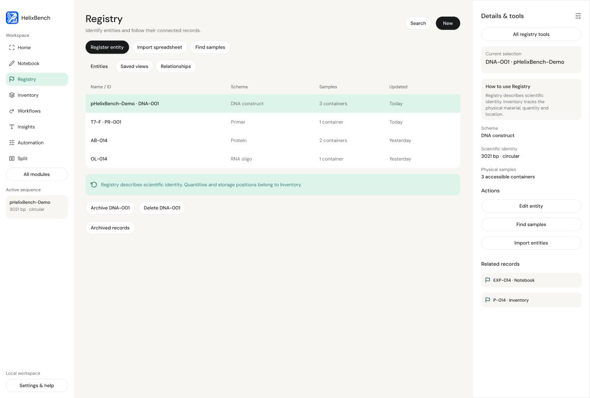

# SCR-09 · Registry

[Current Figma screen](https://www.figma.com/design/U1kWw1K5NZBgEYkuxMz3Qb/helixbench?node-id=107-30897) · Implementation phase P12.

## Purpose and layout

Create, find and relate biological entities, then jump to their documents or locations.

Entity table with kind/schema and stable identity; scientific relationships; related samples; active/archived views; dependency-aware deletion.

## Target requirements

- **SCR-09-R1:** Preserve plasmid, strain and primer schemas; federate biologic/oligo records by typed store references instead of inventing a shared numeric ID namespace.
- **SCR-09-R2:** Open, edit, archive and restore the exact selected entity after sorting or filtering. Display names are not foreign keys.
- **SCR-09-R3:** Archive hides active rows but retains identity and references. Permanent delete requires exact ID confirmation and an explicit dependency summary.
- **SCR-09-R4:** Block deletion when an active dependency needs a live record or a historical result lacks a durable source snapshot. Historical results with complete immutable provenance may retain a tombstone after deletion.
- **SCR-09-R5:** Successful deletion clears selection, inspector actions, active-record cues and search results. Historical output cannot resurrect a deleted source through View source.
- **SCR-09-R6:** CSV import reviews column mapping, row errors, duplicates and partial outcome before persisting. Relationships reject self-links and nonexistent target IDs.

## User flow

1. Choose entity kind
2. Add or import
3. Validate fields and identity
4. Link document / relation / location
5. Save and verify the entity in context

Use the shared typed context, validation/review, persistence and return-location contracts at every relevant transition. Prototype fixture IDs and figures are never production defaults.

## States and recovery

- Loading: retain prior context and identify the active request/operation.
- Populated: show stable object identity, meaningful status and available actions.
- No data: offer the relevant creation/import action.
- No matches: retain query/scope and expose Reset or Change settings.
- Invalid prerequisite: explain the missing input and provide its remedy.
- Validation/write failure: retain draft values and show a constructive correction/retry.
- Dirty/partial/stale/unavailable states use the shared state machines when applicable.

## Screen-specific edge cases

- **SCR-09-EC1:** Same name across kinds/stores; missing linked file; renamed document; archived reference.
- **SCR-09-EC2:** Delete is canceled, ID confirmation differs, a new dependency appears or disk persistence fails.
- **SCR-09-EC3:** Delete a source whose result has a snapshot versus a result whose provenance is incomplete.
- **SCR-09-EC4:** Mixed valid/invalid CSV rows, duplicate headers, quoted commas and repeated import.
- **SCR-09-EC5:** Deleting a row after sort/filter leaves the correct remaining selection or no selection.
- **SCR-09-EC6:** Archive PR-001 must never show DNA-001 in confirmation, completion or restore.

## Current code ownership

- [crates/appcore/src/actions.rs:1353](C:/Users/Admin/Documents/Qoder/2026-11-13/87e5a6b2/helixbench/crates/appcore/src/actions.rs:1353) — `pub fn open_registry(app: &mut AppState)`
- [crates/appcore/src/actions.rs:1357](C:/Users/Admin/Documents/Qoder/2026-11-13/87e5a6b2/helixbench/crates/appcore/src/actions.rs:1357) — `pub fn open_registry_editor(app: &mut AppState, kind: usize, id: Option<u64>)`
- [crates/appcore/src/actions.rs:1375](C:/Users/Admin/Documents/Qoder/2026-11-13/87e5a6b2/helixbench/crates/appcore/src/actions.rs:1375) — `pub fn save_registry_entry(app: &mut AppState, draft: &RegistryEditDraft) -> Result<(), String>`
- [crates/appcore/src/actions.rs:1833](C:/Users/Admin/Documents/Qoder/2026-11-13/87e5a6b2/helixbench/crates/appcore/src/actions.rs:1833) — `pub fn archive_registry_entry(app: &mut AppState, id: u64, archived: bool)`
- [crates/appcore/src/actions.rs:1406](C:/Users/Admin/Documents/Qoder/2026-11-13/87e5a6b2/helixbench/crates/appcore/src/actions.rs:1406) — `pub fn delete_registry_entry(app: &mut AppState, id: u64)`
- [crates/appcore/src/actions.rs:1413](C:/Users/Admin/Documents/Qoder/2026-11-13/87e5a6b2/helixbench/crates/appcore/src/actions.rs:1413) — `pub fn link_registry_entry(app: &mut AppState, id: u64)`
- [crates/appcore/src/actions.rs:1425](C:/Users/Admin/Documents/Qoder/2026-11-13/87e5a6b2/helixbench/crates/appcore/src/actions.rs:1425) — `pub fn open_linked_entry(app: &mut AppState, id: u64)`
- [crates/appcore/src/actions.rs:1820](C:/Users/Admin/Documents/Qoder/2026-11-13/87e5a6b2/helixbench/crates/appcore/src/actions.rs:1820) — `pub fn link_registry_entries(app: &mut AppState, a: u64, b: u64)`
- [crates/appcore/src/actions.rs:1870](C:/Users/Admin/Documents/Qoder/2026-11-13/87e5a6b2/helixbench/crates/appcore/src/actions.rs:1870) — `pub fn run_registry_import(app: &mut AppState, draft: &mut RegistryImportDraft)`
- [crates/appcore/src/actions.rs:1906](C:/Users/Admin/Documents/Qoder/2026-11-13/87e5a6b2/helixbench/crates/appcore/src/actions.rs:1906) — `pub fn parse_registry_rows(csv: &str, name_col: Option<usize>) -> Result<ImportParse, String>`

Domain modules: `crates/domain/src/registry.rs`.

Native presentation entry points:

- [apps/desktop_gpui/src/lab.rs:569](C:/Users/Admin/Documents/Qoder/2026-11-13/87e5a6b2/helixbench/apps/desktop_gpui/src/lab.rs:569) — `render_registry`
- [apps/desktop_gpui/src/dialogs.rs:3995](C:/Users/Admin/Documents/Qoder/2026-11-13/87e5a6b2/helixbench/apps/desktop_gpui/src/dialogs.rs:3995) — `registry`
- [apps/desktop_gpui/src/dialogs.rs:4164](C:/Users/Admin/Documents/Qoder/2026-11-13/87e5a6b2/helixbench/apps/desktop_gpui/src/dialogs.rs:4164) — `registry_editor`
- [apps/desktop_gpui/src/dialogs.rs:5281](C:/Users/Admin/Documents/Qoder/2026-11-13/87e5a6b2/helixbench/apps/desktop_gpui/src/dialogs.rs:5281) — `registry_import`
- [apps/desktop_gpui/src/dialogs.rs:5200](C:/Users/Admin/Documents/Qoder/2026-11-13/87e5a6b2/helixbench/apps/desktop_gpui/src/dialogs.rs:5200) — `entity_map`
- [apps/desktop_gpui/src/dialogs.rs:5469](C:/Users/Admin/Documents/Qoder/2026-11-13/87e5a6b2/helixbench/apps/desktop_gpui/src/dialogs.rs:5469) — `inventory`

## Field/draft contracts

### RegistryDraft

[crates/appcore/src/state.rs:595](C:/Users/Admin/Documents/Qoder/2026-11-13/87e5a6b2/helixbench/crates/appcore/src/state.rs:595)

- `filter: usize` — Use a labeled finite choice with a visible selected value. Validate enum/mode availability; preserve unknown legacy values for review.
- `error: Option<String>` — System-owned validation/error state; never an editable user field.

### RegistryEditDraft

[crates/appcore/src/state.rs:602](C:/Users/Admin/Documents/Qoder/2026-11-13/87e5a6b2/helixbench/crates/appcore/src/state.rs:602)

- `id: Option<u64>` — Resolve a stable typed identity from a labeled picker. Validate existence/kind at submit; do not persist a row index as a foreign key.
- `kind: usize` — Use a labeled finite choice with a visible selected value. Validate enum/mode availability; preserve unknown legacy values for review.
- `values: Vec<String>` — Use the owning feature/module requirements and the current typed source definition. Optional values remain distinguishable from empty/default values; validate before commit.
- `error: Option<String>` — System-owned validation/error state; never an editable user field.

### RegistryImportDraft

[crates/appcore/src/state.rs:553](C:/Users/Admin/Documents/Qoder/2026-11-13/87e5a6b2/helixbench/crates/appcore/src/state.rs:553)

- `csv: String` — Use the owning feature/module requirements and the current typed source definition. Optional values remain distinguishable from empty/default values; validate before commit.
- `kind: usize` — Use a labeled finite choice with a visible selected value. Validate enum/mode availability; preserve unknown legacy values for review.
- `name_col: Option<usize>` — Use the owning feature/module requirements and the current typed source definition. Optional values remain distinguishable from empty/default values; validate before commit.
- `row_errors: Vec<String>` — Use the owning feature/module requirements and the current typed source definition. Optional values remain distinguishable from empty/default values; validate before commit.
- `error: Option<String>` — System-owned validation/error state; never an editable user field.
- `imported: usize` — Use the owning feature/module requirements and the current typed source definition. Optional values remain distinguishable from empty/default values; validate before commit.

### EntityMapDraft

[crates/appcore/src/state.rs:453](C:/Users/Admin/Documents/Qoder/2026-11-13/87e5a6b2/helixbench/crates/appcore/src/state.rs:453)

## Feature-level implementation contracts

### F-110 · Add plasmid / strain / primer

**Status:** Specified; not verified implemented.

**Entry:** Add entry (1 navigation click(s)).

**Prerequisite:** None.

**Outcome:** Kind selector and schema-specific fields.

**Current evidence note:** Page defaults to kind 0 then dialog changes kind.

**Relevant code/action family:** [crates/appcore/src/actions.rs:1353](C:/Users/Admin/Documents/Qoder/2026-11-13/87e5a6b2/helixbench/crates/appcore/src/actions.rs:1353), [crates/appcore/src/actions.rs:1357](C:/Users/Admin/Documents/Qoder/2026-11-13/87e5a6b2/helixbench/crates/appcore/src/actions.rs:1357), [crates/appcore/src/actions.rs:1375](C:/Users/Admin/Documents/Qoder/2026-11-13/87e5a6b2/helixbench/crates/appcore/src/actions.rs:1375), [crates/appcore/src/actions.rs:1833](C:/Users/Admin/Documents/Qoder/2026-11-13/87e5a6b2/helixbench/crates/appcore/src/actions.rs:1833), [crates/appcore/src/actions.rs:1406](C:/Users/Admin/Documents/Qoder/2026-11-13/87e5a6b2/helixbench/crates/appcore/src/actions.rs:1406), [crates/appcore/src/actions.rs:1413](C:/Users/Admin/Documents/Qoder/2026-11-13/87e5a6b2/helixbench/crates/appcore/src/actions.rs:1413), [crates/appcore/src/actions.rs:1425](C:/Users/Admin/Documents/Qoder/2026-11-13/87e5a6b2/helixbench/crates/appcore/src/actions.rs:1425), [crates/appcore/src/actions.rs:1820](C:/Users/Admin/Documents/Qoder/2026-11-13/87e5a6b2/helixbench/crates/appcore/src/actions.rs:1820), [crates/appcore/src/actions.rs:1870](C:/Users/Admin/Documents/Qoder/2026-11-13/87e5a6b2/helixbench/crates/appcore/src/actions.rs:1870), [crates/appcore/src/actions.rs:1906](C:/Users/Admin/Documents/Qoder/2026-11-13/87e5a6b2/helixbench/crates/appcore/src/actions.rs:1906).

**Acceptance:**

- F-110-AC1: Given The owning page and the stated prerequisite are available. When The user follows Add entry. Then Kind selector and schema-specific fields; feature entry requires at most two navigation clicks.
- F-110-AC2: Given The context contains two similar names or a changed table order. When This feature is activated. Then The command payload retains the exact selected typed identity, source revision and scope.
- F-110-AC3: Given A draft contains an invalid or missing required value. When The user submits the form. Then Show a field-local error, retain the draft and perform no mutation.

**Recovery and edge conditions:**

- Invalid required fields are identified beside the input with original draft values retained.
- Cancel does not alter the source object or create an unrelated example record.
- A stale/deleted target is resolved explicitly instead of mutating a row index.
- Successful persistence updates the selected record, related views and audit consistently.
- Delete is canceled, ID confirmation differs, a new dependency appears or disk persistence fails.
- Delete a source whose result has a snapshot versus a result whose provenance is incomplete.

### F-111 · Edit entity fields

**Status:** Specified; not verified implemented.

**Entry:** Entity row → Edit (2 navigation click(s)).

**Prerequisite:** Entity record.

**Outcome:** Open corresponding schema with current values.

**Current evidence note:** Page Edit exists.

**Relevant code/action family:** [crates/appcore/src/actions.rs:1353](C:/Users/Admin/Documents/Qoder/2026-11-13/87e5a6b2/helixbench/crates/appcore/src/actions.rs:1353), [crates/appcore/src/actions.rs:1357](C:/Users/Admin/Documents/Qoder/2026-11-13/87e5a6b2/helixbench/crates/appcore/src/actions.rs:1357), [crates/appcore/src/actions.rs:1375](C:/Users/Admin/Documents/Qoder/2026-11-13/87e5a6b2/helixbench/crates/appcore/src/actions.rs:1375), [crates/appcore/src/actions.rs:1833](C:/Users/Admin/Documents/Qoder/2026-11-13/87e5a6b2/helixbench/crates/appcore/src/actions.rs:1833), [crates/appcore/src/actions.rs:1406](C:/Users/Admin/Documents/Qoder/2026-11-13/87e5a6b2/helixbench/crates/appcore/src/actions.rs:1406), [crates/appcore/src/actions.rs:1413](C:/Users/Admin/Documents/Qoder/2026-11-13/87e5a6b2/helixbench/crates/appcore/src/actions.rs:1413), [crates/appcore/src/actions.rs:1425](C:/Users/Admin/Documents/Qoder/2026-11-13/87e5a6b2/helixbench/crates/appcore/src/actions.rs:1425), [crates/appcore/src/actions.rs:1820](C:/Users/Admin/Documents/Qoder/2026-11-13/87e5a6b2/helixbench/crates/appcore/src/actions.rs:1820), [crates/appcore/src/actions.rs:1870](C:/Users/Admin/Documents/Qoder/2026-11-13/87e5a6b2/helixbench/crates/appcore/src/actions.rs:1870), [crates/appcore/src/actions.rs:1906](C:/Users/Admin/Documents/Qoder/2026-11-13/87e5a6b2/helixbench/crates/appcore/src/actions.rs:1906).

**Acceptance:**

- F-111-AC1: Given The owning page and the stated prerequisite are available. When The user follows Entity row → Edit. Then Open corresponding schema with current values; feature entry requires at most two navigation clicks.
- F-111-AC2: Given The context contains two similar names or a changed table order. When This feature is activated. Then The command payload retains the exact selected typed identity, source revision and scope.
- F-111-AC3: Given A draft contains an invalid or missing required value. When The user submits the form. Then Show a field-local error, retain the draft and perform no mutation.

**Recovery and edge conditions:**

- Invalid required fields are identified beside the input with original draft values retained.
- Cancel does not alter the source object or create an unrelated example record.
- A stale/deleted target is resolved explicitly instead of mutating a row index.
- Successful persistence updates the selected record, related views and audit consistently.
- Delete a source whose result has a snapshot versus a result whose provenance is incomplete.
- Mixed valid/invalid CSV rows, duplicate headers, quoted commas and repeated import.

### F-112 · Filter kind / entity text

**Status:** Specified; not verified implemented.

**Entry:** Kind tab or Filter field (1 navigation click(s)).

**Prerequisite:** None.

**Outcome:** Persistent collection view without modal detour.

**Current evidence note:** Kind filters in Local Registry modal.

**Relevant code/action family:** [crates/appcore/src/actions.rs:1353](C:/Users/Admin/Documents/Qoder/2026-11-13/87e5a6b2/helixbench/crates/appcore/src/actions.rs:1353), [crates/appcore/src/actions.rs:1357](C:/Users/Admin/Documents/Qoder/2026-11-13/87e5a6b2/helixbench/crates/appcore/src/actions.rs:1357), [crates/appcore/src/actions.rs:1375](C:/Users/Admin/Documents/Qoder/2026-11-13/87e5a6b2/helixbench/crates/appcore/src/actions.rs:1375), [crates/appcore/src/actions.rs:1833](C:/Users/Admin/Documents/Qoder/2026-11-13/87e5a6b2/helixbench/crates/appcore/src/actions.rs:1833), [crates/appcore/src/actions.rs:1406](C:/Users/Admin/Documents/Qoder/2026-11-13/87e5a6b2/helixbench/crates/appcore/src/actions.rs:1406), [crates/appcore/src/actions.rs:1413](C:/Users/Admin/Documents/Qoder/2026-11-13/87e5a6b2/helixbench/crates/appcore/src/actions.rs:1413), [crates/appcore/src/actions.rs:1425](C:/Users/Admin/Documents/Qoder/2026-11-13/87e5a6b2/helixbench/crates/appcore/src/actions.rs:1425), [crates/appcore/src/actions.rs:1820](C:/Users/Admin/Documents/Qoder/2026-11-13/87e5a6b2/helixbench/crates/appcore/src/actions.rs:1820), [crates/appcore/src/actions.rs:1870](C:/Users/Admin/Documents/Qoder/2026-11-13/87e5a6b2/helixbench/crates/appcore/src/actions.rs:1870), [crates/appcore/src/actions.rs:1906](C:/Users/Admin/Documents/Qoder/2026-11-13/87e5a6b2/helixbench/crates/appcore/src/actions.rs:1906).

**Acceptance:**

- F-112-AC1: Given The owning page and the stated prerequisite are available. When The user follows Kind tab or Filter field. Then Persistent collection view without modal detour; feature entry requires at most two navigation clicks.
- F-112-AC2: Given The context contains two similar names or a changed table order. When This feature is activated. Then The command payload retains the exact selected typed identity, source revision and scope.
- F-112-AC3: Given Underlying records exist and a query or filter is active. When The query/filter matches no records. Then Show no matches with the active scope and reset remedy; do not claim that the dataset is empty or failed.

**Recovery and edge conditions:**

- Empty source, filtered-out records and failed load have different status/remedies.
- Sorting/filtering or a same-name record cannot change the selected stable identity.
- Returning restores the same query/filter/scope and scroll anchor where supported.
- Inspection-only changes do not mark scientific content dirty.
- Mixed valid/invalid CSV rows, duplicate headers, quoted commas and repeated import.
- Deleting a row after sort/filter leaves the correct remaining selection or no selection.

### F-113 · Archive / unarchive

**Status:** Specified; not verified implemented.

**Entry:** Entity row → Archive or Unarchive (2 navigation click(s)).

**Prerequisite:** Existing entity.

**Outcome:** Explain archive versus deletion; show archived toggle.

**Current evidence note:** Page supports archive flag.

**Relevant code/action family:** [crates/appcore/src/actions.rs:1353](C:/Users/Admin/Documents/Qoder/2026-11-13/87e5a6b2/helixbench/crates/appcore/src/actions.rs:1353), [crates/appcore/src/actions.rs:1357](C:/Users/Admin/Documents/Qoder/2026-11-13/87e5a6b2/helixbench/crates/appcore/src/actions.rs:1357), [crates/appcore/src/actions.rs:1375](C:/Users/Admin/Documents/Qoder/2026-11-13/87e5a6b2/helixbench/crates/appcore/src/actions.rs:1375), [crates/appcore/src/actions.rs:1833](C:/Users/Admin/Documents/Qoder/2026-11-13/87e5a6b2/helixbench/crates/appcore/src/actions.rs:1833), [crates/appcore/src/actions.rs:1406](C:/Users/Admin/Documents/Qoder/2026-11-13/87e5a6b2/helixbench/crates/appcore/src/actions.rs:1406), [crates/appcore/src/actions.rs:1413](C:/Users/Admin/Documents/Qoder/2026-11-13/87e5a6b2/helixbench/crates/appcore/src/actions.rs:1413), [crates/appcore/src/actions.rs:1425](C:/Users/Admin/Documents/Qoder/2026-11-13/87e5a6b2/helixbench/crates/appcore/src/actions.rs:1425), [crates/appcore/src/actions.rs:1820](C:/Users/Admin/Documents/Qoder/2026-11-13/87e5a6b2/helixbench/crates/appcore/src/actions.rs:1820), [crates/appcore/src/actions.rs:1870](C:/Users/Admin/Documents/Qoder/2026-11-13/87e5a6b2/helixbench/crates/appcore/src/actions.rs:1870), [crates/appcore/src/actions.rs:1906](C:/Users/Admin/Documents/Qoder/2026-11-13/87e5a6b2/helixbench/crates/appcore/src/actions.rs:1906).

**Acceptance:**

- F-113-AC1: Given The owning page and the stated prerequisite are available. When The user follows Entity row → Archive or Unarchive. Then Explain archive versus deletion; show archived toggle; feature entry requires at most two navigation clicks.
- F-113-AC2: Given The context contains two similar names or a changed table order. When This feature is activated. Then The command payload retains the exact selected typed identity, source revision and scope.
- F-113-AC3: Given A consequence review identifies the selected record. When The user cancels or the commit fails. Then Keep the reviewed object unchanged, preserve useful draft context and show a recoverable outcome.

**Recovery and edge conditions:**

- Cancel before commit leaves the reviewed object and selection unchanged.
- Changing the selected object while the review is open cannot retarget the action.
- Blocked dependencies and persistence failure leave a constructive recovery path; no false success.
- Successful mutation clears or updates the exact selected context and retained references.
- Deleting a row after sort/filter leaves the correct remaining selection or no selection.
- Archive PR-001 must never show DNA-001 in confirmation, completion or restore.

### F-114 · Delete entity

**Status:** Specified; not verified implemented.

**Entry:** Entity row → Delete (2 navigation click(s)).

**Prerequisite:** Existing entity; dependencies reviewed.

**Outcome:** Confirmation identifies links and recovery limitations.

**Current evidence note:** Local Registry dialog only.

**Relevant code/action family:** [crates/appcore/src/actions.rs:1353](C:/Users/Admin/Documents/Qoder/2026-11-13/87e5a6b2/helixbench/crates/appcore/src/actions.rs:1353), [crates/appcore/src/actions.rs:1357](C:/Users/Admin/Documents/Qoder/2026-11-13/87e5a6b2/helixbench/crates/appcore/src/actions.rs:1357), [crates/appcore/src/actions.rs:1375](C:/Users/Admin/Documents/Qoder/2026-11-13/87e5a6b2/helixbench/crates/appcore/src/actions.rs:1375), [crates/appcore/src/actions.rs:1833](C:/Users/Admin/Documents/Qoder/2026-11-13/87e5a6b2/helixbench/crates/appcore/src/actions.rs:1833), [crates/appcore/src/actions.rs:1406](C:/Users/Admin/Documents/Qoder/2026-11-13/87e5a6b2/helixbench/crates/appcore/src/actions.rs:1406), [crates/appcore/src/actions.rs:1413](C:/Users/Admin/Documents/Qoder/2026-11-13/87e5a6b2/helixbench/crates/appcore/src/actions.rs:1413), [crates/appcore/src/actions.rs:1425](C:/Users/Admin/Documents/Qoder/2026-11-13/87e5a6b2/helixbench/crates/appcore/src/actions.rs:1425), [crates/appcore/src/actions.rs:1820](C:/Users/Admin/Documents/Qoder/2026-11-13/87e5a6b2/helixbench/crates/appcore/src/actions.rs:1820), [crates/appcore/src/actions.rs:1870](C:/Users/Admin/Documents/Qoder/2026-11-13/87e5a6b2/helixbench/crates/appcore/src/actions.rs:1870), [crates/appcore/src/actions.rs:1906](C:/Users/Admin/Documents/Qoder/2026-11-13/87e5a6b2/helixbench/crates/appcore/src/actions.rs:1906).

**Acceptance:**

- F-114-AC1: Given The owning page and the stated prerequisite are available. When The user follows Entity row → Delete. Then Confirmation identifies links and recovery limitations; feature entry requires at most two navigation clicks.
- F-114-AC2: Given The context contains two similar names or a changed table order. When This feature is activated. Then The command payload retains the exact selected typed identity, source revision and scope.
- F-114-AC3: Given A consequence review identifies the selected record. When The user cancels or the commit fails. Then Keep the reviewed object unchanged, preserve useful draft context and show a recoverable outcome.

**Recovery and edge conditions:**

- Cancel before commit leaves the reviewed object and selection unchanged.
- Changing the selected object while the review is open cannot retarget the action.
- Blocked dependencies and persistence failure leave a constructive recovery path; no false success.
- Successful mutation clears or updates the exact selected context and retained references.
- Archive PR-001 must never show DNA-001 in confirmation, completion or restore.
- Same name across kinds/stores; missing linked file; renamed document; archived reference.

### F-115 · Link active document

**Status:** Specified; not verified implemented.

**Entry:** Entity row → Link document (2 navigation click(s)).

**Prerequisite:** Active document and entity.

**Outcome:** Show exact linked document.

**Current evidence note:** Local Registry dialog only.

**Relevant code/action family:** [crates/appcore/src/actions.rs:1353](C:/Users/Admin/Documents/Qoder/2026-11-13/87e5a6b2/helixbench/crates/appcore/src/actions.rs:1353), [crates/appcore/src/actions.rs:1357](C:/Users/Admin/Documents/Qoder/2026-11-13/87e5a6b2/helixbench/crates/appcore/src/actions.rs:1357), [crates/appcore/src/actions.rs:1375](C:/Users/Admin/Documents/Qoder/2026-11-13/87e5a6b2/helixbench/crates/appcore/src/actions.rs:1375), [crates/appcore/src/actions.rs:1833](C:/Users/Admin/Documents/Qoder/2026-11-13/87e5a6b2/helixbench/crates/appcore/src/actions.rs:1833), [crates/appcore/src/actions.rs:1406](C:/Users/Admin/Documents/Qoder/2026-11-13/87e5a6b2/helixbench/crates/appcore/src/actions.rs:1406), [crates/appcore/src/actions.rs:1413](C:/Users/Admin/Documents/Qoder/2026-11-13/87e5a6b2/helixbench/crates/appcore/src/actions.rs:1413), [crates/appcore/src/actions.rs:1425](C:/Users/Admin/Documents/Qoder/2026-11-13/87e5a6b2/helixbench/crates/appcore/src/actions.rs:1425), [crates/appcore/src/actions.rs:1820](C:/Users/Admin/Documents/Qoder/2026-11-13/87e5a6b2/helixbench/crates/appcore/src/actions.rs:1820), [crates/appcore/src/actions.rs:1870](C:/Users/Admin/Documents/Qoder/2026-11-13/87e5a6b2/helixbench/crates/appcore/src/actions.rs:1870), [crates/appcore/src/actions.rs:1906](C:/Users/Admin/Documents/Qoder/2026-11-13/87e5a6b2/helixbench/crates/appcore/src/actions.rs:1906).

**Acceptance:**

- F-115-AC1: Given The owning page and the stated prerequisite are available. When The user follows Entity row → Link document. Then Show exact linked document; feature entry requires at most two navigation clicks.
- F-115-AC2: Given The context contains two similar names or a changed table order. When This feature is activated. Then The command payload retains the exact selected typed identity, source revision and scope.
- F-115-AC3: Given A draft contains an invalid or missing required value. When The user submits the form. Then Show a field-local error, retain the draft and perform no mutation.

**Recovery and edge conditions:**

- Invalid required fields are identified beside the input with original draft values retained.
- Cancel does not alter the source object or create an unrelated example record.
- A stale/deleted target is resolved explicitly instead of mutating a row index.
- Successful persistence updates the selected record, related views and audit consistently.
- Same name across kinds/stores; missing linked file; renamed document; archived reference.
- Delete is canceled, ID confirmation differs, a new dependency appears or disk persistence fails.

### F-116 · Open linked document

**Status:** Specified; not verified implemented.

**Entry:** Entity row → Open document (2 navigation click(s)).

**Prerequisite:** Linked document available.

**Outcome:** Open path or explain missing file.

**Current evidence note:** Local Registry dialog only.

**Relevant code/action family:** [crates/appcore/src/actions.rs:1353](C:/Users/Admin/Documents/Qoder/2026-11-13/87e5a6b2/helixbench/crates/appcore/src/actions.rs:1353), [crates/appcore/src/actions.rs:1357](C:/Users/Admin/Documents/Qoder/2026-11-13/87e5a6b2/helixbench/crates/appcore/src/actions.rs:1357), [crates/appcore/src/actions.rs:1375](C:/Users/Admin/Documents/Qoder/2026-11-13/87e5a6b2/helixbench/crates/appcore/src/actions.rs:1375), [crates/appcore/src/actions.rs:1833](C:/Users/Admin/Documents/Qoder/2026-11-13/87e5a6b2/helixbench/crates/appcore/src/actions.rs:1833), [crates/appcore/src/actions.rs:1406](C:/Users/Admin/Documents/Qoder/2026-11-13/87e5a6b2/helixbench/crates/appcore/src/actions.rs:1406), [crates/appcore/src/actions.rs:1413](C:/Users/Admin/Documents/Qoder/2026-11-13/87e5a6b2/helixbench/crates/appcore/src/actions.rs:1413), [crates/appcore/src/actions.rs:1425](C:/Users/Admin/Documents/Qoder/2026-11-13/87e5a6b2/helixbench/crates/appcore/src/actions.rs:1425), [crates/appcore/src/actions.rs:1820](C:/Users/Admin/Documents/Qoder/2026-11-13/87e5a6b2/helixbench/crates/appcore/src/actions.rs:1820), [crates/appcore/src/actions.rs:1870](C:/Users/Admin/Documents/Qoder/2026-11-13/87e5a6b2/helixbench/crates/appcore/src/actions.rs:1870), [crates/appcore/src/actions.rs:1906](C:/Users/Admin/Documents/Qoder/2026-11-13/87e5a6b2/helixbench/crates/appcore/src/actions.rs:1906).

**Acceptance:**

- F-116-AC1: Given The owning page and the stated prerequisite are available. When The user follows Entity row → Open document. Then Open path or explain missing file; feature entry requires at most two navigation clicks.
- F-116-AC2: Given The context contains two similar names or a changed table order. When This feature is activated. Then The command payload retains the exact selected typed identity, source revision and scope.
- F-116-AC3: Given A draft contains an invalid or missing required value. When The user submits the form. Then Show a field-local error, retain the draft and perform no mutation.

**Recovery and edge conditions:**

- Invalid required fields are identified beside the input with original draft values retained.
- Cancel does not alter the source object or create an unrelated example record.
- A stale/deleted target is resolved explicitly instead of mutating a row index.
- Successful persistence updates the selected record, related views and audit consistently.
- Delete is canceled, ID confirmation differs, a new dependency appears or disk persistence fails.
- Delete a source whose result has a snapshot versus a result whose provenance is incomplete.

### F-117 · Import CSV

**Status:** Specified; not verified implemented.

**Entry:** Import CSV (1 navigation click(s)).

**Prerequisite:** CSV file.

**Outcome:** Choose kind; auto-map/review fields; preview validation before import.

**Current evidence note:** Page action and mapping dialog.

**Relevant code/action family:** [crates/appcore/src/actions.rs:1845](C:/Users/Admin/Documents/Qoder/2026-11-13/87e5a6b2/helixbench/crates/appcore/src/actions.rs:1845), [crates/appcore/src/actions.rs:1870](C:/Users/Admin/Documents/Qoder/2026-11-13/87e5a6b2/helixbench/crates/appcore/src/actions.rs:1870).

**Acceptance:**

- F-117-AC1: Given The owning page and the stated prerequisite are available. When The user follows Import CSV. Then Choose kind; auto-map/review fields; preview validation before import; feature entry requires at most two navigation clicks.
- F-117-AC2: Given The context contains two similar names or a changed table order. When This feature is activated. Then The command payload retains the exact selected typed identity, source revision and scope.
- F-117-AC3: Given A file or store write is awaiting completion. When The OS dialog is canceled or the atomic write fails. Then Do not report success, change saved/dirty truth or continue a pending destructive intent; preserve original data.

**Recovery and edge conditions:**

- OS-dialog cancellation leaves drafts, source data and pending navigation intact.
- Permission denied, disk full, locked destination and rename failure never show success.
- Reopening/retrying the same operation preserves identity and does not duplicate successful output.
- Export/import preserves scope, encoding, units and declared lossy transformations.
- Delete a source whose result has a snapshot versus a result whose provenance is incomplete.
- Mixed valid/invalid CSV rows, duplicate headers, quoted commas and repeated import.

### F-118 · Entity relationships

**Status:** Specified; not verified implemented.

**Entry:** Entity row → Relationships tab (2 navigation click(s)).

**Prerequisite:** Two valid entities.

**Outcome:** View and add relationships in context.

**Current evidence note:** Entity Map separate dialog.

**Relevant code/action family:** [crates/appcore/src/actions.rs:1353](C:/Users/Admin/Documents/Qoder/2026-11-13/87e5a6b2/helixbench/crates/appcore/src/actions.rs:1353), [crates/appcore/src/actions.rs:1357](C:/Users/Admin/Documents/Qoder/2026-11-13/87e5a6b2/helixbench/crates/appcore/src/actions.rs:1357), [crates/appcore/src/actions.rs:1375](C:/Users/Admin/Documents/Qoder/2026-11-13/87e5a6b2/helixbench/crates/appcore/src/actions.rs:1375), [crates/appcore/src/actions.rs:1833](C:/Users/Admin/Documents/Qoder/2026-11-13/87e5a6b2/helixbench/crates/appcore/src/actions.rs:1833), [crates/appcore/src/actions.rs:1406](C:/Users/Admin/Documents/Qoder/2026-11-13/87e5a6b2/helixbench/crates/appcore/src/actions.rs:1406), [crates/appcore/src/actions.rs:1413](C:/Users/Admin/Documents/Qoder/2026-11-13/87e5a6b2/helixbench/crates/appcore/src/actions.rs:1413), [crates/appcore/src/actions.rs:1425](C:/Users/Admin/Documents/Qoder/2026-11-13/87e5a6b2/helixbench/crates/appcore/src/actions.rs:1425), [crates/appcore/src/actions.rs:1820](C:/Users/Admin/Documents/Qoder/2026-11-13/87e5a6b2/helixbench/crates/appcore/src/actions.rs:1820), [crates/appcore/src/actions.rs:1870](C:/Users/Admin/Documents/Qoder/2026-11-13/87e5a6b2/helixbench/crates/appcore/src/actions.rs:1870), [crates/appcore/src/actions.rs:1906](C:/Users/Admin/Documents/Qoder/2026-11-13/87e5a6b2/helixbench/crates/appcore/src/actions.rs:1906).

**Acceptance:**

- F-118-AC1: Given The owning page and the stated prerequisite are available. When The user follows Entity row → Relationships tab. Then View and add relationships in context; feature entry requires at most two navigation clicks.
- F-118-AC2: Given The context contains two similar names or a changed table order. When This feature is activated. Then The command payload retains the exact selected typed identity, source revision and scope.
- F-118-AC3: Given The intended target was deleted or became inaccessible after rendering. When The user activates its row or link. Then Show a relevant recovery path without opening an unrelated record; retain a safe return location.

**Recovery and edge conditions:**

- Two same-name records and two stores with the same numeric ID resolve correctly.
- A missing/deleted/inaccessible target offers a relevant remedy rather than another record.
- Back restores the invoking task and selection; dirty work is preserved where necessary.
- Keyboard activation and labeled controls expose the same action as pointer input.
- Mixed valid/invalid CSV rows, duplicate headers, quoted commas and repeated import.
- Deleting a row after sort/filter leaves the correct remaining selection or no selection.

### F-119 · Workspace entity map

**Status:** Specified; not verified implemented.

**Entry:** Entity map (1 navigation click(s)).

**Prerequisite:** Registry records.

**Outcome:** Graph / list with labeled relationship controls.

**Current evidence note:** Existing page button.

**Relevant code/action family:** [crates/appcore/src/actions.rs:1353](C:/Users/Admin/Documents/Qoder/2026-11-13/87e5a6b2/helixbench/crates/appcore/src/actions.rs:1353), [crates/appcore/src/actions.rs:1357](C:/Users/Admin/Documents/Qoder/2026-11-13/87e5a6b2/helixbench/crates/appcore/src/actions.rs:1357), [crates/appcore/src/actions.rs:1375](C:/Users/Admin/Documents/Qoder/2026-11-13/87e5a6b2/helixbench/crates/appcore/src/actions.rs:1375), [crates/appcore/src/actions.rs:1833](C:/Users/Admin/Documents/Qoder/2026-11-13/87e5a6b2/helixbench/crates/appcore/src/actions.rs:1833), [crates/appcore/src/actions.rs:1406](C:/Users/Admin/Documents/Qoder/2026-11-13/87e5a6b2/helixbench/crates/appcore/src/actions.rs:1406), [crates/appcore/src/actions.rs:1413](C:/Users/Admin/Documents/Qoder/2026-11-13/87e5a6b2/helixbench/crates/appcore/src/actions.rs:1413), [crates/appcore/src/actions.rs:1425](C:/Users/Admin/Documents/Qoder/2026-11-13/87e5a6b2/helixbench/crates/appcore/src/actions.rs:1425), [crates/appcore/src/actions.rs:1820](C:/Users/Admin/Documents/Qoder/2026-11-13/87e5a6b2/helixbench/crates/appcore/src/actions.rs:1820), [crates/appcore/src/actions.rs:1870](C:/Users/Admin/Documents/Qoder/2026-11-13/87e5a6b2/helixbench/crates/appcore/src/actions.rs:1870), [crates/appcore/src/actions.rs:1906](C:/Users/Admin/Documents/Qoder/2026-11-13/87e5a6b2/helixbench/crates/appcore/src/actions.rs:1906).

**Acceptance:**

- F-119-AC1: Given The owning page and the stated prerequisite are available. When The user follows Entity map. Then Graph / list with labeled relationship controls; feature entry requires at most two navigation clicks.
- F-119-AC2: Given The context contains two similar names or a changed table order. When This feature is activated. Then The command payload retains the exact selected typed identity, source revision and scope.
- F-119-AC3: Given The intended target was deleted or became inaccessible after rendering. When The user activates its row or link. Then Show a relevant recovery path without opening an unrelated record; retain a safe return location.

**Recovery and edge conditions:**

- Two same-name records and two stores with the same numeric ID resolve correctly.
- A missing/deleted/inaccessible target offers a relevant remedy rather than another record.
- Back restores the invoking task and selection; dirty work is preserved where necessary.
- Keyboard activation and labeled controls expose the same action as pointer input.
- Deleting a row after sort/filter leaves the correct remaining selection or no selection.
- Archive PR-001 must never show DNA-001 in confirmation, completion or restore.

### F-120 · Find physical containers

**Status:** Specified; not verified implemented.

**Entry:** Entity row → Inventory tab (2 navigation click(s)).

**Prerequisite:** Entity has or may have containers.

**Outcome:** Show location/quantity with link back to entity.

**Current evidence note:** Inventory manager lookup is detached.

**Relevant code/action family:** [crates/appcore/src/actions.rs:1353](C:/Users/Admin/Documents/Qoder/2026-11-13/87e5a6b2/helixbench/crates/appcore/src/actions.rs:1353), [crates/appcore/src/actions.rs:1357](C:/Users/Admin/Documents/Qoder/2026-11-13/87e5a6b2/helixbench/crates/appcore/src/actions.rs:1357), [crates/appcore/src/actions.rs:1375](C:/Users/Admin/Documents/Qoder/2026-11-13/87e5a6b2/helixbench/crates/appcore/src/actions.rs:1375), [crates/appcore/src/actions.rs:1833](C:/Users/Admin/Documents/Qoder/2026-11-13/87e5a6b2/helixbench/crates/appcore/src/actions.rs:1833), [crates/appcore/src/actions.rs:1406](C:/Users/Admin/Documents/Qoder/2026-11-13/87e5a6b2/helixbench/crates/appcore/src/actions.rs:1406), [crates/appcore/src/actions.rs:1413](C:/Users/Admin/Documents/Qoder/2026-11-13/87e5a6b2/helixbench/crates/appcore/src/actions.rs:1413), [crates/appcore/src/actions.rs:1425](C:/Users/Admin/Documents/Qoder/2026-11-13/87e5a6b2/helixbench/crates/appcore/src/actions.rs:1425), [crates/appcore/src/actions.rs:1820](C:/Users/Admin/Documents/Qoder/2026-11-13/87e5a6b2/helixbench/crates/appcore/src/actions.rs:1820), [crates/appcore/src/actions.rs:1870](C:/Users/Admin/Documents/Qoder/2026-11-13/87e5a6b2/helixbench/crates/appcore/src/actions.rs:1870), [crates/appcore/src/actions.rs:1906](C:/Users/Admin/Documents/Qoder/2026-11-13/87e5a6b2/helixbench/crates/appcore/src/actions.rs:1906).

**Acceptance:**

- F-120-AC1: Given The owning page and the stated prerequisite are available. When The user follows Entity row → Inventory tab. Then Show location/quantity with link back to entity; feature entry requires at most two navigation clicks.
- F-120-AC2: Given The context contains two similar names or a changed table order. When This feature is activated. Then The command payload retains the exact selected typed identity, source revision and scope.
- F-120-AC3: Given Underlying records exist and a query or filter is active. When The query/filter matches no records. Then Show no matches with the active scope and reset remedy; do not claim that the dataset is empty or failed.

**Recovery and edge conditions:**

- Empty source, filtered-out records and failed load have different status/remedies.
- Sorting/filtering or a same-name record cannot change the selected stable identity.
- Returning restores the same query/filter/scope and scroll anchor where supported.
- Inspection-only changes do not mark scientific content dirty.
- Archive PR-001 must never show DNA-001 in confirmation, completion or restore.
- Same name across kinds/stores; missing linked file; renamed document; archived reference.

### F-121 · Schema-specific metadata

**Status:** Specified; not verified implemented.

**Entry:** Entity row → Details tab (2 navigation click(s)).

**Prerequisite:** Selected kind.

**Outcome:** Plasmid backbone/insert/resistance; strain organism/genotype/status; primer sequence/Tm/GC.

**Current evidence note:** Registry editor fields differ by kind.

**Relevant code/action family:** [crates/appcore/src/actions.rs:1353](C:/Users/Admin/Documents/Qoder/2026-11-13/87e5a6b2/helixbench/crates/appcore/src/actions.rs:1353), [crates/appcore/src/actions.rs:1357](C:/Users/Admin/Documents/Qoder/2026-11-13/87e5a6b2/helixbench/crates/appcore/src/actions.rs:1357), [crates/appcore/src/actions.rs:1375](C:/Users/Admin/Documents/Qoder/2026-11-13/87e5a6b2/helixbench/crates/appcore/src/actions.rs:1375), [crates/appcore/src/actions.rs:1833](C:/Users/Admin/Documents/Qoder/2026-11-13/87e5a6b2/helixbench/crates/appcore/src/actions.rs:1833), [crates/appcore/src/actions.rs:1406](C:/Users/Admin/Documents/Qoder/2026-11-13/87e5a6b2/helixbench/crates/appcore/src/actions.rs:1406), [crates/appcore/src/actions.rs:1413](C:/Users/Admin/Documents/Qoder/2026-11-13/87e5a6b2/helixbench/crates/appcore/src/actions.rs:1413), [crates/appcore/src/actions.rs:1425](C:/Users/Admin/Documents/Qoder/2026-11-13/87e5a6b2/helixbench/crates/appcore/src/actions.rs:1425), [crates/appcore/src/actions.rs:1820](C:/Users/Admin/Documents/Qoder/2026-11-13/87e5a6b2/helixbench/crates/appcore/src/actions.rs:1820), [crates/appcore/src/actions.rs:1870](C:/Users/Admin/Documents/Qoder/2026-11-13/87e5a6b2/helixbench/crates/appcore/src/actions.rs:1870), [crates/appcore/src/actions.rs:1906](C:/Users/Admin/Documents/Qoder/2026-11-13/87e5a6b2/helixbench/crates/appcore/src/actions.rs:1906).

**Acceptance:**

- F-121-AC1: Given The owning page and the stated prerequisite are available. When The user follows Entity row → Details tab. Then Plasmid backbone/insert/resistance; strain organism/genotype/status; primer sequence/Tm/GC; feature entry requires at most two navigation clicks.
- F-121-AC2: Given The context contains two similar names or a changed table order. When This feature is activated. Then The command payload retains the exact selected typed identity, source revision and scope.
- F-121-AC3: Given The intended target was deleted or became inaccessible after rendering. When The user activates its row or link. Then Show a relevant recovery path without opening an unrelated record; retain a safe return location.

**Recovery and edge conditions:**

- Two same-name records and two stores with the same numeric ID resolve correctly.
- A missing/deleted/inaccessible target offers a relevant remedy rather than another record.
- Back restores the invoking task and selection; dirty work is preserved where necessary.
- Keyboard activation and labeled controls expose the same action as pointer input.
- Same name across kinds/stores; missing linked file; renamed document; archived reference.
- Delete is canceled, ID confirmation differs, a new dependency appears or disk persistence fails.

