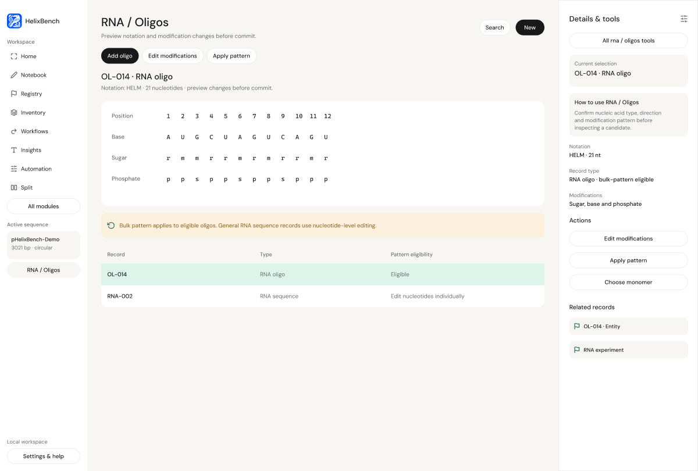

# SCR-17 · RNA / Oligos

[Current Figma screen](https://www.figma.com/design/U1kWw1K5NZBgEYkuxMz3Qb/helixbench?node-id=107-32649) · Implementation phase P17.

## Purpose and layout

Create a modified oligo, inspect HELM and apply an explicit modification pattern.

Named RNA/modified-oligo list; direction, sequence, chemistry pattern and monomer inspection; HELM import/export and related identity.

## Target requirements

- **SCR-17-R1:** Validate RNA/oligo input using its own alphabet and modification model; never pass it through DNA cleaning without explicit conversion review.
- **SCR-17-R2:** Preserve name, sequence, selected pattern, modification code and HELM source. Show the modified positions before applying a pattern.
- **SCR-17-R3:** Sequence order, direction and terminal chemistry remain explicit. Properties reflect the selected oligo, not a generic example.
- **SCR-17-R4:** HELM parsing reports unsupported monomers/connections and preserves original text for correction; export describes supported coverage.
- **SCR-17-R5:** Delete/edit reviews dependent references and retains historical result provenance.

## User flow

1. Add RNA or HELM input
2. Choose modification pattern
3. Validate the oligo
4. Inspect sequence/MW/GC
5. Apply or revise modifications and keep a clear change summary

Use the shared typed context, validation/review, persistence and return-location contracts at every relevant transition. Prototype fixture IDs and figures are never production defaults.

## States and recovery

- Loading: retain prior context and identify the active request/operation.
- Populated: show stable object identity, meaningful status and available actions.
- No data: offer the relevant creation/import action.
- No matches: retain query/scope and expose Reset or Change settings.
- Invalid prerequisite: explain the missing input and provide its remedy.
- Validation/write failure: retain draft values and show a constructive correction/retry.
- Dirty/partial/stale/unavailable states use the shared state machines when applicable.

## Screen-specific edge cases

- **SCR-17-EC1:** Mixed T/U, DNA pasted as RNA, unsupported monomer, terminal modification and empty sequence.
- **SCR-17-EC2:** HELM record has malformed syntax or a monomer outside the local library.
- **SCR-17-EC3:** A modification pattern targets a missing position or conflicts with existing chemistry.
- **SCR-17-EC4:** Same name with different chemistry or an edited oligo still selected by row index.
- **SCR-17-EC5:** No property model exists for a chosen modification; show unavailable rather than a guessed value.
- **SCR-17-EC6:** Round-trip supported HELM without changing residue order or chemistry.

## Current code ownership

- [crates/appcore/src/actions.rs:2220](C:/Users/Admin/Documents/Qoder/2026-11-13/87e5a6b2/helixbench/crates/appcore/src/actions.rs:2220) — `pub fn open_rna_add(app: &mut AppState)`
- [crates/appcore/src/actions.rs:2227](C:/Users/Admin/Documents/Qoder/2026-11-13/87e5a6b2/helixbench/crates/appcore/src/actions.rs:2227) — `pub fn rna_add_save(app: &mut AppState, draft: &RnaDraft) -> Result<u64, String>`
- [crates/appcore/src/actions.rs:2273](C:/Users/Admin/Documents/Qoder/2026-11-13/87e5a6b2/helixbench/crates/appcore/src/actions.rs:2273) — `pub fn rna_apply_pattern(app: &mut AppState, pattern: usize, mod_code: usize)`
- [crates/appcore/src/actions.rs:2296](C:/Users/Admin/Documents/Qoder/2026-11-13/87e5a6b2/helixbench/crates/appcore/src/actions.rs:2296) — `pub fn rna_delete(app: &mut AppState, id: u64)`

Domain modules: `crates/domain/src/rna.rs`.

Native presentation entry points:

- [apps/desktop_gpui/src/lab.rs:1433](C:/Users/Admin/Documents/Qoder/2026-11-13/87e5a6b2/helixbench/apps/desktop_gpui/src/lab.rs:1433) — `render_rna`
- [apps/desktop_gpui/src/dialogs.rs:6366](C:/Users/Admin/Documents/Qoder/2026-11-13/87e5a6b2/helixbench/apps/desktop_gpui/src/dialogs.rs:6366) — `rna`

## Field/draft contracts

### RnaDraft

[crates/appcore/src/state.rs:497](C:/Users/Admin/Documents/Qoder/2026-11-13/87e5a6b2/helixbench/crates/appcore/src/state.rs:497)

- `name: String` — Trim for validation; require a nonempty meaningful label where the owning operation creates an object. Preserve original editable draft on error.
- `seq: String` — Validate the declared molecule/grammar before commit. Preserve original text and report meaningful normalization or unsupported syntax.
- `pattern: usize` — Use a labeled finite choice with a visible selected value. Validate enum/mode availability; preserve unknown legacy values for review.
- `mod_code: usize` — Use a labeled finite choice with a visible selected value. Validate enum/mode availability; preserve unknown legacy values for review.
- `helm: String` — Validate the declared molecule/grammar before commit. Preserve original text and report meaningful normalization or unsupported syntax.
- `error: Option<String>` — System-owned validation/error state; never an editable user field.

## Feature-level implementation contracts

### F-183 · Add oligo / supported HELM input

**Status:** Specified; not verified implemented.

**Entry:** Add oligo (1 navigation click(s)).

**Prerequisite:** Supported input.

**Outcome:** Name, sequence and pattern/modification options.

**Current evidence note:** Existing dialog; HELM parsing in domain/storage.

**Relevant code/action family:** [crates/appcore/src/actions.rs:2220](C:/Users/Admin/Documents/Qoder/2026-11-13/87e5a6b2/helixbench/crates/appcore/src/actions.rs:2220), [crates/appcore/src/actions.rs:2227](C:/Users/Admin/Documents/Qoder/2026-11-13/87e5a6b2/helixbench/crates/appcore/src/actions.rs:2227), [crates/appcore/src/actions.rs:2273](C:/Users/Admin/Documents/Qoder/2026-11-13/87e5a6b2/helixbench/crates/appcore/src/actions.rs:2273), [crates/appcore/src/actions.rs:2296](C:/Users/Admin/Documents/Qoder/2026-11-13/87e5a6b2/helixbench/crates/appcore/src/actions.rs:2296).

**Acceptance:**

- F-183-AC1: Given The owning page and the stated prerequisite are available. When The user follows Add oligo. Then Name, sequence and pattern/modification options; feature entry requires at most two navigation clicks.
- F-183-AC2: Given The context contains two similar names or a changed table order. When This feature is activated. Then The command payload retains the exact selected typed identity, source revision and scope.
- F-183-AC3: Given A draft contains an invalid or missing required value. When The user submits the form. Then Show a field-local error, retain the draft and perform no mutation.

**Recovery and edge conditions:**

- Invalid required fields are identified beside the input with original draft values retained.
- Cancel does not alter the source object or create an unrelated example record.
- A stale/deleted target is resolved explicitly instead of mutating a row index.
- Successful persistence updates the selected record, related views and audit consistently.
- HELM record has malformed syntax or a monomer outside the local library.
- A modification pattern targets a missing position or conflicts with existing chemistry.

### F-184 · Select oligo / inspect sequence

**Status:** Specified; not verified implemented.

**Entry:** Oligo row (1 navigation click(s)).

**Prerequisite:** Existing oligo.

**Outcome:** Length, modified positions and sequence.

**Current evidence note:** Select button.

**Relevant code/action family:** [crates/appcore/src/actions.rs:2220](C:/Users/Admin/Documents/Qoder/2026-11-13/87e5a6b2/helixbench/crates/appcore/src/actions.rs:2220), [crates/appcore/src/actions.rs:2227](C:/Users/Admin/Documents/Qoder/2026-11-13/87e5a6b2/helixbench/crates/appcore/src/actions.rs:2227), [crates/appcore/src/actions.rs:2273](C:/Users/Admin/Documents/Qoder/2026-11-13/87e5a6b2/helixbench/crates/appcore/src/actions.rs:2273), [crates/appcore/src/actions.rs:2296](C:/Users/Admin/Documents/Qoder/2026-11-13/87e5a6b2/helixbench/crates/appcore/src/actions.rs:2296).

**Acceptance:**

- F-184-AC1: Given The owning page and the stated prerequisite are available. When The user follows Oligo row. Then Length, modified positions and sequence; feature entry requires at most two navigation clicks.
- F-184-AC2: Given The context contains two similar names or a changed table order. When This feature is activated. Then The command payload retains the exact selected typed identity, source revision and scope.
- F-184-AC3: Given The intended target was deleted or became inaccessible after rendering. When The user activates its row or link. Then Show a relevant recovery path without opening an unrelated record; retain a safe return location.

**Recovery and edge conditions:**

- Two same-name records and two stores with the same numeric ID resolve correctly.
- A missing/deleted/inaccessible target offers a relevant remedy rather than another record.
- Back restores the invoking task and selection; dirty work is preserved where necessary.
- Keyboard activation and labeled controls expose the same action as pointer input.
- A modification pattern targets a missing position or conflicts with existing chemistry.
- Same name with different chemistry or an edited oligo still selected by row index.

### F-185 · View MW and GC

**Status:** Specified; not verified implemented.

**Entry:** Oligo row → Overview tab (2 navigation click(s)).

**Prerequisite:** Valid oligo.

**Outcome:** Property values with clear units.

**Current evidence note:** Selected inline data.

**Relevant code/action family:** [crates/appcore/src/actions.rs:2220](C:/Users/Admin/Documents/Qoder/2026-11-13/87e5a6b2/helixbench/crates/appcore/src/actions.rs:2220), [crates/appcore/src/actions.rs:2227](C:/Users/Admin/Documents/Qoder/2026-11-13/87e5a6b2/helixbench/crates/appcore/src/actions.rs:2227), [crates/appcore/src/actions.rs:2273](C:/Users/Admin/Documents/Qoder/2026-11-13/87e5a6b2/helixbench/crates/appcore/src/actions.rs:2273), [crates/appcore/src/actions.rs:2296](C:/Users/Admin/Documents/Qoder/2026-11-13/87e5a6b2/helixbench/crates/appcore/src/actions.rs:2296).

**Acceptance:**

- F-185-AC1: Given The owning page and the stated prerequisite are available. When The user follows Oligo row → Overview tab. Then Property values with clear units; feature entry requires at most two navigation clicks.
- F-185-AC2: Given The context contains two similar names or a changed table order. When This feature is activated. Then The command payload retains the exact selected typed identity, source revision and scope.
- F-185-AC3: Given Underlying records exist and a query or filter is active. When The query/filter matches no records. Then Show no matches with the active scope and reset remedy; do not claim that the dataset is empty or failed.

**Recovery and edge conditions:**

- Empty source, filtered-out records and failed load have different status/remedies.
- Sorting/filtering or a same-name record cannot change the selected stable identity.
- Returning restores the same query/filter/scope and scroll anchor where supported.
- Inspection-only changes do not mark scientific content dirty.
- Same name with different chemistry or an edited oligo still selected by row index.
- No property model exists for a chosen modification; show unavailable rather than a guessed value.

### F-186 · Inspect HELM representation

**Status:** Specified; not verified implemented.

**Entry:** Oligo row → HELM tab (2 navigation click(s)).

**Prerequisite:** Existing oligo.

**Outcome:** Readable notation; do not imply unimplemented export.

**Current evidence note:** Read-only representation below selection.

**Relevant code/action family:** [crates/appcore/src/actions.rs:2220](C:/Users/Admin/Documents/Qoder/2026-11-13/87e5a6b2/helixbench/crates/appcore/src/actions.rs:2220), [crates/appcore/src/actions.rs:2227](C:/Users/Admin/Documents/Qoder/2026-11-13/87e5a6b2/helixbench/crates/appcore/src/actions.rs:2227), [crates/appcore/src/actions.rs:2273](C:/Users/Admin/Documents/Qoder/2026-11-13/87e5a6b2/helixbench/crates/appcore/src/actions.rs:2273), [crates/appcore/src/actions.rs:2296](C:/Users/Admin/Documents/Qoder/2026-11-13/87e5a6b2/helixbench/crates/appcore/src/actions.rs:2296).

**Acceptance:**

- F-186-AC1: Given The owning page and the stated prerequisite are available. When The user follows Oligo row → HELM tab. Then Readable notation; do not imply unimplemented export; feature entry requires at most two navigation clicks.
- F-186-AC2: Given The context contains two similar names or a changed table order. When This feature is activated. Then The command payload retains the exact selected typed identity, source revision and scope.
- F-186-AC3: Given The intended target was deleted or became inaccessible after rendering. When The user activates its row or link. Then Show a relevant recovery path without opening an unrelated record; retain a safe return location.

**Recovery and edge conditions:**

- Two same-name records and two stores with the same numeric ID resolve correctly.
- A missing/deleted/inaccessible target offers a relevant remedy rather than another record.
- Back restores the invoking task and selection; dirty work is preserved where necessary.
- Keyboard activation and labeled controls expose the same action as pointer input.
- No property model exists for a chosen modification; show unavailable rather than a guessed value.
- Round-trip supported HELM without changing residue order or chemistry.

### F-187 · Inspect individual modifications

**Status:** Specified; not verified implemented.

**Entry:** Oligo row → Modifications tab (2 navigation click(s)).

**Prerequisite:** Modified positions.

**Outcome:** Position, code and modification name.

**Current evidence note:** Selected list below HELM.

**Relevant code/action family:** [crates/appcore/src/actions.rs:2220](C:/Users/Admin/Documents/Qoder/2026-11-13/87e5a6b2/helixbench/crates/appcore/src/actions.rs:2220), [crates/appcore/src/actions.rs:2227](C:/Users/Admin/Documents/Qoder/2026-11-13/87e5a6b2/helixbench/crates/appcore/src/actions.rs:2227), [crates/appcore/src/actions.rs:2273](C:/Users/Admin/Documents/Qoder/2026-11-13/87e5a6b2/helixbench/crates/appcore/src/actions.rs:2273), [crates/appcore/src/actions.rs:2296](C:/Users/Admin/Documents/Qoder/2026-11-13/87e5a6b2/helixbench/crates/appcore/src/actions.rs:2296).

**Acceptance:**

- F-187-AC1: Given The owning page and the stated prerequisite are available. When The user follows Oligo row → Modifications tab. Then Position, code and modification name; feature entry requires at most two navigation clicks.
- F-187-AC2: Given The context contains two similar names or a changed table order. When This feature is activated. Then The command payload retains the exact selected typed identity, source revision and scope.
- F-187-AC3: Given The intended target was deleted or became inaccessible after rendering. When The user activates its row or link. Then Show a relevant recovery path without opening an unrelated record; retain a safe return location.

**Recovery and edge conditions:**

- Two same-name records and two stores with the same numeric ID resolve correctly.
- A missing/deleted/inaccessible target offers a relevant remedy rather than another record.
- Back restores the invoking task and selection; dirty work is preserved where necessary.
- Keyboard activation and labeled controls expose the same action as pointer input.
- Round-trip supported HELM without changing residue order or chemistry.
- Mixed T/U, DNA pasted as RNA, unsupported monomer, terminal modification and empty sequence.

### F-188 · Apply bulk modification pattern

**Status:** Specified; not verified implemented.

**Entry:** Oligo row → Apply pattern (2 navigation click(s)).

**Prerequisite:** Oligo selected.

**Outcome:** Explicit range/repeat parameters and replacement preview.

**Current evidence note:** Named pattern buttons; fixed parameter in current handler.

**Relevant code/action family:** [crates/appcore/src/actions.rs:2220](C:/Users/Admin/Documents/Qoder/2026-11-13/87e5a6b2/helixbench/crates/appcore/src/actions.rs:2220), [crates/appcore/src/actions.rs:2227](C:/Users/Admin/Documents/Qoder/2026-11-13/87e5a6b2/helixbench/crates/appcore/src/actions.rs:2227), [crates/appcore/src/actions.rs:2273](C:/Users/Admin/Documents/Qoder/2026-11-13/87e5a6b2/helixbench/crates/appcore/src/actions.rs:2273), [crates/appcore/src/actions.rs:2296](C:/Users/Admin/Documents/Qoder/2026-11-13/87e5a6b2/helixbench/crates/appcore/src/actions.rs:2296).

**Acceptance:**

- F-188-AC1: Given The owning page and the stated prerequisite are available. When The user follows Oligo row → Apply pattern. Then Explicit range/repeat parameters and replacement preview; feature entry requires at most two navigation clicks.
- F-188-AC2: Given The context contains two similar names or a changed table order. When This feature is activated. Then The command payload retains the exact selected typed identity, source revision and scope.
- F-188-AC3: Given A draft contains an invalid or missing required value. When The user submits the form. Then Show a field-local error, retain the draft and perform no mutation.

**Recovery and edge conditions:**

- Invalid required fields are identified beside the input with original draft values retained.
- Cancel does not alter the source object or create an unrelated example record.
- A stale/deleted target is resolved explicitly instead of mutating a row index.
- Successful persistence updates the selected record, related views and audit consistently.
- Mixed T/U, DNA pasted as RNA, unsupported monomer, terminal modification and empty sequence.
- HELM record has malformed syntax or a monomer outside the local library.

### F-189 · Browse monomer / modification library

**Status:** Specified; not verified implemented.

**Entry:** Modification library (1 navigation click(s)).

**Prerequisite:** None.

**Outcome:** Sugar, phosphate and MW; contextual explanations.

**Current evidence note:** At page bottom.

**Relevant code/action family:** [crates/appcore/src/actions.rs:2220](C:/Users/Admin/Documents/Qoder/2026-11-13/87e5a6b2/helixbench/crates/appcore/src/actions.rs:2220), [crates/appcore/src/actions.rs:2227](C:/Users/Admin/Documents/Qoder/2026-11-13/87e5a6b2/helixbench/crates/appcore/src/actions.rs:2227), [crates/appcore/src/actions.rs:2273](C:/Users/Admin/Documents/Qoder/2026-11-13/87e5a6b2/helixbench/crates/appcore/src/actions.rs:2273), [crates/appcore/src/actions.rs:2296](C:/Users/Admin/Documents/Qoder/2026-11-13/87e5a6b2/helixbench/crates/appcore/src/actions.rs:2296).

**Acceptance:**

- F-189-AC1: Given The owning page and the stated prerequisite are available. When The user follows Modification library. Then Sugar, phosphate and MW; contextual explanations; feature entry requires at most two navigation clicks.
- F-189-AC2: Given The context contains two similar names or a changed table order. When This feature is activated. Then The command payload retains the exact selected typed identity, source revision and scope.
- F-189-AC3: Given The intended target was deleted or became inaccessible after rendering. When The user activates its row or link. Then Show a relevant recovery path without opening an unrelated record; retain a safe return location.

**Recovery and edge conditions:**

- Two same-name records and two stores with the same numeric ID resolve correctly.
- A missing/deleted/inaccessible target offers a relevant remedy rather than another record.
- Back restores the invoking task and selection; dirty work is preserved where necessary.
- Keyboard activation and labeled controls expose the same action as pointer input.
- HELM record has malformed syntax or a monomer outside the local library.
- A modification pattern targets a missing position or conflicts with existing chemistry.

### F-190 · Delete oligo

**Status:** Specified; not verified implemented.

**Entry:** Oligo row → Delete (2 navigation click(s)).

**Prerequisite:** Existing oligo.

**Outcome:** Named confirmation and recovery policy.

**Current evidence note:** Existing direct delete.

**Relevant code/action family:** [crates/appcore/src/actions.rs:2220](C:/Users/Admin/Documents/Qoder/2026-11-13/87e5a6b2/helixbench/crates/appcore/src/actions.rs:2220), [crates/appcore/src/actions.rs:2227](C:/Users/Admin/Documents/Qoder/2026-11-13/87e5a6b2/helixbench/crates/appcore/src/actions.rs:2227), [crates/appcore/src/actions.rs:2273](C:/Users/Admin/Documents/Qoder/2026-11-13/87e5a6b2/helixbench/crates/appcore/src/actions.rs:2273), [crates/appcore/src/actions.rs:2296](C:/Users/Admin/Documents/Qoder/2026-11-13/87e5a6b2/helixbench/crates/appcore/src/actions.rs:2296).

**Acceptance:**

- F-190-AC1: Given The owning page and the stated prerequisite are available. When The user follows Oligo row → Delete. Then Named confirmation and recovery policy; feature entry requires at most two navigation clicks.
- F-190-AC2: Given The context contains two similar names or a changed table order. When This feature is activated. Then The command payload retains the exact selected typed identity, source revision and scope.
- F-190-AC3: Given A consequence review identifies the selected record. When The user cancels or the commit fails. Then Keep the reviewed object unchanged, preserve useful draft context and show a recoverable outcome.

**Recovery and edge conditions:**

- Cancel before commit leaves the reviewed object and selection unchanged.
- Changing the selected object while the review is open cannot retarget the action.
- Blocked dependencies and persistence failure leave a constructive recovery path; no false success.
- Successful mutation clears or updates the exact selected context and retained references.
- A modification pattern targets a missing position or conflicts with existing chemistry.
- Same name with different chemistry or an edited oligo still selected by row index.

