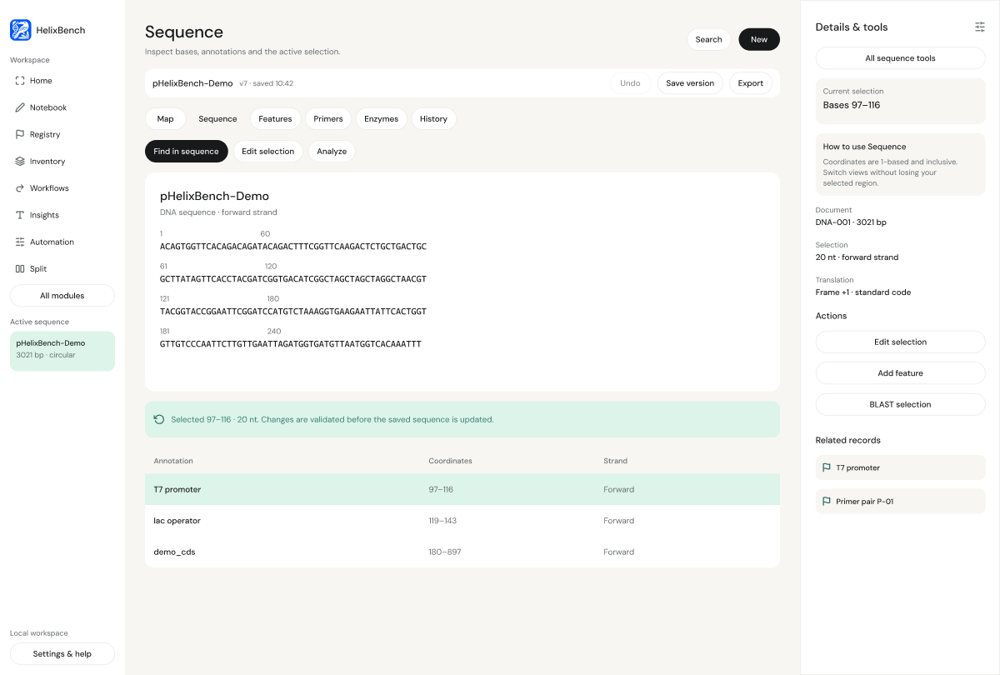

# SCR-03 · Sequence

[Current Figma screen](https://www.figma.com/design/U1kWw1K5NZBgEYkuxMz3Qb/helixbench?node-id=107-29677) · Implementation phase P08A.

## Purpose and layout

Edit bases, inspect annotations and launch analysis from the selected range.

Named sequence and version; virtualized double-stranded base rows; explicit range/strand/frame; Find bar; same contextual tools as Map.

## Target requirements

- **SCR-03-R1:** Paste and replacement preview the original, recognized alphabet and every meaningful transformation before mutation. Whitespace normalization is reported; unsupported symbols are not silently discarded.
- **SCR-03-R2:** Editing updates affected feature/primer coordinates using the existing domain operations and preserves an undo checkpoint. Cancellation changes neither data nor dirty state.
- **SCR-03-R3:** DNA/protein/name search modes stay distinct. Hit navigation, highlighting and search recents retain the query and coordinate system.
- **SCR-03-R4:** Complement, six-frame translation, ORFs, genetic code and custom/history color modes preserve existing scientific behavior. Protein output is not stored as DNA.
- **SCR-03-R5:** Source-view switching retains the active document, draft, range, strand, search position and scroll anchor. Clipboard failure leaves selection and content unchanged.

## User flow

1. Open sequence
2. Find or select bases
3. Edit or analyze the selection
4. Validate the change
5. Save or undo without losing the position

Use the shared typed context, validation/review, persistence and return-location contracts at every relevant transition. Prototype fixture IDs and figures are never production defaults.

## States and recovery

- Loading: retain prior context and identify the active request/operation.
- Populated: show stable object identity, meaningful status and available actions.
- No data: offer the relevant creation/import action.
- No matches: retain query/scope and expose Reset or Change settings.
- Invalid prerequisite: explain the missing input and provide its remedy.
- Validation/write failure: retain draft values and show a constructive correction/retry.
- Dirty/partial/stale/unavailable states use the shared state machines when applicable.

## Screen-specific edge cases

- **SCR-03-EC1:** Paste contains U, gaps, digits, Unicode, lowercase, IUPAC symbols or invalid bytes.
- **SCR-03-EC2:** Replacing a region changes length or overlaps an annotation boundary.
- **SCR-03-EC3:** Search has no hits, wraps to the first hit, matches the reverse strand or uses an invalid alphabet.
- **SCR-03-EC4:** Cut succeeds in mutation only when required clipboard handling succeeds.
- **SCR-03-EC5:** Changing the genetic code changes computed translations without corrupting annotations.
- **SCR-03-EC6:** Window resizing and large text do not move the caret to an unrelated coordinate.

## Current code ownership

- [crates/appcore/src/actions.rs:289](C:/Users/Admin/Documents/Qoder/2026-11-13/87e5a6b2/helixbench/crates/appcore/src/actions.rs:289) — `pub fn insert_bases(app: &mut AppState, text: &str, replace_selection: bool)`
- [crates/appcore/src/actions.rs:260](C:/Users/Admin/Documents/Qoder/2026-11-13/87e5a6b2/helixbench/crates/appcore/src/actions.rs:260) — `pub fn delete_selection(app: &mut AppState)`
- [crates/appcore/src/actions.rs:272](C:/Users/Admin/Documents/Qoder/2026-11-13/87e5a6b2/helixbench/crates/appcore/src/actions.rs:272) — `pub fn copy_selection(app: &AppState) -> String`
- [crates/appcore/src/actions.rs:279](C:/Users/Admin/Documents/Qoder/2026-11-13/87e5a6b2/helixbench/crates/appcore/src/actions.rs:279) — `pub fn cut_selection(app: &mut AppState) -> Option<String>`
- [crates/appcore/src/actions.rs:321](C:/Users/Admin/Documents/Qoder/2026-11-13/87e5a6b2/helixbench/crates/appcore/src/actions.rs:321) — `pub fn select_all(app: &mut AppState)`
- [crates/appcore/src/actions.rs:328](C:/Users/Admin/Documents/Qoder/2026-11-13/87e5a6b2/helixbench/crates/appcore/src/actions.rs:328) — `pub fn reverse_complement_sequence(app: &mut AppState)`
- [crates/appcore/src/actions.rs:435](C:/Users/Admin/Documents/Qoder/2026-11-13/87e5a6b2/helixbench/crates/appcore/src/actions.rs:435) — `pub fn apply_color_selection(app: &mut AppState, draft: ColorDraft)`
- [crates/appcore/src/actions.rs:452](C:/Users/Admin/Documents/Qoder/2026-11-13/87e5a6b2/helixbench/crates/appcore/src/actions.rs:452) — `pub fn clear_custom_colors(app: &mut AppState)`

Domain modules: `crates/domain/src/sequence.rs`, `crates/domain/src/translate.rs`, `crates/domain/src/search.rs`, `crates/domain/src/genetic_code.rs`, `crates/domain/src/iupac.rs`.

Native presentation entry points:

- [apps/desktop_gpui/src/app.rs:284](C:/Users/Admin/Documents/Qoder/2026-11-13/87e5a6b2/helixbench/apps/desktop_gpui/src/app.rs:284) — `render_menu`
- [apps/desktop_gpui/src/dialogs.rs:1624](C:/Users/Admin/Documents/Qoder/2026-11-13/87e5a6b2/helixbench/apps/desktop_gpui/src/dialogs.rs:1624) — `options`

## Field/draft contracts

### SearchState

[crates/appcore/src/state.rs:163](C:/Users/Admin/Documents/Qoder/2026-11-13/87e5a6b2/helixbench/crates/appcore/src/state.rs:163)

- `open: bool` — Explicit labeled toggle; default is specified by the owning feature. Persist only when the corresponding action is confirmed.
- `mode: SearchMode` — Use the owning feature/module requirements and the current typed source definition. Optional values remain distinguishable from empty/default values; validate before commit.
- `query: String` — Use the owning feature/module requirements and the current typed source definition. Optional values remain distinguishable from empty/default values; validate before commit.
- `recents: Vec<(SearchMode, String)>` — Use the owning feature/module requirements and the current typed source definition. Optional values remain distinguishable from empty/default values; validate before commit.
- `dna_hits: Vec<DnaHit>` — Use the owning feature/module requirements and the current typed source definition. Optional values remain distinguishable from empty/default values; validate before commit.
- `protein_hits: Vec<ProteinHit>` — Use the owning feature/module requirements and the current typed source definition. Optional values remain distinguishable from empty/default values; validate before commit.
- `name_hits: Vec<NameHit>` — Use the owning feature/module requirements and the current typed source definition. Optional values remain distinguishable from empty/default values; validate before commit.
- `current: usize` — Use the owning feature/module requirements and the current typed source definition. Optional values remain distinguishable from empty/default values; validate before commit.
- `error: Option<String>` — System-owned validation/error state; never an editable user field.
- `focus_request: bool` — Explicit labeled toggle; default is specified by the owning feature. Persist only when the corresponding action is confirmed.

### ColorDraft

[crates/appcore/src/state.rs:312](C:/Users/Admin/Documents/Qoder/2026-11-13/87e5a6b2/helixbench/crates/appcore/src/state.rs:312)

- `range: Range` — Use the owning feature/module requirements and the current typed source definition. Optional values remain distinguishable from empty/default values; validate before commit.
- `color: [u8; 3]` — Use the owning feature/module requirements and the current typed source definition. Optional values remain distinguishable from empty/default values; validate before commit.
- `strands: StrandMask` — Use the owning feature/module requirements and the current typed source definition. Optional values remain distinguishable from empty/default values; validate before commit.

### NewSeqState

[crates/appcore/src/state.rs:226](C:/Users/Admin/Documents/Qoder/2026-11-13/87e5a6b2/helixbench/crates/appcore/src/state.rs:226)

- `name: String` — Trim for validation; require a nonempty meaningful label where the owning operation creates an object. Preserve original editable draft on error.
- `text: String` — Validate the declared molecule/grammar before commit. Preserve original text and report meaningful normalization or unsupported syntax.
- `topology: Topology` — Use the owning feature/module requirements and the current typed source definition. Optional values remain distinguishable from empty/default values; validate before commit.
- `error: Option<String>` — System-owned validation/error state; never an editable user field.

## Feature-level implementation contracts

### F-035 · Select / navigate a range

**Status:** P08A typed source/revision and top-strand coordinates with independent strand verified; native reverse drag and view switch checked.

**Entry:** Range field (1 navigation click(s)).

**Prerequisite:** Active document.

**Outcome:** Enter coordinates as an accessible alternative to dragging.

**Current evidence note:** Mouse drag and canvas interactions exist.

**Relevant code/action family:** [crates/appcore/src/actions.rs:289](C:/Users/Admin/Documents/Qoder/2026-11-13/87e5a6b2/helixbench/crates/appcore/src/actions.rs:289), [crates/appcore/src/actions.rs:260](C:/Users/Admin/Documents/Qoder/2026-11-13/87e5a6b2/helixbench/crates/appcore/src/actions.rs:260), [crates/appcore/src/actions.rs:272](C:/Users/Admin/Documents/Qoder/2026-11-13/87e5a6b2/helixbench/crates/appcore/src/actions.rs:272), [crates/appcore/src/actions.rs:279](C:/Users/Admin/Documents/Qoder/2026-11-13/87e5a6b2/helixbench/crates/appcore/src/actions.rs:279), [crates/appcore/src/actions.rs:321](C:/Users/Admin/Documents/Qoder/2026-11-13/87e5a6b2/helixbench/crates/appcore/src/actions.rs:321), [crates/appcore/src/actions.rs:328](C:/Users/Admin/Documents/Qoder/2026-11-13/87e5a6b2/helixbench/crates/appcore/src/actions.rs:328), [crates/appcore/src/actions.rs:435](C:/Users/Admin/Documents/Qoder/2026-11-13/87e5a6b2/helixbench/crates/appcore/src/actions.rs:435), [crates/appcore/src/actions.rs:452](C:/Users/Admin/Documents/Qoder/2026-11-13/87e5a6b2/helixbench/crates/appcore/src/actions.rs:452).

**Acceptance:**

- F-035-AC1: Given The owning page and the stated prerequisite are available. When The user follows Range field. Then Enter coordinates as an accessible alternative to dragging; feature entry requires at most two navigation clicks.
- F-035-AC2: Given The context contains two similar names or a changed table order. When This feature is activated. Then The command payload retains the exact selected typed identity, source revision and scope.
- F-035-AC3: Given The intended target was deleted or became inaccessible after rendering. When The user activates its row or link. Then Show a relevant recovery path without opening an unrelated record; retain a safe return location.

**Recovery and edge conditions:**

- Two same-name records and two stores with the same numeric ID resolve correctly.
- A missing/deleted/inaccessible target offers a relevant remedy rather than another record.
- Back restores the invoking task and selection; dirty work is preserved where necessary.
- Keyboard activation and labeled controls expose the same action as pointer input.
- Replacing a region changes length or overlaps an annotation boundary.
- Search has no hits, wraps to the first hit, matches the reverse strand or uses an invalid alphabet.

### F-036 · Edit / insert sequence

**Status:** Specified; not verified implemented.

**Entry:** Edit sequence (1 navigation click(s)).

**Prerequisite:** Selected insertion point or range.

**Outcome:** Editable text with validated characters.

**Current evidence note:** Existing edit controls and keyboard actions.

**Relevant code/action family:** [crates/appcore/src/actions.rs:289](C:/Users/Admin/Documents/Qoder/2026-11-13/87e5a6b2/helixbench/crates/appcore/src/actions.rs:289), [crates/appcore/src/actions.rs:260](C:/Users/Admin/Documents/Qoder/2026-11-13/87e5a6b2/helixbench/crates/appcore/src/actions.rs:260), [crates/appcore/src/actions.rs:272](C:/Users/Admin/Documents/Qoder/2026-11-13/87e5a6b2/helixbench/crates/appcore/src/actions.rs:272), [crates/appcore/src/actions.rs:279](C:/Users/Admin/Documents/Qoder/2026-11-13/87e5a6b2/helixbench/crates/appcore/src/actions.rs:279), [crates/appcore/src/actions.rs:321](C:/Users/Admin/Documents/Qoder/2026-11-13/87e5a6b2/helixbench/crates/appcore/src/actions.rs:321), [crates/appcore/src/actions.rs:328](C:/Users/Admin/Documents/Qoder/2026-11-13/87e5a6b2/helixbench/crates/appcore/src/actions.rs:328), [crates/appcore/src/actions.rs:435](C:/Users/Admin/Documents/Qoder/2026-11-13/87e5a6b2/helixbench/crates/appcore/src/actions.rs:435), [crates/appcore/src/actions.rs:452](C:/Users/Admin/Documents/Qoder/2026-11-13/87e5a6b2/helixbench/crates/appcore/src/actions.rs:452).

**Acceptance:**

- F-036-AC1: Given The owning page and the stated prerequisite are available. When The user follows Edit sequence. Then Editable text with validated characters; feature entry requires at most two navigation clicks.
- F-036-AC2: Given The context contains two similar names or a changed table order. When This feature is activated. Then The command payload retains the exact selected typed identity, source revision and scope.
- F-036-AC3: Given A draft contains an invalid or missing required value. When The user submits the form. Then Show a field-local error, retain the draft and perform no mutation.

**Recovery and edge conditions:**

- Invalid required fields are identified beside the input with original draft values retained.
- Cancel does not alter the source object or create an unrelated example record.
- A stale/deleted target is resolved explicitly instead of mutating a row index.
- Successful persistence updates the selected record, related views and audit consistently.
- Search has no hits, wraps to the first hit, matches the reverse strand or uses an invalid alphabet.
- Cut succeeds in mutation only when required clipboard handling succeeds.

### F-037 · Copy / cut / paste / delete

**Status:** Specified; not verified implemented.

**Entry:** Named edit action (1 navigation click(s)).

**Prerequisite:** Range for cut/delete; clipboard for paste.

**Outcome:** Operate on current selection and report affected bases.

**Current evidence note:** Edit menu and shortcuts.

**Relevant code/action family:** [crates/appcore/src/actions.rs:289](C:/Users/Admin/Documents/Qoder/2026-11-13/87e5a6b2/helixbench/crates/appcore/src/actions.rs:289).

**Acceptance:**

- F-037-AC1: Given The owning page and the stated prerequisite are available. When The user follows Named edit action. Then Operate on current selection and report affected bases; feature entry requires at most two navigation clicks.
- F-037-AC2: Given The context contains two similar names or a changed table order. When This feature is activated. Then The command payload retains the exact selected typed identity, source revision and scope.
- F-037-AC3: Given A consequence review identifies the selected record. When The user cancels or the commit fails. Then Keep the reviewed object unchanged, preserve useful draft context and show a recoverable outcome.

**Recovery and edge conditions:**

- Cancel before commit leaves the reviewed object and selection unchanged.
- Changing the selected object while the review is open cannot retarget the action.
- Blocked dependencies and persistence failure leave a constructive recovery path; no false success.
- Successful mutation clears or updates the exact selected context and retained references.
- Cut succeeds in mutation only when required clipboard handling succeeds.
- Changing the genetic code changes computed translations without corrupting annotations.

### F-038 · Find DNA / protein / name

**Status:** P08A visible Find entry and reverse-hit strand binding verified; existing DNA/protein/name algorithms retained.

**Entry:** Find (1 navigation click(s)).

**Prerequisite:** Active document.

**Outcome:** Open find strip with three labeled modes.

**Current evidence note:** Ctrl+F and mode selector.

**Relevant code/action family:** [crates/appcore/src/actions.rs:289](C:/Users/Admin/Documents/Qoder/2026-11-13/87e5a6b2/helixbench/crates/appcore/src/actions.rs:289), [crates/appcore/src/actions.rs:260](C:/Users/Admin/Documents/Qoder/2026-11-13/87e5a6b2/helixbench/crates/appcore/src/actions.rs:260), [crates/appcore/src/actions.rs:272](C:/Users/Admin/Documents/Qoder/2026-11-13/87e5a6b2/helixbench/crates/appcore/src/actions.rs:272), [crates/appcore/src/actions.rs:279](C:/Users/Admin/Documents/Qoder/2026-11-13/87e5a6b2/helixbench/crates/appcore/src/actions.rs:279), [crates/appcore/src/actions.rs:321](C:/Users/Admin/Documents/Qoder/2026-11-13/87e5a6b2/helixbench/crates/appcore/src/actions.rs:321), [crates/appcore/src/actions.rs:328](C:/Users/Admin/Documents/Qoder/2026-11-13/87e5a6b2/helixbench/crates/appcore/src/actions.rs:328), [crates/appcore/src/actions.rs:435](C:/Users/Admin/Documents/Qoder/2026-11-13/87e5a6b2/helixbench/crates/appcore/src/actions.rs:435), [crates/appcore/src/actions.rs:452](C:/Users/Admin/Documents/Qoder/2026-11-13/87e5a6b2/helixbench/crates/appcore/src/actions.rs:452).

**Acceptance:**

- F-038-AC1: Given The owning page and the stated prerequisite are available. When The user follows Find. Then Open find strip with three labeled modes; feature entry requires at most two navigation clicks.
- F-038-AC2: Given The context contains two similar names or a changed table order. When This feature is activated. Then The command payload retains the exact selected typed identity, source revision and scope.
- F-038-AC3: Given Validated parameters and an immutable input have been captured. When The computation finishes with no scientific matches. Then Show a completed no-match diagnostic, preserve input provenance and offer a meaningful parameter change.

**Recovery and edge conditions:**

- No scientific matches is represented separately from invalid input or a failed computation.
- Changing the source/selection during execution does not substitute a newer input.
- Cancel is offered only at a supported stage; repeated Run does not duplicate an output commit.
- Saved output retains actual input revision, method, parameters and units.
- Changing the genetic code changes computed translations without corrupting annotations.
- Window resizing and large text do not move the caret to an unrelated coordinate.

### F-039 · Next / previous search result

**Status:** P08A hit navigation retains hit strand; existing next/previous controls retained.

**Entry:** Next or Previous result (1 navigation click(s)).

**Prerequisite:** A query with results.

**Outcome:** Keep hit count and strand visible.

**Current evidence note:** Find strip.

**Relevant code/action family:** [crates/appcore/src/actions.rs:289](C:/Users/Admin/Documents/Qoder/2026-11-13/87e5a6b2/helixbench/crates/appcore/src/actions.rs:289), [crates/appcore/src/actions.rs:260](C:/Users/Admin/Documents/Qoder/2026-11-13/87e5a6b2/helixbench/crates/appcore/src/actions.rs:260), [crates/appcore/src/actions.rs:272](C:/Users/Admin/Documents/Qoder/2026-11-13/87e5a6b2/helixbench/crates/appcore/src/actions.rs:272), [crates/appcore/src/actions.rs:279](C:/Users/Admin/Documents/Qoder/2026-11-13/87e5a6b2/helixbench/crates/appcore/src/actions.rs:279), [crates/appcore/src/actions.rs:321](C:/Users/Admin/Documents/Qoder/2026-11-13/87e5a6b2/helixbench/crates/appcore/src/actions.rs:321), [crates/appcore/src/actions.rs:328](C:/Users/Admin/Documents/Qoder/2026-11-13/87e5a6b2/helixbench/crates/appcore/src/actions.rs:328), [crates/appcore/src/actions.rs:435](C:/Users/Admin/Documents/Qoder/2026-11-13/87e5a6b2/helixbench/crates/appcore/src/actions.rs:435), [crates/appcore/src/actions.rs:452](C:/Users/Admin/Documents/Qoder/2026-11-13/87e5a6b2/helixbench/crates/appcore/src/actions.rs:452).

**Acceptance:**

- F-039-AC1: Given The owning page and the stated prerequisite are available. When The user follows Next or Previous result. Then Keep hit count and strand visible; feature entry requires at most two navigation clicks.
- F-039-AC2: Given The context contains two similar names or a changed table order. When This feature is activated. Then The command payload retains the exact selected typed identity, source revision and scope.
- F-039-AC3: Given Underlying records exist and a query or filter is active. When The query/filter matches no records. Then Show no matches with the active scope and reset remedy; do not claim that the dataset is empty or failed.

**Recovery and edge conditions:**

- Empty source, filtered-out records and failed load have different status/remedies.
- Sorting/filtering or a same-name record cannot change the selected stable identity.
- Returning restores the same query/filter/scope and scroll anchor where supported.
- Inspection-only changes do not mark scientific content dirty.
- Window resizing and large text do not move the caret to an unrelated coordinate.
- Paste contains U, gaps, digits, Unicode, lowercase, IUPAC symbols or invalid bytes.

### F-040 · Create feature

**Status:** Specified; not verified implemented.

**Entry:** Add feature (1 navigation click(s)).

**Prerequisite:** Optional range.

**Outcome:** Seed coordinates and strand.

**Current evidence note:** Features menu or separate page.

**Relevant code/action family:** [crates/appcore/src/actions.rs:289](C:/Users/Admin/Documents/Qoder/2026-11-13/87e5a6b2/helixbench/crates/appcore/src/actions.rs:289), [crates/appcore/src/actions.rs:260](C:/Users/Admin/Documents/Qoder/2026-11-13/87e5a6b2/helixbench/crates/appcore/src/actions.rs:260), [crates/appcore/src/actions.rs:272](C:/Users/Admin/Documents/Qoder/2026-11-13/87e5a6b2/helixbench/crates/appcore/src/actions.rs:272), [crates/appcore/src/actions.rs:279](C:/Users/Admin/Documents/Qoder/2026-11-13/87e5a6b2/helixbench/crates/appcore/src/actions.rs:279), [crates/appcore/src/actions.rs:321](C:/Users/Admin/Documents/Qoder/2026-11-13/87e5a6b2/helixbench/crates/appcore/src/actions.rs:321), [crates/appcore/src/actions.rs:328](C:/Users/Admin/Documents/Qoder/2026-11-13/87e5a6b2/helixbench/crates/appcore/src/actions.rs:328), [crates/appcore/src/actions.rs:435](C:/Users/Admin/Documents/Qoder/2026-11-13/87e5a6b2/helixbench/crates/appcore/src/actions.rs:435), [crates/appcore/src/actions.rs:452](C:/Users/Admin/Documents/Qoder/2026-11-13/87e5a6b2/helixbench/crates/appcore/src/actions.rs:452).

**Acceptance:**

- F-040-AC1: Given The owning page and the stated prerequisite are available. When The user follows Add feature. Then Seed coordinates and strand; feature entry requires at most two navigation clicks.
- F-040-AC2: Given The context contains two similar names or a changed table order. When This feature is activated. Then The command payload retains the exact selected typed identity, source revision and scope.
- F-040-AC3: Given A draft contains an invalid or missing required value. When The user submits the form. Then Show a field-local error, retain the draft and perform no mutation.

**Recovery and edge conditions:**

- Invalid required fields are identified beside the input with original draft values retained.
- Cancel does not alter the source object or create an unrelated example record.
- A stale/deleted target is resolved explicitly instead of mutating a row index.
- Successful persistence updates the selected record, related views and audit consistently.
- Paste contains U, gaps, digits, Unicode, lowercase, IUPAC symbols or invalid bytes.
- Replacing a region changes length or overlaps an annotation boundary.

### F-041 · Create primer from range

**Status:** Specified; not verified implemented.

**Entry:** Selection actions → Add primer (2 navigation click(s)).

**Prerequisite:** DNA selected.

**Outcome:** Open primer editor without losing selection.

**Current evidence note:** Primers menu.

**Relevant code/action family:** [crates/appcore/src/actions.rs:289](C:/Users/Admin/Documents/Qoder/2026-11-13/87e5a6b2/helixbench/crates/appcore/src/actions.rs:289), [crates/appcore/src/actions.rs:260](C:/Users/Admin/Documents/Qoder/2026-11-13/87e5a6b2/helixbench/crates/appcore/src/actions.rs:260), [crates/appcore/src/actions.rs:272](C:/Users/Admin/Documents/Qoder/2026-11-13/87e5a6b2/helixbench/crates/appcore/src/actions.rs:272), [crates/appcore/src/actions.rs:279](C:/Users/Admin/Documents/Qoder/2026-11-13/87e5a6b2/helixbench/crates/appcore/src/actions.rs:279), [crates/appcore/src/actions.rs:321](C:/Users/Admin/Documents/Qoder/2026-11-13/87e5a6b2/helixbench/crates/appcore/src/actions.rs:321), [crates/appcore/src/actions.rs:328](C:/Users/Admin/Documents/Qoder/2026-11-13/87e5a6b2/helixbench/crates/appcore/src/actions.rs:328), [crates/appcore/src/actions.rs:435](C:/Users/Admin/Documents/Qoder/2026-11-13/87e5a6b2/helixbench/crates/appcore/src/actions.rs:435), [crates/appcore/src/actions.rs:452](C:/Users/Admin/Documents/Qoder/2026-11-13/87e5a6b2/helixbench/crates/appcore/src/actions.rs:452).

**Acceptance:**

- F-041-AC1: Given The owning page and the stated prerequisite are available. When The user follows Selection actions → Add primer. Then Open primer editor without losing selection; feature entry requires at most two navigation clicks.
- F-041-AC2: Given The context contains two similar names or a changed table order. When This feature is activated. Then The command payload retains the exact selected typed identity, source revision and scope.
- F-041-AC3: Given A draft contains an invalid or missing required value. When The user submits the form. Then Show a field-local error, retain the draft and perform no mutation.

**Recovery and edge conditions:**

- Invalid required fields are identified beside the input with original draft values retained.
- Cancel does not alter the source object or create an unrelated example record.
- A stale/deleted target is resolved explicitly instead of mutating a row index.
- Successful persistence updates the selected record, related views and audit consistently.
- Replacing a region changes length or overlaps an annotation boundary.
- Search has no hits, wraps to the first hit, matches the reverse strand or uses an invalid alphabet.

### F-042 · Design primer pair / PCR

**Status:** Specified; not verified implemented.

**Entry:** Analyze → Primer design or PCR (2 navigation click(s)).

**Prerequisite:** Template selected.

**Outcome:** Prefill region and preserve sequence position.

**Current evidence note:** Tools menu.

**Relevant code/action family:** [crates/appcore/src/actions.rs:644](C:/Users/Admin/Documents/Qoder/2026-11-13/87e5a6b2/helixbench/crates/appcore/src/actions.rs:644), [crates/appcore/src/actions.rs:664](C:/Users/Admin/Documents/Qoder/2026-11-13/87e5a6b2/helixbench/crates/appcore/src/actions.rs:664), [crates/appcore/src/actions.rs:691](C:/Users/Admin/Documents/Qoder/2026-11-13/87e5a6b2/helixbench/crates/appcore/src/actions.rs:691), [crates/appcore/src/actions.rs:747](C:/Users/Admin/Documents/Qoder/2026-11-13/87e5a6b2/helixbench/crates/appcore/src/actions.rs:747), [crates/appcore/src/actions.rs:765](C:/Users/Admin/Documents/Qoder/2026-11-13/87e5a6b2/helixbench/crates/appcore/src/actions.rs:765), [crates/appcore/src/actions.rs:795](C:/Users/Admin/Documents/Qoder/2026-11-13/87e5a6b2/helixbench/crates/appcore/src/actions.rs:795).

**Acceptance:**

- F-042-AC1: Given The owning page and the stated prerequisite are available. When The user follows Analyze → Primer design or PCR. Then Prefill region and preserve sequence position; feature entry requires at most two navigation clicks.
- F-042-AC2: Given The context contains two similar names or a changed table order. When This feature is activated. Then The command payload retains the exact selected typed identity, source revision and scope.
- F-042-AC3: Given Validated parameters and an immutable input have been captured. When The computation finishes with no scientific matches. Then Show a completed no-match diagnostic, preserve input provenance and offer a meaningful parameter change.

**Recovery and edge conditions:**

- No scientific matches is represented separately from invalid input or a failed computation.
- Changing the source/selection during execution does not substitute a newer input.
- Cancel is offered only at a supported stage; repeated Run does not duplicate an output commit.
- Saved output retains actual input revision, method, parameters and units.
- Search has no hits, wraps to the first hit, matches the reverse strand or uses an invalid alphabet.
- Cut succeeds in mutation only when required clipboard handling succeeds.

### F-043 · Alignment / local BLAST

**Status:** Specified; not verified implemented.

**Entry:** Analyze → Alignment or Local BLAST (2 navigation click(s)).

**Prerequisite:** Comparison or database as appropriate.

**Outcome:** Open result workspace linked to source.

**Current evidence note:** Tools menu.

**Relevant code/action family:** [crates/appcore/src/actions.rs:839](C:/Users/Admin/Documents/Qoder/2026-11-13/87e5a6b2/helixbench/crates/appcore/src/actions.rs:839), [crates/appcore/src/actions.rs:849](C:/Users/Admin/Documents/Qoder/2026-11-13/87e5a6b2/helixbench/crates/appcore/src/actions.rs:849), [crates/appcore/src/actions.rs:891](C:/Users/Admin/Documents/Qoder/2026-11-13/87e5a6b2/helixbench/crates/appcore/src/actions.rs:891), [crates/appcore/src/actions.rs:915](C:/Users/Admin/Documents/Qoder/2026-11-13/87e5a6b2/helixbench/crates/appcore/src/actions.rs:915), [crates/appcore/src/actions.rs:1180](C:/Users/Admin/Documents/Qoder/2026-11-13/87e5a6b2/helixbench/crates/appcore/src/actions.rs:1180), [crates/appcore/src/actions.rs:1222](C:/Users/Admin/Documents/Qoder/2026-11-13/87e5a6b2/helixbench/crates/appcore/src/actions.rs:1222), [crates/appcore/src/actions.rs:1190](C:/Users/Admin/Documents/Qoder/2026-11-13/87e5a6b2/helixbench/crates/appcore/src/actions.rs:1190).

**Acceptance:**

- F-043-AC1: Given The owning page and the stated prerequisite are available. When The user follows Analyze → Alignment or Local BLAST. Then Open result workspace linked to source; feature entry requires at most two navigation clicks.
- F-043-AC2: Given The context contains two similar names or a changed table order. When This feature is activated. Then The command payload retains the exact selected typed identity, source revision and scope.
- F-043-AC3: Given Validated parameters and an immutable input have been captured. When The computation finishes with no scientific matches. Then Show a completed no-match diagnostic, preserve input provenance and offer a meaningful parameter change.

**Recovery and edge conditions:**

- No scientific matches is represented separately from invalid input or a failed computation.
- Changing the source/selection during execution does not substitute a newer input.
- Cancel is offered only at a supported stage; repeated Run does not duplicate an output commit.
- Saved output retains actual input revision, method, parameters and units.
- Cut succeeds in mutation only when required clipboard handling succeeds.
- Changing the genetic code changes computed translations without corrupting annotations.

### F-044 · Protein analysis / codon optimization

**Status:** Specified; not verified implemented.

**Entry:** Analyze → Protein analysis or Codon optimization (2 navigation click(s)).

**Prerequisite:** Suitable sequence/CDS.

**Outcome:** Make input molecule and preservation constraints explicit.

**Current evidence note:** Tools menu.

**Relevant code/action family:** [crates/appcore/src/actions.rs:1111](C:/Users/Admin/Documents/Qoder/2026-11-13/87e5a6b2/helixbench/crates/appcore/src/actions.rs:1111), [crates/appcore/src/actions.rs:1133](C:/Users/Admin/Documents/Qoder/2026-11-13/87e5a6b2/helixbench/crates/appcore/src/actions.rs:1133), [crates/appcore/src/actions.rs:1159](C:/Users/Admin/Documents/Qoder/2026-11-13/87e5a6b2/helixbench/crates/appcore/src/actions.rs:1159), [crates/appcore/src/actions.rs:1442](C:/Users/Admin/Documents/Qoder/2026-11-13/87e5a6b2/helixbench/crates/appcore/src/actions.rs:1442), [crates/appcore/src/actions.rs:1446](C:/Users/Admin/Documents/Qoder/2026-11-13/87e5a6b2/helixbench/crates/appcore/src/actions.rs:1446).

**Acceptance:**

- F-044-AC1: Given The owning page and the stated prerequisite are available. When The user follows Analyze → Protein analysis or Codon optimization. Then Make input molecule and preservation constraints explicit; feature entry requires at most two navigation clicks.
- F-044-AC2: Given The context contains two similar names or a changed table order. When This feature is activated. Then The command payload retains the exact selected typed identity, source revision and scope.
- F-044-AC3: Given Validated parameters and an immutable input have been captured. When The computation finishes with no scientific matches. Then Show a completed no-match diagnostic, preserve input provenance and offer a meaningful parameter change.

**Recovery and edge conditions:**

- No scientific matches is represented separately from invalid input or a failed computation.
- Changing the source/selection during execution does not substitute a newer input.
- Cancel is offered only at a supported stage; repeated Run does not duplicate an output commit.
- Saved output retains actual input revision, method, parameters and units.
- Changing the genetic code changes computed translations without corrupting annotations.
- Window resizing and large text do not move the caret to an unrelated coordinate.

### F-045 · ORFs / translation / complement / base colors

**Status:** P08A labeled ORF/translation/complement/color display controls wired; scientific algorithms retained.

**Entry:** Display → Named layer (2 navigation click(s)).

**Prerequisite:** Active document.

**Outcome:** Change one layer with current state visible.

**Current evidence note:** View menu and Options.

**Relevant code/action family:** [crates/appcore/src/actions.rs:289](C:/Users/Admin/Documents/Qoder/2026-11-13/87e5a6b2/helixbench/crates/appcore/src/actions.rs:289), [crates/appcore/src/actions.rs:260](C:/Users/Admin/Documents/Qoder/2026-11-13/87e5a6b2/helixbench/crates/appcore/src/actions.rs:260), [crates/appcore/src/actions.rs:272](C:/Users/Admin/Documents/Qoder/2026-11-13/87e5a6b2/helixbench/crates/appcore/src/actions.rs:272), [crates/appcore/src/actions.rs:279](C:/Users/Admin/Documents/Qoder/2026-11-13/87e5a6b2/helixbench/crates/appcore/src/actions.rs:279), [crates/appcore/src/actions.rs:321](C:/Users/Admin/Documents/Qoder/2026-11-13/87e5a6b2/helixbench/crates/appcore/src/actions.rs:321), [crates/appcore/src/actions.rs:328](C:/Users/Admin/Documents/Qoder/2026-11-13/87e5a6b2/helixbench/crates/appcore/src/actions.rs:328), [crates/appcore/src/actions.rs:435](C:/Users/Admin/Documents/Qoder/2026-11-13/87e5a6b2/helixbench/crates/appcore/src/actions.rs:435), [crates/appcore/src/actions.rs:452](C:/Users/Admin/Documents/Qoder/2026-11-13/87e5a6b2/helixbench/crates/appcore/src/actions.rs:452).

**Acceptance:**

- F-045-AC1: Given The owning page and the stated prerequisite are available. When The user follows Display → Named layer. Then Change one layer with current state visible; feature entry requires at most two navigation clicks.
- F-045-AC2: Given The context contains two similar names or a changed table order. When This feature is activated. Then The command payload retains the exact selected typed identity, source revision and scope.
- F-045-AC3: Given Validated parameters and an immutable input have been captured. When The computation finishes with no scientific matches. Then Show a completed no-match diagnostic, preserve input provenance and offer a meaningful parameter change.

**Recovery and edge conditions:**

- No scientific matches is represented separately from invalid input or a failed computation.
- Changing the source/selection during execution does not substitute a newer input.
- Cancel is offered only at a supported stage; repeated Run does not duplicate an output commit.
- Saved output retains actual input revision, method, parameters and units.
- Window resizing and large text do not move the caret to an unrelated coordinate.
- Paste contains U, gaps, digits, Unicode, lowercase, IUPAC symbols or invalid bytes.

### F-046 · Translation code / minimum ORF length

**Status:** Specified; not verified implemented.

**Entry:** Display → Translation & ORF settings (2 navigation click(s)).

**Prerequisite:** Active document.

**Outcome:** Edit settings beside the visualization.

**Current evidence note:** Options and Genetic codes dialogs.

**Relevant code/action family:** [crates/appcore/src/actions.rs:289](C:/Users/Admin/Documents/Qoder/2026-11-13/87e5a6b2/helixbench/crates/appcore/src/actions.rs:289), [crates/appcore/src/actions.rs:260](C:/Users/Admin/Documents/Qoder/2026-11-13/87e5a6b2/helixbench/crates/appcore/src/actions.rs:260), [crates/appcore/src/actions.rs:272](C:/Users/Admin/Documents/Qoder/2026-11-13/87e5a6b2/helixbench/crates/appcore/src/actions.rs:272), [crates/appcore/src/actions.rs:279](C:/Users/Admin/Documents/Qoder/2026-11-13/87e5a6b2/helixbench/crates/appcore/src/actions.rs:279), [crates/appcore/src/actions.rs:321](C:/Users/Admin/Documents/Qoder/2026-11-13/87e5a6b2/helixbench/crates/appcore/src/actions.rs:321), [crates/appcore/src/actions.rs:328](C:/Users/Admin/Documents/Qoder/2026-11-13/87e5a6b2/helixbench/crates/appcore/src/actions.rs:328), [crates/appcore/src/actions.rs:435](C:/Users/Admin/Documents/Qoder/2026-11-13/87e5a6b2/helixbench/crates/appcore/src/actions.rs:435), [crates/appcore/src/actions.rs:452](C:/Users/Admin/Documents/Qoder/2026-11-13/87e5a6b2/helixbench/crates/appcore/src/actions.rs:452).

**Acceptance:**

- F-046-AC1: Given The owning page and the stated prerequisite are available. When The user follows Display → Translation & ORF settings. Then Edit settings beside the visualization; feature entry requires at most two navigation clicks.
- F-046-AC2: Given The context contains two similar names or a changed table order. When This feature is activated. Then The command payload retains the exact selected typed identity, source revision and scope.
- F-046-AC3: Given Validated parameters and an immutable input have been captured. When The computation finishes with no scientific matches. Then Show a completed no-match diagnostic, preserve input provenance and offer a meaningful parameter change.

**Recovery and edge conditions:**

- No scientific matches is represented separately from invalid input or a failed computation.
- Changing the source/selection during execution does not substitute a newer input.
- Cancel is offered only at a supported stage; repeated Run does not duplicate an output commit.
- Saved output retains actual input revision, method, parameters and units.
- Paste contains U, gaps, digits, Unicode, lowercase, IUPAC symbols or invalid bytes.
- Replacing a region changes length or overlaps an annotation boundary.

### F-047 · Zoom / fit / center / minimap

**Status:** P08A short-sequence zoom bounds and circular minimap selection segments verified; existing center/minimap controls retained.

**Entry:** Visible zoom controls (1 navigation click(s)).

**Prerequisite:** Active document.

**Outcome:** Pan and zoom with selection maintained.

**Current evidence note:** Hidden until enabled in View.

**Relevant code/action family:** [crates/appcore/src/actions.rs:289](C:/Users/Admin/Documents/Qoder/2026-11-13/87e5a6b2/helixbench/crates/appcore/src/actions.rs:289), [crates/appcore/src/actions.rs:260](C:/Users/Admin/Documents/Qoder/2026-11-13/87e5a6b2/helixbench/crates/appcore/src/actions.rs:260), [crates/appcore/src/actions.rs:272](C:/Users/Admin/Documents/Qoder/2026-11-13/87e5a6b2/helixbench/crates/appcore/src/actions.rs:272), [crates/appcore/src/actions.rs:279](C:/Users/Admin/Documents/Qoder/2026-11-13/87e5a6b2/helixbench/crates/appcore/src/actions.rs:279), [crates/appcore/src/actions.rs:321](C:/Users/Admin/Documents/Qoder/2026-11-13/87e5a6b2/helixbench/crates/appcore/src/actions.rs:321), [crates/appcore/src/actions.rs:328](C:/Users/Admin/Documents/Qoder/2026-11-13/87e5a6b2/helixbench/crates/appcore/src/actions.rs:328), [crates/appcore/src/actions.rs:435](C:/Users/Admin/Documents/Qoder/2026-11-13/87e5a6b2/helixbench/crates/appcore/src/actions.rs:435), [crates/appcore/src/actions.rs:452](C:/Users/Admin/Documents/Qoder/2026-11-13/87e5a6b2/helixbench/crates/appcore/src/actions.rs:452).

**Acceptance:**

- F-047-AC1: Given The owning page and the stated prerequisite are available. When The user follows Visible zoom controls. Then Pan and zoom with selection maintained; feature entry requires at most two navigation clicks.
- F-047-AC2: Given The context contains two similar names or a changed table order. When This feature is activated. Then The command payload retains the exact selected typed identity, source revision and scope.
- F-047-AC3: Given Underlying records exist and a query or filter is active. When The query/filter matches no records. Then Show no matches with the active scope and reset remedy; do not claim that the dataset is empty or failed.

**Recovery and edge conditions:**

- Empty source, filtered-out records and failed load have different status/remedies.
- Sorting/filtering or a same-name record cannot change the selected stable identity.
- Returning restores the same query/filter/scope and scroll anchor where supported.
- Inspection-only changes do not mark scientific content dirty.
- Replacing a region changes length or overlaps an annotation boundary.
- Search has no hits, wraps to the first hit, matches the reverse strand or uses an invalid alphabet.

### F-048 · Custom coloring / strand scope

**Status:** Specified; not verified implemented.

**Entry:** Selection actions → Color selection (2 navigation click(s)).

**Prerequisite:** Range selected.

**Outcome:** Choose forward/reverse/both strands and preview.

**Current evidence note:** Edit menu.

**Relevant code/action family:** [crates/appcore/src/actions.rs:289](C:/Users/Admin/Documents/Qoder/2026-11-13/87e5a6b2/helixbench/crates/appcore/src/actions.rs:289), [crates/appcore/src/actions.rs:260](C:/Users/Admin/Documents/Qoder/2026-11-13/87e5a6b2/helixbench/crates/appcore/src/actions.rs:260), [crates/appcore/src/actions.rs:272](C:/Users/Admin/Documents/Qoder/2026-11-13/87e5a6b2/helixbench/crates/appcore/src/actions.rs:272), [crates/appcore/src/actions.rs:279](C:/Users/Admin/Documents/Qoder/2026-11-13/87e5a6b2/helixbench/crates/appcore/src/actions.rs:279), [crates/appcore/src/actions.rs:321](C:/Users/Admin/Documents/Qoder/2026-11-13/87e5a6b2/helixbench/crates/appcore/src/actions.rs:321), [crates/appcore/src/actions.rs:328](C:/Users/Admin/Documents/Qoder/2026-11-13/87e5a6b2/helixbench/crates/appcore/src/actions.rs:328), [crates/appcore/src/actions.rs:435](C:/Users/Admin/Documents/Qoder/2026-11-13/87e5a6b2/helixbench/crates/appcore/src/actions.rs:435), [crates/appcore/src/actions.rs:452](C:/Users/Admin/Documents/Qoder/2026-11-13/87e5a6b2/helixbench/crates/appcore/src/actions.rs:452).

**Acceptance:**

- F-048-AC1: Given The owning page and the stated prerequisite are available. When The user follows Selection actions → Color selection. Then Choose forward/reverse/both strands and preview; feature entry requires at most two navigation clicks.
- F-048-AC2: Given The context contains two similar names or a changed table order. When This feature is activated. Then The command payload retains the exact selected typed identity, source revision and scope.
- F-048-AC3: Given Underlying records exist and a query or filter is active. When The query/filter matches no records. Then Show no matches with the active scope and reset remedy; do not claim that the dataset is empty or failed.

**Recovery and edge conditions:**

- Empty source, filtered-out records and failed load have different status/remedies.
- Sorting/filtering or a same-name record cannot change the selected stable identity.
- Returning restores the same query/filter/scope and scroll anchor where supported.
- Inspection-only changes do not mark scientific content dirty.
- Search has no hits, wraps to the first hit, matches the reverse strand or uses an invalid alphabet.
- Cut succeeds in mutation only when required clipboard handling succeeds.

### F-049 · Reverse complement / rotate / topology

**Status:** Specified; not verified implemented.

**Entry:** Sequence actions → Named transform (2 navigation click(s)).

**Prerequisite:** Circular for rotate.

**Outcome:** Preview consequences; undo is always available.

**Current evidence note:** Tools menu.

**Relevant code/action family:** [crates/appcore/src/actions.rs:328](C:/Users/Admin/Documents/Qoder/2026-11-13/87e5a6b2/helixbench/crates/appcore/src/actions.rs:328), [crates/appcore/src/actions.rs:373](C:/Users/Admin/Documents/Qoder/2026-11-13/87e5a6b2/helixbench/crates/appcore/src/actions.rs:373).

**Acceptance:**

- F-049-AC1: Given The owning page and the stated prerequisite are available. When The user follows Sequence actions → Named transform. Then Preview consequences; undo is always available; feature entry requires at most two navigation clicks.
- F-049-AC2: Given The context contains two similar names or a changed table order. When This feature is activated. Then The command payload retains the exact selected typed identity, source revision and scope.
- F-049-AC3: Given The intended target was deleted or became inaccessible after rendering. When The user activates its row or link. Then Show a relevant recovery path without opening an unrelated record; retain a safe return location.

**Recovery and edge conditions:**

- Two same-name records and two stores with the same numeric ID resolve correctly.
- A missing/deleted/inaccessible target offers a relevant remedy rather than another record.
- Back restores the invoking task and selection; dirty work is preserved where necessary.
- Keyboard activation and labeled controls expose the same action as pointer input.
- Cut succeeds in mutation only when required clipboard handling succeeds.
- Changing the genetic code changes computed translations without corrupting annotations.

### F-050 · Save / save as / export

**Status:** Specified; not verified implemented.

**Entry:** Save or Export → Format (2 navigation click(s)).

**Prerequisite:** Active document.

**Outcome:** Write .hbx or choose FASTA / GenBank / text export.

**Current evidence note:** File menu; main Soft Gallery lacks visible Save.

**Relevant code/action family:** [crates/appcore/src/actions.rs:289](C:/Users/Admin/Documents/Qoder/2026-11-13/87e5a6b2/helixbench/crates/appcore/src/actions.rs:289), [crates/appcore/src/actions.rs:260](C:/Users/Admin/Documents/Qoder/2026-11-13/87e5a6b2/helixbench/crates/appcore/src/actions.rs:260), [crates/appcore/src/actions.rs:272](C:/Users/Admin/Documents/Qoder/2026-11-13/87e5a6b2/helixbench/crates/appcore/src/actions.rs:272), [crates/appcore/src/actions.rs:279](C:/Users/Admin/Documents/Qoder/2026-11-13/87e5a6b2/helixbench/crates/appcore/src/actions.rs:279), [crates/appcore/src/actions.rs:321](C:/Users/Admin/Documents/Qoder/2026-11-13/87e5a6b2/helixbench/crates/appcore/src/actions.rs:321), [crates/appcore/src/actions.rs:328](C:/Users/Admin/Documents/Qoder/2026-11-13/87e5a6b2/helixbench/crates/appcore/src/actions.rs:328), [crates/appcore/src/actions.rs:435](C:/Users/Admin/Documents/Qoder/2026-11-13/87e5a6b2/helixbench/crates/appcore/src/actions.rs:435), [crates/appcore/src/actions.rs:452](C:/Users/Admin/Documents/Qoder/2026-11-13/87e5a6b2/helixbench/crates/appcore/src/actions.rs:452).

**Acceptance:**

- F-050-AC1: Given The owning page and the stated prerequisite are available. When The user follows Save or Export → Format. Then Write .hbx or choose FASTA / GenBank / text export; feature entry requires at most two navigation clicks.
- F-050-AC2: Given The context contains two similar names or a changed table order. When This feature is activated. Then The command payload retains the exact selected typed identity, source revision and scope.
- F-050-AC3: Given A file or store write is awaiting completion. When The OS dialog is canceled or the atomic write fails. Then Do not report success, change saved/dirty truth or continue a pending destructive intent; preserve original data.

**Recovery and edge conditions:**

- OS-dialog cancellation leaves drafts, source data and pending navigation intact.
- Permission denied, disk full, locked destination and rename failure never show success.
- Reopening/retrying the same operation preserves identity and does not duplicate successful output.
- Export/import preserves scope, encoding, units and declared lossy transformations.
- Changing the genetic code changes computed translations without corrupting annotations.
- Window resizing and large text do not move the caret to an unrelated coordinate.

## P08A implementation evidence — 16 November 2026

Shared selection feedback uses 1-based inclusive coordinates, explicit forward/reverse
strand and an origin-crossing label. Domain ranges remain zero-based start plus length.
Map/Sequence switches retain the source document, range and strand; navigation snapshots
now capture strand instead of assigning Top. Invalid/stale range actions preserve state.

Find in sequence, Annotation list, Show entire sequence and Zoom controls have direct
visible entries. Clear selection clears dependent feature/primer inspector actions.
Page tools exposes labeled display toggles, including missing-prerequisite explanations
for analysis commands. Map annotations use readable ink text while scientific fills stay
unchanged. Primer list selection explicitly chooses the first site; an exact map-site
click selects that site's coordinates and strand. A primer without a site clears the
previous DNA range instead of leaving an unrelated range selected.

Verification:14 core P08A regressions and1 native renderer/hit-test regression;339 core
tests in total passed. Native1600px sample checks covered reverse-complement-row drag,
whitespace click, Sequence→Map range/strand retention and Features Off. The final P08A
controls were not separately visually checked at1280px; P07 shell validation remains
independent evidence. Dense scientific labels, full keyboard/screen-reader behavior and
large-data performance are not comprehensively established by these checks.

Copy retains its existing top-strand semantics; reverse complement remains explicit.
Editing/import review, mutation impact previews and tool/result lifecycle are governed
by their owning P03/P08B–P10 milestones. This evidence does not mark those complete.
