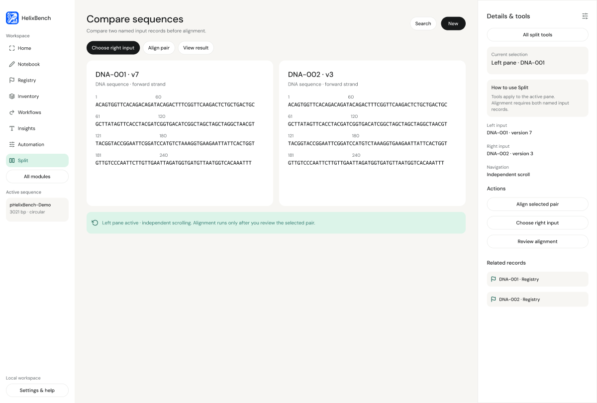

# SCR-14 · Split

[Current Figma screen](https://www.figma.com/design/U1kWw1K5NZBgEYkuxMz3Qb/helixbench?node-id=107-32075) · Implementation phase P10A.

## Purpose and layout

Compare two known documents while preserving their identities and selections.

Two named inputs with active-pane indication; independent/synchronized navigation; pair/multiple alignment setup and saved alignments.

## Target requirements

- **SCR-14-R1:** Each pane identifies document ID, revision, topology and active selection. Tool actions specify the pane or the captured input set.
- **SCR-14-R2:** Choosing another input honors its dirty-document guard and keeps the other pane intact. The same document in both panes is an explicit choice.
- **SCR-14-R3:** Alignment captures pair order, reindex option, scoring/method and source versions; saved alignments have their own stable ID.
- **SCR-14-R4:** Preserve existing pair and progressive multiple alignment, consensus and identity outputs; do not turn a display comparison into sequence mutation.
- **SCR-14-R5:** Opening a saved result whose source is closed or deleted shows retained provenance and offers a safe source-resolution path.

## User flow

1. Choose two documents
2. Compare their representations
3. Select a region or discrepancy
4. Open in editor or align
5. Return with both choices preserved

Use the shared typed context, validation/review, persistence and return-location contracts at every relevant transition. Prototype fixture IDs and figures are never production defaults.

## States and recovery

- Loading: retain prior context and identify the active request/operation.
- Populated: show stable object identity, meaningful status and available actions.
- No data: offer the relevant creation/import action.
- No matches: retain query/scope and expose Reset or Change settings.
- Invalid prerequisite: explain the missing input and provide its remedy.
- Validation/write failure: retain draft values and show a constructive correction/retry.
- Dirty/partial/stale/unavailable states use the shared state machines when applicable.

## Screen-specific edge cases

- **SCR-14-EC1:** No second document, same input twice, one empty input, linear versus circular and reversed input order.
- **SCR-14-EC2:** Selection is made in the right pane but a tool tries to use the left pane.
- **SCR-14-EC3:** Circular auto-reindex changes coordinate presentation; preserve an explicit mapping.
- **SCR-14-EC4:** Source edited during a long alignment or removed while loading a saved alignment.
- **SCR-14-EC5:** Very long sequences or many documents require budget review, background work and cancellation.
- **SCR-14-EC6:** Delete a saved alignment after sorting; retain the underlying documents.

## Current code ownership

- [crates/appcore/src/actions.rs:839](C:/Users/Admin/Documents/Qoder/2026-11-13/87e5a6b2/helixbench/crates/appcore/src/actions.rs:839) — `pub fn open_alignment(app: &mut AppState)`
- [crates/appcore/src/actions.rs:849](C:/Users/Admin/Documents/Qoder/2026-11-13/87e5a6b2/helixbench/crates/appcore/src/actions.rs:849) — `pub fn run_alignment(app: &mut AppState, draft: &mut AlignmentDraft)`
- [crates/appcore/src/actions.rs:891](C:/Users/Admin/Documents/Qoder/2026-11-13/87e5a6b2/helixbench/crates/appcore/src/actions.rs:891) — `pub fn alignment_save(app: &mut AppState, name: &str)`
- [crates/appcore/src/actions.rs:915](C:/Users/Admin/Documents/Qoder/2026-11-13/87e5a6b2/helixbench/crates/appcore/src/actions.rs:915) — `pub fn alignment_load_saved(app: &mut AppState, id: u64)`
- [crates/appcore/src/actions.rs:929](C:/Users/Admin/Documents/Qoder/2026-11-13/87e5a6b2/helixbench/crates/appcore/src/actions.rs:929) — `pub fn alignment_delete_saved(app: &mut AppState, id: u64)`

Domain modules: `crates/domain/src/align.rs`, `crates/domain/src/msa.rs`.

Native presentation entry points:

- [apps/desktop_gpui/src/lab.rs:1118](C:/Users/Admin/Documents/Qoder/2026-11-13/87e5a6b2/helixbench/apps/desktop_gpui/src/lab.rs:1118) — `render_split`
- [apps/desktop_gpui/src/dialogs.rs:2886](C:/Users/Admin/Documents/Qoder/2026-11-13/87e5a6b2/helixbench/apps/desktop_gpui/src/dialogs.rs:2886) — `alignment`

## Field/draft contracts

### AlignmentDraft

[crates/appcore/src/state.rs:348](C:/Users/Admin/Documents/Qoder/2026-11-13/87e5a6b2/helixbench/crates/appcore/src/state.rs:348)

- `reference: usize` — Resolve a stable typed identity from a labeled picker. Validate existence/kind at submit; do not persist a row index as a foreign key.
- `reindex: bool` — Explicit labeled toggle; default is specified by the owning feature. Persist only when the corresponding action is confirmed.
- `result: Option<domain::align::Alignment>` — Computed preview/output state. Clear or mark stale when relevant input changes; never commit an unrelated result.
- `labels: Vec<String>` — Use the owning feature/module requirements and the current typed source definition. Optional values remain distinguishable from empty/default values; validate before commit.
- `error: Option<String>` — System-owned validation/error state; never an editable user field.

## Feature-level implementation contracts

### F-160 · Choose comparison document

**Status:** Specified; not verified implemented.

**Entry:** Right document selector → Document name (2 navigation click(s)).

**Prerequisite:** Two open documents.

**Outcome:** Show active left/right names and topology.

**Current evidence note:** Buttons for open documents.

**Relevant code/action family:** [crates/appcore/src/actions.rs:839](C:/Users/Admin/Documents/Qoder/2026-11-13/87e5a6b2/helixbench/crates/appcore/src/actions.rs:839), [crates/appcore/src/actions.rs:849](C:/Users/Admin/Documents/Qoder/2026-11-13/87e5a6b2/helixbench/crates/appcore/src/actions.rs:849), [crates/appcore/src/actions.rs:891](C:/Users/Admin/Documents/Qoder/2026-11-13/87e5a6b2/helixbench/crates/appcore/src/actions.rs:891), [crates/appcore/src/actions.rs:915](C:/Users/Admin/Documents/Qoder/2026-11-13/87e5a6b2/helixbench/crates/appcore/src/actions.rs:915), [crates/appcore/src/actions.rs:929](C:/Users/Admin/Documents/Qoder/2026-11-13/87e5a6b2/helixbench/crates/appcore/src/actions.rs:929).

**Acceptance:**

- F-160-AC1: Given The owning page and the stated prerequisite are available. When The user follows Right document selector → Document name. Then Show active left/right names and topology; feature entry requires at most two navigation clicks.
- F-160-AC2: Given The context contains two similar names or a changed table order. When This feature is activated. Then The command payload retains the exact selected typed identity, source revision and scope.
- F-160-AC3: Given The intended target was deleted or became inaccessible after rendering. When The user activates its row or link. Then Show a relevant recovery path without opening an unrelated record; retain a safe return location.

**Recovery and edge conditions:**

- Two same-name records and two stores with the same numeric ID resolve correctly.
- A missing/deleted/inaccessible target offers a relevant remedy rather than another record.
- Back restores the invoking task and selection; dirty work is preserved where necessary.
- Keyboard activation and labeled controls expose the same action as pointer input.
- Selection is made in the right pane but a tool tries to use the left pane.
- Circular auto-reindex changes coordinate presentation; preserve an explicit mapping.

### F-161 · Open second document

**Status:** Specified; not verified implemented.

**Entry:** Open another document (1 navigation click(s)).

**Prerequisite:** One or zero documents.

**Outcome:** Native file picker then populate right pane.

**Current evidence note:** Empty state is instructional text.

**Relevant code/action family:** [crates/appcore/src/actions.rs:839](C:/Users/Admin/Documents/Qoder/2026-11-13/87e5a6b2/helixbench/crates/appcore/src/actions.rs:839), [crates/appcore/src/actions.rs:849](C:/Users/Admin/Documents/Qoder/2026-11-13/87e5a6b2/helixbench/crates/appcore/src/actions.rs:849), [crates/appcore/src/actions.rs:891](C:/Users/Admin/Documents/Qoder/2026-11-13/87e5a6b2/helixbench/crates/appcore/src/actions.rs:891), [crates/appcore/src/actions.rs:915](C:/Users/Admin/Documents/Qoder/2026-11-13/87e5a6b2/helixbench/crates/appcore/src/actions.rs:915), [crates/appcore/src/actions.rs:929](C:/Users/Admin/Documents/Qoder/2026-11-13/87e5a6b2/helixbench/crates/appcore/src/actions.rs:929).

**Acceptance:**

- F-161-AC1: Given The owning page and the stated prerequisite are available. When The user follows Open another document. Then Native file picker then populate right pane; feature entry requires at most two navigation clicks.
- F-161-AC2: Given The context contains two similar names or a changed table order. When This feature is activated. Then The command payload retains the exact selected typed identity, source revision and scope.
- F-161-AC3: Given The intended target was deleted or became inaccessible after rendering. When The user activates its row or link. Then Show a relevant recovery path without opening an unrelated record; retain a safe return location.

**Recovery and edge conditions:**

- Two same-name records and two stores with the same numeric ID resolve correctly.
- A missing/deleted/inaccessible target offers a relevant remedy rather than another record.
- Back restores the invoking task and selection; dirty work is preserved where necessary.
- Keyboard activation and labeled controls expose the same action as pointer input.
- Circular auto-reindex changes coordinate presentation; preserve an explicit mapping.
- Source edited during a long alignment or removed while loading a saved alignment.

### F-162 · Inspect left or right map

**Status:** Specified; not verified implemented.

**Entry:** Map region (1 navigation click(s)).

**Prerequisite:** Both documents selected.

**Outcome:** Show pane identity and selection scope.

**Current evidence note:** Source compares two maps.

**Relevant code/action family:** [crates/appcore/src/actions.rs:839](C:/Users/Admin/Documents/Qoder/2026-11-13/87e5a6b2/helixbench/crates/appcore/src/actions.rs:839), [crates/appcore/src/actions.rs:849](C:/Users/Admin/Documents/Qoder/2026-11-13/87e5a6b2/helixbench/crates/appcore/src/actions.rs:849), [crates/appcore/src/actions.rs:891](C:/Users/Admin/Documents/Qoder/2026-11-13/87e5a6b2/helixbench/crates/appcore/src/actions.rs:891), [crates/appcore/src/actions.rs:915](C:/Users/Admin/Documents/Qoder/2026-11-13/87e5a6b2/helixbench/crates/appcore/src/actions.rs:915), [crates/appcore/src/actions.rs:929](C:/Users/Admin/Documents/Qoder/2026-11-13/87e5a6b2/helixbench/crates/appcore/src/actions.rs:929).

**Acceptance:**

- F-162-AC1: Given The owning page and the stated prerequisite are available. When The user follows Map region. Then Show pane identity and selection scope; feature entry requires at most two navigation clicks.
- F-162-AC2: Given The context contains two similar names or a changed table order. When This feature is activated. Then The command payload retains the exact selected typed identity, source revision and scope.
- F-162-AC3: Given The intended target was deleted or became inaccessible after rendering. When The user activates its row or link. Then Show a relevant recovery path without opening an unrelated record; retain a safe return location.

**Recovery and edge conditions:**

- Two same-name records and two stores with the same numeric ID resolve correctly.
- A missing/deleted/inaccessible target offers a relevant remedy rather than another record.
- Back restores the invoking task and selection; dirty work is preserved where necessary.
- Keyboard activation and labeled controls expose the same action as pointer input.
- Source edited during a long alignment or removed while loading a saved alignment.
- Very long sequences or many documents require budget review, background work and cancellation.

### F-163 · Open chosen pane in editor

**Status:** Specified; not verified implemented.

**Entry:** Pane Open in editor (1 navigation click(s)).

**Prerequisite:** Document selected.

**Outcome:** Activate exact document in Map/Sequence.

**Current evidence note:** No dedicated continuation control verified.

**Relevant code/action family:** [crates/appcore/src/actions.rs:839](C:/Users/Admin/Documents/Qoder/2026-11-13/87e5a6b2/helixbench/crates/appcore/src/actions.rs:839), [crates/appcore/src/actions.rs:849](C:/Users/Admin/Documents/Qoder/2026-11-13/87e5a6b2/helixbench/crates/appcore/src/actions.rs:849), [crates/appcore/src/actions.rs:891](C:/Users/Admin/Documents/Qoder/2026-11-13/87e5a6b2/helixbench/crates/appcore/src/actions.rs:891), [crates/appcore/src/actions.rs:915](C:/Users/Admin/Documents/Qoder/2026-11-13/87e5a6b2/helixbench/crates/appcore/src/actions.rs:915), [crates/appcore/src/actions.rs:929](C:/Users/Admin/Documents/Qoder/2026-11-13/87e5a6b2/helixbench/crates/appcore/src/actions.rs:929).

**Acceptance:**

- F-163-AC1: Given The owning page and the stated prerequisite are available. When The user follows Pane Open in editor. Then Activate exact document in Map/Sequence; feature entry requires at most two navigation clicks.
- F-163-AC2: Given The context contains two similar names or a changed table order. When This feature is activated. Then The command payload retains the exact selected typed identity, source revision and scope.
- F-163-AC3: Given A draft contains an invalid or missing required value. When The user submits the form. Then Show a field-local error, retain the draft and perform no mutation.

**Recovery and edge conditions:**

- Invalid required fields are identified beside the input with original draft values retained.
- Cancel does not alter the source object or create an unrelated example record.
- A stale/deleted target is resolved explicitly instead of mutating a row index.
- Successful persistence updates the selected record, related views and audit consistently.
- Very long sequences or many documents require budget review, background work and cancellation.
- Delete a saved alignment after sorting; retain the underlying documents.

### F-164 · Align compared documents

**Status:** Specified; not verified implemented.

**Entry:** Align pair (1 navigation click(s)).

**Prerequisite:** Two comparable sequences.

**Outcome:** Open alignment with both prefilled.

**Current evidence note:** Alignment tool currently separate.

**Relevant code/action family:** [crates/appcore/src/actions.rs:839](C:/Users/Admin/Documents/Qoder/2026-11-13/87e5a6b2/helixbench/crates/appcore/src/actions.rs:839), [crates/appcore/src/actions.rs:849](C:/Users/Admin/Documents/Qoder/2026-11-13/87e5a6b2/helixbench/crates/appcore/src/actions.rs:849), [crates/appcore/src/actions.rs:891](C:/Users/Admin/Documents/Qoder/2026-11-13/87e5a6b2/helixbench/crates/appcore/src/actions.rs:891), [crates/appcore/src/actions.rs:915](C:/Users/Admin/Documents/Qoder/2026-11-13/87e5a6b2/helixbench/crates/appcore/src/actions.rs:915), [crates/appcore/src/actions.rs:929](C:/Users/Admin/Documents/Qoder/2026-11-13/87e5a6b2/helixbench/crates/appcore/src/actions.rs:929).

**Acceptance:**

- F-164-AC1: Given The owning page and the stated prerequisite are available. When The user follows Align pair. Then Open alignment with both prefilled; feature entry requires at most two navigation clicks.
- F-164-AC2: Given The context contains two similar names or a changed table order. When This feature is activated. Then The command payload retains the exact selected typed identity, source revision and scope.
- F-164-AC3: Given Validated parameters and an immutable input have been captured. When The computation finishes with no scientific matches. Then Show a completed no-match diagnostic, preserve input provenance and offer a meaningful parameter change.

**Recovery and edge conditions:**

- No scientific matches is represented separately from invalid input or a failed computation.
- Changing the source/selection during execution does not substitute a newer input.
- Cancel is offered only at a supported stage; repeated Run does not duplicate an output commit.
- Saved output retains actual input revision, method, parameters and units.
- Delete a saved alignment after sorting; retain the underlying documents.
- No second document, same input twice, one empty input, linear versus circular and reversed input order.

### F-165 · Switch map / sequence representation

**Status:** Specified; not verified implemented.

**Entry:** Pane view control → Representation (2 navigation click(s)).

**Prerequisite:** Document selected.

**Outcome:** Keep identity and selection.

**Current evidence note:** Source currently map-based compare.

**Relevant code/action family:** [crates/appcore/src/actions.rs:839](C:/Users/Admin/Documents/Qoder/2026-11-13/87e5a6b2/helixbench/crates/appcore/src/actions.rs:839), [crates/appcore/src/actions.rs:849](C:/Users/Admin/Documents/Qoder/2026-11-13/87e5a6b2/helixbench/crates/appcore/src/actions.rs:849), [crates/appcore/src/actions.rs:891](C:/Users/Admin/Documents/Qoder/2026-11-13/87e5a6b2/helixbench/crates/appcore/src/actions.rs:891), [crates/appcore/src/actions.rs:915](C:/Users/Admin/Documents/Qoder/2026-11-13/87e5a6b2/helixbench/crates/appcore/src/actions.rs:915), [crates/appcore/src/actions.rs:929](C:/Users/Admin/Documents/Qoder/2026-11-13/87e5a6b2/helixbench/crates/appcore/src/actions.rs:929).

**Acceptance:**

- F-165-AC1: Given The owning page and the stated prerequisite are available. When The user follows Pane view control → Representation. Then Keep identity and selection; feature entry requires at most two navigation clicks.
- F-165-AC2: Given The context contains two similar names or a changed table order. When This feature is activated. Then The command payload retains the exact selected typed identity, source revision and scope.
- F-165-AC3: Given The intended target was deleted or became inaccessible after rendering. When The user activates its row or link. Then Show a relevant recovery path without opening an unrelated record; retain a safe return location.

**Recovery and edge conditions:**

- Two same-name records and two stores with the same numeric ID resolve correctly.
- A missing/deleted/inaccessible target offers a relevant remedy rather than another record.
- Back restores the invoking task and selection; dirty work is preserved where necessary.
- Keyboard activation and labeled controls expose the same action as pointer input.
- No second document, same input twice, one empty input, linear versus circular and reversed input order.
- Selection is made in the right pane but a tool tries to use the left pane.

