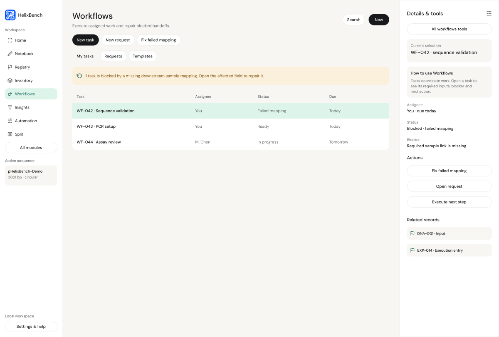

# SCR-11 · Workflows

[Current Figma screen](https://www.figma.com/design/U1kWw1K5NZBgEYkuxMz3Qb/helixbench?node-id=107-31495) · Implementation phase P14.

## Purpose and layout

Know what to do next, execute it, and submit an explicit result.

Named tasks/requests and flowchart; selected task details, required inputs, output mapping, blocker and next executable step.

## Target requirements

- **SCR-11-R1:** Every row opens its own task or request ID and current status. Assignee, due date and source references remain visible.
- **SCR-11-R2:** A task with missing required mappings is blocked with a field-level remedy; repairing it does not silently execute the next step.
- **SCR-11-R3:** Request draft/sent and task execution status are distinct local state machines. Send records a local transition, not a remote delivery.
- **SCR-11-R4:** Execute a reviewed graph step against captured inputs; advance only after its outputs persist successfully. Reject missing steps, cycles or incompatible output types.
- **SCR-11-R5:** Resume retains the run cursor, selected task and mapping; cancellation or failed writeback does not skip or duplicate a step.

## User flow

1. Choose task or request
2. Inspect required input
3. Start work
4. Enter output and complete or fail
5. See next step and audit event

Use the shared typed context, validation/review, persistence and return-location contracts at every relevant transition. Prototype fixture IDs and figures are never production defaults.

## States and recovery

- Loading: retain prior context and identify the active request/operation.
- Populated: show stable object identity, meaningful status and available actions.
- No data: offer the relevant creation/import action.
- No matches: retain query/scope and expose Reset or Change settings.
- Invalid prerequisite: explain the missing input and provide its remedy.
- Validation/write failure: retain draft values and show a constructive correction/retry.
- Dirty/partial/stale/unavailable states use the shared state machines when applicable.

## Screen-specific edge cases

- **SCR-11-EC1:** Missing/deleted input, invalid mapping key, duplicate task title, no selected task and inconsistent assignee label.
- **SCR-11-EC2:** A downstream mapping fails after an upstream step succeeds.
- **SCR-11-EC3:** Repeated Execute, status edit during execution and a completed step invoked again.
- **SCR-11-EC4:** Malformed flowchart, dangling edge, branch with no output or a cycle.
- **SCR-11-EC5:** Request validation fails or local persistence fails after Send is selected.
- **SCR-11-EC6:** Returning from Notebook or Registry restores the same task rather than opening a generic worklist.

## Current code ownership

- [crates/appcore/src/actions.rs:2711](C:/Users/Admin/Documents/Qoder/2026-11-13/87e5a6b2/helixbench/crates/appcore/src/actions.rs:2711) — `pub fn open_workflows(app: &mut AppState)`
- [crates/appcore/src/actions.rs:2719](C:/Users/Admin/Documents/Qoder/2026-11-13/87e5a6b2/helixbench/crates/appcore/src/actions.rs:2719) — `pub fn wf_add_task(app: &mut AppState, draft: &WorkflowDraft)`
- [crates/appcore/src/actions.rs:2732](C:/Users/Admin/Documents/Qoder/2026-11-13/87e5a6b2/helixbench/crates/appcore/src/actions.rs:2732) — `pub fn wf_set_status(app: &mut AppState, id: u64, status: domain::workflow::TaskStatus)`
- [crates/appcore/src/actions.rs:2739](C:/Users/Admin/Documents/Qoder/2026-11-13/87e5a6b2/helixbench/crates/appcore/src/actions.rs:2739) — `pub fn wf_submit_output(app: &mut AppState, draft: &WorkflowDraft)`
- [crates/appcore/src/actions.rs:2758](C:/Users/Admin/Documents/Qoder/2026-11-13/87e5a6b2/helixbench/crates/appcore/src/actions.rs:2758) — `pub fn wf_add_request(app: &mut AppState, draft: &WorkflowDraft)`
- [crates/appcore/src/actions.rs:2776](C:/Users/Admin/Documents/Qoder/2026-11-13/87e5a6b2/helixbench/crates/appcore/src/actions.rs:2776) — `pub fn wf_send_request(app: &mut AppState, id: u64)`
- [crates/appcore/src/actions.rs:2785](C:/Users/Admin/Documents/Qoder/2026-11-13/87e5a6b2/helixbench/crates/appcore/src/actions.rs:2785) — `pub fn wf_execute_next(app: &mut AppState)`

Domain modules: `crates/domain/src/workflow.rs`.

Native presentation entry points:

- [apps/desktop_gpui/src/lab.rs:736](C:/Users/Admin/Documents/Qoder/2026-11-13/87e5a6b2/helixbench/apps/desktop_gpui/src/lab.rs:736) — `render_workflows`
- [apps/desktop_gpui/src/dialogs.rs:5722](C:/Users/Admin/Documents/Qoder/2026-11-13/87e5a6b2/helixbench/apps/desktop_gpui/src/dialogs.rs:5722) — `workflows`

## Field/draft contracts

### WorkflowDraft

[crates/appcore/src/state.rs:574](C:/Users/Admin/Documents/Qoder/2026-11-13/87e5a6b2/helixbench/crates/appcore/src/state.rs:574)

- `title: String` — Trim for validation; require a nonempty meaningful label where the owning operation creates an object. Preserve original editable draft on error.
- `schema: String` — Use the owning feature/module requirements and the current typed source definition. Optional values remain distinguishable from empty/default values; validate before commit.
- `request_name: String` — Use the owning feature/module requirements and the current typed source definition. Optional values remain distinguishable from empty/default values; validate before commit.
- `output_key: String` — Use the owning feature/module requirements and the current typed source definition. Optional values remain distinguishable from empty/default values; validate before commit.
- `output_val: String` — Use the owning feature/module requirements and the current typed source definition. Optional values remain distinguishable from empty/default values; validate before commit.
- `selected_task: Option<u64>` — Resolve a stable typed identity from a labeled picker. Validate existence/kind at submit; do not persist a row index as a foreign key.
- `error: Option<String>` — System-owned validation/error state; never an editable user field.

## Feature-level implementation contracts

### F-133 · Create task

**Status:** Specified; not verified implemented.

**Entry:** New task (1 navigation click(s)).

**Prerequisite:** None.

**Outcome:** Title and schema form on the page.

**Current evidence note:** Manager-only Add task.

**Relevant code/action family:** [crates/appcore/src/actions.rs:2711](C:/Users/Admin/Documents/Qoder/2026-11-13/87e5a6b2/helixbench/crates/appcore/src/actions.rs:2711), [crates/appcore/src/actions.rs:2719](C:/Users/Admin/Documents/Qoder/2026-11-13/87e5a6b2/helixbench/crates/appcore/src/actions.rs:2719), [crates/appcore/src/actions.rs:2732](C:/Users/Admin/Documents/Qoder/2026-11-13/87e5a6b2/helixbench/crates/appcore/src/actions.rs:2732), [crates/appcore/src/actions.rs:2739](C:/Users/Admin/Documents/Qoder/2026-11-13/87e5a6b2/helixbench/crates/appcore/src/actions.rs:2739), [crates/appcore/src/actions.rs:2758](C:/Users/Admin/Documents/Qoder/2026-11-13/87e5a6b2/helixbench/crates/appcore/src/actions.rs:2758), [crates/appcore/src/actions.rs:2776](C:/Users/Admin/Documents/Qoder/2026-11-13/87e5a6b2/helixbench/crates/appcore/src/actions.rs:2776), [crates/appcore/src/actions.rs:2785](C:/Users/Admin/Documents/Qoder/2026-11-13/87e5a6b2/helixbench/crates/appcore/src/actions.rs:2785).

**Acceptance:**

- F-133-AC1: Given The owning page and the stated prerequisite are available. When The user follows New task. Then Title and schema form on the page; feature entry requires at most two navigation clicks.
- F-133-AC2: Given The context contains two similar names or a changed table order. When This feature is activated. Then The command payload retains the exact selected typed identity, source revision and scope.
- F-133-AC3: Given A draft contains an invalid or missing required value. When The user submits the form. Then Show a field-local error, retain the draft and perform no mutation.

**Recovery and edge conditions:**

- Invalid required fields are identified beside the input with original draft values retained.
- Cancel does not alter the source object or create an unrelated example record.
- A stale/deleted target is resolved explicitly instead of mutating a row index.
- Successful persistence updates the selected record, related views and audit consistently.
- A downstream mapping fails after an upstream step succeeds.
- Repeated Execute, status edit during execution and a completed step invoked again.

### F-134 · Select / inspect task

**Status:** Specified; not verified implemented.

**Entry:** Task row (1 navigation click(s)).

**Prerequisite:** Existing task.

**Outcome:** Show schema, context and allowed next actions.

**Current evidence note:** Manager Select; page mostly status rows.

**Relevant code/action family:** [crates/appcore/src/actions.rs:2711](C:/Users/Admin/Documents/Qoder/2026-11-13/87e5a6b2/helixbench/crates/appcore/src/actions.rs:2711), [crates/appcore/src/actions.rs:2719](C:/Users/Admin/Documents/Qoder/2026-11-13/87e5a6b2/helixbench/crates/appcore/src/actions.rs:2719), [crates/appcore/src/actions.rs:2732](C:/Users/Admin/Documents/Qoder/2026-11-13/87e5a6b2/helixbench/crates/appcore/src/actions.rs:2732), [crates/appcore/src/actions.rs:2739](C:/Users/Admin/Documents/Qoder/2026-11-13/87e5a6b2/helixbench/crates/appcore/src/actions.rs:2739), [crates/appcore/src/actions.rs:2758](C:/Users/Admin/Documents/Qoder/2026-11-13/87e5a6b2/helixbench/crates/appcore/src/actions.rs:2758), [crates/appcore/src/actions.rs:2776](C:/Users/Admin/Documents/Qoder/2026-11-13/87e5a6b2/helixbench/crates/appcore/src/actions.rs:2776), [crates/appcore/src/actions.rs:2785](C:/Users/Admin/Documents/Qoder/2026-11-13/87e5a6b2/helixbench/crates/appcore/src/actions.rs:2785).

**Acceptance:**

- F-134-AC1: Given The owning page and the stated prerequisite are available. When The user follows Task row. Then Show schema, context and allowed next actions; feature entry requires at most two navigation clicks.
- F-134-AC2: Given The context contains two similar names or a changed table order. When This feature is activated. Then The command payload retains the exact selected typed identity, source revision and scope.
- F-134-AC3: Given The intended target was deleted or became inaccessible after rendering. When The user activates its row or link. Then Show a relevant recovery path without opening an unrelated record; retain a safe return location.

**Recovery and edge conditions:**

- Two same-name records and two stores with the same numeric ID resolve correctly.
- A missing/deleted/inaccessible target offers a relevant remedy rather than another record.
- Back restores the invoking task and selection; dirty work is preserved where necessary.
- Keyboard activation and labeled controls expose the same action as pointer input.
- Repeated Execute, status edit during execution and a completed step invoked again.
- Malformed flowchart, dangling edge, branch with no output or a cycle.

### F-135 · Start task

**Status:** Specified; not verified implemented.

**Entry:** Task row → Start (2 navigation click(s)).

**Prerequisite:** Open task.

**Outcome:** Status becomes In progress.

**Current evidence note:** Page button exists.

**Relevant code/action family:** [crates/appcore/src/actions.rs:2711](C:/Users/Admin/Documents/Qoder/2026-11-13/87e5a6b2/helixbench/crates/appcore/src/actions.rs:2711), [crates/appcore/src/actions.rs:2719](C:/Users/Admin/Documents/Qoder/2026-11-13/87e5a6b2/helixbench/crates/appcore/src/actions.rs:2719), [crates/appcore/src/actions.rs:2732](C:/Users/Admin/Documents/Qoder/2026-11-13/87e5a6b2/helixbench/crates/appcore/src/actions.rs:2732), [crates/appcore/src/actions.rs:2739](C:/Users/Admin/Documents/Qoder/2026-11-13/87e5a6b2/helixbench/crates/appcore/src/actions.rs:2739), [crates/appcore/src/actions.rs:2758](C:/Users/Admin/Documents/Qoder/2026-11-13/87e5a6b2/helixbench/crates/appcore/src/actions.rs:2758), [crates/appcore/src/actions.rs:2776](C:/Users/Admin/Documents/Qoder/2026-11-13/87e5a6b2/helixbench/crates/appcore/src/actions.rs:2776), [crates/appcore/src/actions.rs:2785](C:/Users/Admin/Documents/Qoder/2026-11-13/87e5a6b2/helixbench/crates/appcore/src/actions.rs:2785).

**Acceptance:**

- F-135-AC1: Given The owning page and the stated prerequisite are available. When The user follows Task row → Start. Then Status becomes In progress; feature entry requires at most two navigation clicks.
- F-135-AC2: Given The context contains two similar names or a changed table order. When This feature is activated. Then The command payload retains the exact selected typed identity, source revision and scope.
- F-135-AC3: Given The intended target was deleted or became inaccessible after rendering. When The user activates its row or link. Then Show a relevant recovery path without opening an unrelated record; retain a safe return location.

**Recovery and edge conditions:**

- Two same-name records and two stores with the same numeric ID resolve correctly.
- A missing/deleted/inaccessible target offers a relevant remedy rather than another record.
- Back restores the invoking task and selection; dirty work is preserved where necessary.
- Keyboard activation and labeled controls expose the same action as pointer input.
- Malformed flowchart, dangling edge, branch with no output or a cycle.
- Request validation fails or local persistence fails after Send is selected.

### F-136 · Complete with output

**Status:** Specified; not verified implemented.

**Entry:** Task row → Complete with output (2 navigation click(s)).

**Prerequisite:** Task in progress.

**Outcome:** Review required output; validate before completion.

**Current evidence note:** Manager-only output key/value; page completion bypasses it.

**Relevant code/action family:** [crates/appcore/src/actions.rs:2711](C:/Users/Admin/Documents/Qoder/2026-11-13/87e5a6b2/helixbench/crates/appcore/src/actions.rs:2711), [crates/appcore/src/actions.rs:2719](C:/Users/Admin/Documents/Qoder/2026-11-13/87e5a6b2/helixbench/crates/appcore/src/actions.rs:2719), [crates/appcore/src/actions.rs:2732](C:/Users/Admin/Documents/Qoder/2026-11-13/87e5a6b2/helixbench/crates/appcore/src/actions.rs:2732), [crates/appcore/src/actions.rs:2739](C:/Users/Admin/Documents/Qoder/2026-11-13/87e5a6b2/helixbench/crates/appcore/src/actions.rs:2739), [crates/appcore/src/actions.rs:2758](C:/Users/Admin/Documents/Qoder/2026-11-13/87e5a6b2/helixbench/crates/appcore/src/actions.rs:2758), [crates/appcore/src/actions.rs:2776](C:/Users/Admin/Documents/Qoder/2026-11-13/87e5a6b2/helixbench/crates/appcore/src/actions.rs:2776), [crates/appcore/src/actions.rs:2785](C:/Users/Admin/Documents/Qoder/2026-11-13/87e5a6b2/helixbench/crates/appcore/src/actions.rs:2785).

**Acceptance:**

- F-136-AC1: Given The owning page and the stated prerequisite are available. When The user follows Task row → Complete with output. Then Review required output; validate before completion; feature entry requires at most two navigation clicks.
- F-136-AC2: Given The context contains two similar names or a changed table order. When This feature is activated. Then The command payload retains the exact selected typed identity, source revision and scope.
- F-136-AC3: Given The intended target was deleted or became inaccessible after rendering. When The user activates its row or link. Then Show a relevant recovery path without opening an unrelated record; retain a safe return location.

**Recovery and edge conditions:**

- Two same-name records and two stores with the same numeric ID resolve correctly.
- A missing/deleted/inaccessible target offers a relevant remedy rather than another record.
- Back restores the invoking task and selection; dirty work is preserved where necessary.
- Keyboard activation and labeled controls expose the same action as pointer input.
- Request validation fails or local persistence fails after Send is selected.
- Returning from Notebook or Registry restores the same task rather than opening a generic worklist.

### F-137 · Mark failed task

**Status:** Specified; not verified implemented.

**Entry:** Task row → Mark failed (2 navigation click(s)).

**Prerequisite:** Eligible task.

**Outcome:** Capture outcome; expose recovery path.

**Current evidence note:** Manager-only Fail.

**Relevant code/action family:** [crates/appcore/src/actions.rs:2711](C:/Users/Admin/Documents/Qoder/2026-11-13/87e5a6b2/helixbench/crates/appcore/src/actions.rs:2711), [crates/appcore/src/actions.rs:2719](C:/Users/Admin/Documents/Qoder/2026-11-13/87e5a6b2/helixbench/crates/appcore/src/actions.rs:2719), [crates/appcore/src/actions.rs:2732](C:/Users/Admin/Documents/Qoder/2026-11-13/87e5a6b2/helixbench/crates/appcore/src/actions.rs:2732), [crates/appcore/src/actions.rs:2739](C:/Users/Admin/Documents/Qoder/2026-11-13/87e5a6b2/helixbench/crates/appcore/src/actions.rs:2739), [crates/appcore/src/actions.rs:2758](C:/Users/Admin/Documents/Qoder/2026-11-13/87e5a6b2/helixbench/crates/appcore/src/actions.rs:2758), [crates/appcore/src/actions.rs:2776](C:/Users/Admin/Documents/Qoder/2026-11-13/87e5a6b2/helixbench/crates/appcore/src/actions.rs:2776), [crates/appcore/src/actions.rs:2785](C:/Users/Admin/Documents/Qoder/2026-11-13/87e5a6b2/helixbench/crates/appcore/src/actions.rs:2785).

**Acceptance:**

- F-137-AC1: Given The owning page and the stated prerequisite are available. When The user follows Task row → Mark failed. Then Capture outcome; expose recovery path; feature entry requires at most two navigation clicks.
- F-137-AC2: Given The context contains two similar names or a changed table order. When This feature is activated. Then The command payload retains the exact selected typed identity, source revision and scope.
- F-137-AC3: Given The intended target was deleted or became inaccessible after rendering. When The user activates its row or link. Then Show a relevant recovery path without opening an unrelated record; retain a safe return location.

**Recovery and edge conditions:**

- Two same-name records and two stores with the same numeric ID resolve correctly.
- A missing/deleted/inaccessible target offers a relevant remedy rather than another record.
- Back restores the invoking task and selection; dirty work is preserved where necessary.
- Keyboard activation and labeled controls expose the same action as pointer input.
- Returning from Notebook or Registry restores the same task rather than opening a generic worklist.
- Missing/deleted input, invalid mapping key, duplicate task title, no selected task and inconsistent assignee label.

### F-138 · Draft request

**Status:** Specified; not verified implemented.

**Entry:** New request (1 navigation click(s)).

**Prerequisite:** None.

**Outcome:** Request name and target context.

**Current evidence note:** Manager-only request input.

**Relevant code/action family:** [crates/appcore/src/actions.rs:2711](C:/Users/Admin/Documents/Qoder/2026-11-13/87e5a6b2/helixbench/crates/appcore/src/actions.rs:2711), [crates/appcore/src/actions.rs:2719](C:/Users/Admin/Documents/Qoder/2026-11-13/87e5a6b2/helixbench/crates/appcore/src/actions.rs:2719), [crates/appcore/src/actions.rs:2732](C:/Users/Admin/Documents/Qoder/2026-11-13/87e5a6b2/helixbench/crates/appcore/src/actions.rs:2732), [crates/appcore/src/actions.rs:2739](C:/Users/Admin/Documents/Qoder/2026-11-13/87e5a6b2/helixbench/crates/appcore/src/actions.rs:2739), [crates/appcore/src/actions.rs:2758](C:/Users/Admin/Documents/Qoder/2026-11-13/87e5a6b2/helixbench/crates/appcore/src/actions.rs:2758), [crates/appcore/src/actions.rs:2776](C:/Users/Admin/Documents/Qoder/2026-11-13/87e5a6b2/helixbench/crates/appcore/src/actions.rs:2776), [crates/appcore/src/actions.rs:2785](C:/Users/Admin/Documents/Qoder/2026-11-13/87e5a6b2/helixbench/crates/appcore/src/actions.rs:2785).

**Acceptance:**

- F-138-AC1: Given The owning page and the stated prerequisite are available. When The user follows New request. Then Request name and target context; feature entry requires at most two navigation clicks.
- F-138-AC2: Given The context contains two similar names or a changed table order. When This feature is activated. Then The command payload retains the exact selected typed identity, source revision and scope.
- F-138-AC3: Given The intended target was deleted or became inaccessible after rendering. When The user activates its row or link. Then Show a relevant recovery path without opening an unrelated record; retain a safe return location.

**Recovery and edge conditions:**

- Two same-name records and two stores with the same numeric ID resolve correctly.
- A missing/deleted/inaccessible target offers a relevant remedy rather than another record.
- Back restores the invoking task and selection; dirty work is preserved where necessary.
- Keyboard activation and labeled controls expose the same action as pointer input.
- Missing/deleted input, invalid mapping key, duplicate task title, no selected task and inconsistent assignee label.
- A downstream mapping fails after an upstream step succeeds.

### F-139 · Send request

**Status:** Specified; not verified implemented.

**Entry:** Request row → Send (2 navigation click(s)).

**Prerequisite:** Draft request.

**Outcome:** Confirm state; avoid implying external messaging.

**Current evidence note:** Manager-only action.

**Relevant code/action family:** [crates/appcore/src/actions.rs:2711](C:/Users/Admin/Documents/Qoder/2026-11-13/87e5a6b2/helixbench/crates/appcore/src/actions.rs:2711), [crates/appcore/src/actions.rs:2719](C:/Users/Admin/Documents/Qoder/2026-11-13/87e5a6b2/helixbench/crates/appcore/src/actions.rs:2719), [crates/appcore/src/actions.rs:2732](C:/Users/Admin/Documents/Qoder/2026-11-13/87e5a6b2/helixbench/crates/appcore/src/actions.rs:2732), [crates/appcore/src/actions.rs:2739](C:/Users/Admin/Documents/Qoder/2026-11-13/87e5a6b2/helixbench/crates/appcore/src/actions.rs:2739), [crates/appcore/src/actions.rs:2758](C:/Users/Admin/Documents/Qoder/2026-11-13/87e5a6b2/helixbench/crates/appcore/src/actions.rs:2758), [crates/appcore/src/actions.rs:2776](C:/Users/Admin/Documents/Qoder/2026-11-13/87e5a6b2/helixbench/crates/appcore/src/actions.rs:2776), [crates/appcore/src/actions.rs:2785](C:/Users/Admin/Documents/Qoder/2026-11-13/87e5a6b2/helixbench/crates/appcore/src/actions.rs:2785).

**Acceptance:**

- F-139-AC1: Given The owning page and the stated prerequisite are available. When The user follows Request row → Send. Then Confirm state; avoid implying external messaging; feature entry requires at most two navigation clicks.
- F-139-AC2: Given The context contains two similar names or a changed table order. When This feature is activated. Then The command payload retains the exact selected typed identity, source revision and scope.
- F-139-AC3: Given A file or store write is awaiting completion. When The OS dialog is canceled or the atomic write fails. Then Do not report success, change saved/dirty truth or continue a pending destructive intent; preserve original data.

**Recovery and edge conditions:**

- OS-dialog cancellation leaves drafts, source data and pending navigation intact.
- Permission denied, disk full, locked destination and rename failure never show success.
- Reopening/retrying the same operation preserves identity and does not duplicate successful output.
- Export/import preserves scope, encoding, units and declared lossy transformations.
- A downstream mapping fails after an upstream step succeeds.
- Repeated Execute, status edit during execution and a completed step invoked again.

### F-140 · Inspect request state

**Status:** Specified; not verified implemented.

**Entry:** Requests tab (1 navigation click(s)).

**Prerequisite:** Existing request.

**Outcome:** Clear Draft / Sent status.

**Current evidence note:** Draft/sent list inside manager.

**Relevant code/action family:** [crates/appcore/src/actions.rs:2711](C:/Users/Admin/Documents/Qoder/2026-11-13/87e5a6b2/helixbench/crates/appcore/src/actions.rs:2711), [crates/appcore/src/actions.rs:2719](C:/Users/Admin/Documents/Qoder/2026-11-13/87e5a6b2/helixbench/crates/appcore/src/actions.rs:2719), [crates/appcore/src/actions.rs:2732](C:/Users/Admin/Documents/Qoder/2026-11-13/87e5a6b2/helixbench/crates/appcore/src/actions.rs:2732), [crates/appcore/src/actions.rs:2739](C:/Users/Admin/Documents/Qoder/2026-11-13/87e5a6b2/helixbench/crates/appcore/src/actions.rs:2739), [crates/appcore/src/actions.rs:2758](C:/Users/Admin/Documents/Qoder/2026-11-13/87e5a6b2/helixbench/crates/appcore/src/actions.rs:2758), [crates/appcore/src/actions.rs:2776](C:/Users/Admin/Documents/Qoder/2026-11-13/87e5a6b2/helixbench/crates/appcore/src/actions.rs:2776), [crates/appcore/src/actions.rs:2785](C:/Users/Admin/Documents/Qoder/2026-11-13/87e5a6b2/helixbench/crates/appcore/src/actions.rs:2785).

**Acceptance:**

- F-140-AC1: Given The owning page and the stated prerequisite are available. When The user follows Requests tab. Then Clear Draft / Sent status; feature entry requires at most two navigation clicks.
- F-140-AC2: Given The context contains two similar names or a changed table order. When This feature is activated. Then The command payload retains the exact selected typed identity, source revision and scope.
- F-140-AC3: Given The intended target was deleted or became inaccessible after rendering. When The user activates its row or link. Then Show a relevant recovery path without opening an unrelated record; retain a safe return location.

**Recovery and edge conditions:**

- Two same-name records and two stores with the same numeric ID resolve correctly.
- A missing/deleted/inaccessible target offers a relevant remedy rather than another record.
- Back restores the invoking task and selection; dirty work is preserved where necessary.
- Keyboard activation and labeled controls expose the same action as pointer input.
- Repeated Execute, status edit during execution and a completed step invoked again.
- Malformed flowchart, dangling edge, branch with no output or a cycle.

### F-141 · View execution flow

**Status:** Specified; not verified implemented.

**Entry:** Flow tab (1 navigation click(s)).

**Prerequisite:** Flow steps exist.

**Outcome:** Current step, inputs and outputs visible.

**Current evidence note:** Flowchart text in manager.

**Relevant code/action family:** [crates/appcore/src/actions.rs:2711](C:/Users/Admin/Documents/Qoder/2026-11-13/87e5a6b2/helixbench/crates/appcore/src/actions.rs:2711), [crates/appcore/src/actions.rs:2719](C:/Users/Admin/Documents/Qoder/2026-11-13/87e5a6b2/helixbench/crates/appcore/src/actions.rs:2719), [crates/appcore/src/actions.rs:2732](C:/Users/Admin/Documents/Qoder/2026-11-13/87e5a6b2/helixbench/crates/appcore/src/actions.rs:2732), [crates/appcore/src/actions.rs:2739](C:/Users/Admin/Documents/Qoder/2026-11-13/87e5a6b2/helixbench/crates/appcore/src/actions.rs:2739), [crates/appcore/src/actions.rs:2758](C:/Users/Admin/Documents/Qoder/2026-11-13/87e5a6b2/helixbench/crates/appcore/src/actions.rs:2758), [crates/appcore/src/actions.rs:2776](C:/Users/Admin/Documents/Qoder/2026-11-13/87e5a6b2/helixbench/crates/appcore/src/actions.rs:2776), [crates/appcore/src/actions.rs:2785](C:/Users/Admin/Documents/Qoder/2026-11-13/87e5a6b2/helixbench/crates/appcore/src/actions.rs:2785).

**Acceptance:**

- F-141-AC1: Given The owning page and the stated prerequisite are available. When The user follows Flow tab. Then Current step, inputs and outputs visible; feature entry requires at most two navigation clicks.
- F-141-AC2: Given The context contains two similar names or a changed table order. When This feature is activated. Then The command payload retains the exact selected typed identity, source revision and scope.
- F-141-AC3: Given Underlying records exist and a query or filter is active. When The query/filter matches no records. Then Show no matches with the active scope and reset remedy; do not claim that the dataset is empty or failed.

**Recovery and edge conditions:**

- Empty source, filtered-out records and failed load have different status/remedies.
- Sorting/filtering or a same-name record cannot change the selected stable identity.
- Returning restores the same query/filter/scope and scroll anchor where supported.
- Inspection-only changes do not mark scientific content dirty.
- Malformed flowchart, dangling edge, branch with no output or a cycle.
- Request validation fails or local persistence fails after Send is selected.

### F-142 · Execute next step

**Status:** Specified; not verified implemented.

**Entry:** Execute next step (1 navigation click(s)).

**Prerequisite:** Runnable next step.

**Outcome:** Preview step and input, then run with result feedback.

**Current evidence note:** Page and manager action; weak current-step context.

**Relevant code/action family:** [crates/appcore/src/actions.rs:2711](C:/Users/Admin/Documents/Qoder/2026-11-13/87e5a6b2/helixbench/crates/appcore/src/actions.rs:2711), [crates/appcore/src/actions.rs:2719](C:/Users/Admin/Documents/Qoder/2026-11-13/87e5a6b2/helixbench/crates/appcore/src/actions.rs:2719), [crates/appcore/src/actions.rs:2732](C:/Users/Admin/Documents/Qoder/2026-11-13/87e5a6b2/helixbench/crates/appcore/src/actions.rs:2732), [crates/appcore/src/actions.rs:2739](C:/Users/Admin/Documents/Qoder/2026-11-13/87e5a6b2/helixbench/crates/appcore/src/actions.rs:2739), [crates/appcore/src/actions.rs:2758](C:/Users/Admin/Documents/Qoder/2026-11-13/87e5a6b2/helixbench/crates/appcore/src/actions.rs:2758), [crates/appcore/src/actions.rs:2776](C:/Users/Admin/Documents/Qoder/2026-11-13/87e5a6b2/helixbench/crates/appcore/src/actions.rs:2776), [crates/appcore/src/actions.rs:2785](C:/Users/Admin/Documents/Qoder/2026-11-13/87e5a6b2/helixbench/crates/appcore/src/actions.rs:2785).

**Acceptance:**

- F-142-AC1: Given The owning page and the stated prerequisite are available. When The user follows Execute next step. Then Preview step and input, then run with result feedback; feature entry requires at most two navigation clicks.
- F-142-AC2: Given The context contains two similar names or a changed table order. When This feature is activated. Then The command payload retains the exact selected typed identity, source revision and scope.
- F-142-AC3: Given Validated parameters and an immutable input have been captured. When The computation finishes with no scientific matches. Then Show a completed no-match diagnostic, preserve input provenance and offer a meaningful parameter change.

**Recovery and edge conditions:**

- No scientific matches is represented separately from invalid input or a failed computation.
- Changing the source/selection during execution does not substitute a newer input.
- Cancel is offered only at a supported stage; repeated Run does not duplicate an output commit.
- Saved output retains actual input revision, method, parameters and units.
- Request validation fails or local persistence fails after Send is selected.
- Returning from Notebook or Registry restores the same task rather than opening a generic worklist.

### F-143 · Review output / retry context

**Status:** Specified; not verified implemented.

**Entry:** Task row → Output tab (2 navigation click(s)).

**Prerequisite:** Task output exists.

**Outcome:** See produced values and next step.

**Current evidence note:** Completion information detached.

**Relevant code/action family:** [crates/appcore/src/actions.rs:1725](C:/Users/Admin/Documents/Qoder/2026-11-13/87e5a6b2/helixbench/crates/appcore/src/actions.rs:1725).

**Acceptance:**

- F-143-AC1: Given The owning page and the stated prerequisite are available. When The user follows Task row → Output tab. Then See produced values and next step; feature entry requires at most two navigation clicks.
- F-143-AC2: Given The context contains two similar names or a changed table order. When This feature is activated. Then The command payload retains the exact selected typed identity, source revision and scope.
- F-143-AC3: Given Underlying records exist and a query or filter is active. When The query/filter matches no records. Then Show no matches with the active scope and reset remedy; do not claim that the dataset is empty or failed.

**Recovery and edge conditions:**

- Empty source, filtered-out records and failed load have different status/remedies.
- Sorting/filtering or a same-name record cannot change the selected stable identity.
- Returning restores the same query/filter/scope and scroll anchor where supported.
- Inspection-only changes do not mark scientific content dirty.
- Returning from Notebook or Registry restores the same task rather than opening a generic worklist.
- Missing/deleted input, invalid mapping key, duplicate task title, no selected task and inconsistent assignee label.

